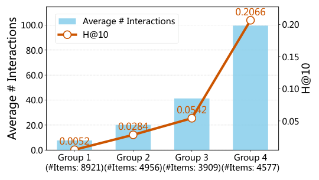
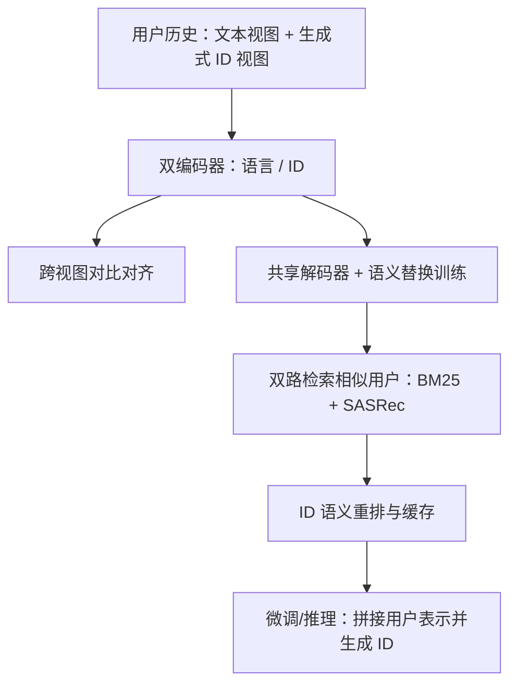
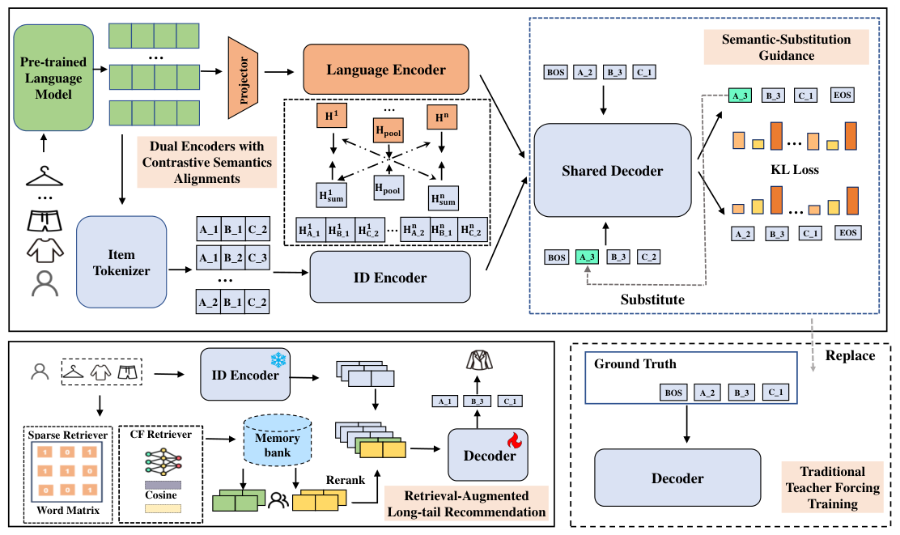

# GENPLUGIN: A Plug-and-Play Framework for Long-Tail Generative Recommendation with Exposure Bias Mitigation (面向长尾生成式推荐与曝光偏差缓解的可插拔框架)

- **会议/期刊**: DASFAA 2026
- **作者与机构**: Kun Yang, Siyao Zheng, Tianyi Li, Xiaodong Li, Hui Li（厦门大学）
- **推荐链路定位**: 端到端生成式召回（生成式 ID 解码）
- **研究方向**: 生成式推荐与离散语义 ID / 冷启动与长尾推荐
- **论文原文**: [论文原文链接](https://arxiv.org/abs/2507.03568v1)
- **开源代码**: 暂未开源

## TL;DR (1分钟核心速览)

GENPLUGIN 针对生成式推荐中 teacher-forcing 造成的曝光偏差，以及仅靠共享语义 ID 仍难覆盖长尾物品的问题，提出可插拔双编码器-共享解码器框架：以语言/ID 双视图对比对齐、语义替换训练和双路检索增强联合改进。在 5 个 Amazon 数据集、全库排序协议下，插入 TIGER 后 Beauty H@10 提升 34.5%，Toys H@10 提升 65.3%，Arts 尾部 H@5 提升 54%。

## Background & Motivation (背景与核心矛盾)

- **主流范式**: TIGER/LETTER/MQL4Rec 用 RQ-VAE 等将物品转为离散语义 ID，再以自回归解码直接生成推荐物品，免去逐候选打分。
- **前人局限**: 训练时依赖真实前序 ID token，推理时却依赖自生成 token，误差逐步累积形成曝光偏差；同时长尾物品交互稀疏，共享语义 ID 并不足以补齐协同信号。
- **核心洞察 (Key Insight)**: 语言视图语义丰富但 ID token 属 OOV，二者可互相监督；相似用户的历史可在长尾场景提供额外协同证据。
- **本文切入点**: 用双视图对齐与语言视图预测替换真实 ID token，并用检索到的相似用户增强解码。

实证上，TIGER 在 Beauty 的 H@10 仅 0.0609，加入本文去偏插件后升至 0.0790；图 1 显示 Beauty 物品分组的 H@10 从 0.0052 到 0.2066，长尾组显著偏低。

<figure class="paper-figure" markdown="span">
  <figcaption>图 1：TIGER 在 Amazon Beauty 上针对不同物品组的性能。</figcaption>
</figure>

## Method (核心方法设计)

### 1. 整体框架 (Overall Architecture)

输入同一用户历史的两视图：物品文本描述经冻结 LLM 投影得到语言序列，生成式 ID token 得到 ID 序列。双 Transformer 编码器分别编码后，做 item-level 与 user-level 对比对齐；共享解码器在语言视图预测的引导下学习 ID 视图生成，以语义替换缓解曝光偏差。微调阶段冻结编码器，用 BM25 与 SASRec 双路召回相似用户，再按 ID 语义重排并缓存用户表示，拼接到目标用户表示后送入解码器，实现长尾增强。

<figure class="paper-figure" markdown="span">
  <figcaption>图 2：GENPLUGIN 概览</figcaption>
</figure>

### 2. 关键设计拆解 (Key Designs)

1. **双编码器对比语义对齐**：ID token 对 LLM 是 OOV，单靠 ID 视图语义不稳。本文对物品级表示 $h_i$（语言）与$g_i=\mathrm{sum}(\{c_i^{(r)}\})$（ID）做双向 InfoNCE，并对用户序列池化表示$p_u,q_u$做同样对齐：$\mathcal{L}_{\text{item}}=\sum_i[\log\frac{\exp(\mathrm{sim}(h_i,g_i)/\tau)}{\sum_{j\in Neg(i)}\exp(\mathrm{sim}(h_i,g_j)/\tau)}+\log\frac{\exp(\mathrm{sim}(g_i,h_i)/\tau)}{\sum_{j\in Neg(i)}\exp(\mathrm{sim}(g_i,h_j)/\tau)}]$。直觉是让 ID 码本吸收文本语义，同时保留协同可区分性。

2. **语义替换引导 (SSG)**：直接 teacher forcing 使模型只见过正确前缀。本文先由语言视图解码出初始 ID token；以概率 $p_1$保留真实序列，以$1-p_1$用语言视图预测序列替换；替换序列内每个 token 再以$p_2$保留真值、$1-p_2$用预测 token。对语言视图 logits 取 top-$q$并温度缩放：$P_{i,l}(c)=\frac{\exp(z_c/\phi)}{\sum_b\exp(z_b/\phi)}$，再用双向 KL 约束两视图分布：$\mathcal{L}_{KL}=-\sum_i\sum_{l=1}^{k}(D_{KL}(P^{lan}_{i,l}\|P^{id}_{i,l})+D_{KL}(P^{id}_{i,l}\|P^{lan}_{i,l}))$。这样解码器在训练中见到“错误前缀”，推理时更鲁棒。

3. **检索增强长尾推荐**：内容路用用户历史文本伪文档做 BM25 召回 top-$z$，协同路用 SASRec 用户表示做 cosine 召回 top-$z$，合并后按 ID 语义空间$q$重排，保留$v$个相似用户。为避免拼接$v$条历史导致约$v$倍编码开销，缓存相似用户的$q$，微调时冻结编码器，仅将目标用户$q$与检索用户$q$拼接送入解码器。总损失为$\mathcal{L}=\mathcal{L}_{lan}+\mathcal{L}_{id}+\lambda_1\mathcal{L}_{item}+\lambda_2\mathcal{L}_{user}+\lambda_3\mathcal{L}_{KL}$；对比学习用 batch 内负样本，生成主损失为下一 ID token 交叉熵，不做候选负采样。

## Experimental Setup & Evaluation Protocol (实验设置与评估协议)

- **数据集与预处理**: 五个 Amazon 子集，按 TIGER 系 GenRec 常用 5-core 过滤；统计量如下（原文主文未展开，附录 A.1 给细节）：

| 数据集 | #Users | #Items | #Interactions | 稀疏度/密度 | 特征/场景说明 |
| :--- | :---: | :---: | :---: | :---: | :--- |
| Beauty | 22,363 | 12,101 | 198,502 | 0.073% | 美妆，文本标题/描述 |
| Toys | 19,412 | 11,924 | 186,799 | 0.081% | 玩具，序列交互 |
| Sports | 35,598 | 18,357 | 296,337 | 0.045% | 运动户外 |
| Instruments | 24,962 | 9,989 | 115,337 | 0.046% | 乐器 |
| Arts | 22,428 | 19,771 | 171,223 | 0.039% | 艺术手作 |

- **数据划分与防穿越 (Splitting Strategy)**: 采用 Leave-One-Out（末次交互测试、前一次验证），按用户序列构造；长尾分析另按物品交互频次分 head/tail。
- **排名评测协议 (Ranking Protocol)**: 全库 Full-Ranking，对未交互候选统一排序；报告 H@5/H@10 与 N@5/N@10。未采用采样排序。
- **对比基线与超参设置**: 传统基线 GRU4Rec、SASRec、BERT4Rec、S3Rec；GenRec 基线 TIGER、LETTER、MQL4Rec（无预训练版）。token embedding $d=128$，4 层 Transformer、6 头、head dim 64、FFN 1024，最大序列长 20，batch 512；未报告显著性检验。

## Key Experimental Results (实验关键数据)

### 1. 主实验对比 (Main Results)

下表为 H@10 / N@10，粗体为各数据集最优（含本文插件）：

| 方法 | Beauty | Toys | Sports | Instruments | Arts |
| :--- | :---: | :---: | :---: | :---: | :---: |
| SASRec | 0.0536/0.0278 | 0.0531/0.0276 | 0.0260/0.0113 | 0.1201/0.0815 | 0.1256/0.0728 |
| S3Rec | 0.0614/0.0309 | 0.0545/0.0285 | 0.0365/0.0192 | 0.1115/0.0741 | 0.1042/0.0642 |
| TIGER | 0.0609/0.0325 | 0.0518/0.0271 | 0.0356/0.0187 | 0.1211/0.0962 | 0.1225/0.0863 |
| TIGER++ | 0.0819/0.0467 | 0.0856/0.0477 | 0.0491/0.0261 | 0.1405/0.1074 | 0.1436/0.1022 |
| LETTER++ | **0.0839/0.0478** | **0.0889/0.0478** | **0.0514/0.0282** | **0.1436/0.1093** | **0.1463/0.1025** |
| MQL4Rec++ | 0.0814/0.0459 | 0.0780/0.0416 | 0.0417/0.0218 | 0.1387/0.1063 | 0.1450/0.1019 |

`Improv.%`（TIGER++ vs TIGER，H@10/N@10）：Beauty +34.5/+43.7，Toys +65.3/+76.0，Sports +37.9/+39.6，Instruments +16.0/+11.6，Arts +17.2/+18.4。

### 2. 消融实验 (Ablation Study)

以 LETTER 为底座，DSA=双编码对比对齐，SSG=语义替换，RAR=检索增强；表中为 H@10 / N@10：

| 变体 | Beauty | Toys | Sports | Instruments | Arts |
| :--- | :---: | :---: | :---: | :---: | :---: |
| LETTER | 0.0669/0.0361 | 0.0606/0.0326 | 0.0376/0.0193 | 0.1267/0.0972 | 0.1225/0.0856 |
| +DSA | 0.0706/0.0394 | 0.0768/0.0403 | 0.0443/0.0238 | 0.1337/0.1022 | 0.1349/0.0993 |
| +DSA+SSG | 0.0818/0.0452 | 0.0853/0.0466 | 0.0503/0.0276 | 0.1390/0.1059 | 0.1426/0.1004 |
| +DSA+SSG+RAR | **0.0839/0.0478** | **0.0889/0.0478** | **0.0514/0.0282** | **0.1436/0.1093** | **0.1463/0.1025** |

### 3. 关键实验发现 (Key Findings)

1. **去偏带来跨骨干稳定增益**：TIGER++ 在 Beauty 的 H@10/N@10 提升 34.5%/43.7%，Toys 提升 65.3%/76.0%；LETTER++ 在 Sports 相比 LETTER 也提升 36.7%/46.1%，说明语义替换不是单模型特例。
2. **三模块贡献呈互补关系**：Toys 上仅加 DSA 即较 LETTER 提升 26.7%/23.6%；再加 SSG 提升 11.0%/15.6%；最后 RAR 仍加 4.2%/2.5%，表明对齐、去偏、检索分别解决不同瓶颈。
3. **长尾收益显著但头部未受损**：Arts 上 TIGER++ 的尾部 H@5 相对 TIGER 提升 54%，同时 head 组也保持提升；检索增强通过相似用户协同信号弥补长尾稀疏，而非以牺牲热门物品为代价。

## Highlights & Limitations (亮点、对比与审稿批判)

- **与代表作对比 (vs. Prior Work)**: TIGER 解决语义 ID 生成但未处理 teacher-forcing 偏差；LETTER 做语义对齐却缺少“错误前缀”训练与用户级检索增强；MQL4Rec 侧多模态 ID，本文强调正交可插拔。GENPLUGIN 的增量在于双视图语义替换与缓存式检索增强。
- **可迁移亮点**: 任意自回归语义 ID 推荐都可复用“语言视图预测 token 替换真实 token”的训练策略；检索阶段缓存用户 ID 表示，可避免拼接长历史带来的重复编码。
- **审稿级局限批判**: 检索与微调引入额外延迟/存储，论文仅离线 Amazon 同域实验，缺线上 A/B 与严格零样本冷启动验证；$p_1,p_2,\phi,q,z,v$ 等超参敏感性主要放在附录，主文未给显著性检验，工业部署前仍需压测。

## Rating (四维评分)

- **方法创新性 (Novelty)**: ⭐⭐⭐⭐ （双视图语义替换与缓存检索增强组合较新颖，直接对应 GenRec 两个痛点）
- **评估协议与实验扎实度 (Protocol & Experiments)**: ⭐⭐⭐⭐ （5 个 Amazon 数据集、3 个 GenRec 底座、全库排序与完整消融，但缺显著性检验）
- **写作与数学规范度 (Clarity & Rigor)**: ⭐⭐⭐⭐ （框架与公式清晰，替换策略需结合附录细读，复杂度分析较克制）
- **工业落地与复现价值 (Industrial & Practical Value)**: ⭐⭐⭐⭐ （插件式接入友好，缓存设计降低检索开销，但线上延迟与存储成本待验证）

