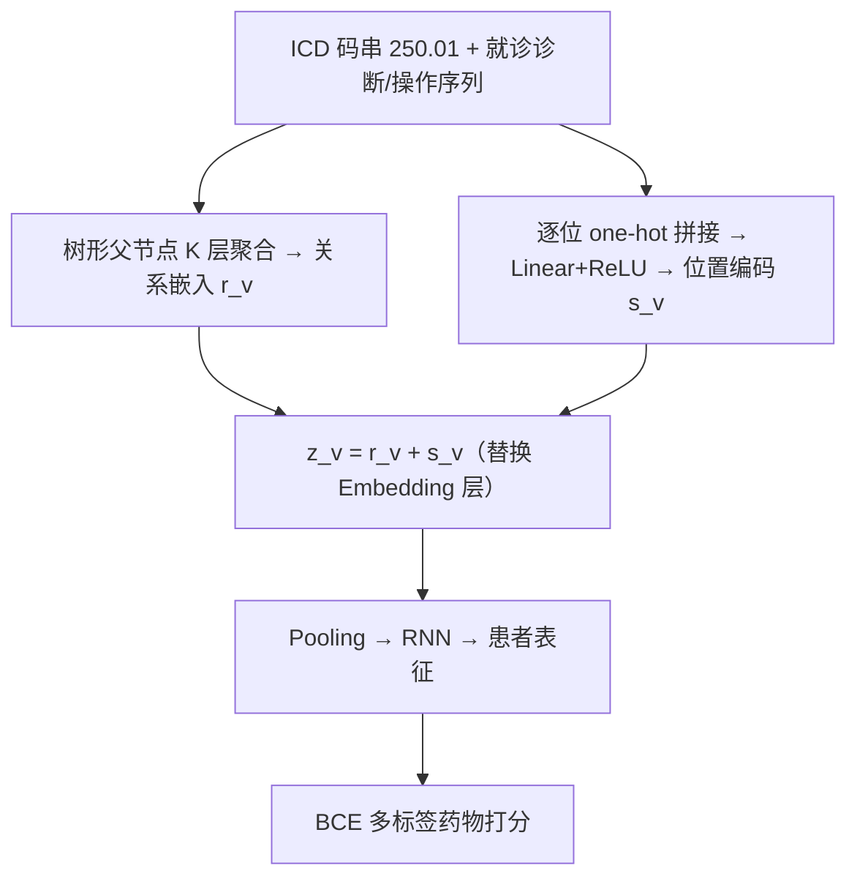
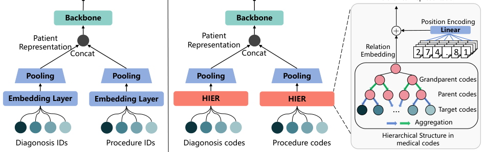

# Self-supervised Hierarchical Representation for Medication Recommendation (面向药物推荐的自监督层次表征)

- **会议/期刊**: DASFAA 2026
- **作者与机构**: Yuliang Liang, Yuting Liu, Yizhou Dang, Enneng Yang, Guibing Guo, Wei Cai, Jianzhe Zhao, Xingwei Wang（东北大学、东软研究院）
- **推荐链路定位**: 精排（纵向就诊序列 → 多标签药物组合预测）
- **研究方向**: 图神经网络与知识图谱推荐 / 自监督与去噪推荐
- **论文原文**: [https://arxiv.org/abs/2411.03143v1](https://arxiv.org/abs/2411.03143v1)
- **开源代码**: [https://github.com/sunlabuiuc/PyHealth](https://github.com/sunlabuiuc/PyHealth)（基于 PyHealth 框架实现）

## TL;DR (1分钟核心速览)

药物推荐把诊断/操作当作互不相干的 one-hot ID 学嵌入，忽视了 ICD 编码中"由泛到专"的树形层级，导致长尾码泛化极差。作者提出即插即用的层次编码器 **HIER**：用父节点逐层聚合得到**关系嵌入**（配自监督对齐父码目标），再把 ICD 码串逐位 one-hot 拼成**位置编码**显式注入全局层级位置，两者相加后直接替换传统 Embedding 层。在 MIMIC-III/IV（保留长尾码、患者级 8:1:1 划分、193/200 药物全库多标签打分）上，RETAIN/GAMENet/SafeDrug/MoleRec 四个基线的 Jaccard 提升 0.8%~5.7%，多数设置下 DDI 同步下降。

## Background & Motivation (背景与核心矛盾)

- **主流范式**: LEAP、RETAIN、GAMENet、SafeDrug、MoleRec 均把诊断/操作 one-hot 化后查可学习嵌入表，用 sum-pooling 聚合一次就诊内的多个码，RNN 建模纵向就诊，最后以 BCE 匹配药物组合；改进重点几乎全在**药物侧**（分子结构、DDI 图、知识图谱）。
- **前人局限**: ① 数据极端稀疏——MIMIC-III 中仅 5,449 名 ≥2 次就诊的患者，却覆盖 4,491 个诊断码与 1,412 个操作码，尾部码几乎学不到表征；② pooling 置换不变、模型缺乏内建的关系推理算子，码间层级只能靠数据"硬学"，训练负担被转移到本就稀疏的样本上。
- **核心洞察 (Key Insight)**: 把标准 BCE 展开可分解为 $\underbrace{y\,f(u)^{\top}f(m)}_{\text{Alignment}}-\underbrace{\log(1+e^{f(u)^{\top}f(m)}})_{\text{Uniformity}}$，即现有目标只约束"患者-药物对齐"与"球面均匀分布"，从未约束码的层级关系；而 ICD-9-CM 的 250 → 250.0 → 250.01 天然提供了免费的结构先验。
- **本文切入点**: 不再从数据里学码间关系，而是把 ICD 树直接编码进表征，作为与模型无关的嵌入层插件。

## Method (核心方法设计)

### 1. 整体框架 (Overall Architecture)

HIER 是一个"嵌入式"改造：把 ICD-9-CM（及同类编码体系）解析为诊断、操作两棵无向树，每个码 $v$先经$K$层父节点聚合得到关系嵌入$r_v$，再经码位编码得到位置向量$s_v$，二者相加得层级表征$z_v$ 并回填到原模型的嵌入表位置；随后完全复用下游流程——sum-pooling 聚合就诊内多码、双 RNN 建模就诊序列、拼接成患者表征、backbone 输出药物概率。训练分两段：关系嵌入以自监督目标预训练（与具体任务解耦、可跨模型复用），下游只微调关系嵌入与位置编码的线性层参数；推理时 HIER 退化为一次查表加法，开销近似为零。

<figure class="paper-figure" markdown="span">
  <figcaption>图 1. 药物推荐模型示意图，其中 (a) 为现有方法的范式；(b) 为采用层次编码器的本文方法。</figcaption>
</figure>

### 2. 关键设计拆解 (Key Designs)

1. **关系嵌入（Relation Embedding）：把父码信息逐层灌进子码**：痛点是一hot 码彼此正交，层级关系无从体现。做法是在树上做自底向上的聚合 $e_v^{k+1}=\sigma\big(\mathbf{W}^{k+1}\cdot\mathrm{Concat}(e_v^{k},e_{p(v)}^{k})\big)$，$K$层后取$r_v \leftarrow e_v^{K}$。直觉上它把"慢性支气管炎"的表征强行锚定在"呼吸系统疾病→慢性呼吸系统疾病"的语义锥内，使稀有子码也能借祖先码的统计量获得可泛化表征。

2. **位置编码（Position Encoding）：显式注入全局层级坐标**：关系嵌入只覆盖邻居结构，无法区分不同子树。作者把码串拆成数字序列 $\{v_1,\dots,v_L\}$，逐位 one-hot 后拼接成 multi-hot$\mathrm{PE}_v$，短码零填充，再经$s_v=\sigma(\mathrm{Linear}(\mathrm{PE}_v))$投影；其中 ReLU 是关键细节——保证位置向量非负，避免与 sum-pooling 聚合时产生符号抵消。最终$z_v = r_v + s_v$，加法而非拼接使维度不变、可直接替换原嵌入层。

3. **自监督目标、负采样与推理开销**：预训练损失 $\mathcal{L}=-\frac{1}{N}\sum_{n=1}^{N}\big[\log(r_v\cdot r_{p(v)})+\log(r_v\cdot r_{rand})\big]$，即拉近码与其父码、推远随机采样的无关码（负样本为均匀随机码，无需难负例挖掘）；下游沿用原模型的 BCE，不引入额外损失项。因$r_v$与任务解耦且可离线一次算好，训练只更新$r_v$ 与位置投影矩阵，在线推理等价于原嵌入查表。

## Experimental Setup & Evaluation Protocol (实验设置与评估协议)

- **数据集与预处理**: 过滤只含单次就诊的患者（无法反映纵向病程），**保留长尾诊断/操作码**（不设最小频次阈值，比常见过滤更严苛）：

| 数据集 | #Users | #Items(诊断/操作/药物) | #Interactions(就诊数) | 稀疏度/密度 | 特征/场景说明 |
| :--- | :---: | :---: | :---: | :---: | :--- |
| MIMIC-III | 5,449 | 4,491 / 1,412 / 193 | 14,141 | 平均 2.59 次/人（max 29） | 每次就诊平均 31.65 诊断、9.46 操作 |
| MIMIC-IV | 43,939 | 19,184 / 10,603 / 200 | 147,406 | 平均 3.35 次/人（max 70） | 每次就诊平均 48.98 诊断、8.76 操作 |

- **数据划分与防穿越 (Splitting Strategy)**: 以**患者为单位**的 8:1:1 随机划分（非时间戳切分），同一患者的所有就诊不会跨集合，但未显式禁止跨患者的时间泄漏。
- **排名评测协议 (Ranking Protocol)**: 属**多标签全库打分**——对全部 193/200 种药物逐一输出概率后阈值化，报告 Jaccard、F1、PRAUC 与 DDI rate（越低越好）；训练侧无负采样（BCE 覆盖全部标签），因此不存在采样排序偏差。
- **对比基线与超参设置**: 4 个纵向 SOTA（RETAIN、GAMENet、SafeDrug、MoleRec），统一以"+Ours"方式**仅替换其嵌入层**做公平对比；嵌入维度沿用各基线原配置，学习率 $\{10^{-3},10^{-4},10^{-5}\}$，训练 25 epoch；未报告显著性检验（$p$ 值）。

## Key Experimental Results (实验关键数据)

### 1. 主实验对比 (Main Results)

| 方法 | MIMIC-III Jaccard↑ | F1↑ | PRAUC↑ | DDI↓ | MIMIC-IV Jaccard↑ | F1↑ | PRAUC↑ | DDI↓ |
| :--- | :---: | :---: | :---: | :---: | :---: | :---: | :---: | :---: |
| RETAIN | **0.4645** | **0.6224** | **0.7376** | 0.0680 | **0.4673** | **0.6197** | **0.7390** | **0.0629** |
| RETAIN + HIER | **0.4837** | **0.6405** | **0.7540** | **0.0660** | **0.4710** | **0.6236** | **0.7438** | 0.0632 |
| GAMENet | 0.4485 | 0.6075 | 0.7136 | 0.0679 | 0.4544 | 0.6073 | 0.7173 | 0.0652 |
| GAMENet + HIER (Improv. 5.66%) | 0.4739 (+5.66%) | 0.6307 (+3.82%) | 0.7402 (+3.73%) | 0.0663 | 0.4777 (+5.13%) | 0.6305 (+3.82%) | 0.7506 (+4.64%) | 0.0639 |
| SafeDrug | 0.4541 | 0.6132 | 0.7174 | 0.0710 | 0.4519 | 0.6038 | 0.7121 | 0.0638 |
| SafeDrug + HIER (+4.49%) | 0.4745 (+4.49%) | 0.6314 (+2.97%) | 0.7405 (+3.22%) | **0.0692** | 0.4704 (+4.09%) | 0.6219 (+3.00%) | 0.7420 (+4.20%) | **0.0614** |
| MoleRec | 0.4572 | 0.6159 | 0.7157 | 0.0684 | 0.4302 | 0.5865 | 0.6962 | 0.0642 |
| MoleRec + HIER | 0.4627 (+1.21%) | 0.6213 (+0.88%) | 0.7252 (+1.33%) | 0.0652 | 0.4324 (+0.51%) | 0.5904 (+0.66%) | 0.7000 (+0.55%) | 0.0641 |

### 2. 消融实验 (Ablation Study)

（MIMIC-III + SafeDrug 底座）

| 变体 | Jaccard↑ | F1↑ | PRAUC↑ | DDI↓ |
| :--- | :---: | :---: | :---: | :---: |
| w/o E & P（原 SafeDrug） | 0.4541 | 0.6132 | 0.7174 | 0.0710 |
| w/ E（仅关系嵌入） | 0.4668 (+2.80%) | 0.6245 | 0.7346 | 0.0698 |
| w/ P（仅位置编码） | 0.4717 (+3.88%) | 0.6292 | 0.7368 | 0.0727 |
| **Ours（E + P）** | **0.4745 (+4.49%)** | **0.6314** | **0.7405** | **0.0692** |

### 3. 关键实验发现 (Key Findings)

- **层级先验的收益与底座强弱成反比**：GAMENet 增益最大（Jaccard +5.66%），而本身最强的 RETAIN 仅 +4.13%（MIMIC-III）/ +0.79%（MIMIC-IV），MoleRec 因药物分子子结构与稀疏诊断难以对齐，MIMIC-IV 上 Jaccard 仅从 0.4302 升到 0.4324——说明 HIER 补偿的是**码表征质量**，而非模型架构能力。
- **位置编码比关系嵌入更"划算"**：单用位置编码即得 +3.88% Jaccard（0.4541→0.4717），超过单用关系嵌入的 +2.80%，二者叠加再增益 0.6%；但位置编码单独使用时 DDI 反而劣化到 0.0727（高于原模型 0.0710），说明**只有关系嵌入的语义聚类才带来安全性副作用收益**，全局坐标本身不保证安全。
- **收敛效率与表征结构同时改善**：GAMENet/SafeDrug 在 epoch≈15 即饱和，而 +HIER 版本到 25 epoch 仍在上升，同 epoch 预算下 Jaccard/F1/PRAUC 全程领先；t-SNE 上传统嵌入按首位码呈近乎均匀散点，HIER 的关系嵌入则形成与医学大类对应的明显簇（图 3），直接验证层级结构被写入几何空间。

## Highlights & Limitations (亮点、对比与审稿批判)

- **与代表作对比 (vs. Prior Work)**: 与 GRAM（对祖先码做加权平均，需按层维护膨胀的嵌入矩阵）和 HieNet/GCN-based ICD 编码（端到端、目标为自动编码任务、不可嵌入药物推荐主干）相比，HIER 的差异在于**与任务解耦、可离线预训练、零推理开销的插件形态**；相比 SafeDrug/MoleRec 在药物侧堆结构先验，本文把先验搬到此前被忽视的**疾病侧**。
- **可迁移亮点**: ① "码串逐位 one-hot + ReLU 投影"是一种零参数的层级坐标编码，可直接搬到电商类目树、POI 类目、岗位职级等任何带分段编码的 ID 体系；② 用"父节点聚合 + 自监督对齐父码"为长尾 ID 造表征，可迁移到冷启动物品表征。
- **审稿级局限批判**: ① 自监督目标 $\log(r_v\cdot r_{p(v)})+\log(r_v\cdot r_{rand})$ 未做 sigmoid/温度归一化，点积无界且两项符号处理非常规（拉近父码与推远随机码写在同一负号内），缺乏理论保证与敏感性分析；② 实验仅 2 个数据集、4 个基线，增益多为 1%~5%，且**未报告显著性检验**；DDI 在 RETAIN（0.0629→0.0632）与 MoleRec（0.0642→0.0641）上并无改善，与"提升表征即可降 DDI"的叙述存在张力；③ 评估仅覆盖固定药物表（193/200）的多标签阈值打分，缺乏 top-k 召回曲线与冷启动物理分桶，层级深度也只用到 2~3 层，深树场景未验证。

## Rating (四维评分)

- **方法创新性 (Novelty)**: ⭐⭐⭐⭐ （把 ICD 树先验以"插件式关系嵌入 + 码位位置编码"注入疾病侧表征，思路朴素但此前确为空白，且有 alignment/uniformity 的理论动机支撑）
- **评估协议与实验扎实度 (Protocol & Experiments)**: ⭐⭐⭐ （保留长尾码、四基线统一换嵌入层的对比设计较公平，但仅 2 数据集、无显著性检验、无 top-k 与分桶实验，安全性指标结论不一致）
- **写作与数学规范度 (Clarity & Rigor)**: ⭐⭐⭐ （结构清晰、图示直观，但自监督目标形式不规范、缺少复杂度与超参敏感性分析，理论部分仅给出 BCE 分解而未证明层级不可学的必然性）
- **工业落地与复现价值 (Industrial & Practical Value)**: ⭐⭐⭐⭐ （推理零额外开销、可离线预计算、依赖 PyHealth 已开源，工程接入成本极低，适合作为任意医疗编码模型的通用前置层）

