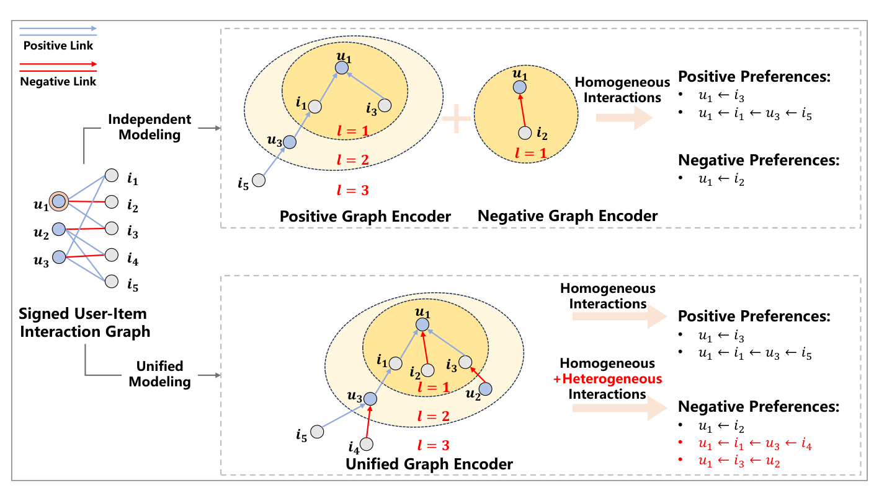
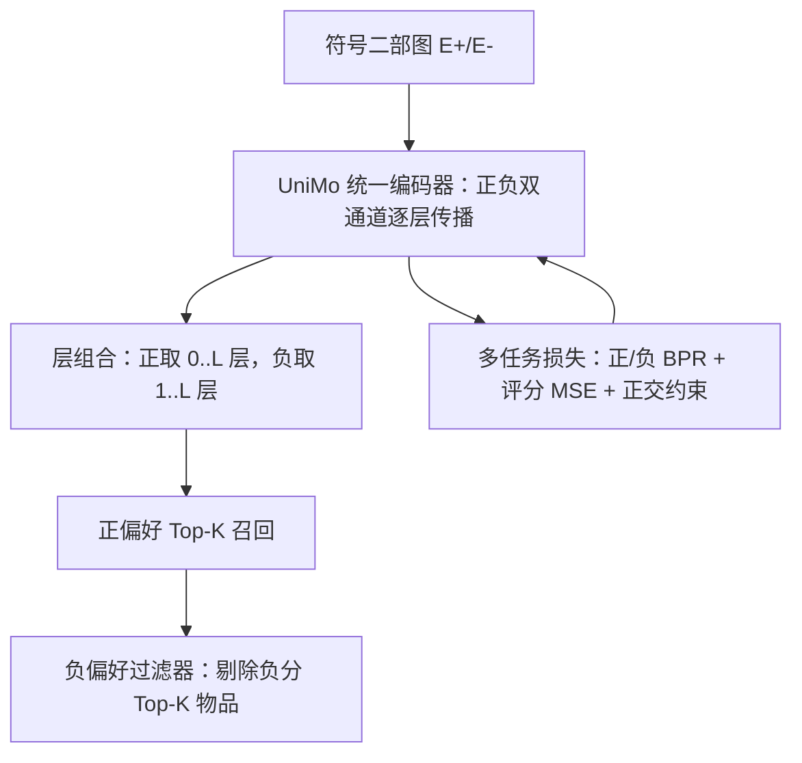

# Towards Unified Modeling for Positive and Negative Preferences in Sign-Aware Recommendation (面向符号感知推荐的用户正负偏好统一建模)

- **会议/期刊**: DASFAA 2026（arXiv 预印本 2024-03）
- **作者与机构**: Yuting Liu, Yizhou Dang, Yuliang Liang, Qiang Liu, Guibing Guo, Jianzhe Zhao, Xingwei Wang（东北大学软件学院、中科院自动化所）
- **推荐链路定位**: 召回（图协同过滤表征学习 + 全库排序）
- **研究方向**: 图神经网络与知识图谱推荐 / 协同过滤与双塔召回
- **论文原文**: [https://arxiv.org/abs/2403.08246v1](https://arxiv.org/abs/2403.08246v1)
- **开源代码**: [https://anonymous.4open.science/r/LSGRec-BB95](https://anonymous.4open.science/r/LSGRec-BB95)

## TL;DR (1分钟核心速览)

符号感知推荐需要同时建模"喜欢"与"讨厌"，但现有方法（SiReN、PANE-GNN、Dual-LightGCN）把正/负边拆成两张子图、各用独立编码器，直接切断了跨符号的高阶异质路径，且负边在推荐场景并不满足平衡理论。本文提出 LSGRec：在**同一张符号二部图**上用一个统一编码器传播正负表征（负信息沿正边传播，借助同质性而非平衡理论），再接一个"负偏好过滤器"从 Top-K 候选中剔除用户明确反感的物品，并以符号感知 BPR、评分回归与正交解耦约束联合训练。在 Beauty/Book/Yelp 三个真实数据集上、8:2 划分 + 全库排序协议下，P@10、R@10、NDCG@10 相对次优基线最高提升 10.64%、16.21%、15.60%，且单轮训练仅需 2.0–69 秒，显著快于 PANE-GNN（33.5–892 秒）。

## Background & Motivation (背景与核心矛盾)

- **主流范式**: LightGCN 式轻量图卷积在用户-物品二部图上做邻居聚合，但把全部交互视为正反馈；签名推荐（signed rec）则把评分按阈值拆成正/负两张子图，用两个独立编码器分别学"喜欢"与"讨厌"。
- **前人局限 1**: 独立建模破坏符号图的高阶连通性。$u_1$喜欢$i_3$、$u_2$讨厌$i_3$，则两人偏好应呈负相关；拆图后这一"异号同物"的协同信号彻底丢失。
- **前人局限 2**: 独立建模遗漏**高阶异质交互**。独立负图编码器只能看到负边构成的路径，而 $u_1\leftarrow i_1\leftarrow u_3\leftarrow i_4$（正-正-负）这类路径在负子图里并不存在；当数据集负边稀少（Book 正负比仅 1:0.07）时，负子图退化为森林，负编码器几乎学不到东西。
- **核心洞察 (Key Insight)**: 刻画符号用户-物品图不应借用社交网络的**平衡理论**（"敌人的敌人是朋友"在推荐中不成立，SGCN 因此反而最差），而应借助**同质性**：相似用户的负偏好也相似，因此负信息可以沿正边安全传播。
- **本文切入点**: 用一个统一编码器在整图上同时传播正、负两类表征，再用负偏好过滤器显式"扣分"。

<figure class="paper-figure" markdown="span">
  <figcaption>图 1：用户-物品带符号交互图及其分别通过统一建模和独立建模得到的高阶连通性示意图。节点 𝑢1 是需要推荐的目标用户。最右侧展示了不同建模方法中正偏好和负偏好的路径。</figcaption>
</figure>

## Method (核心方法设计)

### 1. 整体框架 (Overall Architecture)

输入为按阈值 $\delta=2.5$二值化的符号二部图$\mathcal{G}=(\mathcal{U},\mathcal{I},\mathcal{E}^{+},\mathcal{E}^{-})$。统一编码器 UniMo 逐层传播得到每层的正、负表征，并按 LightGCN 方式做层组合得到$\mathbf{e}_u^{+},\mathbf{e}_i^{+},\mathbf{e}_u^{-},\mathbf{e}_i^{-}$；预测阶段先按正偏好取 Top-K 候选，再由负偏好过滤器剔除负分最高的 Top-K 反感项，输出重排后的列表；训练端由正 BPR、负 BPR、评分回归 MLP 与正交约束四路损失联合优化，参数量仅为首层嵌入表。

### 2. 关键设计拆解 (Key Designs)

1. **统一传播规则（一阶分通道，高阶只走正边）**：一阶时正/负表征各自由同号邻居聚合、按对应度数归一化；但从第二层起，负信息的传播**只允许经过正边**，即 $\mathbf{e}_u^{(l+1)-}=\frac{1}{\sqrt{|\mathcal{N}_u^{+}|}\sqrt{|\mathcal{N}_i^{+}|}}\sum_{i\in\mathcal{N}_u^{+}}\mathbf{e}_i^{(l)-}$。直觉：负边本身不传递相似性（无法做多跳负-负聚合），但"我喜欢的物品被谁讨厌"这类异质路径可靠且信息量大，正是独立建模丢掉的增量信号。另需注意层组合的非对称设计——正表征平均第$0\sim L$层（首层嵌入本身即正先验），负表征仅平均第$1\sim L$ 层，避免把无符号语义的初始嵌入误当作负偏好。

2. **负偏好过滤器（Negative Preference Filter）**：$Rec(u)=\mathrm{Filter}(\mathrm{topK}(\hat{y}^{+}_{ui}),\ \mathrm{topK}(\hat{y}^{-}_{ui}))$，其中$\hat{y}^{+}_{ui}=\mathbf{e}_u^{+\top}\mathbf{e}_i^{+}$、$\hat{y}^{-}_{ui}=\mathbf{e}_u^{-\top}\mathbf{e}_i^{-}$。相当于在打分阶段把"高分但被明确反感"的物品硬性屏蔽，比单纯调低权重更符合业务直觉（如用户爱运动但厌恶足球，足球类目应直接下架而非降权）。

3. **多任务目标与训练策略**：$\mathcal{L}=\mathcal{L}^{+}_{BPR}+\mathcal{L}^{-}_{BPR}+\mathcal{L}_{MSE}+\mathcal{L}_{ortho}+\lambda\|\Theta\|_2^2$。正 BPR 引入差值项$c_1$保证"正-未观测"的分数差大于"负-未观测"；负 BPR 用$c_2$反向压制负分；$\mathcal{L}_{ortho}=\|\mathbf{e}_u^{+}\cdot\mathbf{e}_u^{-}\|^2+\|\mathbf{e}_i^{+}\cdot\mathbf{e}_i^{-}\|^2$强制正负表征张成近正交子空间——因为二者共享同一初始嵌入，若无约束会在卷积中相互污染。负采样采用"已观测正/负项 vs 未观测项"的三元组对，无额外难负样本挖掘；推理时正负打分均为一次内积，复杂度与 LightGCN 同阶，$O(|E|Ld)$。

## Experimental Setup & Evaluation Protocol (实验设置与评估协议)

- **数据集与预处理**: 全部按评分阈值 $\delta=2.5$ 二值化符号；Beauty 采用 `5-core`，Book 与 Yelp 采用 `20-core` 过滤。

| 数据集 | #Users | #Items | #Interactions | 密度(%) | 正负比/说明 |
| :--- | :---: | :---: | :---: | :---: | :--- |
| Amazon-Beauty | 22,363 | 12,101 | 172,188 | 0.064 | 1:0.13，最稀疏 |
| Amazon-Book | 35,736 | 38,121 | 1,960,674 | 0.14 | 1:0.07，负边最少 |
| Yelp2021 | 41,772 | 30,037 | 2,116,215 | 0.16 | 1:0.16，负边最丰富 |

- **数据划分与防穿越 (Splitting Strategy)**: 训练/测试按 **8:2 比例随机划分**（非时间戳切分），并采用 **5-fold 交叉验证** 报告均值，未见冷启动或时间穿越防护设计。
- **排名评测协议 (Ranking Protocol)**: 报告 $Precision@K$、$Recall@K$、$NDCG@K$（$K=10,20$），对测试集候选做全物品打分排序，**未采用采样负例排序**；亦未报告显著性检验（仅以 5 折均值降低方差）。
- **对比基线与超参设置**: 基线含非符号方法 NGCF、LightGCN，符号方法 SGCN、SiReN、PANE-GNN；嵌入维度 $d=64$，batch size 1024，Adam + MultiStepLR，学习率 0.005，层数$L\in\{1,2,3,4\}$，训练 200 epoch 并按 Recall@10 选最优，Xavier 初始化。

## Key Experimental Results (实验关键数据)

### 1. 主实验对比 (Main Results)

| 数据集 | 指标(×100%) | NGCF | LightGCN | SGCN | SiReN | PANE-GNN | **LSGRec** | Improv.% |
| :--- | :--- | :---: | :---: | :---: | :---: | :---: | :---: | :---: |
| Beauty | P@10 | 1.286 | 1.892 | 1.149 | 1.996 | 1.831 | **2.108** | 5.61 |
| Beauty | R@10 | 5.025 | 7.673 | 4.525 | 8.762 | 8.017 | **9.265** | 5.74 |
| Beauty | NDCG@10 | 3.348 | 5.017 | 2.887 | 5.802 | 5.225 | **6.143** | 5.88 |
| Book | P@10 | 5.499 | 6.055 | 3.646 | 5.646 | 5.921 | **6.699** | 10.64 |
| Book | R@10 | 6.676 | 6.985 | 4.237 | 6.858 | 7.025 | **8.164** | 16.21 |
| Book | NDCG@10 | 7.937 | 8.012 | 4.822 | 7.755 | 8.018 | **9.269** | 15.60 |
| Yelp | P@10 | 2.721 | 2.919 | 2.677 | 4.213 | 4.059 | **4.411** | 4.70 |
| Yelp | R@10 | 4.033 | 4.234 | 3.336 | 5.304 | 5.098 | **5.516** | 4.00 |
| Yelp | NDCG@10 | 3.872 | 4.308 | 3.705 | 5.787 | 5.643 | **6.107** | 5.53 |
| Secs/Epoch↓ | — | 3.0 / 39.5 / 65.0 | 2.5 / 34.0 / 41.5 | 3.5 / 40.0 / 76.5 | 4.0 / 83.5 / 89.5 | 33.5 / 739.5 / 892.0 | **2.0 / 38.5 / 69.0** | — |

（Secs/Epoch 依次为 Beauty / Book / Yelp，越低越好。）

### 2. 消融实验 (Ablation Study)

| 变体 | Beauty R@10 | Book R@10 | Yelp R@10 | Yelp NDCG@10 |
| :--- | :---: | :---: | :---: | :---: |
| LSGRec 完整 | **9.26** | **8.16** | **5.51** | **6.11** |
| w/o $\mathcal{L}^{-}_{BPR}$ | 9.23 | 7.88 | 5.17 | 5.72 |
| w/o $\mathcal{L}_{MSE}$ | 9.21 | 7.86 | 5.39 | 5.99 |
| w/o $\mathcal{L}_{ortho}$ | 9.09 | 7.89 | 5.01 | 5.55 |
| w/o filter | 9.17 | 7.88 | 5.04 | 5.61 |

### 3. 关键实验发现 (Key Findings)

1. **统一建模在负边稀缺时收益最大**：Book 正负比仅 1:0.07，独立负图退化为森林，LSGRec 因此取得 +16.21% R@10 的峰值提升；而在负边最丰富、稀疏度最低的 Beauty 上提升仅约 2.9–5.9%，说明该方法的红利主要来自"负信号不够用"的场景。
2. **效率与效果同时占优**：LSGRec 的 Secs/Epoch（2.0/38.5/69.0）接近甚至低于 LightGCN（2.5/34.0/41.5），而 PANE-GNN 因对比学习需 33.5/739.5/892.0 秒；同时 SGCN 因误用平衡理论把"敌人的敌人"当正邻居，三项指标全面垫底（Book R@10 仅 4.237），从反面印证了平衡理论不适用于推荐。
3. **正交约束是消融中最关键的组件，过滤器次之**：去掉 $\mathcal{L}_{ortho}$后 Yelp R@10 由 5.51 降至 5.01（-9.1%）、NDCG@10 由 6.11 降至 5.55；去掉过滤器则降至 5.04/5.61，二者对 Yelp 的影响均大于 Book（如 w/o filter 仅从 8.16 降至 7.88），说明交互密度越高、负偏好越可辨，显式解耦与剔除机制的价值越大；层数敏感性上 Beauty/Yelp 最优点为$L=2$、Book 为$L=4$。

## Highlights & Limitations (亮点、对比与审稿批判)

- **与代表作对比 (vs. Prior Work)**: 相较 SiReN 与 Dual-LightGCN 的"拆图双编码器"，本文保持单图单编码器的极简结构即获得高阶异质路径；相较 PANE-GNN 在负图上做卷积+对比学习，本文放弃高开销对比范式，指出"负边不传相似性"这一根本约束；相较社交域的 SGCN，本文用同质性替代平衡理论，避免把朋友圈逻辑错搬到推荐域。
- **可迁移亮点**: ①"负信息只沿正边传播"的非对称传播规则，可直接用于多行为/多关系图中稀缺信号通道的传播设计；②层组合时正负通道取不同层区间（0..L vs 1..L），这一"先验偏置"技巧对任何共享初始嵌入的多通道表征都适用。
- **审稿级局限批判**: ①评估透明度和严谨性不足——8:2 随机划分（非时间切分）存在潜在穿越风险，未报告采样比与显著性检验，也未设冷启动或长尾分桶实验；②训练目标堆叠了 4 项损失与两个人工阈值（$\delta=2.5$、BPR 差值项$c_1,c_2$），超参敏感度未做系统分析，且负偏好的"过滤"需要推理时就地对全库计算负分，工业侧可用的近似近邻裁剪策略未被讨论。

## Rating (四维评分)

- **方法创新性 (Novelty)**: ⭐⭐⭐⭐ （"同图统一编码 + 负信息只走正边"是干净且反直觉的算子级创新，摆脱平衡理论束缚，理论动机（同质性 vs 平衡理论）阐述清晰）
- **评估协议与实验扎实度 (Protocol & Experiments)**: ⭐⭐⭐ （三个真实数据集 + 5 折交叉验证 + 效率对比 + 消融完整，但划分方式未做时间切分、无显著性检验、无稀疏/长尾分桶分析）
- **写作与数学规范度 (Clarity & Rigor)**: ⭐⭐⭐⭐ （传播公式与层组合的非对称设计交代明确，复杂度论证简洁；但 BPR 差值项 $c_1,c_2$ 的取值与推导被作者自承"简化处理"，符号定义略显松散）
- **工业落地与复现价值 (Industrial & Practical Value)**: ⭐⭐⭐⭐ （单图单编码器、参数量仅初始嵌入、训练开销与 LightGCN 同级，匿名代码已公开，对同时存在显式负反馈（差评/踩/退货）的平台可直接复用）

