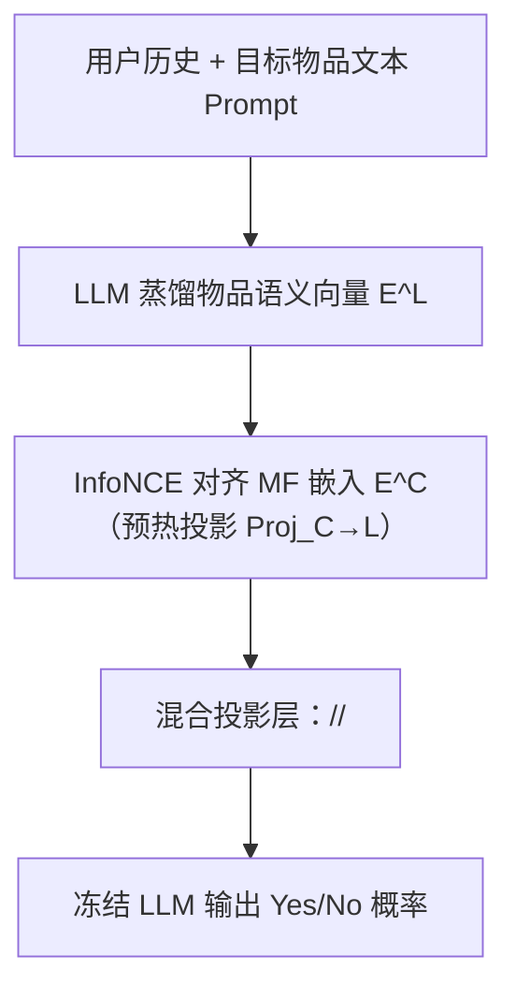
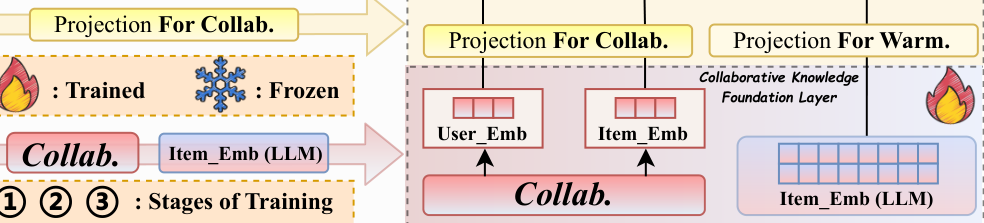

# Enhancing LLM-based Recommendation through Semantic-Aligned Collaborative Knowledge (通过语义对齐的协同知识增强大模型推荐)

- **会议/期刊**: DASFAA 2026
- **作者与机构**: Zihan Wang, Jinghao Lin, Xiaocui Yang, Yongkang Liu, Shi Feng, Daling Wang, Yifei Zhang（东北大学）
- **推荐链路定位**: 精排（CTR 二分类打分）
- **研究方向**: 大语言模型推荐 / 协同过滤
- **论文原文**: [https://arxiv.org/abs/2504.10107v1](https://arxiv.org/abs/2504.10107v1)
- **开源代码**: 暂未开源

## TL;DR (1分钟核心速览)

LLM 无法建模稀疏的 user/item ID，而 CoLLM/BinLLM 这类把协同嵌入投影进 LLM 词表空间的方案，因两个模型知识分布差异大，单靠一层投影层远不足以完成迁移。SeLLa-Rec 改为**双向语义对齐 + 预热投影**：先用 LLM 蒸馏出的物品语义向量以 InfoNCE 约束 MF 训练，使协同模型主动继承 LLM 的语义分布，再用对齐阶段训练好的投影层初始化注入模块。在 ML-1M 与 Amazon-Book 上 AUC 达 0.7606/0.8837，较 BinLLM 相对提升 2.6%/4.8%。

## Background & Motivation (背景与核心矛盾)

- **主流范式**: CoLLM 将预训练好的 MF 嵌入经线性层映射为特殊 token 拼入 prompt；BinLLM 进一步把协同向量量化成"IP 地址"文本；PersonPrompt 则从零训练个性化 soft token。
- **前人局限**: (1) 协同模型与 LLM **独立训练、分布割裂**，单次投影层训练无法让 LLM 建立对协同信号的完整理解，投影本质上是"盲映射"；(2) 从零训练特殊 token（PersonPrompt）既低效又丢弃了成熟 CF 模型的结构化知识。
- **核心洞察 (Key Insight)**: 对齐不应只发生在"投影那一刻"，而应前置到**协同模型自身的训练过程**——若 CF 嵌入在训练时就已被 LLM 语义向量拉近，则投影的信息损失与判别性噪声都会显著降低。
- **本文切入点**: 把"对齐"拆成两条互补通路：CF 侧用对比学习前对齐（继承 LLM 分布），同时保留对齐后的 LLM 语义向量作为协同信息的**第三种来源**，二者共同构成特殊 token。

## Method (核心方法设计)

### 1. 整体框架 (Overall Architecture)

模型自上而下分三层：顶层 LLM 推荐层（Qwen2-7B-Base + LoRA）负责最终 Yes/No 打分；中间混合投影层把两类知识映射成三个特殊 token `<User_ID>`、`<Item_ID>`、`<Warm_ID>`，替换 prompt 中对应位置的原始嵌入；底层协同知识基座层由 MF 嵌入与 LLM 蒸馏语义向量组成。训练严格分三阶段：①LoRA 指令微调使 LLM 适配推荐任务；②蒸馏物品语义向量并以 InfoNCE 引导 MF 联合训练；③冻结全部 LLM 参数，仅训练两个投影层与协同嵌入完成知识注入。推理时仅需一次前向即可输出 Yes/No 概率。

<figure class="paper-figure" markdown="span">
  <figcaption>图1：SeLLa-Rec 的整体框架。右侧展示 SeLLa-Rec 的结构，左侧说明预训练组件的来源。编号标记①、②和③表示 SeLLa-Rec 的依次训练阶段。</figcaption>
</figure>

### 2. 关键设计拆解 (Key Designs)

1. **协同基座的语义前对齐 (Semantic Pre-Alignment)**：痛点是从零训练的投影层面对 $d_C\!\approx\!128$到$d_L\!\approx\!3584$的维度鸿沟必然丢信息。本文在 MF 训练目标上叠加对齐损失，用蒸馏得到的 LLM 物品向量$e^L_i$ 作为 anchor：
$\mathcal{L}_{align}=-\mathbb{E}\left[\log\frac{\exp(\cos(\mathrm{Proj}^{C\to L}(e^C_i),e^L_i)/\tau)}{\sum_{i'\in\mathcal{I}}\exp(\cos(\mathrm{Proj}^{C\to L}(e^C_{i'}),e^L_{i'})/\tau)}\right]$总损失$\mathcal{L}=\mathcal{L}_{collab}+\lambda\mathcal{L}_{align}$，其中$\mathcal{L}_{collab}$ 为评分回归 MSE。直觉：CF 嵌入被"拽"进 LLM 语义邻域，投影退化为近恒等变换。

2. **预热式混合投影与三类特殊 token**：`<User_ID>`/`<Item_ID>` 复用对齐阶段已收敛的 $\mathrm{Proj}^{C\to L}$（而非随机初始化）映射$d_C$维 CF 嵌入；`<Warm_ID>` 用独立的$\mathrm{Proj}^{W\to L}\in\mathbb{R}^{d_L\times d_L}$ 映射对齐后的 LLM 语义向量，保留 LLM 自身的物品先验。最终输入为
$E^L_{final}=E^L(P^{L+C})\oplus[e^L_{user};e^L_{item};e^L_{warm}]$
两路知识互补，避免协同信号"淹没"语义信号。

3. **训练目标与推理开销**：Stage 1 用 BCE 监督 LoRA；Stage 3 目标 $\mathcal{L}_{Proj}=-y\log\hat{y}^{L+C}_{u,i}-(1-y)\log(1-\hat{y}^{L+C}_{u,i})$。全程无负采样设计，负例由评分阈值天然划分（Movie 阈值 3，Book 阈值 4）。推理为单次 7B 前向，三个 token 不增加序列长度，主要成本来自 LLM 本体。

## Experimental Setup & Evaluation Protocol (实验设置与评估协议)

| 数据集 | #Users | #Items | #Train / #Valid / #Test | 密度 | 说明 |
| :--- | :---: | :---: | :---: | :---: | :--- |
| MovieLens-1M | 839 | 3,256 | 33,891 / 10,401 / 7,331 | ~1.6% | 2000–2003，阈值 3 二值化 |
| Amazon-Book | 22,967 | 34,154 | 727,468 / 25,747 / 25,747 | ~0.09% | 只用 2017 年数据，阈值 4 |

- **数据划分与防穿越**: **全局时间戳切分**，Movie 按 10:5:5、Book 按 11:0.5:0.5，仅保留交互数 >20 的用户；测试集天然包含训练期未出现物品，构成**冷启动划分**。
- **排名评测协议**: 本文为 **pointwise 二分类**评测，使用 `AUC` 与用户级 `UAUC`，**未采用 Full-Ranking 或 Sampled Ranking**，亦未报告 NDCG@K/HR@K，这是与主流 Top-N 评测的最大差异。
- **对比基线与超参**: 11 个基线分四类（MF/LightGCN/SASRec/DIN；Zero-shot/Prompt4NR/TallRec；CTRL；PersonPrompt/CoLLM/BinLLM）。下游 CF 统一用 MF，LLM 主干由 Vicuna-7B 换为更强的 Qwen2-7B-Base 以排除主干劣势。$\tau$、$\lambda$ 未给敏感性分析。

## Key Experimental Results (实验关键数据)

### 1. 主实验对比 (Main Results)

| 类别 | 模型 | Movie AUC | Movie UAUC | Book AUC | Book UAUC |
| :--- | :--- | :---: | :---: | :---: | :---: |
| Collab. | MF | 0.6473 | 0.6264 | 0.6949 | 0.5366 |
| Collab. | LightGCN | 0.6139 | 0.6276 | 0.7011 | 0.5528 |
| Collab. | DIN | 0.7138 | 0.6595 | 0.8102 | 0.5986 |
| LLMRec | TallRec | 0.7268 | 0.6989 | 0.8358 | 0.6921 |
| LLMRec | Prompt4NR | 0.7191 | 0.6839 | 0.8177 | 0.6733 |
| LLM+Collab. | PersonPrompt | 0.7223 | 0.6991 | 0.8141 | 0.6730 |
| LLM+Collab. | CoLLM-MF | 0.7357 | 0.7179 | 0.8391 | 0.6957 |
| LLM+Collab. | BinLLM | 0.7417 | 0.7239 | 0.8429 | 0.7073 |
| **Ours** | **SeLLa-Rec** | **0.7606** | **0.7464** | **0.8837** | **0.7459** |
| Improv.% | vs. best baseline | **+2.55%** | **+3.11%** | **+4.84%** | **+5.46%** |

### 2. 消融实验 (Ablation Study)

| 变体 | 说明 | Movie AUC | Movie UAUC | Book AUC | Book UAUC |
| :--- | :--- | :---: | :---: | :---: | :---: |
| SeLLa-w/o | 去掉对齐（≈CoLLM） | 0.7357 | 0.7179 | 0.8391 | 0.6957 |
| SeLLa-Proj | 投影层随机初始化 | 0.7511 | 0.7333 | 0.8424 | 0.7225 |
| SeLLa-Warm | 去掉 `<Warm_ID>` | 0.7521 | 0.7371 | 0.8764 | 0.7444 |
| SeLLa-UI | 去掉 `<User_ID>`+`<Item_ID>` | 0.7305 | 0.7076 | 0.8417 | 0.7186 |
| SeLLa-W-UI | 先训 Warm 再训 UI | 0.7576 | 0.7458 | 0.8625 | 0.7350 |
| SeLLa-UI-W | 先训 UI 再训 Warm | 0.7539 | 0.7410 | 0.8797 | 0.7403 |
| **SeLLa-Rec** | 联合训练 | **0.7606** | **0.7464** | **0.8837** | **0.7459** |

### 3. 关键实验发现 (Key Findings)

1. **UI token 是主增益来源，Warm token 是稳定器但不可替代**：去掉 `<User_ID>/<Item_ID>` 后 Movie AUC 跌至 0.7305，甚至低于 CoLLM 的 0.7357；而只去 `<Warm_ID>` 仍有 0.7521。说明仅注入协同信号已能超越基线，但双路知识叠加才拿到 0.7606 的峰值。
2. **前对齐可显著提升跨模型知识迁移效率**：Stage 3 起始步（Step 0）即在 warm 数据上评测，CL+Proj 达 0.7421/0.8450，CL 单独 0.7393/0.8319，完全不对齐 0.7283/0.8158——即**尚未训练投影层时对齐收益已兑现**，平均提升约 1.9%。t-SNE 与余弦相似度分布亦显示对比学习显著收窄两嵌入空间的分布差距。
3. **冷热分桶下全面占优，但 Book 数据存在分布伪影**：LLM 类模型在 Book 冷子集（zero-shot AUC 0.7604）反超热子集（0.6602），作者归因为测试集包含更多"熟悉书籍"及分布不均；SeLLa-Rec 在 Movie/Book 的 warm 与 cold 四个子集上均领先，说明注入协同知识并未削弱 LLM 的冷启动泛化。

## Highlights & Limitations (亮点、对比与审稿批判)

- **与代表作对比**: vs. **CoLLM**：CoLLM 把 CF 嵌入经随机初始化投影直接塞进 LLM，本文把对齐前移到 CF 训练并用其参数预热投影；vs. **BinLLM**：BinLLM 将协同向量离散化为 IP 地址文本，量化损失不可避免，本文保留连续向量并用 `<Warm_ID>` 补回语义分支；vs. **PersonPrompt**：其特殊 token 从零训练，本文直接复用成熟 MF 嵌入，收敛更快。
- **可迁移亮点**: (1) "先在源模型训练中做对比对齐、再用对齐后的投影层做 warm-start"可泛化到任何跨空间知识注入（如多模态、跨域迁移）；(2) 用一路 token 承载"对齐后语义向量"来平衡两类知识的做法，可直接移植到序列推荐/多场景建模。
- **审稿级局限批判**: (1) 评测仅用 pointwise AUC/UAUC，缺少 Full-Ranking 下的 NDCG@K/HR@K，且负例由评分阈值隐式定义，无法与 Top-N 文献直接比较；(2) 推理依赖 7B LLM 全前向，论文未给出延迟、显存或与 CoLLM/BinLLM 的效率对比，$\tau$、$\lambda$ 与三阶段超参亦无敏感性分析。

## Rating (四维评分)

- **方法创新性 (Novelty)**: ⭐⭐⭐⭐ （把"对齐"从投影层前置到协同模型训练，并给出预热投影 + 双路 token 的完整闭环，思路清晰但组件均为已有技术的组合）
- **评估协议与实验扎实度 (Protocol & Experiments)**: ⭐⭐⭐ （11 个基线、冷热分桶与 6 组消融较完整，但仅两个数据集、仅 pointwise AUC，缺 Top-N 排序与显著性检验）
- **写作与数学规范度 (Clarity & Rigor)**: ⭐⭐⭐⭐ （三阶段训练状态表与公式定义清晰，消融与对齐分析自洽；个别符号与图注存在排版瑕疵）
- **工业落地与复现价值 (Industrial & Practical Value)**: ⭐⭐⭐ （仅需一次 LLM 前向即可打分、下游可用轻量 MF，落地友好；但 7B 主干成本高且未开源代码，复现门槛偏大）

