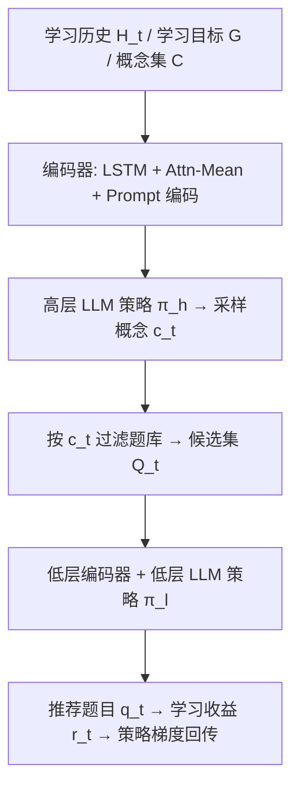
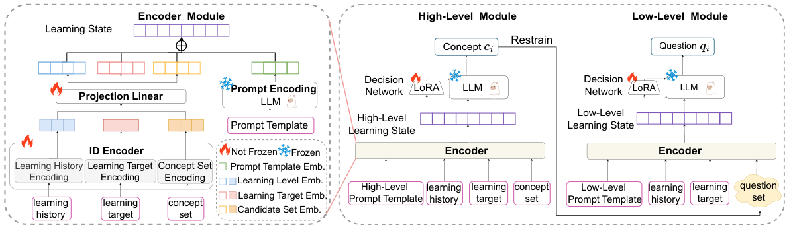

# HierLLM: Hierarchical Large Language Model for Question Recommendation (面向题目推荐的层次化大语言模型)

- **会议/期刊**: DASFAA 2026
- **作者与机构**: Yuxuan Liu, Haipeng Liu, Ting Long（吉林大学）
- **推荐链路定位**: 端到端序列决策（召回+精排合一的学习路径策略）
- **研究方向**: 大语言模型推荐 (LLM4Rec) / 强化学习与动态探索推荐
- **论文原文**: [https://arxiv.org/abs/2409.06177v1](https://arxiv.org/abs/2409.06177v1)
- **开源代码**: 暂未开源

## TL;DR (1分钟核心速览)

教育题目推荐需在**冷启动（无学习历史）**与**超大题库（上千至十万级）**下做长程决策。HierLLM 用「概念→题目」双层 LLM 策略（Llama2-7B + LoRA）先把动作空间收缩到概念相关候选集，再从中选题，并用策略梯度直接优化学习收益 $\Delta_u$。在 KSS 与 4 个知识追踪模拟器上，$t{=}200$ 时 I-A 达 0.7848（+38.1%）、D-A 达 0.0510（+264%）；历史长度置零的冷启动设置下性能几乎无损。

## Background & Motivation (背景与核心矛盾)

- **主流范式**: SRC/CSEAL/GEHRL 等把题目推荐建模为序列决策，先用 LSTM/注意力把学习历史压成"学习状态"向量，再拼接学习目标，由神经网络（或 HRL 高层+低层）从题库中选下一题，用 RL 优化长期学习收益。
- **前人局限**: ①**时序矛盾**——状态估计完全依赖学习历史，冷启动（$|\mathcal{H}_t|=0$）时状态向量近乎噪声，推荐退化为随机；②**空间矛盾**——动作空间为整个题库，ID 类特征语义稀薄，几千至十万级候选中精准命中"最有收益题"极难。
- **核心洞察 (Key Insight)**: 概念数 $m$远小于题目数$n$（ASSIST09: 121 vs 15003；Junyi: 39 vs 2163），且概念-题目是多对多映射。先定概念即可把决策空间压缩 1–2 个数量级；而 LLM 的领域先验与推理能力可以替代缺失的学习历史。
- **本文切入点**: 把单层 MDP 拆成概念级与题目级两层 MDP，两层决策网络均由 LoRA 微调的 LLM 承担。

## Method (核心方法设计)

### 1. 整体框架 (Overall Architecture)

每个时间步，原始输入（学习历史 $\mathcal{H}_t$、学习目标$\mathcal{G}$、概念集$\mathcal{C}$或候选题目集$\mathcal{Q}_t$、以及把三者串成 ID 序列的模板 Prompt）先经编码器融合为学生状态；高层模块在概念集上输出分布$p^c_t$并采样概念$c_t$，据此过滤题库得到候选集$\mathcal{Q}_t$；低层模块在同一结构下（参数独立）在$\mathcal{Q}_t$上输出$p^q_t$ 并采样题目推荐给学生。训练时冻结 LLM 主干、仅训 LoRA，用两层策略梯度 + 掌握度预测辅助损失联合优化。

<figure class="paper-figure" markdown="span">
  <figcaption>图2：HierLLM 的框架。HierLLM 是一种基于 LLM 的层次结构，由高层模块和低层模块（右侧）组成。高层模块负责推荐概念，以将推荐空间缩小到问题候选集，降低推荐难度。低层模块负责从问题候选集中选择问题。</figcaption>
</figure>

### 2. 关键设计拆解 (Key Designs)

1. **概念-题目双层 HMDP（空间收缩算子）**: 单层策略在 $|\mathcal{Q}|$上做 softmax 采样，梯度被海量无关题目稀释。本文定义高层策略$\pi_h(c_t\mid s^h_t,\mathcal{C})$与低层策略$\pi_l(q_t\mid s^l_t,\mathcal{Q}_t)$，联合目标为
 $\max_{\pi_h,\pi_l} J=\frac{1}{T}\sum_{t=0}^{T} r\!\left(q_t\mid s^l_t,\mathcal{Q}_t(c_t\mid s^h_t,\mathcal{C})\right)$。
 直觉：概念是题目的"语义桶"，先桶后题等价于对动作空间做了一次粗粒度召回，把低层的选择难度从"万级"降到"百级"。
2. **多源学习状态编码器（融合算子）**: 直接把 ID 序列喂 LLM 会丢失结构化信号，因此分四路编码后加和：历史用 LSTM（$\mathbf{h}_i=\mathrm{RNN}(\mathbf{z}_i,\mathbf{h}_{i-1})$，$\mathbf{z}_i=f_z([\mathbf{e}_i;y_i])$ 编码题目+对错）、目标与集合用 one-hot + 注意力均值池化、Prompt 用预训练 LLM 编码，最终
 $s^h_t=f_{p1}(\mathbf{h}_t)+f_{p2}(\mathbf{g}_t)+f_{p3}(\mathbf{e}^c_t)+\mathbf{m}^h_t$。
 关键在于让领域状态与 LLM 的通用语义落在同一空间，使 LLM 决策头能"看懂"外部状态。
3. **训练目标、负采样与推理效率**: 无负采样，直接对采样动作做策略梯度，
 $\mathcal{L}=-\sum_t \hat r_t\log p^c_t-\sum_t \hat r_t\log p^q_t+\alpha\mathcal{L}_p,\quad \hat r_t=r_t+\gamma\hat r_{t+1}$，
 其中 $\mathcal{L}_p$为用$\mathbf{h}_t$预测答题对错的 BCE 辅助任务，$\alpha{=}1,\gamma{=}1$。推理需逐步调用两个 7B 模型并采样，长程（$T{=}200$）成本高昂是本设计的主要工程代价。

## Experimental Setup & Evaluation Protocol (实验设置与评估协议)

- **数据集与预处理**:

| 数据集 | #Students | #Concepts | #Questions | #Records | 说明 |
| :--- | :---: | :---: | :---: | :---: | :--- |
| ASSIST09 | 2968 | 121 | 15003 | 185110 | 概念-题目多对多，含 session 与时间戳 |
| Junyi | 10000 | 39 | 2163 | 882198 | 概念粒度粗、记录更密集 |

- **数据划分与防穿越**: 非静态切分式划分。因原始数据不含交互式反馈，作者沿用 CSEAL/SRC 做法构建**模拟器**：规则型 KSS（IRT 建模，10 题、概念-题目一一对应、最长 30 步）与 KT 型模拟器（DKT/IEKT 分别在 A/J 数据集上训练，得 D-A、D-J、I-A、I-J；初始历史 20、目标 400 题、最长 200 步）。学习目标随机初始化，模拟器内部状态对模型不可见，天然规避穿越。
- **排名评测协议**: 非 Full-Ranking / Sampled Ranking 类检索指标，而是**长程学习收益** $\Delta_u=(E_a-E_b)/(E_{max}-E_b)$，即在模拟器上评估推荐后目标题答对数相对提升，跨模拟学生取均值，每结果 5 次运行取平均并报标准差。
- **对比基线与超参**: 三类基线——非 RL（Random、GRU4REC、FMLP、GPT-3.5 few-shot）、经典 RL（DQN、AC、SAC、TD3）、RL 题目推荐（CSEAL、SRC、GEHRL）。LoRA rank 8 / scale 16，微调 `q_proj, v_proj`；$d_a{=}d_z{=}64,d_h{=}128,d_m{=}4096$；显著性检验$p<0.05$（表中 *）。

## Key Experimental Results (实验关键数据)

### 1. 主实验对比 (Main Results)

| 方法 | KSS ($t{=}30$) | I-J ($t{=}200$) | D-J ($t{=}200$) | I-A ($t{=}200$) | D-A ($t{=}200$) |
| :--- | :---: | :---: | :---: | :---: | :---: |
| Random | 0.1901 | 0.0307 | 0.0015 | 0.2734 | 0.0000 |
| GRU4REC | 0.0006 | 0.1306 | 0.0040 | 0.0953 | -0.0020 |
| GPT-3.5 (免微调) | 0.0468 | -0.0301 | -0.0019 | -0.0651 | -0.0649 |
| DQN | 0.1469 | 0.4795 | 0.0096 | 0.5176 | 0.0082 |
| SAC | 0.0788 | 0.1087 | 0.0049 | 0.5683 | 0.0140 |
| CSEAL | 0.4835 | 0.2687 | 0.0014 | 0.1419 | -0.0096 |
| SRC | 0.2416 | 0.2089 | 0.0028 | 0.3041 | 0.0021 |
| GEHRL | 0.3173 | 0.3130 | 0.0027 | 0.2984 | 0.0021 |
| **HierLLM** | **0.4937** | **0.6470** | **0.0176** | **0.7848** | **0.0510** |
| **Improv.** | +2.1% | +34.9% | +83.1% | +38.1% | +264% |

**冷启动（初始学习历史长度 0）对照**：KSS($t{=}30$) 0.4846 vs CSEAL 0.4295；I-A($t{=}200$) 0.7817 vs GEHRL 0.2667；I-J($t{=}200$) 0.5838 vs GEHRL 0.2710；D-A($t{=}10$) 0.0274 vs DQN 0.0175，全面领先。

### 2. 消融实验 (Ablation Study)

原文以图 3（柱状图）给出，未列具体数值，此处按趋势汇总：

| 变体 | 改动 | 性能变化（相对完整模型） |
| :--- | :--- | :--- |
| `-High` | 去掉高层模块，全题库作为低层候选 | KSS 上持平（概念≡题目，1-1 映射，高层退化为恒等）；I-J/I-A/D-A/D-J 均下降 |
| `-LLM` | 两层 LLM 决策头换为普通 MLP | 全部模拟器下降，但 D-J/I-A/D-A 上仍优于 `LLMFrozen` |
| `LLMFrozen` | 冻结 LLM 不微调 | 下降最显著，说明个性化必须靠 LoRA 域内适配 |

### 3. 关键实验发现 (Key Findings)

1. **LLM 先验可替代学习历史**：历史置零后 I-A($t{=}200$) 仅从 0.7848 降至 0.7817（-0.4%），而 GEHRL 从 0.2984 降至 0.2667、CSEAL 冷启动甚至为负；说明冷启动收益主要来自 LLM 的领域推理，而非状态编码。
2. **RL 基线在低信号模拟器上崩塌，本文拉开数量级差距**：D-A 上 CSEAL 为 -0.0096、SRC/GEHRL 仅 0.0021，HierLLM 达 0.0510（+264%）；D-J 上相对 DQN 提升 83.1%——当"答题-掌握"信号极稀疏时，纯数据驱动的价值估计失效，LLM 的知识先验成为主要信号源。
3. **长程收益单调放大**：I-A 从 $t{=}10$的 0.3533 升至$t{=}200$ 的 0.7848，且与次优基线的差距由 +100%（0.3533 vs 0.2205）扩大到 +38%（0.7848 vs 0.5683，绝对值差 0.2165 vs 0.1338），验证双层结构在长序列中"边学边收敛"的增量优化能力；同时概念数 1–5 性能平稳、>5 后下滑，初始历史 10→15 出现最大跃升、>20 饱和。

## Highlights & Limitations (亮点、对比与审稿批判)

- **与代表作对比 (vs. Prior Work)**: 相比 CSEAL 与 GEHRL 的 HRL 同样做层次分解，但两层均依赖人工状态向量且动作空间未压缩到语义单元；相比 SRC 的 seq2seq 路径生成，本文不生成整条路径而是逐步策略采样；相比 TALLRec 类 LoRA 微调直接生成物品 ID，本文用层级化把生成式动作空间缩到可采样规模。
- **可迁移亮点**: ①"概念桶→候选集→细粒度选择"的**两级语义收缩**可直接移植到电商类目推荐、短视频标签-视频召回；②把结构化序列特征（LSTM 历史编码）与 LLM Prompt 表征**加和融合**，是一条廉价的多模态对齐方案。
- **审稿级局限批判**: ①**评估依赖模拟器**：KSS 用 IRT、KT 型用 DKT/IEKT，$\Delta_u$完全由模拟器的学习动力学定义，缺乏真实学生在线 A/B 或 HR/NDCG 类排序指标，结论存在模拟器保真度风险；②**推理开销与实现细节**：每步串行调用两个 7B 模型、最长 200 步采样，在线延迟不可忽视，且未报告 FLOPs/时延；③KSS 中概念与题目一一对应使高层模块不可消融，$c_t$ 单概念采样也易过滤掉高收益题（论文自承），另稿件排版存在模板残留与"KSS 上 `-High` 与完整模型相同"的表述歧义。

## Rating (四维评分)

- **方法创新性 (Novelty)**: ⭐⭐⭐ （层次 LLM 策略本身是成熟 HRL 与 LLM 的组合，创新点在"概念收缩动作空间 + LLM 抗冷启动"的动机耦合，缺乏理论/谱分析支撑）
- **评估协议与实验扎实度 (Protocol & Experiments)**: ⭐⭐⭐ （5 个模拟器 + 5 次重复 + $p<0.05$ 显著性较规范，但全为模拟器离线评估、冷启动与主实验缺真实用户验证，消融仅以柱状图呈现无具体数值）
- **写作与数学规范度 (Clarity & Rigor)**: ⭐⭐⭐ （公式与符号定义完整、HMDP 五元组交代清楚，但存在模板残留、`-LLM`/`LLMFrozen` 关系表述前后不一等瑕疵）
- **工业落地与复现价值 (Industrial & Practical Value)**: ⭐⭐ （未开源；每步双 7B LLM 推理在真实题库上时延与成本极高，冷启动收益虽大但工程部署门槛明显）

