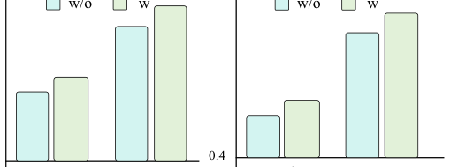
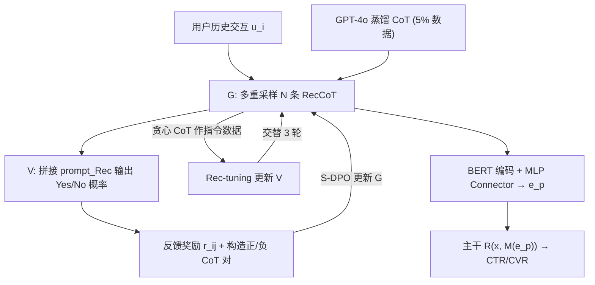
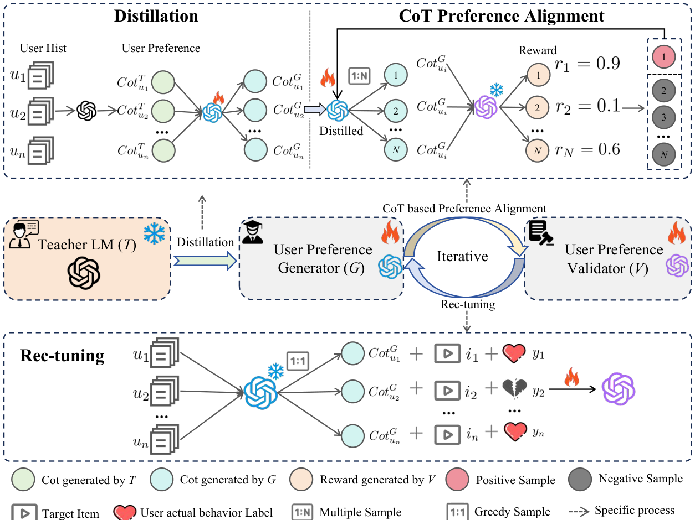

# TrackRec: Iterative Alternating Feedback with Chain-of-Thought via Preference Alignment for Recommendation (基于偏好对齐与迭代交替反馈的思维链推荐框架)

- **会议/期刊**: DASFAA 2026
- **作者与机构**: Yu Xia, Rui Zhong, Zeyu Song, Wei Yang, Junchen Wan, Qingpeng Cai, Chi Lu, Peng Jiang（中国科学院大学 / 快手科技）
- **推荐链路定位**: 精排（CTR/CVR 侧信息特征增强，非端到端生成式排序）
- **研究方向**: 大语言模型推荐 / CTR 预估与特征交叉
- **论文原文**: [https://arxiv.org/abs/2508.15388v1](https://arxiv.org/abs/2508.15388v1)
- **开源代码**: 暂未开源

## TL;DR (1分钟核心速览)

LLM 直接做推荐时 CoT 推理常幻觉、7B 小模型推理弱，且大模型在线延迟不可接受。TrackRec 把"用 LLM 做推荐"拆成 **RecCoT 生成器 $G$** 与 **RecCoT 验证器$V$**：$G$多重采样出$N$条用户偏好摘要，$V$以真实点击标签给出反馈奖励，$G$用 S-DPO 对齐、$V$ 用 G 的贪心 CoT 做指令微调，交替迭代 3 轮；最终 CoT 经 BERT+MLP 接入 DIN/AutoInt 等主干作为额外特征域。在 MovieLens/Amazon-Book 上对 7 个 CTR 主干与 Qwen-7B 全线 AUC 提升 0.6%–1.8%，线上 A/B（14 天）增收 2.3%、CVR +1.6%。

## Background & Motivation (背景与核心矛盾)

- **主流范式**: 一类工作让 LLM 直接当推荐器（TALLRec、CoLLM、BinLLM 做指令微调/映射 ID 到 token 空间），另一类让 LLM 当"侧信息推理器"（KAR 等生成用户画像喂给传统模型）。
- **前人局限 1（CoT 不可靠）**: LLM 生成空间与推荐标签空间未对齐，CoT 可能自洽但违背真实反馈；且缺少"参考 CoT"可供监督，无法直接 SFT。
- **前人局限 2（小模型推理弱 / 大模型延迟高）**: 7B 级模型 zero-shot 推理质量随参数规模骤降，而 130B 级模型单样本推理远超推荐系统可承受延迟。
- **核心洞察 (Key Insight)**: 图 1 显示，仅加入用户偏好摘要（RecCoT）就能在 zero-shot/SFT 下把推荐 AUC 从 0.78 抬到 0.84 量级——**CoT 的价值在于"是否被推荐任务验证"，而非"是否语言通顺"**；因此可以用下游 recommender 当裁判，把偏好对齐问题转化成验证器反馈驱动的偏好优化问题。
- **本文切入点**: 把 CoT 质量判定权交给一个与推荐任务同分布的验证器 $V$，用$V$的 Yes/No 概率当 reward，构造正/负 CoT 对，迭代互训$G$与$V$。

<figure class="paper-figure" markdown="span">
  <figcaption>图 1：当 LLM 直接用作推荐器时，引入用户偏好（Rec-CoT）对其推荐性能的影响。w/o 和 w 分别表示不含和含 RecCoT。</figcaption>
</figure>

## Method (核心方法设计)

### 1. 整体框架 (Overall Architecture)

输入为用户历史交互 $u_i$与候选物品$i_i$。四个阶段闭环：(a) **Distillation**：用 GPT-4o 按$prompt_{CoT}$生成 CoT 与 prompt 拼接，仅取约 5% 数据微调$G$（Qwen2.5-7B）以初始化推理能力；(b) **CoT Preference Alignment**：$G$以$t=1, top\_p=0.9$多次采样$N=10$条 CoT，逐条塞入$V$的$prompt_{Rec}$得到奖励，用 S-DPO 更新$G$；(c) **Rec-tuning**：对齐后的$G$贪心解码 CoT，与$prompt_{Rec}$、标签组成指令数据微调$V$；(d) **偏好利用**：$G$的最终 CoT 经 BERT 编码 + MLP connector 投影为稠密特征$e_p$，与 ID 特征显式交叉送入主干$R$。训练侧$G/V$ 交替 3 轮，推理侧对活跃用户离线算一次 CoT，线上仅走主干前向。

<figure class="paper-figure" markdown="span">
  <figcaption>图 3：TrackRec 的架构，由推荐思维链（RecCoT）生成器 𝐺 和 RecCoT 验证器 𝑉 组成，并包含四个过程：蒸馏、CoT 偏好对齐、Rec-tuning 和迭代交替反馈学习。</figcaption>
</figure>

### 2. 关键设计拆解 (Key Designs)

1. **验证器反馈奖励（把 CoT 优劣变成可优化的标量）**：痛点是无参考 CoT、无人工标注。做法是 $V$在$prompt_{Rec}$ 下输出 Yes/No 概率并归一化，再按真实标签取对应侧概率：
$r_{ij}=p_{T,ij}\ \text{if}\ y_i=\text{Yes},\quad r_{ij}=p_{F,ij}\ \text{if}\ y_i=\text{No}$其中$p_{T,ij}=\frac{p_{T,ij}}{p_{T,ij}+p_{F,ij}}$。直觉：**用"能否帮助判对标签"作为 CoT 的效用函数**，天然与推荐目标同向，且无需外部标注。

2. **S-DPO 偏好对齐（多负样本而非一对一）**：一次采样天然产出 1 正 $N-1$ 负的偏序结构，正好匹配 Softmax-DPO：
$\mathcal{L}_{S\text{-}DPO}=-\log\sigma\Big(-\log\!\!\sum_{Cot_d\in C_{\varepsilon}}\!\exp\big(\beta\log\tfrac{\pi_\theta(Cot_d|u_i)}{G(Cot_d|u_i)}-\beta\log\tfrac{\pi_\theta(Cot_p|u_i)}{G(Cot_p|u_i)}\big)\Big)$相比两两 DPO，把全部$N-1$ 条负例压进同一 softmax 分母，梯度信号更密集，抑制"只比最差那条好"的伪对齐。

3. **Rec-tuning 与偏好特征接入**：$V$以$\mathcal{L}_V=y_i\log V(u_i,i_i,G(u_i))+(1-y_i)\log(1-V(u_i,i_i,G(u_i)))$微调，使验证器分布贴近推荐任务；主干侧$e_p=\mathrm{Agg}(\mathrm{Encoder}(G(u_i)))$、$\hat{y}=R(x,M(e_p))$，connector$M$ 与主干以 BCE 联合优化，完成"语义空间→推荐空间"的降维对齐。

4. **训练目标、负采样与推理效率**：总损失为 $\mathcal{L}_{S\text{-}DPO}$（训$G$）+$\mathcal{L}_V$（训$V$）交替；负样本完全来自$G$的多重采样排序（免 in-batch、免 hard-negative 挖掘）。$N=10$、迭代$T=3$、AdamW 学习率$1e^{-5}$。推理上 Table 5a 显示单样本 1303ms（Qwen-7B 直接推）降至 613ms，训练 524ms/样本——对齐后 CoT 更短，冗余 token 生成被显著削减。

## Experimental Setup & Evaluation Protocol (实验设置与评估协议)

- **数据集与预处理**（沿用 CoLLM 的标签处理、数据筛选与划分，训练集随机抽小比例样本做蒸馏初始化）：

| 数据集 | #Users | #Items | #Train | #Valid | #Test | 说明 |
| :--- | :---: | :---: | :---: | :---: | :---: | :--- |
| Amazon-Book | 22,967 | 34,154 | 727,468 | 25,747 | 25,747 | 影评视作交互，按用户时间排序 |
| MovieLens | 839 | 3,256 | 33,891 | 10,401 | 7,331 | 含用户/物品文本 |
| 工业广告平台 | 亿级 | 百万广告 | 曝光日志采样 | — | — | 14 天在线 A/B，实验/对照桶各 >10% 流量 |

- **数据划分与防穿越**: 公共集为**比例划分**（train/valid/test 独立），工业集按曝光日志时间切分，无未来交互泄漏。
- **排名评测协议**: 本文任务为 CTR/CVR **点击率点估计**（AUC / ACC / LogLoss），非 Full-Ranking 全库排序，也无采样负例排序指标；工业集额外报告 Revenue 与 CVR 的线上桶间对比。
- **对比基线与超参设置**: 主干选 AutoInt / DeepFM / FiGNN / FiBiNet / DCN / DIN / DIEN 与 Qwen-7B；LLM 基线分两类——LLM as Rec（TALLRec、LLM-REC、CoLLM、BinLLM、RLPF）与 LLM improve Rec（KAR、RLPF+DIN）。$G,V$均为 Qwen2.5-7B，教师为 GPT-4o，$N=10$、$top\_p=0.9$、$T=3$；显著性用$t$-test，$p<0.001$（表中 `*`）。

## Key Experimental Results (实验关键数据)

### 1. 主实验对比 (Main Results)

模型无关增益（7 个 CTR 主干 + Qwen-7B 直接当推荐器，`+x%` 为 Our 相对 Base 的 AUC 提升）：

| Model | Amazon AUC (Base→Our) | Amazon ACC | ML AUC (Base→Our) | ML ACC |
| :--- | :---: | :---: | :---: | :---: |
| AutoInt | 0.8071→**0.8163** (+1.14%) | 0.7445→0.7482 | 0.7553→**0.7628** (+0.99%) | 0.6877→0.6918 |
| DeepFM | 0.8086→**0.8163** (+0.95%) | 0.7451→0.7464 | 0.7556→**0.7668** (+1.48%) | 0.6868→0.6974 |
| FiGNN | 0.8066→**0.8188** (+1.51%) | 0.7437→0.7448 | 0.7575→**0.7688** (+1.49%) | 0.6910→0.6972 |
| FiBiNet | 0.8077→**0.8189** (+1.39%) | 0.7442→0.7511 | 0.7560→**0.7691** (+1.73%) | 0.6892→0.6992 |
| DCN | 0.8085→**0.8181** (+1.19%) | 0.7453→0.7505 | 0.7563→**0.7696** (+1.76%) | 0.6899→0.6954 |
| DIN | 0.8002→**0.8125** (+1.54%) | 0.7400→0.7428 | 0.7621→**0.7729** (+1.42%) | 0.6879→0.6996 |
| DIEN | 0.8030→**0.8142** (+1.39%) | 0.7422→0.7453 | 0.7608→**0.7710** (+1.34%) | 0.6896→0.6980 |
| Qwen-7B as Rec | 0.8318→**0.8368** (+0.60%) | 0.7563→0.7607 | 0.7762→**0.7887** (+1.61%) | 0.7011→0.7143 |

与 LLM 类推荐器对比（AUC，Rel.Impr. 为 TrackRec 相对各基线的提升）：

| 方法 | 设置 | Amazon-Book | Rel.Impr. | MovieLens | Rel.Impr. |
| :--- | :--- | :---: | :---: | :---: | :---: |
| TALLRec | zero-shot, LLM as Rec | 0.4857 | 72.28% | 0.5612 | 40.53% |
| LLM-REC | zero-shot, LLM as Rec | 0.4820 | 73.61% | 0.5320 | 48.25% |
| CoLLM | sft, LLM as Rec | 0.8245 | 1.49% | 0.7296 | 8.10% |
| BinLLM | sft, LLM as Rec | 0.8264 | 1.29% | 0.7425 | 6.22% |
| RLPF | RL, LLM as Rec | 0.8271 | 1.17% | 0.7855 | 0.41% |
| KAR | zero-shot, LLM improve Rec (DIN) | 0.8048 | 0.96% | 0.7649 | 1.04% |
| RLPF | RL, LLM improve Rec (DIN) | 0.8046 | 0.98% | 0.7695 | 0.44% |
| **TrackRec** | — | **0.8368*** | — | **0.7887*** | — |

工业线上（14 天 A/B）：全量 AUC 0.8335→**0.8363**，收入 **+2.3%**、CVR **+1.6%**；长尾桶 AUC 0.8172→**0.8232**，收入 **+4.2%**、CVR **+1.7%**（$p<0.001$）。延迟：QPS 从 100 升到 1000，线上耗时 20.0→21.6ms，与基线 20→21.5ms 几乎无异。

### 2. 消融实验 (Ablation Study)

| 变体 | Amazon DIN AUC | Amazon Qwen AUC | ML DIN AUC | ML Qwen AUC |
| :--- | :---: | :---: | :---: | :---: |
| w/o 偏好对齐 $M_c$ | 0.8002 | 0.8318 | 0.7621 | 0.7762 |
| **w/ $M_c$** | **0.8068*** | **0.8339*** | **0.7695*** | **0.7855*** |
| w/o 蒸馏 $M_d$ | 0.8002 | 0.8318 | 0.7621 | 0.7772 |
| **w/ $M_d$** | **0.8019*** | **0.8333*** | **0.7667*** | **0.7817*** |
| 迭代 0 轮 | — | 基线 | — | 基线 |
| 迭代 3 轮 | +1.56% | +0.60% | +0.81% | +0.90% |

### 3. 关键实验发现 (Key Findings)

1. **$M_c$（偏好对齐）是最大功臣，且对弱主干更有效**：DIN 上 AUC 提升 +0.82%（Amazon）/ +0.97%（ML），而 Qwen-7B 直接作推荐器仅 +0.25% / +1.19%。说明传统 ID 模型本身缺乏用户语义画像，CoT 特征补的是"语义空洞"；LLM 本身已含语义，边际收益更小。
2. **迭代收益单调但递减，2–3 轮即饱和**：Amazon DIN 从 0→3 轮累计 +1.56%，MovieLens 上 Qwen/DIN 各 +0.90%/+0.81%，第 3 轮后曲线趋平（图 5），印证 $G$–$V$ 互训存在"验证器能力上限"约束，继续迭代会导致奖励信号自洽过拟合。
3. **CoT 的真实价值在长尾而非头部**：线上长尾桶增益（收入 +4.2%、CVR +1.7%）显著高于全量桶（+2.3%/+1.6%），定量支持"LLM 世界知识可补偿 ID 类模型冷启动/稀疏估计短板"这一因果解释，而非单纯特征增强。

## Highlights & Limitations (亮点、对比与审稿批判)

- **与代表作对比**: 与 TALLRec/CoLLM/BinLLM 的"LLM 直接输出推荐结果"不同，本文只让 LLM 输出**偏好摘要**，把打分权留给成熟主干，规避了 token 空间与推荐空间硬对齐的难题；与 KAR 等"一次性 prompt 抽取画像"相比，本文的 CoT 经过 $V$ 反馈的多轮偏好优化，是**可迭代自我纠错**的；与 RLPF 的 RLHF 路线相比，本文不依赖人工偏好对，奖励直接来自推荐标签，更贴合业务。
- **可迁移亮点**: (1) "生成器–验证器交替互训 + 多重采样 S-DPO"这套范式可平移到对话推荐的理由生成、序列推荐的兴趣摘要抽取；(2) 用真实 label 反推 CoT 效用的 reward 设计，可替代昂贵的 LLM-as-Judge 打分。
- **审稿级局限批判**: (1) **奖励信号自洽风险**：$r_{ij}$完全来自$V$自身概率，$G$优化的目标与$V$ 的校准误差耦合，缺乏外部/人工锚点，长迭代下有 reward hacking 隐患；(2) **工业部署隐忧**：离线需 2×7B 模型推理且仅对活跃用户计算，冷启动新用户恰恰拿不到 CoT 特征，长尾增益的因果链条存在选择偏差；线上延迟报告为"总服务耗时"，未单列特征拉取与缓存命中率。此外表 7 中 Qwen ACC 0.7011→0.8047 明显为笔误，数值一致性需复核。

## Rating (四维评分)

- **方法创新性 (Novelty)**: ⭐⭐⭐⭐ （生成器–验证器交替反馈 + 多重采样 S-DPO，把 CoT 对齐转成推荐标签驱动的偏好优化，机制新颖但组件均为已有技术的精巧组合）
- **评估协议与实验扎实度 (Protocol & Experiments)**: ⭐⭐⭐⭐ （7 个主干 + 7 个 LLM 基线 + 14 天线上 A/B + 长尾分桶 + 效率测试，覆盖面强；但仅有 AUC/ACC 点估计，缺 Full-Ranking 排序指标与方差报告）
- **写作与数学规范度 (Clarity & Rigor)**: ⭐⭐⭐ （四阶段流程与算法伪代码清晰，但 S-DPO 公式排版存在冗余下标、Table 7 数值疑为笔误，符号 $M_c$/$M_d$ 与正文命名不完全统一）
- **工业落地与复现价值 (Industrial & Practical Value)**: ⭐⭐⭐⭐ （亿级广告平台实测 +2.3% 收入、延迟几乎无损，工程说服力强；但代码未开源，且依赖 GPT-4o 蒸馏数据，复现成本偏高）

