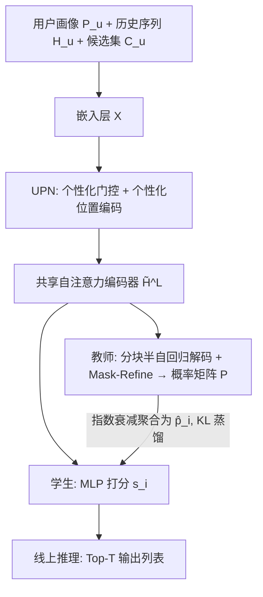

# Efficient Personalized Reranking with Semi-Autoregressive Generation and Online Knowledge Distillation (基于半自回归生成与在线知识蒸馏的高效个性化重排)

- **会议/期刊**: DASFAA 2026
- **作者与机构**: Kai Cheng, Hao Wang, Enhong Chen (中国科学技术大学), Wei Guo, Yong Liu (华为), Weiwen Liu (上海交通大学), Yawen Li (北京邮电大学)
- **推荐链路定位**: 重排 (Reranking, 精排之后的最终列表生成)
- **研究方向**: 多任务学习与列表级重排 / 生成式推荐
- **论文原文**: [https://arxiv.org/abs/2603.07107v1](https://arxiv.org/abs/2603.07107v1)
- **开源代码**: [https://github.com/rank2rec/rerank](https://github.com/rank2rec/rerank)

## TL;DR (1分钟核心速览)

生成式重排长期困于「自回归精度高但延迟大、非自回归快但列表不连贯」的两难，且用户画像与物品特征交互过浅。本文提出 PSAD：以**分块半自回归生成器为教师**（含 mask-and-refine 上下文增强）保证列表质量，同时**在线蒸馏**出一个轻量打分网络作为学生用于线上实时推理；再用**用户画像门控**与**个性化位置编码**把用户意图注入编码器底层。在 Ad / PRM Public / Avito 三套百万级数据上，PSAD-G 的 NDCG@10 相对最优基线提升 1.2%–2.1%，PSAD-S 推理耗时较教师模型降低约 49%。

## Background & Motivation (背景与核心矛盾)

- **主流范式**: 重排分为判别式（DLCM/PRM/SetRank 用 RNN/Transformer/GNN 建模候选集内上下文）与生成式（Seq2Slate、CRUM、PIER、NAR4Rec 直接「生成最优排列」）两条路线。
- **前人局限 1（质量-效率冲突）**: 自回归逐项生成精度高但推理慢且误差累积；非自回归并行生成快，却依赖强条件独立假设导致列表内部不自洽，补救手段（迭代精修、两阶段范式）又把省下的时间赔回去。
- **前人局限 2（用户-物品交互不足）**: 一类方法只把用户特征与物品特征简单拼接，无法刻画「同一物品在不同用户语义下的差异」；另一类只在高层隐层做后期交互，丢掉底层潜在关联。
- **核心洞察 (Key Insight)**: 生成器的排列知识本质是一个「物品-位置」概率矩阵，该矩阵可在训练中即时聚合成物品级分数，因此无需预训练教师即可把列表级知识在线压进轻量打分器。
- **本文切入点**: 用半自回归把生成步数从 $T$降到$\lceil T/K \rceil$，用共享编码器的在线蒸馏把推理复杂度从「生成」降为「一次 MLP 打分」，用 UPN 在编码器输入端就完成用户-物品深度融合。

## Method (核心方法设计)

### 1. 整体框架 (Overall Architecture)

输入为用户画像 $P_u$、长度为$N$的历史序列$H_u$与长度$M$的候选集$C_u$；先经嵌入层拼成物品矩阵$X\in\mathbb{R}^{(N+M)\times d_x}$，由 UPN 依据$P_u$重写为个性化表示$\hat{X}$并生成个性化位置偏置，再送入多层自注意力共享编码器得$\tilde{H}^L$。编码结果分两路：教师路用分块半自回归解码器 + mask-and-refine 生成「物品-位置」概率矩阵$P$；学生路用单层 MLP 打分$s_i$。两路共享编码器与同一优化器联合训练，教师概率矩阵经指数衰减聚合为软标签$\hat{p}_i$蒸馏给学生。线上仅部署学生网络，$O(M)$ 一次前向即完成排序。

### 2. 关键设计拆解 (Key Designs)

1. **分块半自回归生成 + 上下文增强**：痛点是非自回归一次性生成破坏列表内部依赖、自回归又太慢。做法是把目标长度 $T$切成块$I_b=\{(b-1)K+1,\dots,\min(bK,T)\}$，每步并行出$K$个 token，仅依赖前序块：$Y^l_{I_b}=\mathrm{CrossAttn}(H^l,Y^l_{<I_b})$；块内不一致再用随机掩码$|M|=\gamma$的 refine 修正：$Y'_{M}=\mathrm{CrossAttn}(H^l,Y_{\{1..T\}\setminus M})$。直觉是「块间保留自回归因果、块内用 refine 补回全局一致性」，把生成步数压缩$K$ 倍且抑制误差累积。

2. **在线知识蒸馏（共享编码器、无需预训练教师）**：生成器概率矩阵 $p_{ij}$先按位置做 softmax，再以$e^{-j}$衰减权重聚合成物品级软目标$\hat{p}_i=\sum_j \tilde{p}_{ij}e^{-j}/\sum_j e^{-j}$，使学生直接继承「越靠前越重要」的列表级偏好；蒸馏损失为$\mathcal{L}_{\text{Distillation}}=\mathrm{KL}\big(\mathrm{Softmax}(\hat{p}/\tau)\,\|\,\mathrm{Softmax}(s/\tau)\big)$。相比离线两阶段蒸馏，教师与学生同步进化，既省去预训练开销又避免静态知识的次优性。

3. **User Profile Network (UPN)**：门控分支用 stop-gradient 隔离物品侧梯度，只优化用户画像通路，加速收敛并防止物品表示被用户噪声污染：$G_1=\mathrm{MLP}_1(\oslash X,P_u)$，$G_2=\mathrm{GeLU}(\mathrm{MLP}_2(\oslash X,P_u))$，$\hat{X}=S\odot X,\ S=\sigma(\mathrm{MLP}(G_1\odot G_2))$；位置分支把统一衰减偏置改为用户自适应：$\hat{P}^l_{ij}=P^l_{ij}+\tanh(\mathrm{MLP}(\oslash P_u\oplus P^l_{ij}))$。

4. **训练目标、负采样与推理开销**：总损失 $\mathcal{L}=\mathcal{L}_{\text{gen}}+\mathcal{L}_{\text{scorer}}+\alpha\mathcal{L}_{\text{Distillation}}$，其中生成损失混合逐点交叉熵与列表 hinge，并按 DCG 权重$\omega_j=1/\log(j+1)$ 加权；打分器用标准交叉熵。任务为「候选集内全排列」监督，不做额外负采样。推理时教师需 beam search 逐块解码，学生仅一次 MLP 前向，故延迟大幅下降。

## Experimental Setup & Evaluation Protocol (实验设置与评估协议)

- **数据集与预处理**: 参照前人做法过滤交互记录少于 4 条的用户与物品（4-core 风格），并只保留至少有一次点击的用户。

| 数据集 | #Users | #Items | #Interactions | 特征/场景说明 |
| :--- | :---: | :---: | :---: | :--- |
| Ad | $1.06\times10^6$|$8.27\times10^5$|$2.04\times10^6$ | 广告曝光，9 个用户特征 + 6 个物品特征，5 分钟内交互聚为一个列表 |
| PRM Public | $7.44\times10^5$|$7.25\times10^6$|$1.44\times10^7$ | 3 个画像特征 + 5 类别 + 19 稠密特征 |
| Avito | $1.32\times10^6$|$2.36\times10^7$|$5.36\times10^7$ | 搜索日志，最近一次搜索页为预测目标，前序页为历史 |

- **数据划分与防穿越 (Splitting Strategy)**: 采用 `Leave-Last-List-Out` 式时序划分——最后一张交互列表作为预测目标，此前列表构建历史序列，严格避免未来信息泄漏。
- **排名评测协议 (Ranking Protocol)**: 候选集内 `Full-Ranking`（对给定候选列表整体排序，Ad/PRM 重排长度 10，Avito 候选仅 5 项），指标为 NDCG@K 与 MAP@K，Ad/PRM 取 $K=5,10$，Avito 取$K=5$；显著性用 Wilcoxon 符号秩检验（$p<0.05$）。
- **对比基线与超参设置**: 判别式基线 miDNN、DLCM、PRM；生成式基线 Seq2Slate、CRUM、PIER、NAR4Rec。稀疏特征嵌入维度 16，历史长度 50，批大小 256，Adam 优化器，Ad 候选长度 20 / lr $1\times10^{-4}$，PRM 候选长度 30 / lr$3\times10^{-5}$，Avito lr$3\times10^{-5}$。

## Key Experimental Results (实验关键数据)

### 1. 主实验对比 (Main Results)

| 数据集 | \multicolumn{3}{c}{Ad} | \multicolumn{3}{c}{PRM Public} | \multicolumn{2}{c}{Avito} |
| :--- | :---: | :---: | :---: | :---: | :---: | :---: | :---: | :---: |
| 指标 | N@5 | N@10 | M@10 | N@5 | N@10 | M@10 | N@5 | M@5 |
| miDNN | 0.6819 | 0.6952 | 0.6063 | 0.2620 | 0.3341 | 0.2954 | 0.6737 | 0.6838 |
| DLCM | 0.6857 | 0.6989 | 0.6100 | 0.2664 | 0.3395 | 0.3023 | 0.6912 | 0.7057 |
| PRM | 0.6872 | 0.7015 | 0.6117 | 0.2689 | 0.3430 | 0.3042 | 0.7047 | 0.7174 |
| Seq2Slate | 0.6916 | 0.7062 | 0.6155 | 0.2709 | 0.3449 | 0.3061 | 0.7245 | 0.7360 |
| PIER | 0.6940 | 0.7070 | 0.6158 | 0.2694 | 0.3423 | 0.3038 | 0.7156 | 0.7292 |
| NAR4Rec | 0.6965 | 0.7101 | 0.6188 | 0.2701 | 0.3455 | 0.3071 | 0.7315 | 0.7462 |
| **PSAD-G** | **0.7038** | **0.7184** | **0.6255** | **0.2762** | **0.3528** | **0.3136** | **0.7427** | **0.7561** |
| **PSAD-S** | 0.6962 | 0.7091 | 0.6185 | 0.2717 | 0.3464 | 0.3079 | 0.7285 | 0.7396 |
| Improv. (G vs. best) | +1.05% | +1.17% | +1.08% | +1.96% | +2.11% | +2.12% | +1.53% | +1.33% |

**效率对比（PRM Public，秒/步，批大小 256）**：PSAD-S 推理 0.2161s，仅为教师 PSAD-G（0.4239s）的约 51%，亦优于 NAR4Rec（0.3572s）与 Seq2Slate（0.5873s）；训练耗时 PSAD-S 0.5128s，远低于自回归 Seq2Slate 的 0.8384s，与非自回归 NAR4Rec（0.4649s）同量级。

### 2. 消融实验 (Ablation Study)

| 变体 | Ad N@10 | Ad M@10 | PRM N@10 | PRM M@10 | Avito N@5 | Avito M@5 |
| :--- | :---: | :---: | :---: | :---: | :---: | :---: |
| w/o sa（一次性生成） | 0.7095 | 0.6192 | 0.3455 | 0.3054 | 0.7145 | 0.7295 |
| w/o ce（去上下文增强） | 0.7133 | 0.6220 | 0.3482 | 0.3096 | 0.7231 | 0.7360 |
| w/o sace（两者皆去） | 0.7042 | 0.6139 | 0.3441 | 0.3052 | 0.7103 | 0.7217 |
| w/o ppe（去个性化位置编码） | 0.7168 | 0.6248 | 0.3523 | 0.3128 | 0.7384 | 0.7546 |
| w/o pg（去个性化门控） | 0.7136 | 0.6224 | 0.3507 | 0.3110 | 0.7402 | 0.7543 |
| **PSAD-G** | **0.7184** | **0.6255** | **0.3528** | **0.3136** | **0.7427** | **0.7561** |

### 3. 关键实验发现 (Key Findings)

1. **半自回归与上下文增强是互补而非冗余**：单独去掉任一模块（Ad N@10 降至 0.7095 / 0.7133）均不及两者同时去掉后的对照可比性——而同时去掉后跌至 0.7042，比仅去一项更低约 0.5–1.4 个千分点，说明分块保留了块间因果、refine 修复块内一致性，二者组合才能逼近全自回归质量。
2. **蒸馏的收益来自「教师类型 + 在线范式」双重选择**：以半自回归为教师的在线蒸馏在 Ad 上取得 0.7091 的 N@10，优于 AR 教师（0.7078）与 NAR 教师（0.7046）；而离线蒸馏虽达 0.7083，训练耗时却是在线版的 1.7 倍（0.6547s vs 0.3752s），印证在线蒸馏「边学边教」的效率优势。
3. **UPN 的增益随用户活跃度放大**：在按序列长度划分的前 20% 高活跃用户上，UPN 相对简单拼接与后期融合的 NDCG@10 提升显著高于低活跃用户群，说明充足的画像信号才能让门控与个性化位置衰减真正发挥作用；同时去掉 ppe / pg 分别损失约 0.16%–0.58%，其中 Avito 上 pg 的贡献（0.7402 vs 0.7427）小于 ppe（0.7384），提示位置衰减建模在短候选场景更关键。

## Highlights & Limitations (亮点、对比与审稿批判)

- **与代表作对比 (vs. Prior Work)**: 相比 NAR4Rec 的纯并行生成，本文用分块 + refine 在同等推理量级下补回列表依赖；相比 Seq2Slate 的逐项指针网络，训练与推理分别快约 39% / 28%；相比 PRM 这类判别式重排，PSAD-G 在 Ad N@10 上高出 2.4%，且通过蒸馏把线上成本压回判别式水平。
- **可迁移亮点**: (1) 「概率矩阵按位置指数衰减聚合成物品级软标签」是一种通用的列表级→点级知识压缩算子，可迁移到任何 set-to-list 生成模型；(2) stop-gradient 门控只优化用户侧参数，是低成本注入画像特征、避免污染物品表示的实用技巧。
- **审稿级局限批判**: (1) 效率优势高度依赖批大小，批大小 256 时 PSAD-S 推理（0.2161s）反而略慢于 PRM（0.2037s），论文的「超越复杂判别式模型」结论在小批量下才严格成立；(2) 评估仅覆盖效用型指标（NDCG/MAP）与候选集内全排序，未涉及多样性/公平性目标，也未报告在线 A/B 与真实 QPS 压力测试，工业落地证据仍不充分。

## Rating (四维评分)

- **方法创新性 (Novelty)**: ⭐⭐⭐⭐ （半自回归教师 + 在线蒸馏的组合在重排场景首次系统化，UPN 的门控与个性化位置编码有新意，但组件本身多为已有技术的巧妙拼装）
- **评估协议与实验扎实度 (Protocol & Experiments)**: ⭐⭐⭐⭐ （三套百万级公开数据、7 个强基线、显著性检验与效率/蒸馏/活跃度多维分析齐全，欠缺线上验证与多目标指标）
- **写作与数学规范度 (Clarity & Rigor)**: ⭐⭐⭐⭐ （公式链条完整、损失设计与直觉解释清楚，但 Eq.6 的 hinge 项符号书写与部分符号上下标略欠严谨）
- **工业落地与复现价值 (Industrial & Practical Value)**: ⭐⭐⭐⭐⭐ （共享编码器在线蒸馏几乎零额外训练成本，学生网络一次 MLP 前向即可上线，代码已开源，工程可复现性强）

