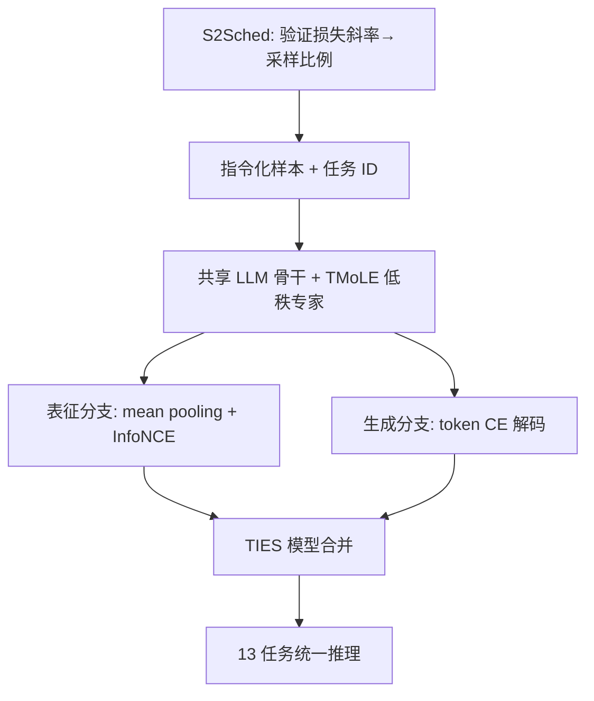
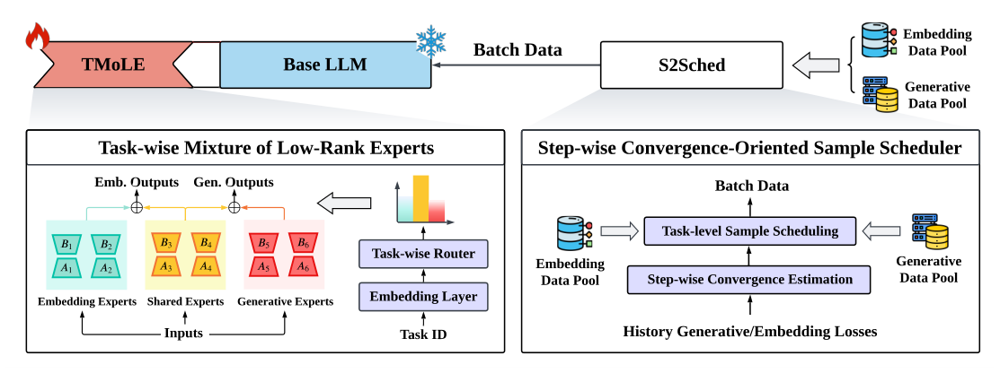

# Generative Representational Learning of Foundation Models for Recommendation (面向推荐的基座模型生成-表征统一学习)

- **会议/期刊**: DASFAA 2026（预印本 arXiv:2506.11999v3）
- **作者与机构**: Zheli Zhou, Jianghao Lin, Weinan Zhang 等（上海交通大学）；Chenxu Zhu, Bo Chen, Ruiming Tang（华为诺亚方舟实验室）
- **推荐链路定位**: 端到端生成式 + 表征召回（统一骨干，同时服务 embedding 检索与生成式任务）
- **研究方向**: 多任务学习与列表级重排 / LLM4Rec
- **论文原文**: [https://arxiv.org/abs/2506.11999v3](https://arxiv.org/abs/2506.11999v3)
- **开源代码**: 论文与项目页 (https://junkfood436.github.io/RecFound/) 声称开源，但正式代码仓库暂未检出，暂未开源

## TL;DR (1分钟核心速览)

现有推荐基座模型只做生成任务、忽略对召回至关重要的表征（embedding）任务，且多任务微调时遭受任务间知识冲突与收敛速度不一致。本文首次构造覆盖 3 个表征任务 + 10 个生成任务的 RecFound 数据集，并提出 TMoLE（任务级低秩专家 + 掩码路由）、S2Sched（按任务未收敛率动态重分配 batch 内采样比例）与 TIES 模型合并。在 Mistral-7B 骨干上，RecFound 于 13 个任务的**平均排名**从最优基线 eCeLLM 的 3.20 降至 1.30，User2Item 表征 MRR@20 由 0.439 提升到 0.570（+29.8%）。

## Background & Motivation (背景与核心矛盾)

- **主流范式**: 以 GritLM 为代表的"生成-表征指令微调"（同一 LLM 用指令区分两种模式），以及 eCeLLM / LLaMA-E 等电商场景生成式基座模型，靠大规模指令数据把多任务塞进一个模型。
- **前人局限**: ① 上述工作完全不做 embedding 任务，而召回/检索质量依赖高质量用户与物品表征；② 多任务联合训练存在**知识共享与冲突**（生成任务的 token 级 CE 与表征任务的 InfoNCE 梯度方向互斥）和**收敛速度不一致**（简单任务迅速过拟合、难任务长期欠拟合），单纯共享骨干必然遭遇跷跷板效应。
- **核心洞察 (Key Insight)**: 作者发现按任务类型（表征/生成）以及任务语义簇（General NLP / User Understanding / Item Understanding）划分的"子网络"能自然解耦梯度；同时任务的验证损失斜率（而非损失绝对值）是可靠的收敛状态信号——当任务接近收敛时该斜率趋于 0。
- **本文切入点**: 在**模型侧**用任务级掩码 MoE 做硬性知识分流，在**数据侧**用非收敛率重排 batch 内任务配比，最后在**参数侧**用 TIES-Merging 消除跨任务更新方向冲突。

## Method (核心方法设计)

### 1. 整体框架 (Overall Architecture)

所有原始样本统一改写为 instruction-response 指令对。表征分支输入加 `<|embed|>` 起始符，取最后一层隐状态**均值池化**得向量，用 InfoNCE 训练，覆盖 U2I/Q2I/I2I；生成分支用 token 级交叉熵训练，覆盖通用 NLP、用户理解与物品理解共 10 个任务。两支**共享同一 Mistral-7B 骨干**、梯度联合回传，每个 Transformer 层的 Q/K/V/O 投影上挂载 TMoLE 低秩专家。训练过程由 S2Sched 依据各任务验证损失斜率每步重分配 batch 预算，训练结束后对多个任务的低秩专家做 TIES 合并得到最终权重。推理时表征任务只跑一次前向取池化向量，生成任务自回归解码（上限 2048 token）。

<figure class="paper-figure" markdown="span">
  <figcaption>图1：RecFound 方法。在 TMoLE 结构中，我们假设分别使用 2 个嵌入专家、2 个共享专家和 2 个生成专家。</figcaption>
</figure>

### 2. 关键设计拆解 (Key Designs)

1. **任务级低秩专家 TMoLE（解知识冲突）**：传统 token 级 MoE 按 token 路由，无法阻止生成任务的梯度污染表征子空间。TMoLE 把每个投影的 $N=6$个 LoRA 专家分为表征专家$\mathcal{E}$、生成专家$\mathcal{G}$、共享专家$\mathcal{S}$（各 2 个），路由输入是**任务 ID 的嵌入**$e_i$ 而非 token，并用掩码屏蔽异类专家：

$$v_i=\mathrm{Softmax}\big(\mathrm{Mask}(\mathrm{MLP}(e_i))\big),\quad o=W_0x+\sum_{j=1}^{N}v_{i,j}A_jB_jx$$

   其中 $\mathrm{Mask}(\cdot)$给无关任务维度赋$-\infty$，例如生成任务路由时表征专家门控恒为 0。直觉：共享专家负责跨任务泛化，专属专家吸收类内知识，掩码硬隔离彻底切断异类任务的梯度路径，而低秩分解$r=16\ll d$ 使额外参数与显存几乎可忽略。

2. **步进收敛感知采样器 S2Sched（解收敛不一致）**：直接对不同量纲的 InfoNCE 与 CE 做损失重加权会导致训练震荡，故改为**改数据不改损失**。对每个任务 $i$，用最近$L=64$步验证损失斜率$\alpha_i(t)$估计两类未收敛率：类间$\gamma^{\text{inter}}_{i,b}(t)=-\mathrm{Softmax}_i\big(|\mathcal{T}^{(b)}|\alpha_i(t)/\sum_i|\alpha_i(t)|\big)$，类内$\gamma^{\text{intra}}_{i,b}(t)=\mathrm{Softmax}_i\big(-L\alpha_i(t)/\sum_s|\alpha_i(s)|\big)$，再用平衡权重$\beta_b(t)$ 插值并归一化成本 batch 采样比：

$$\omega_{i,b}(t)=\mathrm{Softmax}_i\Big(-\beta_b(t)\gamma^{\text{inter}}_{i,b}(t)-(1-\beta_b(t))\gamma^{\text{intra}}_{i,b}(t)\Big)$$

   每步按 $n_i^{(b)}(t)=\lfloor B^{(b)}\cdot\omega_{i,b}(t)\rfloor$ 从各任务池无放回均匀采样。收敛快的任务被减配比、慢的被增配比，且权重会"回落—回升"交替，避免过度冷落已收敛任务造成遗忘。表征与生成分支各自维护独立 batch（2048 / 1024）与估计器，规避损失量级差异干扰。

3. **训练目标与模型合并**：总损失 $\mathcal{L}=\mathcal{L}_{\text{InfoNCE}}+\mathcal{L}_{\text{CE}}$，负样本取 in-batch 负采样（无额外难负样本挖掘）。合并阶段用 TIES-Merging 对各任务检查点的低秩增量执行"裁剪小幅更新 → 多数投票消解方向冲突 → 仅对一致方向取平均"，以缓解跷跷板效应。

## Experimental Setup & Evaluation Protocol (实验设置与评估协议)

| 任务组 | 任务 | #Train | #Test | 指标 |
| :--- | :--- | :---: | :---: | :--- |
| 表征 | U2I / Q2I / I2I | 86,000 / 40,000 / 83,680 | 4,800 / 4,000 / 4,800 | MRR@20 / MRR@20 / NDCG@20 |
| 通用 NLP | QR / AVE / AG | 3,260 / 20,000 / 20,000 | 124 / 1,334 / 1,332 | F1 |
| 用户理解 | SR / SA / UP / AP | 各 20,000 | 1,334 / 227 / 1,334 / 1,333 | R@1 / F1×3 |
| 物品理解 | PRP / PM / IP | 15,000 / 4,000 / 15,000 | 1,333 / 168 / 266 | F1 |
| 合计 | 13 任务 | 366,940 | 22,383 | — |

- **数据来源与过滤**: 由 Amazon Reviews、Shopping Queries、ECInstruct、MuDoCo、AmazonQA、MovieLens、Amazon-Google Products 等真实交互清洗而来，剔除非法符号/错误/缺字段样本，**未采用 5-core 过滤**，各任务按固定比例独立划分训练/验证/测试（非 Leave-One-Out、非时间戳切分）。
- **排名评测协议 (Ranking Protocol)**: **非 Full-Ranking**。检索类任务按 NDCG@20 / MRR@20 在给定测试集合内排序；SR 采用**选项式打分**——从 6–7 个候选项中输出最可能的下一个物品计 Recall@1，候选池远小于全库，属强约束下的 Sampled 评测；其余生成任务用 F1 词级重叠，评估时最多生成 2048 token，基线全部 zero-shot（无 few-shot 模板）。
- **基线**: 未微调（Llama3-8B、Mistral-7B、Mixtral-8x7B、Qwen2.5-7B/14B/32B、GritLM-7B、eCeLLM-L、gte-Qwen2-7B、SFR-Embedding-Mistral、bge-large-en-v1.5）与微调组（GritLM、eCeLLM、Embed.Only）。骨干 Mistral-7B-Instruct，LoRA $r=16,\alpha=64$，lr$2\times10^{-5}$，AdamW，S2Sched 预热 10%、$\tau=10$、每步抽 128 条验证样本估斜率。原文未报告显著性检验。

## Key Experimental Results (实验关键数据)

### 1. 主实验对比 (Main Results)

生成任务（F1 / R@1，**粗体为最优**，Avg.Rank 越小越好）：

| 模型 | QR | AVE | AG | SR | SA | UP | AP | PRP | PM | IP | Avg.Rank↓ |
| :--- | :---: | :---: | :---: | :---: | :---: | :---: | :---: | :---: | :---: | :---: | :---: |
| Qwen2.5-7B-Instruct | 0.952 | 0.000 | 0.834 | 0.027 | 0.448 | 0.872 | 0.383 | 0.208 | 0.215 | 0.881 | 8.60 |
| Qwen2.5-32B-Instruct | 0.961 | 0.000 | 0.828 | 0.128 | 0.466 | 0.872 | 0.488 | 0.212 | 0.373 | 0.887 | 7.70 |
| GritLM-7B | 0.960 | 0.000 | 0.840 | 0.000 | 0.227 | 0.868 | 0.285 | 0.219 | 0.491 | 0.881 | 8.70 |
| eCeLLM-L | 0.943 | 0.002 | 0.843 | 0.177 | 0.362 | 0.848 | 0.812 | 0.361 | 0.994 | 0.857 | 6.70 |
| eCeLLM (FT) | 0.973 | 0.315 | 0.841 | **0.251** | 0.532 | 0.878 | 0.821 | 0.450 | 0.967 | 0.888 | 3.20 |
| GritLM (FT) | 0.973 | 0.316 | 0.839 | 0.242 | 0.501 | 0.874 | 0.814 | 0.426 | 0.967 | 0.889 | 4.10 |
| RecFound w/o M.M. | **0.974** | 0.341 | **0.853** | 0.234 | **0.545** | **0.895** | 0.827 | **0.471** | 0.988 | 0.902 | 1.80 |
| **RecFound** | 0.973 | **0.344** | **0.853** | **0.251** | 0.533 | **0.895** | **0.830** | 0.462 | **0.994** | **0.903** | **1.30** |

表征任务：

| 模型 | Item Emb (NDCG@20) | Query Emb (MRR@20) | User Emb (MRR@20) | Avg.Rank↓ |
| :--- | :---: | :---: | :---: | :---: |
| bge-large-en-v1.5 | 0.799 | 0.957 | 0.419 | 8.33 |
| gte-Qwen2-7B-Instruct | 0.806 | 0.975 | 0.431 | 6.00 |
| SFR-Embedding-Mistral | 0.805 | 0.974 | 0.419 | 7.00 |
| GritLM-7B | 0.823 | 0.985 | 0.458 | 2.67 |
| Embed.Only (单任务微调) | 0.819 | 0.983 | 0.447 | 4.67 |
| GritLM (FT) | 0.820 | 0.985 | 0.439 | 4.00 |
| RecFound w/o M.M. | 0.821 | 0.987 | **0.573** | 2.00 |
| **RecFound** | **0.824** | **0.988** | 0.570 | **1.33** |

> 相对提升：AVE 较 GritLM(FT) 提升 **+8.9%**（0.316→0.344），AP **+2.7%**，UP **+1.9%**；User Emb 较 GritLM(FT) 提升 **+29.8%**（0.439→0.570），且**超过只微调表征的 Embed.Only**（0.447）。生成 Avg.Rank 3.20→1.30（相对改善 59%）。

### 2. 消融实验 (Ablation Study)

| 模型变体 | 生成 (Avg.) | 表征 (Avg.) |
| :--- | :---: | :---: |
| RecFound（全模块） | **0.704** | **0.775** |
| w/o Model Merge | 0.703 | 0.775 |
| w/o M.M. & S2Sched | 0.679 | 0.762 |
| w/o M.M. & TMoLE（退化为纯 LoRA） | 0.678 | 0.759 |
| w/o M.M. & S2Sched & TMoLE | 0.684 | 0.748 |

### 3. 关键实验发现 (Key Findings)

1. **TMoLE 是最大功臣，且主要收益在"难任务"上**：退化到统一 LoRA 后生成均值掉 0.026（0.704→0.678），逐任务看 AVE 从 0.344 崩至 0.264（−23%）、AP 0.462→0.385，而简单任务 QR 几乎不动（0.973→0.966），说明专家隔离主要救的是与表征任务梯度冲突最强的抽取/推理类任务。
2. **S2Sched 的收益独立且与 TMoLE 互补**：单独去掉 S2Sched（保留 TMoLE）生成掉 0.025，表征掉 0.013；图 3 显示各任务采样比呈**此消彼长的振荡**而非单调收敛，验证了"防止已收敛任务被长期冷落而遗忘"的设计意图。
3. **模型合并是"均衡器"而非"增益器"**：加 M.M. 后生成均值仅 +0.001、表征均值持平，但**平均排名**由 1.80 降至 1.30（标准差 0.98→0.46），个别任务（SR 0.234→0.251、PM 0.988→0.994）上升而 SA 略微回退（0.545→0.533），说明 TIES 合并的真实价值在于压缩跨任务方差而非抬高均值。

## Highlights & Limitations (亮点、对比与审稿批判)

- **与代表作对比 (vs. Prior Work)**: 相比 GritLM 的"指令区分 + 全参数共享"，本文用**任务 ID 驱动的掩码路由**做硬隔离，避免两类损失在同一子空间互相拉扯；相比 eCeLLM 只覆盖生成任务，本文首次把 U2I/Q2I/I2I 纳入统一训练，User Emb 提升 29.8% 正是这一覆盖的直接回报；相比 TaskMoE/DoRA 等 PEFT-MoE，本文的关键增量是"低秩专家分组 + 任务级掩码 + 与采样调度/模型合并的联合设计"。
- **可迁移亮点**: ① 用**验证损失斜率**而非损失值来衡量任务收敛并直接改写 batch 采样配比，可无痛迁移到任何多目标精排/多场景联合训练；② 按任务类型给 MoE 路由加 $-\infty$ 掩码，是低成本抑制梯度冲突的通用手段。
- **审稿级局限批判**: ① **评测协议偏弱**：SR 仅在 6–7 个候选项中选 1（Recall@1），未做全库 Full-Ranking，F1 词级重叠也无法反映推荐的排序质量，指标与真实线上收益之间存在明显 gap；数据集自建自评、无公开 leaderboard 交叉验证，且未报告显著性检验。② **工程与泛化成本**：TMoLE 需为每层 4 个投影各挂 6 个低秩专家并逐步计算 128 条验证样本的损失斜率（相当于每步多一次多任务前向），训练开销显著；模型合并需保存多任务检查点，且论文自承对任务数据不均衡敏感、不支持任务持续扩展（continual task expansion）。

## Rating (四维评分)

- **方法创新性 (Novelty)**: ⭐⭐⭐⭐ （任务级掩码低秩 MoE + 收敛斜率驱动采样 + TIES 合并的三位一体设计务实且互补，但单点技术均为已有模块的组合，缺少理论刻画）
- **评估协议与实验扎实度 (Protocol & Experiments)**: ⭐⭐⭐ （13 任务覆盖广、基线含 32B 大模型值得肯定，但 SR 仅 7 候选、无 Full-Ranking、无显著性检验，自建数据集自评削弱说服力）
- **写作与数学规范度 (Clarity & Rigor)**: ⭐⭐⭐⭐ （TMoLE 与 S2Sched 公式链条完整、超参与掩码语义交代清楚，路由与采样的可视化分析到位；总损失与负采样细节略简）
- **工业落地与复现价值 (Industrial & Practical Value)**: ⭐⭐⭐⭐ （低秩专家参数量可控、表征分支推理即一次前向，可直接服务召回；但每步验证集估斜率与多检查点合并的工程成本需额外优化，代码仓库尚未实际放出）

