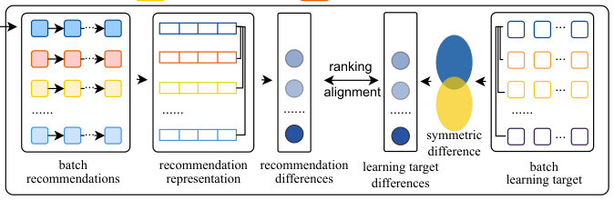
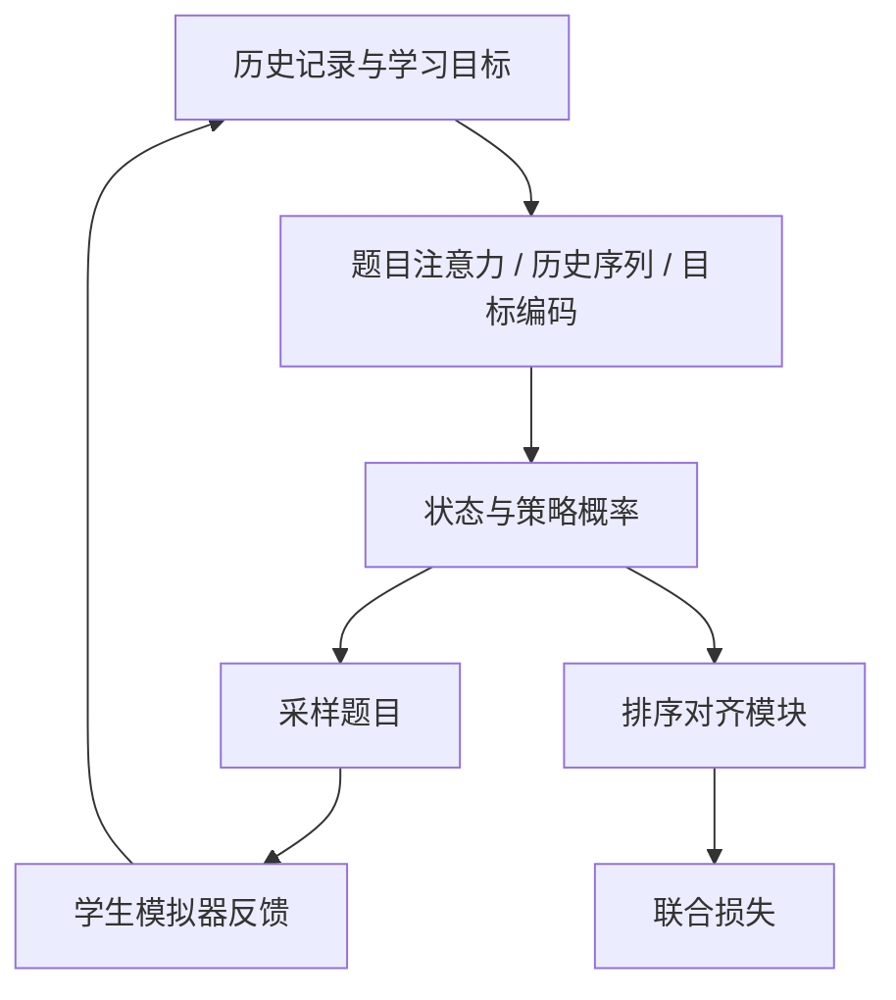

# Personalized Education with Ranking Alignment Recommendation (面向个性化教育的排序对齐推荐)

- **会议/期刊**: DASFAA 2026
- **作者与机构**: Haipeng Liu, Yuxuan Liu, Ting Long；吉林大学人工智能学院
- **推荐链路定位**: 端到端策略学习 / 训练探索（非传统召回-精排）
- **研究方向**: 强化学习与动态探索推荐 / 序列推荐
- **论文原文**: [论文原文链接](https://arxiv.org/abs/2507.23664v1)
- **开源代码**: [开源代码仓库链接](https://github.com/wuming29/RAR.git)

## TL;DR (1分钟核心速览)

RAR 针对 RL 题目推荐在百万级题库/学生规模下 $\epsilon$-greedy 探索低效的问题，把协同先验引入探索：用学习目标对称差度量学生差异，用推荐概率序列度量推荐差异，并以排序对齐损失约束二者单调一致。在 KSS 与四个 DKT/IEKT 模拟器中，$t=30$ 时 RAR-S 于 KSS/DKTJU/DKTA09 分别提升 29.4%/770.7%/35.8%。

## Background & Motivation (背景与核心矛盾)

- **主流范式**: 将题目推荐建模为 MDP，用策略梯度/值函数按学生历史与学习目标逐步选题，依赖 $\epsilon$-greedy 等探索。
- **前人局限**: 探索以单个学生为单位，在百万级学生/题库上有限 episode 内难以覆盖有效题目；随机探索与个性化目标脱节，早期低质推荐还会污染训练数据。
- **核心洞察 (Key Insight)**: 学习目标相同的学生应获得相近题目分布，目标不同者应被差异化推荐；利用这种协同结构可缩小探索空间。
- **本文切入点**: 把学生差异与推荐差异做成成对排序约束，作为任意 RL 推荐器的辅助损失。

## Method (核心方法设计)

### 1. 整体框架 (Overall Architecture)

RAR 将任意 RL 题目推荐器作为基座：题目经 one-hot+注意力编码，历史记录 $(q_i,y_i)$经序列模型编码，学习目标由目标题注意力聚合；三者拼成状态$s_t$，策略输出$p_t$并采样$q_t$。训练时另设对齐模块，在同一 batch 内采$m$ 个学生，比较学习目标差异与推荐序列差异，通过排序损失约束二者一致；学习器由策略梯度、KT 辅助损失与对齐损失联合优化。整体流程见图 2。

<figure class="paper-figure" markdown="span">
  <figcaption>图2：我们的方法流程。</figcaption>
</figure>

### 2. 关键设计拆解 (Key Designs)

1. **协同学生差异度量**：以学习目标集合的对称差作为学生距离，$d^t_{uv}=|(T_u\cup T_v)\setminus(T_u\cap T_v)|$。目标越接近，约束越弱，允许共享探索结果；目标差异大，则要求推荐分布拉开。
2. **推荐差异与排序对齐损失**：用 $b_u^{s}=f_s(\{p_1,\ldots,p_n\})$或$b_u^{a}=\sum_i p_i$得推荐序列表征，$d^p_{uv}=\|b_u-b_v\|_2$；损失$\mathcal{L}_r=\sum_{u\in U_b}\sum_{v\in U_u}\mathrm{Clip}(\psi d^t_{uv}-d^p_{uv},0,\omega)$。当$d^p_{uv}<\psi d^t_{uv}$时惩罚，使推荐距离至少按目标距离排序；上限$\omega$ 防过度分离。
3. **训练目标、负采样与推理效率**：总损失 $\mathcal{L}=\mathcal{L}_p+\alpha\mathcal{L}_k+\beta\mathcal{L}_r$，$\mathcal{L}_p$为策略梯度，$\mathcal{L}_k$为 KT 辅助 BCE；无经典负采样，动作从$p_t$采样，对齐对从 batch 内采$m$学生；推理仅一次前向+采样，训练多$O(Bm)$ 成对距离。

## Experimental Setup & Evaluation Protocol (实验设置与评估协议)

- **数据集与预处理**: 在 KSS 规则模拟器与由 ASSIST09、Junyi 训练出的 DKT/IEKT 模拟器中评估；原文未报告用户/题目/交互统计及 5-core 过滤细节。

| 数据集/模拟器 | #Users | #Items | #Interactions | 稀疏度/密度 | 特征/场景说明 |
| :--- | :---: | :---: | :---: | :---: | :--- |
| KSS | — | — | — | — | 规则模拟器；最多 30 步 |
| ASSIST09→DKTA09/IEKTA09 | — | — | — | — | 真实日志训练 DKT/IEKT 学生模拟器 |
| Junyi→DKTJU/IEKTJU | — | — | — | — | 真实日志训练 DKT/IEKT 学生模拟器 |

- **数据划分与防穿越 (Splitting Strategy)**: 真实日志仅用于训练 KT 模拟器；推荐器不按 LOO/比例切分，而是在模拟器中交互 $n$步（KSS 最多 30，其余至 200）后计算$\Delta_u$。
- **排名评测协议 (Ranking Protocol)**: 非 Full-Ranking/Sampled Ranking；策略按 $p_t$采样动作，指标为学习效果$\Delta_u=\frac{m_e-m_b}{m_{sup}-m_b}$；无经典负采样排序。
- **对比基线与超参设置**: 三组基线：FMLP/GPT-3.5；DQN/SAC；CSEAL/SRC/GEHRL。$d_e=48$，$d_r=d_h=d_v=d_s=128$，注意力头 1；Adam，lr 取$\{1\times10^{-3},5\times10^{-4},1\times10^{-4}\}$；$\alpha,\beta\in\{0,0.1,0.5,1\}$。未报告显著性检验。

## Key Experimental Results (实验关键数据)

### 1. 主实验对比 (Main Results)

$t=30$的学习效果$\Delta_u$（越高越好；加粗为该列最优）：

| 方法 | KSS | DKTJU | IEKTJU | DKTA09 | IEKTA09 |
| :--- | ---: | ---: | ---: | ---: | ---: |
| FMLP | 0.002 | -0.074 | -0.003 | -0.050 | -0.073 |
| GPT-3.5 | 0.057 | -0.044 | -0.001 | 0.093 | -0.007 |
| DQN | 0.113 | 0.293 | 0.010 | 0.424 | 0.016 |
| SAC | 0.049 | 0.007 | 0.001 | 0.303 | 0.010 |
| CSEAL | 0.476 | 0.019 | 0.000 | -0.070 | -0.041 |
| SRC | 0.251 | 0.048 | 0.001 | 0.132 | 0.000 |
| GEHRL | 0.323 | 0.058 | 0.001 | 0.121 | 0.010 |
| RAR-S | **0.616** | **0.505** | **0.019** | **0.576** | 0.058 |
| RAR-A | 0.614 | 0.442 | 0.012 | 0.523 | **0.059** |
| **最佳 RAR 相对基线提升** | **+29.4%** | **+770.7%** | **+90.0%** | **+35.8%** | **+268.8%** |

### 2. 消融实验 (Ablation Study)

排序对齐模块（RAM）接入 DQN/SAC 的兼容性/消融结果：

| 方法 | KSS | DKTA09 | IEKTA09 | DKTJu | IEKTJu |
| :--- | ---: | ---: | ---: | ---: | ---: |
| DQN | 0.1128 | 0.0050 | 0.6445 | 0.0070 | 0.5248 |
| DQN+RAM | **0.1310** | **0.0351** | 0.3736 | 0.0057 | **0.5463** |
| SAC | 0.0485 | 0.0204 | 0.5170 | -0.0011 | 0.1370 |
| SAC+RAM | **0.0799** | **0.0691** | **0.7574** | **0.0085** | **0.4217** |

### 3. 关键实验发现 (Key Findings)

- 主实验中 RAR-S 在 KSS/DKTJU/DKTA09 的 $t=30$ 达 0.616/0.505/0.576，较最强基线 CSEAL/GEHRL/DQN 提升 29.4%/770.7%/35.8%，说明协同对齐显著改善有限 episode 下的探索效率。
- RAR-S 整体优于 RAR-A：DKTJU 0.505 vs 0.442、DKTA09 0.576 vs 0.523；但 IEKTA09 两者几乎持平（0.058 vs 0.059），IEKTJU 长程 $t=200$ 时 RAR-A 略高（0.059 vs 0.055），序列编码器并非总是必要。
- 兼容性上，SAC+RAM 在 IEKTA09 从 0.5170 升至 0.7574（+46.5%），DKTA09 从 0.0204 升至 0.0691（+238.7%）；但 DQN+RAM 在 IEKTA09 从 0.6445 降至 0.3736，表明对齐信号依赖基座策略能有效利用探索数据，并非无条件增益。

## Highlights & Limitations (亮点、对比与审稿批判)

- **与代表作对比 (vs. Prior Work)**: CSEAL 用 $\epsilon$-greedy 做个体随机探索；SRC/GEHRL 主要改策略/状态编码；RAR 不改基座策略，只加协同成对排序正则，模型无关，可直接插到 DQN/SAC。
- **可迁移亮点**: 用“用户目标距离 vs 推荐分布距离”的成对排序约束作为探索正则，可迁移到冷启动、多场景策略学习；RAR-A 的概率加和表征计算便宜，适合大 batch。
- **审稿级局限批判**: 仅模拟器评估，无真实学生在线 A/B；DKT/IEKT 模拟器可能带来 simulator bias。未报告数据统计、划分与显著性检验；成对对齐 $O(Bm)$与序列编码增加训练开销，$\psi,\omega,\alpha,\beta$ 敏感度分析不足。

## Rating (四维评分)

- **方法创新性 (Novelty)**: ⭐⭐⭐⭐ （把协同排序对齐引入 RL 探索，机制简单新颖且模型无关；但理论分析较浅）
- **评估协议与实验扎实度 (Protocol & Experiments)**: ⭐⭐⭐ （覆盖 KSS+四个 KT 模拟器，但全为模拟环境，缺少真实在线与显著性检验）
- **写作与数学规范度 (Clarity & Rigor)**: ⭐⭐⭐⭐ （流程与损失公式清晰，RAR-S/A 区分明确；符号与统计细节略欠）
- **工业落地与复现价值 (Industrial & Practical Value)**: ⭐⭐⭐ （代码开源、可插拔性强；但成对开销与模拟-真实鸿沟限制线上直接部署）

