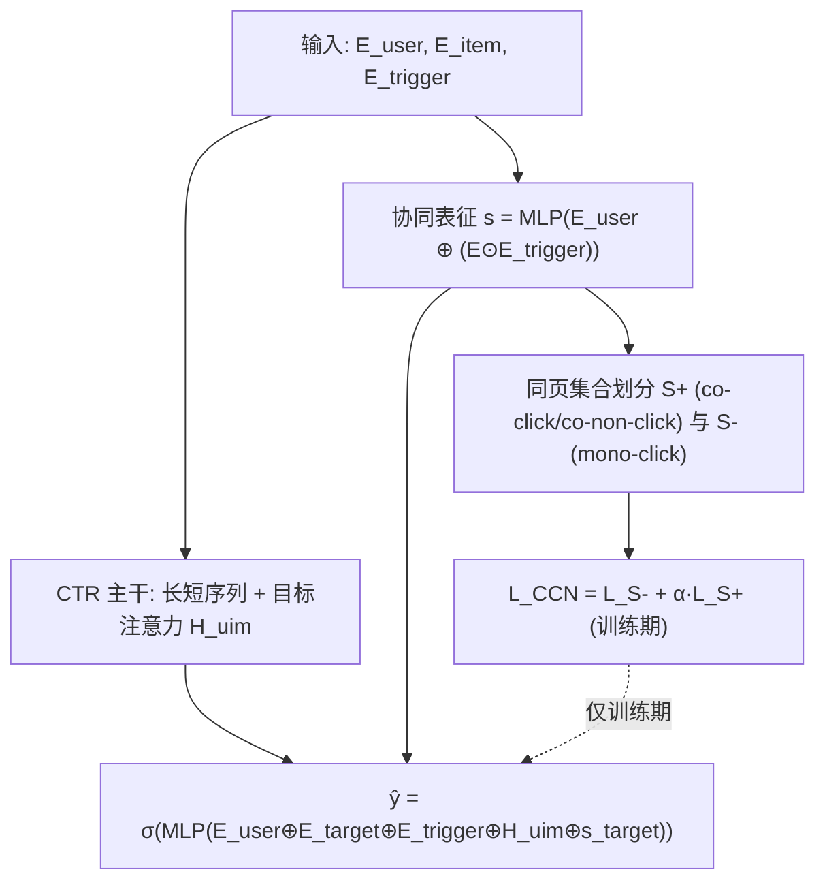
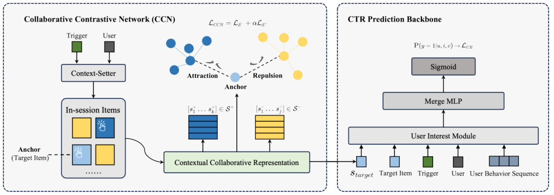

# Beyond the Trigger: Learning Collaborative Context for Generalizable Trigger-Induced Recommendation (超越触发：学习协同上下文以实现可泛化的触发诱导推荐)

- **会议/期刊**: DASFAA 2026
- **作者与机构**: Chen Gao, Zixin Zhao, Lv Shao, Tong Liu（阿里巴巴 / 淘宝）
- **推荐链路定位**: 精排（CTR 预估）+ 训练期自监督辅助任务
- **研究方向**: 自监督对比学习与交互去噪 / CTR 预估与特征交叉
- **论文原文**: [https://arxiv.org/abs/2411.11508v2](https://arxiv.org/abs/2411.11508v2)
- **开源代码**: 暂未开源

## TL;DR (1分钟核心速览)

针对电商"点击触发物 → 进入专题页"的 Trigger-Induced Recommendation（TIR），现有方法要么陷入*触发物依赖陷阱*（DIHN 假设进入与触发物强因果，只推高相似品），要么陷入*数据饥饿陷阱*（DIAN 需长期稳定数据才能解耦二元进入意图）。本文放弃"猜用户为何进来"，转为"建模用户进来后偏好什么"：把 $(u,\text{trigger})$ 视为唯一上下文，用同页 co-click/co-non-click 作正、mono-click 作负构造对比学习。在十余个场景训练、**全新未见场景（双 11）**上测试，AUC 0.7326（较 SIM +0.50pt），线上 CTR +12.3%、订单量 +12.7%。

## Background & Motivation (背景与核心矛盾)

- **主流范式**: 工业界以 Wide&Deep / DIN / DIEN / SIM 为主干，将 trigger 当作普通特征；trigger-aware 工作（DIHN、DIAN）额外加入触发物建模范式。
- **前人局限**: (i) *触发物依赖陷阱*——DIHN 强行假设进入与 trigger 存在因果，导致推荐结果与 trigger 高度同质，忽略"大促主题"这类更宽意图；(ii) *数据饥饿陷阱*——DIAN 把进入意图解耦为 trigger-driven/app-driven 二分类，需长时间累积数据，对短命促销场景（双 11 专场）不可行。
- **核心洞察 (Key Insight)**: 显式建模"进入意图"本身是个不可靠前提；真正稳定可得的是**同页曝光集合内的协同反馈**——同一页面上"共同被点/共同未点"直接表征了该 trigger 上下文下的偏好结构。
- **本文切入点**: 以 user-trigger 对为复合条件重塑物品表征空间，使正/负信号变成自监督对比监督，完全不依赖长期意图数据。

## Method (核心方法设计)

### 1. 整体框架 (Overall Architecture)

模型由**CTR 预估主干**与**协同对比网络 CCN** 两部分构成。主干接收类别/数值/序列特征，用多头目标注意力与搜索式长序列建模（DIN/SIM 范式）提取用户即时兴趣 $H_{uim}$；CCN 则为每个候选物品生成一个以$(u,\text{trigger})$为条件的动态协同表征$s$，并将其作为关键特征拼入主干参与最终打分。训练时以联合损失端到端优化 CTR 交叉熵与对比损失；推理时对比分支被封装为 **training-only operator**，线上只跑主干，因此不增加服务延迟。

<figure class="paper-figure" markdown="span">
  <figcaption>图2. 我们模型的整体架构。它由CTR预测主干和我们核心创新——协同对比网络（CCN）组成。CCN学习一种以触发为条件的协同表示，然后将其作为关键特征输入主干，以增强最终预测。</figcaption>
</figure>

### 2. 关键设计拆解 (Key Designs)

1. **触发条件下的协同表征 (Contextual Collaborative Representation)**：静态物品 embedding 无法反映"同一物品在不同 trigger 页面下意义不同"这一事实。本文用 Hadamard 积把物品与 trigger 做逐维交互后再拼用户画像：$s=\mathrm{MLP}\left(\mathbf{E}_{user}\oplus(\mathbf{E}\odot\mathbf{E}_{trigger})\right)$。直觉上$\mathbf{E}\odot\mathbf{E}_{trigger}$相当于把"物品 × 触发主题"的相容度显式编码进表征，$s$ 因此天然带上下文。

2. **协同对比目标 (Collaborative Contrastive Objective)**：痛点在于 TIR 里既无稳定标签也无长周期意图。作者把同一页面（含滚动后的全部真实曝光）中与锚点**同标签**的物品划入 $S^+$（co-click 或 co-non-click），**异标签**划入$S^-$（mono-click）。排斥损失用 InfoNCE 变体：$\mathcal{L}_{S^-}=-\mathbb{E}_{i\in\mathcal{D}}\left[\log\frac{e^{s_i/\tau}}{e^{s_i/\tau}+\sum_{s'_j\in S^-_i}\omega^-_j e^{s'_j/\tau}}\right]$；吸引损失用有界余弦相似度以稳定训练：$\mathcal{L}_{S^+}=\mathbb{E}_{i\in\mathcal{D}}\left[1-\cos\left(s_i,\sum_{s'_k\in S^+_i}\omega^+_k s'_k\right)\right]$。两组权重均在各自集合内做重要性采样：$\omega=\frac{e^{-s/\tau}}{\sum_{s_i\in S}e^{-s_i/\tau}}$，即对集合内低分（更难）样本加码，抑制 click 稀疏带来的离群点主导。

3. **联合训练、负采样与推理开销**：$\mathcal{L}=\mathcal{L}_{CE}+\lambda\left(\mathcal{L}_{S^-}+\alpha\mathcal{L}_{S^+}\right)$，$\alpha$平衡吸引/排斥，负样本**免采样**——直接取同页真实曝光未点击项，天然构成 in-page hard negative。线上仅执行主干与一次$s_{target}$ 计算，对比分支全部离线，故 QPS 与基线持平。

## Experimental Setup & Evaluation Protocol (实验设置与评估协议)

- **数据集与预处理**: 淘宝工业日志，训练集覆盖**一年内十余个异质促销场景**，测试集为**完全未见的双 11 场景**（场景级划分，即跨场景泛化设定）：

| 数据集 | #Users | #Items | #Instances | 特征/场景说明 |
| :--- | :---: | :---: | :---: | :--- |
| Train | 61.6M | 19.1M | 2.33B | 十余个促销场景，跨一整年，意图与人群分布差异大 |
| Test | 56.2M | 10M | 536.8M | 全新未见场景（双 11 大促） |

- **数据划分与防穿越 (Splitting Strategy)**: 采用**场景级（scenario-wise）划分**而非随机/时间划分——训练场景与测试场景无交集，专门检验跨场景泛化，是本实验设计最严苛之处。
- **排名评测协议 (Ranking Protocol)**: 任务为曝光级 CTR 预估，采用 **AUC** 指标在完整线上曝光日志上评估（无负采样、无 candidate 裁剪），结果取 **5 次独立运行均值**。
- **对比基线与超参设置**: 基线含通用 CTR 模型（Wide&Deep、DIN、SIM，SIM 为线上 production baseline）与 trigger-aware 模型（DIHN、DIAN）；所有模型在同一框架、同一特征集下实现以保公平。温度 $\tau$、权重$\lambda,\alpha$ 的具体取值原文未披露（可复现性缺口）。

## Key Experimental Results (实验关键数据)

### 1. 主实验对比 (Main Results)

| 类别 | 模型 | AUC | ΔAUC vs. SIM |
| :--- | :--- | :---: | :---: |
| 通用 CTR | Wide&Deep | 0.6872 | -4.04pt |
| 通用 CTR | DIN | 0.7117 | -1.59pt |
| 通用 CTR | **SIM (Baseline)** | 0.7276 | – |
| Trigger-aware | DIHN | 0.7259 | **-0.17pt** |
| Trigger-aware | DIAN | 0.7200 | **-0.76pt** |
| 本文 | **CCN (Ours)** | **0.7326** | **+0.50pt** |

### 2. 消融实验 (Ablation Study)

| 配置 | AUC | ΔAUC vs. SIM |
| :--- | :---: | :---: |
| Baseline + Trigger | 0.7281 | +0.05pt |
| Baseline + Trigger + UIM | 0.7293 | +0.17pt |
| **CCN (full)** | **0.7326** | **+0.50pt** |
| w/o Attraction Loss $\mathcal{L}_{S^+}$ | 0.7312 | +0.36pt |
| w/o Repulsion Loss $\mathcal{L}_{S^-}$ | 0.7309 | +0.33pt |
| w/o UIM | 0.7315 | +0.39pt |

### 3. 关键实验发现 (Key Findings)

1. **对比范式贡献远大于特征堆叠**：仅加 trigger 特征 +UIM 只带来 +0.17pt，CCN 再补 +0.33pt；另一线上场景中"Trigger+UIM"仅 +2.21% CTR，而 CCN 达 +17.48%，说明增益来自协同表征而非特征增量。
2. **两个损失缺一不可但排斥略重**：去掉 $\mathcal{L}_{S^-}$掉至 +0.33pt、去掉$\mathcal{L}_{S^+}$ 掉至 +0.36pt，说明 hard negative（mono-click）对刻画"用户不要什么"更关键，正样本聚合次之；二者同时保留才达 +0.50pt。
3. **显式意图建模在短命场景全面失效**：DIAN 的意图估计辅助任务在本文设定下 AUC 仅 0.60（原论文评估为 0.94），线上 CTR 与订单量分别 -5.6%/-1.5%，DIHN 更差（-7.3%/-3.1%）；而 CCN 同时提升 CTR（+12.3%）与 Orders/User（+12.7%），突破了点击-转化跷跷板效应。

## Highlights & Limitations (亮点、对比与审稿批判)

- **与代表作对比 (vs. Prior Work)**: 与 DIHN 的本质差异在于**不做 trigger→item 的因果假设**，因而不受"只推相似品"的束缚；与 DIAN 的差异在于**放弃显式意图二分类**，把意图隐式编码进对比表征空间，因此在无长周期数据的短命场景仍可用。
- **可迁移亮点**: (i) 把"同页共点击/共不点击"当作免费的自监督正样本构造规则，可直接迁移到任意 list/feeds 场景的对比预训练；(ii) training-only operator 的封装方式，使重辅助任务零在线延迟，工程上极易复用。
- **审稿级局限批判**: (i) 超参 $\tau,\lambda,\alpha$ 与网络规模未披露，且无公开代码，复现门槛高；(ii) 评估只报 AUC 与线上相对提升，缺少排序类指标（GAUC/Recall@K）、长尾与冷启动物品分桶分析，也无法判断同页正样本噪声（误点/曝光偏差）对表征的影响；(iii) 正负集合完全依赖"同页"定义，页面物品数过少或触发物本身未点击时的退化行为未讨论。

## Rating (四维评分)

- **方法创新性 (Novelty)**: ⭐⭐⭐⭐ （用 user-trigger 复合条件 + 共点击/单点击自监督替代意图解耦，视角新颖，但对比学习本身机制无理论分析支撑）
- **评估协议与实验扎实度 (Protocol & Experiments)**: ⭐⭐⭐⭐ （场景级划分 + 未见场景线上 A/B 极具说服力，2.33B 训练样本规模罕见；扣分于缺少排序指标与分桶分析、超参未披露）
- **写作与数学规范度 (Clarity & Rigor)**: ⭐⭐⭐⭐ （两个损失的动机与公式清晰，式 (6)(7) 的 $\alpha$双重出现略显冗余，重要性采样权重的$e^{-s/\tau}$ 定义与直觉解释未展开）
- **工业落地与复现价值 (Industrial & Practical Value)**: ⭐⭐⭐⭐ （已全量上线淘宝所有促销场景，零额外推理延迟；但无开源代码、数据集为内部日志，学术复现困难）

