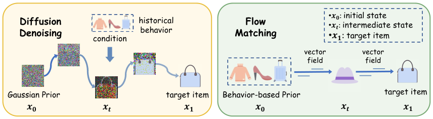
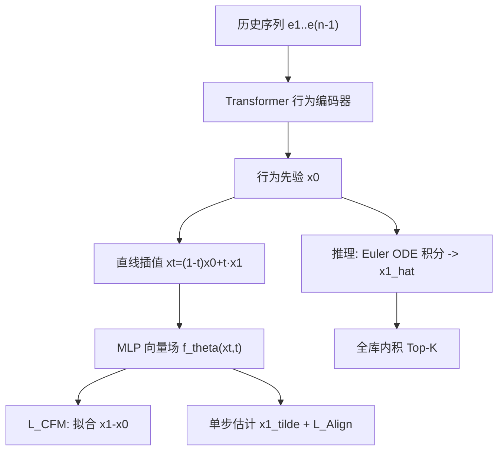

# FlowRec: Prior-Informed Flow Matching for Efficient Sequential Recommendation Generation (先验引导流匹配的高效序列推荐生成)

- **会议/期刊**: DASFAA 2026
- **作者与机构**: Li Li, Mingyue Cheng, Yuyang Ye, Zhiding Liu, Enhong Chen（中国科学技术大学认知智能全国重点实验室；罗格斯大学）
- **推荐链路定位**: 端到端生成式（生成下一物品表征后全库内积排序）
- **研究方向**: 序列与会话推荐 / 生成式推荐
- **论文原文**: [https://arxiv.org/abs/2508.17618v2](https://arxiv.org/abs/2508.17618v2)
- **开源代码**: 暂未开源

## TL;DR (1分钟核心速览)

扩散式序列推荐存在两处硬伤：高斯先验与用户兴趣分布严重错位、弯曲噪声调度导致误差累积与训练不稳；随机 SDE 采样又带来额外噪声与高昂开销。FlowRec 把偏好演化建模为「行为编码得到的个性化先验 $\to$ 目标物品」之间的连续直线流，学习向量场做条件流匹配，并加入带正负样本的单步对齐损失补足排序判别性，最后用确定性 Euler ODE 推理。在 4 个基准、`Leave-One-Out + Full-Ranking` 协议下，Beauty 上 HR@5 相对最强基线 DiffuRec 提升 9.87%，Toys 提升 9.64%，采样步数由 30–35 步降至 8–10 步，推理时间降至 DiffuRec 的约 1/6.7。

## Background & Motivation (背景与核心矛盾)

- **主流范式**: 以 SASRec/BERT4Rec 为代表的自注意力序列编码，以及 DiffuRec、DreamRec、PreferDiff 等把下一物品表征先加高斯噪声再迭代去噪的扩散生成范式。
- **前人局限**: ①高斯先验本身不含用户信息，模型必须从"无意义初值"重建偏好，条件不足时易生成漂移物品；②扩散的弯曲噪声调度 + 随机 SDE 采样导致误差累积、结果不稳定且需数十步采样，线上延迟高。
- **核心洞察 (Key Insight)**: Flow Matching 允许**任意先验分布**与**直线插值路径**，其条件向量场沿路径恒定（$u_t = x_1 - x_0$），因此既能用用户行为表征做初始化，又能用极少的 ODE 步数完成确定性生成。
- **本文切入点**: 把"用户历史编码的隐意图"直接当作生成起点 $x_0$，让模型只学一条从个性化先验指向真实下一物品的直线流。

<figure class="paper-figure" markdown="span">
  <figcaption>图1：我们提出的方法与基于扩散的方法的比较。</figcaption>
</figure>

## Method (核心方法设计)

### 1. 整体框架 (Overall Architecture)

输入为用户历史序列 $[i_1,\dots,i_{n-1}]$的物品嵌入，经 4 层双向 Transformer 编码，取末位隐状态$h_{n-1}$作为行为先验$x_0$；目标物品嵌入$e_n$作为$x_1$。训练时先以交叉熵把$x_0$拉近真实下一物品（`L_Prior`），再在$x_0$与$x_1$之间线性插值采样中间态$x_t$，用 2 层 MLP 拟合常向量场（`L_CFM`），并用该场做一次 Euler 前推得到$\tilde{x}_1$，施加对比式对齐损失（`L_Align`）。推理阶段仅从$x_0$出发、用 Euler 法积分学到的 ODE 得到$\hat{x}_1$，与全库物品嵌入内积取 Top-K，全过程无噪声注入。

### 2. 关键设计拆解 (Key Designs)

1. **行为先验分布 (Behavior-based Prior)**：针对高斯先验无信息的问题，用编码器末位隐状态定义先验 $x_0=\mathrm{Trm}(e_1,\dots,e_{n-1})[-1]$，并以
$\mathcal{L}_{Prior}=-\frac{1}{|U|}\sum_{u}\log\frac{\exp(x_0\cdot e_n^u)}{\sum_{i\in\mathcal{I}}\exp(x_0\cdot e_i^u)}$
约束其落在目标分布附近。直觉上把"生成起点"提前搬到用户兴趣邻域，显著缩短了需要学习的传输距离，也使弱上下文（短序列、长尾物品）下不至于崩坏。

2. **直线流向量场 (Straight Preference Flow)**：取 $a_t=1-t,\ b_t=t$，则$x_t=(1-t)x_0+t x_1$，条件场恒为$u_t=x_1-x_0$，损失退化为
$\mathcal{L}_{CFM}=\mathbb{E}_{t,x_0,x_1}\|f_\theta(\lambda\odot x_t,\,t)-(x_1-x_0)\|^2$，
其中 $\lambda\sim\mathcal{N}(\delta,\delta)$（$\delta=0.001$）做随机调制以避免直接暴露$x_0,x_1$。由于路径是直线且场与$t$ 无关，数值积分误差远小于弯曲扩散调度，这是"少步即准"的根源。

3. **单步对齐损失与训练目标**：仅最小化欧氏距离只保证"靠近正样本"，不保证"远离负样本"，排序判别性不足。作者用一阶 Euler 前推 $\tilde{x}_1=x_t+(1-t)f_\theta(x_t,t)$，再对$\tilde{x}_1$ 施加对比交叉熵
$\mathcal{L}_{Align}=-\frac{1}{|U|}\sum_u \log\frac{\exp(\tilde{x}_1\cdot e_n^u)}{\sum_{i\in\mathcal{I}}\exp(\tilde{x}_1\cdot e_i^u)}$，
总损失 $\mathcal{L}=\mathcal{L}_{Prior}+\alpha\mathcal{L}_{CFM}+\beta\mathcal{L}_{Align}$（$\alpha\in[5,20],\beta\in[1,5]$）。训练负采样为 **批内/全物品 softmax（免显式负采样）**；推理用 Euler 法$x_{t+1/T}=x_t+\frac{1}{T}f_\theta(x_t,t)$，$T$ 取 8–10 即可，开销近似 SASRec。

## Experimental Setup & Evaluation Protocol (实验设置与评估协议)

- **数据集与预处理**（统一 `5-core` 过滤，最大序列长度 50）：

| 数据集 | #Users(序列) | #Items | #Interactions | 平均长度 | 稀疏度 |
| :--- | :---: | :---: | :---: | :---: | :---: |
| Beauty | 22,363 | 12,101 | 198,502 | 8.53 | 99.93% |
| Toys | 19,412 | 11,924 | 167,597 | 8.63 | 99.93% |
| ML-1M | 6,040 | 3,416 | 999,611 | 165.50 | 95.16% |
| Yelp | 30,431 | 20,033 | 316,354 | 10.40 | 99.95% |

- **数据划分与防穿越**: `Leave-One-Out`（最后一件为测试、倒数第二件为验证），序列按时间顺序截断/填充至 50。
- **排名评测协议**: 无偏 `Full-Ranking`（对全物品集排序，未做负采样截断），指标 HR@5/10、NDCG@5/10。
- **对比基线与超参**: 三类共 8 个基线——经典（GRU4Rec、SASRec、BERT4Rec）、对比学习（CL4SRec、CaDiRec）、生成式（ACVAE、PreferDiff、DiffuRec）。嵌入/隐层维度 $d=128$，batch 512，Adam，lr 0.005，dropout 0.1/0.3，早停 patience 10；单卡 RTX 4090。原文未报告显著性检验。

## Key Experimental Results (实验关键数据)

### 1. 主实验对比 (Main Results)

| 数据集 | 指标 | GRU4Rec | SASRec | BERT4Rec | CL4SRec | ACVAE | PreferDiff | DiffuRec | **FlowRec** | Improv. |
| :--- | :--- | :---: | :---: | :---: | :---: | :---: | :---: | :---: | :---: | :---: |
| Beauty | HR@5 | 3.1910 | 3.4623 | 2.4427 | 4.3438 | 5.0912 | 4.6147 | 5.3812 | **5.9123** | +9.87% |
| Beauty | N@5 | 2.1850 | 2.4802 | 1.5684 | 2.8437 | 4.0230 | 3.4595 | 3.9230 | **4.2166** | +7.48% |
| Beauty | HR@10 | 4.7054 | 4.8909 | 4.0865 | 6.5313 | 7.1074 | 5.8087 | 7.5912 | **8.2760** | +9.02% |
| Toys | HR@5 | 1.7780 | 4.7127 | 2.2170 | 5.4039 | 5.5878 | 5.0421 | 5.7039 | **6.2539** | +9.64% |
| Toys | N@5 | 1.2350 | 3.4509 | 1.3413 | 3.7329 | 4.2412 | 3.8068 | 4.2871 | **4.6209** | +7.79% |
| Toys | HR@10 | 2.7398 | 6.4063 | 3.5463 | 7.4232 | 7.3213 | 6.0890 | 7.3512 | **8.2261** | +6.95% |
| Yelp | HR@5 | 1.6976 | 2.6009 | 2.6602 | 1.9684 | 1.3223 | 2.0505 | 3.8268 | **3.9683** | +3.70% |
| Yelp | N@5 | 1.1749 | 1.8038 | 1.8953 | 1.2151 | 0.9135 | 1.4777 | 2.6579 | **2.7929** | +5.08% |
| ML-1M | HR@5 | 5.8405 | 9.0894 | 8.2220 | 1.7219 | 9.5543 | 7.7716 | 15.2918 | **15.5848** | +1.92% |
| ML-1M | N@5 | 3.8281 | 5.5502 | 5.1276 | 1.0221 | 6.5349 | 5.0609 | 10.0919 | **10.3634** | +2.69% |

（`Improv.` 为相对最强基线 DiffuRec 的提升；采样效率：Toys 推理 1.27 s/epoch vs. DiffuRec 8.51 s、PreferDiff 5.25 s，训练 9.98 s 与 10.11 s 基本持平。）

### 2. 消融实验 (Ablation Study)

| 变体 | Beauty HR@5 | Beauty N@5 | Beauty HR@10 | Toys HR@5 | Toys N@5 | Toys HR@10 |
| :--- | :---: | :---: | :---: | :---: | :---: | :---: |
| w/o $\mathcal{L}_{Prior}$ | 2.9476 | 1.9851 | 4.4039 | 4.0813 | 2.8858 | 5.6610 |
| w/o $\mathcal{L}_{CFM}$ | 5.3070 | 3.7331 | 7.7036 | 5.9959 | 4.0643 | 8.1911 |
| w/o $\mathcal{L}_{Align}$ | 3.7949 | 2.4130 | 5.8232 | 4.0246 | 2.5603 | 5.9105 |
| 编码器换 GRU | 4.3986 | 3.0822 | 6.4790 | 3.9605 | 2.8067 | 5.5336 |
| 仅初始态 $x_0$ | 5.6843 | 4.0517 | 8.0083 | 6.0529 | 4.4397 | 8.1090 |
| **FlowRec 完整** | **5.9125** | **4.2166** | **8.2760** | **6.2539** | **4.6209** | **8.2261** |

### 3. 关键实验发现 (Key Findings)

1. **行为先验是最大功臣**：去掉 $\mathcal{L}_{Prior}$ 后 Beauty HR@5 从 5.91 崩至 2.95（−50.1%），Even 弱于 SASRec，说明生成范式成败取决于"初值是否落在用户兴趣邻域"，而非网络容量。
2. **对齐损失承担排序判别，CFM 更多是"精修"**：去掉 $\mathcal{L}_{Align}$掉至 3.79（−35.8%），而去掉$\mathcal{L}_{CFM}$仍保 5.31；仅用初始态$x_0$ 已达 5.68，完整流仅再涨 4.1%——证明大部分收益来自先验 + 对比对齐，连续流提供稳定的小幅增益。
3. **稀疏/短上下文与长尾更受益，稠密数据趋于饱和**：Toys 头部物品仅 +8.85%、长尾物品达 +21.28%；而 ML-1M（平均长度 165.5、交互近百万）相对 DiffuRec 仅 +1.92%~+2.69%，说明该方法的价值集中在弱监督、稀疏场景。

## Highlights & Limitations (亮点、对比与审稿批判)

- **与代表作对比 (vs. Prior Work)**: 相较 DiffuRec/DreamRec（高斯先验 + 弯曲噪声调度 + 随机 SDE 采样），FlowRec 同时改写"起点"（行为先验）与"路径"（直线流 + 确定性 ODE）；相较同期 FMRec 也做流匹配，本文的差异化在于**显式的行为先验分布**与**带负样本的单步对齐损失**，把生成目标与排序目标显式缝合。
- **可迁移亮点**: ①"用编码器末位隐状态替代高斯先验"可低成本移植到任何扩散式生成推荐（物品/语义 ID 均可）；②"单步 Euler 前推 + 对比损失"是一种通用的少步生成正则，可在扩散/流式模型中作为 plug-in。
- **审稿级局限批判**: ①直线假设 + 常向量场本质是"一次残差修正"，$x_0$ 质量差时补救能力有限（消融中 w/o Prior 的崩坏即旁证），且未对不同先验质量做理论分析；②评估仅 4 个公开集、单次运行，未报告方差/显著性检验，也未与 FMRec 等流匹配基线直接对比；③效率结论仅以 s/epoch 呈现，缺少工业级 QPS、显存与候选规模扩展性测试。

## Rating (四维评分)

- **方法创新性 (Novelty)**: ⭐⭐⭐⭐ （把扩散换成直线流匹配并非全新，但"行为先验 + 单步对齐"的组合针对序列推荐痛点精准，机理清晰）
- **评估协议与实验扎实度 (Protocol & Experiments)**: ⭐⭐⭐⭐ （4 数据集 + 无偏 Full-Ranking + 8 基线 + 完整消融与效率分析，唯缺显著性检验与流匹配同类对比）
- **写作与数学规范度 (Clarity & Rigor)**: ⭐⭐⭐⭐ （流匹配公式链条完整、符号一致，但对"直线路径最优性"缺乏理论论证）
- **工业落地与复现价值 (Industrial & Practical Value)**: ⭐⭐⭐⭐ （8–10 步确定性推理、耗时接近 SASRec，落地成本低；可惜暂未开源、缺大规模线上验证）

