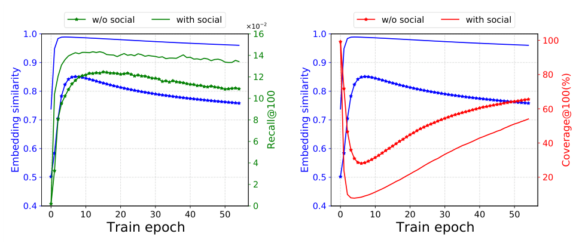
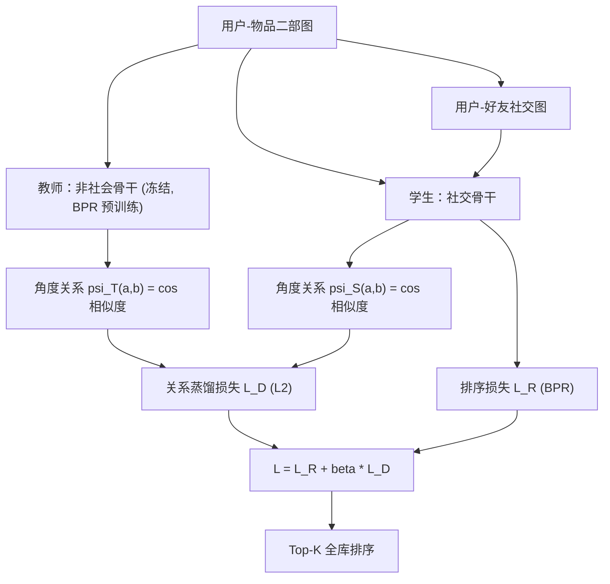
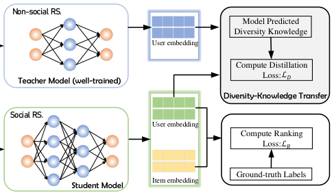

# Leave No One Behind: Enhancing Diversity While Maintaining Accuracy in Social Recommendation (兼顾准确与多样：面向社交推荐的多样性增强框架)

- **会议/期刊**: DASFAA 2025
- **作者与机构**: Lei Li, Xiao Zhou（中国人民大学高瓴人工智能学院）
- **推荐链路定位**: 排序阶段（Top-K 全库排序打分）
- **研究方向**: 社交与群组推荐 / 去偏·多样性与可信
- **论文原文**: [https://arxiv.org/abs/2502.11374v2](https://arxiv.org/abs/2502.11374v2)
- **开源代码**: [https://github.com/ll0ruc/DivSR](https://github.com/ll0ruc/DivSR)

## TL;DR (1分钟核心速览)

社交推荐借社交图提升准确率，却因"社交影响力导致偏好同质化"而系统性牺牲系统级多样性。作者先做对照实验量化该现象（DiffNet 在 Yelp 上 Recall 12.54→14.14，但 Coverage 39.97%→16.74%），再提出 DivSR：以**非社会推荐模型为教师、社会推荐模型为学生**，用**角度级关系型知识蒸馏**把"用户-好友嵌入低相似度"这一多样性结构知识迁移过去。在 Yelp/Ciao/Flickr 三数据集、5 个骨干上，Coverage@100 平均提升 20%–68%，Recall@100 变化控制在 ±4% 内，且在准确-多样权衡曲线上优于 MMR/DPP/DGRec。

## Background & Motivation (背景与核心矛盾)

- **主流范式**: 社交推荐把用户-用户社交图（SoReg/SocialMF 的正则约束、DiffNet 的层级扩散、MHCN 的超图/自监督、DESIGN 的跨源蒸馏）当作辅助信号叠加到用户-物品二部图上，目标函数几乎只有 BPR 排序损失，即以准确率为唯一优化目标。
- **前人局限**: ①社交影响力理论下，好友偏好被反复聚合，用户表征在训练中逐步同质化，推荐列表收敛到少数热门物品，系统级覆盖度坍塌；②已有的多样化方法（MMR/DPP 重排、DGRec 多样化嵌入）只在**单一模型内部**做扰动，无法回答"社交结构本身把多样性挤掉了多少"，也无法与任意社交骨干即插即用。
- **核心洞察 (Key Insight)**: 作者用"去掉社交模块、其余结构不变"的对照实验发现——社交模型相对其非社会变体，准确率普遍提升、多样性普遍下降；且训练过程中**用户-好友余弦相似度与 Coverage 呈明显负相关**（图 1）。即"好友嵌入过于相似"是可测量的多样性损失代理指标，而非社会模型天然具备低相似度结构。
- **本文切入点**: 把"低相似度"当作一种可蒸馏的**结构化知识**，从非社会教师迁移到社会学生，在不动骨干架构的前提下恢复多样性。

<figure class="paper-figure" markdown="span">
  <figcaption>图 1：训练过程中用户-好友嵌入相似性的趋势。</figcaption>
</figure>

## Method (核心方法设计)

### 1. 整体框架 (Overall Architecture)

DivSR 是模型无关的双阶段框架。**阶段一**：取目标社交骨干，摘除全部社交相关模块得到非社会变体，仅用用户-物品二部图与 BPR 损失预训练为教师 $f_t(\theta_t)$，随后冻结。**阶段二**：完整的社交模型作为学生$f_s(\theta_s)$，同时接收二部图与社交图，用$\mathcal{L}=\mathcal{L}_R+\beta\mathcal{L}_D$主辅联合训练，其中$\mathcal{L}_R$为常规 BPR、$\mathcal{L}_D$强迫学生复现教师在"用户-好友对"上的角度关系。推理时教师完全丢弃，学生保持原骨干的$(\mathbf{q}_i^s)^\top\mathbf{p}_a^s$ 打分，无额外在线开销。

<figure class="paper-figure" markdown="span">
  <figcaption>图 2：DivSR 的整体框架。</figcaption>
</figure>

### 2. 关键设计拆解 (Key Designs)

1. **角度级关系型知识蒸馏 (RKD) 替代点式蒸馏**：痛点在于常规 KD 逐点对齐教师/学生的输出打分，而多样性是**成对结构性质**，点式迁移无法表达。DivSR 对每条社交边 $(a,b)\in G_s$ 对齐两者的余弦角势：
$$\mathcal{L}_D=\sum_{(a,b)\in G_s} l_\delta\big(\psi_T(a,b),\ \psi_S(a,b)\big),\qquad \psi(a,b)=\cos\theta=\frac{\mathbf{p}_a^\top \mathbf{p}_b}{\lVert \mathbf{p}_a\rVert\,\lVert \mathbf{p}_b\rVert}$$
角度比欧氏距离携带更高阶关系信息（对尺度不敏感），只约束"方向关系"而不约束绝对位置，给学生骨干留出拟合准确率的自由度——这正是"多样性上来、Recall 不掉"的物理直觉。

2. **社交邻居均值平滑的抗噪蒸馏目标**：真实社交图噪声大、存在大量弱关系边，逐对计算 $(a,b)$相似度会把噪声当监督信号放大。作者改为只计算用户$a$与其**社交邻居质心**的关系：$\mathbf{p}_{a_f}=\mathrm{mean}(\{\mathbf{p}_b\}),\ b\in N_s(a)$，把$\psi(a,b)$替换为$\psi(a,a_f)$。均值操作等效于一次低通滤波，既压低单边噪声，又保留"我与我的社交圈整体应有多不像"这一群体级多样性约束。

3. **主辅损失的 $\beta$权衡与训练开销**：总目标$\mathcal{L}=\mathcal{L}_R(\theta_s)+\beta\,\mathcal{L}_D(\theta_s\mid\theta_t)$，$\beta$大则偏多样性、小则退化为原始社交模型（$\beta\to 0$ 时性能收敛回 Base）。负采样沿用 BPR 的"每正例 1 个未交互负例"，构造简单、无额外采样成本；蒸馏仅需一次教师前向（且可离线缓存），训练开销近似 2 倍前向，推理零额外开销。

## Experimental Setup & Evaluation Protocol (实验设置与评估协议)

- **数据集与预处理**: 沿用 DiffNet/MHCN 官方版本，未额外做 k-core 过滤。

| 数据集 | #Users | #Items | #Interactions | #Relations | 反馈密度 | 社交密度 | 场景说明 |
| :--- | :---: | :---: | :---: | :---: | :---: | :---: | :--- |
| Yelp | 17,220 | 35,351 | 205,529 | 143,609 | 0.034% | 0.048% | LBSN 点评社交 |
| Ciao | 6,788 | 77,248 | 206,143 | 110,383 | 0.039% | 0.239% | 商品评分+信任 |
| Flickr | 8,137 | 76,190 | 320,775 | 182,078 | 0.050% | 0.275% | 图片社交分享 |

- **数据划分与防穿越**: 原文未显式给出划分比例，仅声明与 DiffNet/MHCN 的官方设定保持一致（该类基准惯例为随机 8:1:1 划分），**未采用全局时间戳切分**——这是本文评估上的一个可质疑点。
- **排名评测协议**: 报告 top-100 结果，Recall@100/NDCG@100 衡量准确率、Coverage@100/Entropy@100 衡量系统级多样性；Coverage 定义在全物品库上，实质等价于**全库候选**下的覆盖率度量，而非采样负例排序。训练侧为 BPR + 单负例。
- **对比基线与超参**: 5 个社交骨干（TrustMF、SocialMF、DiffNet、DESIGN、MHCN）× 各自 `w/o social` 变体 + 多样化基线（MMR、DPP、DivMF、DGRec）；嵌入维度 $d=64$、Adam、lr=1e-3、batch=2000、$\lambda=1e-3$、$\beta\in\{2.0,1.0,0.5,\dots,10^{-4}\}$，5 次重复取均值 + early stopping。

## Key Experimental Results (实验关键数据)

### 1. 主实验对比 (Main Results)

表 1：5 个骨干上的 Base → DivSR 对比（R=Recall@100，C=Coverage@100，单位 %；加粗为 DivSR 相对 Base 的多样性最优提升）

| 骨干 | Yelp R | Yelp C (Improv.) | Ciao R | Ciao C (Improv.) | Flickr R | Flickr C (Improv.) |
| :--- | :---: | :---: | :---: | :---: | :---: | :---: |
| TrustMF Base → DivSR | 13.773→13.721 | 23.276→**28.015 (+20.4%)** | 12.778→12.634 | 21.524→**27.245 (+26.6%)** | 3.242→3.299 | 21.547→**25.329 (+17.6%)** |
| SocialMF Base → DivSR | 14.077→14.139 | 21.335→**35.938 (+68.5%)** | 12.899→12.942 | 22.215→**31.684 (+42.6%)** | 3.339→3.330 | 27.125→**32.424 (+19.5%)** |
| DiffNet Base → DivSR | 14.136→**14.278** | 16.738→**26.770 (+59.9%)** | 12.658→**13.133** | 27.560→**31.822 (+15.5%)** | 3.539→3.517 | 32.663→**37.160 (+13.8%)** |
| DESIGN Base → DivSR | 14.984→**15.008** | 42.228→**43.371 (+2.7%)** | 15.367→**15.424** | 24.262→**26.661 (+9.9%)** | 4.127→**4.172** | 35.290→**37.298 (+5.7%)** |
| MHCN Base → DivSR | 15.365→15.323 | 53.273→**55.903 (+4.9%)** | 16.338→16.336 | 22.173→**25.572 (+15.3%)** | 4.574→**4.579** | 40.205→**43.757 (+8.8%)** |

### 2. 消融实验 (Ablation Study)

表 2：教师策略消融（R/C，%）

| 骨干 | 数据集 | Base | Uns.（免教师，直接最小化好友相似度） | DivSR(M)（最优单一非社会教师） | DivSR（自身非社会变体） |
| :--- | :--- | :---: | :---: | :---: | :---: |
| SocialMF | Yelp | 14.077 / 21.335 | 13.802 / 24.469 | 14.059 / 34.698 | **14.139 / 35.938** |
| SocialMF | Ciao | 12.899 / 22.215 | 12.824 / 29.078 | **13.151 / 31.975** | 12.942 / 31.684 |
| DiffNet | Yelp | 14.136 / 16.738 | 13.685 / 22.936 | 13.829 / 25.270 | **14.278 / 26.770** |
| DiffNet | Flickr | 3.539 / 32.663 | 2.298 / 33.053 | **3.517 / 37.160** | **3.517 / 37.160** |

### 3. 关键实验发现 (Key Findings)

1. **社交模块是多样性下降的直接元凶，且可被量化**：对照实验显示 DiffNet 在 Yelp 上加社交后 Coverage 从 39.97% 腰斩至 16.74%（β 前的 Base），而 DivSR 单靠蒸馏就把它拉回 26.77%（+59.9%），Recall 反而微涨 1.0%——说明"相似度约束"与"准确率"并非零和，原模型只是把多样性过度牺牲了。
2. **蒸馏增益与骨干的社会依赖强度正相关**：强社交影响力模型受益最大（SocialMF Yelp +68.5%、DiffNet Yelp +59.9%），而 MHCN/DESIGN 这类把社交当自监督辅助信号的模型增益有限（+2.7%~+9.9%），印证"社交影响力越强 → 同质化越重 → 可回收的多样性越多"。
3. **有监督的教师信号明显优于无监督压制**：Uns. 在 Yelp(SocialMF) 上虽把 Coverage 提到 24.47%，但 Recall 掉到 13.802；DivSR 用教师信号同时拿到 14.139/35.938，且 DivSR(M) 与 DivSR 均稳定进前二，说明教师提供的"低相似度参照系"比强行压低相似度更不易伤害排序精度；$\beta$在 0.05–0.1 区间取得最优权衡，$\beta\to 0$ 时退化为 Base。

## Highlights & Limitations (亮点、对比与审稿批判)

- **与代表作对比 (vs. Prior Work)**: 与 MMR/DPP 的重排思路不同，DivSR 在**表征层**而非列表层介入，因而能在图 3 的准确-多样性平面上落在右上角（重排方法多样性高但 Recall 显著下滑）；与 DGRec 相比，DivSR 不修改邻域选择或生成多样化嵌入，而是复用教师结构信号，故可直接套在 5 种异构骨干上；与同为蒸馏的 DESIGN 相比，DESIGN 蒸馏的是"社交信号"以提准确率，DivSR 蒸馏的是"去社交化后的低相似度结构"以提多样性，方向恰好互补。
- **可迁移亮点**: ①"去掉某模块构造对照变体、再用蒸馏把该变体的优良性质迁回"是一个通用的权衡调节范式，可迁移到跨域/多场景的准确-探索权衡；②用邻居质心代替逐对关系做结构蒸馏，是社交图噪声场景下即插即用的低成本正则技巧。
- **审稿级局限批判**: ①多样性只做系统级（Coverage/Entropy）评估，缺少**用户级（列表内）多样性**与长尾/冷启分桶分析，且划分协议未明示、无时间切分，存在潜在信息泄漏与结论泛化风险；②框架需为每个骨干额外预训练并冻结一个教师，训练成本约翻倍，且 $\beta$需在$10^{-4}\sim2$ 范围网格搜索，对工业部署的参数调优负担不可忽视。

## Rating (四维评分)

- **方法创新性 (Novelty)**: ⭐⭐⭐ （把"社交同质化"量化为好友嵌入相似度并用 RKD 反向蒸馏，思路巧妙但组件均为成熟技术组合）
- **评估协议与实验扎实度 (Protocol & Experiments)**: ⭐⭐⭐ （5 骨干 × 3 数据集 + 教师策略消融较充分，但划分协议含糊、缺用户级多样性与显著性检验）
- **写作与数学规范度 (Clarity & Rigor)**: ⭐⭐⭐⭐ （公式精简、教师/学生目标界定清晰，仅 RKD 与邻居均值的记账细节略欠推导）
- **工业落地与复现价值 (Industrial & Practical Value)**: ⭐⭐⭐⭐ （模型无关、推理零额外开销、代码开源，作为"多样性旋钮"易插入现有社交推荐管线）

