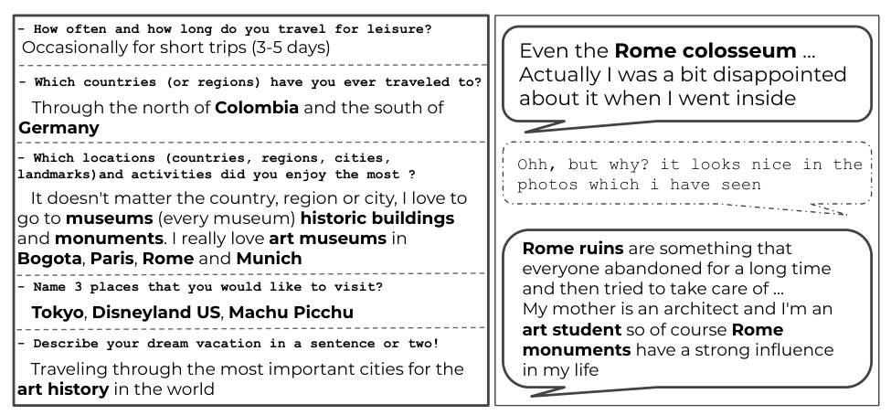
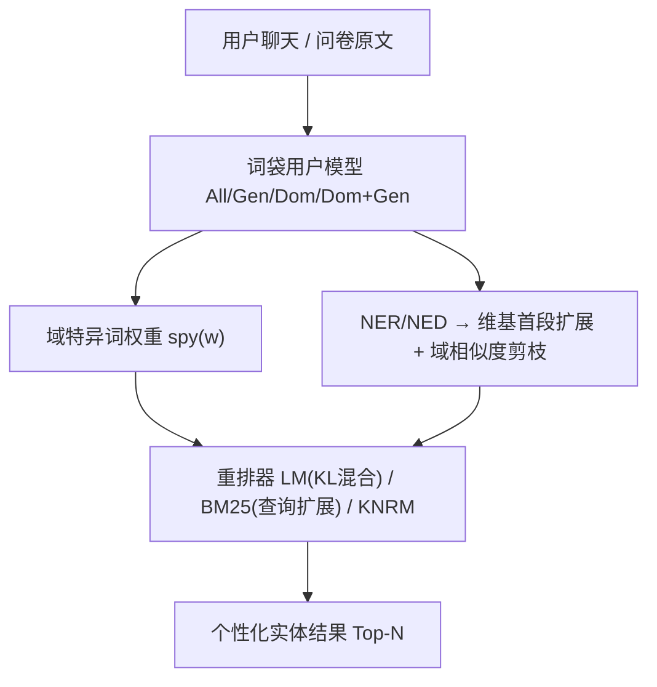

# You Get What You Chat: Using Conversations to Personalize Search-based Recommendations (对话即所得：以聊天个性化搜索式推荐)

- **会议/期刊**: ECIR 2021
- **作者与机构**: Ghazaleh H. Torbati, Andrew Yates, Gerhard Weikum（Max-Planck Institute for Informatics）
- **推荐链路定位**: 重排（对搜索引擎返回的实体候选池做个性化重排序）
- **研究方向**: 对话推荐与智能体仿真 / 去偏、可信隐私与工业架构
- **论文原文**: [https://arxiv.org/abs/2109.04716v1](https://arxiv.org/abs/2109.04716v1)
- **开源代码**: 暂未开源（数据与标注发布：http://personalization.mpi-inf.mpg.de/）

## TL;DR (1分钟核心速览)

本文针对"个性化推荐只能依赖点击/评分等显式信号或用户手工填写的简短问卷"这一痛点，首次把**用户与用户之间的在线聊天**当作隐式兴趣源：以词袋用户模型（All / Gen / Dom / Dom+Gen 四种粒度）配合**域特异词权重** `spy(w)` 与**实体识别-维基描述扩展**，对中粒度商品/目的地查询的实体结果做重排（LM 的 KL 混合、BM25/KNRM 的查询扩展）。在 14 位用户、73 条查询、2673 条人工分级标注上的 NDCG@20 达 0.830–0.833，较查询基线 0.785–0.796 提升约 2–4 点（相对 4–6%），P@1 由 66% 升至 83%。

## Background & Motivation (背景与核心矛盾)

- **主流范式**: 搜索式推荐（用户给中粒度短语，如 *wine lover destinations*）通过点击、点赞、评分、购买（方案 A）或简短问卷式画像（方案 B）学习用户偏好，再对实体答案重排；对话推荐（CRS）则依赖**用户-系统**多轮追问。
- **前人局限**: 其一，方案 A 的稠密行为数据只有大厂才有，冷启动与中小垂直域基本不可用；其二，问卷画像需用户主动填写、难以随兴趣演化持续更新，且 CRS 的主动追问会让用户产生交互负担。
- **核心洞察 (Key Insight)**: 用户间聊天是**零额外成本**的自然产生物，且天然富含命名实体（"罗马斗兽场""Bourgogne 葡萄园"）与品味形容词；但它以口语、错拼、主题跳跃为特征，噪声远高于问卷。
- **本文切入点**: 把聊天/问卷统一压成词袋用户模型，用"域聚焦 + 实体扩展"两步去噪，再喂给三种经典重排器，系统对比聊天与问卷两条画像路线。

<figure class="paper-figure" markdown="span">
  <figcaption>图1. 用户问卷和旅行领域聊天中的摘录（识别出的命名实体和概念以粗体显示）</figcaption>
</figure>（图 1：同一用户的问卷与旅行聊天摘录对照，粗体为识别出的实体与概念——可见聊天信息量更高但更嘈杂）

## Method (核心方法设计)

### 1. 整体框架 (Overall Architecture)

输入是用户的历史聊天文本或问卷答案；先按"通用 / 域内 / 通用+域内"切分构造成词袋用户模型 $u$，经域特异词权重 `spy(w)` 抑制无关词、再由 NER/NED 抽出实体并用维基百科首段描述做扩展与域相似度剪枝；随后把$u$ 融入重排器（LM 以 KL 混合打分、BM25 与 KNRM 以查询扩展方式注入），对搜索引擎 top-100 实体答案重排输出。全流程无神经网络用户编码，推理开销仅为一次稀疏词表比对。

### 2. 关键设计拆解 (Key Designs)

1. **KL 混合式聊天重排 (LM)**：痛点是把画像塞进检索模型容易压过查询本身。做法是把"查询-文档"与"用户-文档"两个 KL 散度线性混合，Dirichlet 平滑，$\mu$ 取平均文档长度：
$\mathrm{score}(q,d,u)\propto-\lambda\,\mathrm{KL}(\theta_q\|\theta_d)-(1-\lambda)\,\mathrm{KL}(\theta_u\|\theta_d)$并在求和内乘 `spy(w)`。直觉：$\lambda$ 控制"忠于查询 vs 忠于品味"，实体候选池本身已与查询相关，因此用户项只需做温和偏移。
2. **域特异词权重 `spy(w)`**：聊天里的 *history*、*museum* 是旅行强信号，*price*、*bargain* 在同域 idf 相近却毫无区分度。作者用"域内词频/全库词频"的比值估计条件概率作权重：
$\mathrm{spy}(w)=P(w\in\mathrm{Dom}\mid w\in\mathrm{All})\propto\frac{\mathrm{tf}(w\in\mathrm{Dom})/|\mathrm{Dom}|}{\mathrm{tf}(w\in\mathrm{All})/|\mathrm{All}|}$
域语料取该域全部召回文档（书评、游记、菜谱）并集，等价于给查询模型与用户模型"套一个域先验"。
3. **实体扩展与选择性剪枝**：直接加入长尾实体名会过拟合；作者实测 **Wikipedia2vec 实体近邻扩展失败**（"history"最近邻是"literature"），改为用维基首段描述词扩展，并以实体向量与域向量（各域取 $m=50$ 个最相关词/实体的加权平均）的余弦相似度阈值做筛选，只保留域相关实体。**训练与推理**：LM/BM25 免训练；KNRM 以分级标签直接监督、10 折交叉验证，无负采样环节；在线仅增加一次稀疏打分，延迟近乎为零。

## Experimental Setup & Evaluation Protocol (实验设置与评估协议)

- **数据集与预处理**: 4 周受控用户研究，14 名学生的两两配对聊天（83 场、9797 句、59k token、93 小时），配问卷（通用 18 题 + 书 2/旅行 5/美食 10 题）：

| 数据集 | #Users | #Items（候选实体） | #Interactions（人工标注） | 稀疏度/密度 | 特征/场景说明 |
| :--- | :---: | :---: | :---: | :---: | :--- |
| Books | 14 | 25 查询 × ≥90 实体 | 504 | — | goodreads.com 书实体 |
| Travel | 14 | 25 查询 × ≥90 实体 | 772 | — | wikivoyage.org 目的地 |
| Food | 14 | 25 查询 × ≥90 实体 | 806 | — | allrecipes.com 菜谱 |
| All | 14 | 73 条不同查询（113 用户-查询对） | 2673 | — | 三域合并，跨域泛化 |

- **数据划分与防穿越**: 非时序场景；LM/BM25 免训练，KNRM 采用 **10 折交叉验证（8/1/1 训练/验证/测试）**，另有 `KNRM-all` 将三域 2082 条标注合并训练，属**跨域划分**。
- **排名评测协议**: 属**采样排序（Sampled-Pool Ranking）**而非全库排序——每查询从搜索引擎 top-100 中**均匀随机抽 20 条**（消位置偏置）作主评测池，另加原始 top-10 池（有偏，仅作参考）；主指标 NDCG@20，辅以 P@1（判为 1/2 即算命中）与 NDCG@top10。人工分级 2/1/0，"不确定"作废。
- **对比基线与超参设置**: SE（商用搜索引擎原始排序）、LM（$\lambda\in\{0,1\}$）、LM-embed（word2vec，相似度阈值 0.5）、BM25（$k_1=1.5,b=0.75$）、KNRM（查询/文档截断 50/5000）、KNRM-all；显著性用双侧配对 t 检验，$p<0.05$ 记 `∗`。

## Key Experimental Results (实验关键数据)

### 1. 主实验对比 (Main Results)

| 方法 | Overall | Books | Travel | Food |
| :--- | :---: | :---: | :---: | :---: |
| SE（无个性化） | 0.786 | 0.777 | 0.794 | 0.785 |
| LM Query-Only | 0.796 | 0.825 | 0.818 | 0.753 |
| LM + Q-Dom+Gen | 0.824∗ | 0.834 | 0.838 | 0.803∗ |
| LM + Chat-Dom | 0.822∗ | 0.844 | 0.841 | 0.785 |
| LM-embed + Q-All | 0.791 | 0.795 | 0.799 | 0.778 |
| BM25 Query-Only | 0.785 | 0.814 | 0.794 | 0.756 |
| **BM25 + Q-Dom+Gen** | **0.833∗** | 0.847 | 0.849∗ | **0.806∗** |
| BM25 + Chat-Dom | 0.827∗ | **0.851** | 0.844∗ | 0.793∗ |
| BM25 + Q-Dom | 0.827∗ | 0.834 | **0.857∗** | 0.791 |
| KNRM Query-Only | 0.807 | 0.826 | 0.838 | 0.761 |
| KNRM + Chat-Dom | 0.784 | 0.790 | 0.805 | 0.757 |

### 2. 消融实验 (Ablation Study)

两项增强在原文中**分别单独评测**（未叠加），LM 重排、Overall NDCG@20：

| 消融设置 | C-All | C-Gen | C-Dom | C-Dom+Gen | Q-All | Q-Dom |
| :--- | :---: | :---: | :---: | :---: | :---: | :---: |
| 基线（无域权重、无扩展） | 0.811 | 0.806 | 0.822 | 0.817 | 0.816 | 0.823 |
| + 域词权重 `spy(w)` | 0.821 | 0.813 | **0.830** | 0.826 | – | – |
| + 实体扩展（Domain 剪枝） | **0.821∗** | 0.814∗ | 0.829 | 0.824 | 0.823 | 0.827 |
| + 实体扩展（NE-dom 仅实体） | 0.819∗ | **0.815∗** | **0.830** | 0.824∗ | **0.829∗** | 0.825 |

### 3. 关键实验发现 (Key Findings)

1. **个性化收益真实但幅度中等，聊天可平替问卷**：BM25 由 Query-Only 0.785 升至问卷最佳 0.833（+6.1% 相对），聊天最佳 0.827 几乎持平；P@1 则由 66% 跃至 83%，说明收益集中在头部结果而非长尾排序。
2. **"域聚焦"比"多数据"更重要，但域词权重不显著**：Chat-Dom 0.822 优于 Chat-All 0.811，而仅用寒暄性质的 Gen 聊天最差（0.806）；`spy(w)` 平均只带来约 +0.8 点且 $p>0.1$——作者归因于人类聊天天然跨主题跳转，域过滤难有锐利边界。
3. **实体扩展只对"啰嗦"的聊天画像有效**：Chat-All 0.811→0.821（$p<0.05$）显著，问卷画像 0.816→0.823 不显著（画像本已高度浓缩）；反过来 NE-dom 使 Q-All 达 0.829∗，说明实体化还能提纯短画像。而 KNRM 一旦注入用户模型反而从 0.807 掉到 0.784，暴露小样本神经重排器对扩展词表的过拟合。

## Highlights & Limitations (亮点、对比与审稿批判)

- **与代表作对比 (vs. Prior Work)**: 相较问卷画像 [43]，本文用**零人工成本、可自动更新**的聊天替代显式填写；相较 CRS [36,26] 的"用户-系统"对话，这里是"用户-用户"对话，不打扰用户也不需额外轮次；相较评论驱动的个性化商品搜索 [2]，本文信号与商品页解耦，可跨垂直域复用。
- **可迁移亮点**: ①`spy(w)` 域特异权重 + 域向量相似度剪枝这套"跨域主题漂移抑制"可移植到多场景序列推荐与跨域 CDR 的词表/ID 侧过滤；②用维基首段描述扩展实体而非嵌入近邻，是长尾实体扩展的稳健替代（实测嵌入近邻噪声显著）。
- **审稿级局限批判**: ①样本仅 14 人、83 场聊天，统计效力弱且无线上 A/B，跨人群泛化未验证；②评测池是"20 条随机采样 + top-10"，非全库排序，NDCG@20 与真实线上收益存在偏差；③NER 需众包人工纠正（precision≈0.83）才能达标，工程成本被低估；④聊天画像不如问卷透明可改，隐私风险（原文含身份线索）与可解释性仅停留在讨论层面，未量化。

## Rating (四维评分)

- **方法创新性 (Novelty)**: ⭐⭐⭐⭐ （首次把用户-用户聊天作为搜索式推荐信号源，思路新颖；但重排器与 KL/BM25 公式均为经典组合，增量偏"信号源"而非"模型机制"）
- **评估协议与实验扎实度 (Protocol & Experiments)**: ⭐⭐⭐ （受控用户研究+人工分级标注扎实，随机采样池有效抑制位置偏置并做配对 t 检验；但 14 用户小样本、无全库排序、无线上验证，消融未做叠加实验）
- **写作与数学规范度 (Clarity & Rigor)**: ⭐⭐⭐⭐ （KL 混合打分与 `spy(w)` 定义清晰、公式与超参交代明确；但域模型阈值与网格搜索细节较粗，实体扩展的失败尝试分析多于理论支撑）
- **工业落地与复现价值 (Industrial & Practical Value)**: ⭐⭐⭐⭐ （推理零额外延迟、三种重排器均可直接插入现有检索栈，数据已公开；但众包 NER 纠正成本与聊天数据的隐私合规是上线硬门槛）

