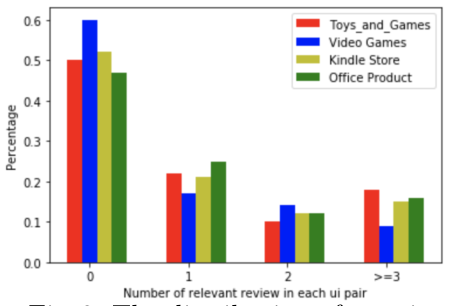
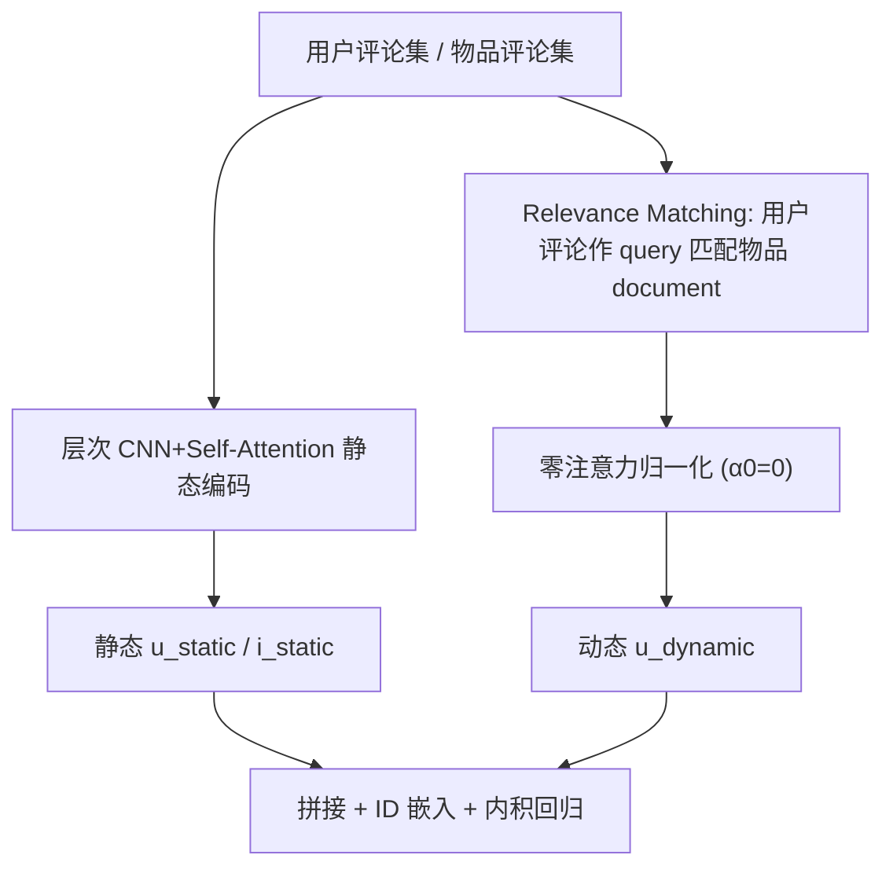
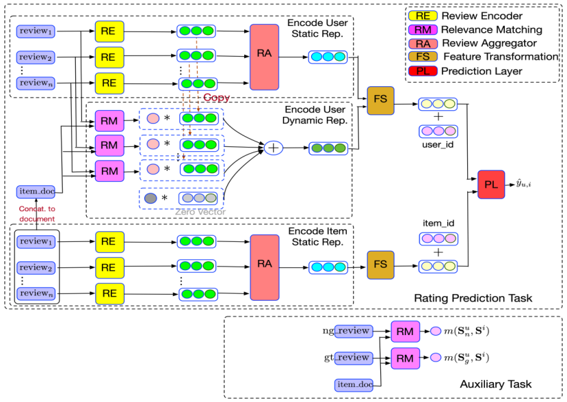

# A Zero Attentive Relevance Matching Network for Review Modeling in Recommendation System (零注意力相关性匹配评论推荐网络)

- **会议/期刊**: ECIR 2021
- **作者与机构**: Hansi Zeng, Zhichao Xu, Qingyao Ai（犹他大学计算学院）
- **推荐链路定位**: 精排（评分预测 / Rating Prediction）
- **研究方向**: 协同过滤与双塔召回 / 多模态推荐与内容理解
- **论文原文**: [https://arxiv.org/abs/2101.06387v2](https://arxiv.org/abs/2101.06387v2)
- **开源代码**: [https://github.com/HansiZeng/ZARM](https://github.com/HansiZeng/ZARM)

## TL;DR (1分钟核心速览)

评论增强推荐长期分为「siamese 静态编码」与「interaction-based 动态交互」两派，后者容量更大却常因强制匹配、语义相似度≠真实偏好而反被前者压制。本文提出 ZARM：把用户评论当 query、目标物品评论集当 document 做相关性匹配打分，用**零注意力**让无相关评论时动态表征自动退化为零向量、退回 siamese 通路，并用**真实评论正负对辅助损失**监督匹配函数。在 4 个 Amazon 5-core 数据集的比例划分评分预测（MSE）上，相对最优基线降低 0.83%–1.89%。

## Background & Motivation (背景与核心矛盾)

- **主流范式**: 评论建模分两支——DeepCoNN/NARRE 等 siamese 模型对用户、物品评论各自静态编码后回归评分；MPCN/AHN 等 interaction-based 模型用 co-attention 按目标物品动态抽取用户评论中有用部分。
- **前人局限 1（信息稀释）**: 共注意力在两个长文本序列上做词级对齐，用户与物品各有数十条、单条上千词的评论，匹配信号被大量无关词稀释。
- **前人局限 2（强制匹配导致过拟合）**: 训练集中用户评论往往根本不涉及目标物品的属性；强制从有限评论中"抠出"目标相关信息，会把无关侧面塞进用户表征，造成严重过拟合。
- **前人局限 3（语义相似度错位）**: 文本相似 ≠ 真实偏好——"我喜欢牛肉粉的味道"与"卡布奇诺味道不错"文本更相似，但"我是重度咖啡爱好者"对预测咖啡机评分才更有信息量。
- **核心洞察 (Key Insight)**: 统计显示约 48%–60% 的用户-物品对**不存在**任何相关评论（图 2），因此动态交互通路必须具备"主动弃权"的能力，而不是被归一化强制分配注意力权重。
- **本文切入点**: 用 IR 领域的 relevance matching + 零注意力替代 NLP 式 semantic matching，让模型在"有相关评论时动态、无相关评论时静态"之间平滑切换。

<figure class="paper-figure" markdown="span">
  <figcaption>图2：具有不同相关数量的用户-物品对分布</figcaption>
</figure>

## Method (核心方法设计)

### 1. 整体框架 (Overall Architecture)

模型由两路并行静态编码器与一路动态交互模块构成。静态侧对用户/物品评论做词→句→评论三层「CNN + 多头自注意力 + 加性注意力」层次编码，得到 $u_{static}$、$i_{static}$；动态侧把每条用户评论作为 query 与目标物品全部评论拼接成的 document 做相关性匹配得到$\alpha_k$，再经零注意力归一化加权求和得$u_{dynamic}$；两者拼接经特征变换层后与 ID 嵌入相加，用内积 + 偏置回归评分。训练时除回归损失外，额外以「用户对该物品写下的真实评论 = 正 query、随机负样本评论 = 负 query」构造辅助损失来监督匹配函数。

<figure class="paper-figure" markdown="span">
  <figcaption>图1：我们的模型结构概览</figcaption>
</figure>

### 2. 关键设计拆解 (Key Designs)

1. **相关性匹配函数替代共注意力**：痛点是大文本下词级共注意力被稀释 $\to$对第$k$条用户评论$S_u^k$与物品 document$S_i$先算相似度矩阵$\mathbf{M}=(S_u^k)^{\top}S_i$，再对每行做 mean/max 双池化并与词重要性$\mathrm{imp}(S_u^k)$逐元素相乘，拼接成$2M$维直方图式特征$I_{rel}$送入两层 FFN 输出标量$\alpha_k$。物理直觉：DRMM 式「池化直方图」把整篇 document 压缩为每词的匹配强度分布，长度不再是噪声源。
2. **零注意力 (Zero-Attention)**：痛点是 softmax 归一化后即使所有 $\alpha_k\ll 0$，权重仍会均摊到$1/N$，动态向量无法为零$\to$引入虚拟零分数$\alpha_0=0$参与归一化：$\hat{\alpha}_k=\frac{1+e^{\alpha_k}}{1+\sum_j e^{\alpha_j}}$，$\hat{\alpha}_0=\frac{1}{1+\sum_j e^{\alpha_j}}$，$u_{dynamic}=\sum_k \hat{\alpha}_k r_u^k+\hat{\alpha}_0\cdot\vec{0}$。当全部评论无关时$\hat{\alpha}_k\to 0$、$u_{dynamic}\to \vec{0}$，模型自动退化为纯 siamese；若某条$\alpha_k=10$，则$\hat{\alpha}_k\approx 1$，等价于只取该条评论。
3. **训练目标、负采样与推理效率**：总损失 $\mathcal{L}=\sum_{(u,i)}(y_{u,i}-\hat{y}_{u,i})^2-\big[\log m(S_u^{g},S_i)+\log(1-m(S_u^{n},S_i))\big]$，其中$S_u^g$为该用户对该物品的真实评论、$S_u^n$ 为跨用户跨物品随机采样评论（1 正 1 负的 pairwise 构造，无 in-batch 难负样本）。辅助损失把「真实偏好」而非「文本相似」注入匹配函数。推理时每条候选需与该用户全部评论逐一匹配，开销随评论数线性增长。

## Experimental Setup & Evaluation Protocol (实验设置与评估协议)

- **数据集与预处理**: 四个 Amazon 5-core 子类；用 NLTK 分词，用户/物品侧评论数统一截断为覆盖 90% 用户的条数。

| 数据集 | #Users | #Items | #Reviews | 密度 | 场景说明 |
| :--- | :---: | :---: | :---: | :---: | :--- |
| Toys & Games | 19k | 12k | 167k | 0.073% | 玩具评论，情感词密集 |
| Video Games | 24k | 11k | 232k | 0.088% | 电子游戏，评论最长 |
| Kindle Store | 68k | 62k | 983k | 0.023% | 电子书，最稀疏 |
| Office Products | 2k | 4k | 53k | 0.660% | 办公用品，最稠密 |

- **数据划分与防穿越 (Splitting Strategy)**: 用户-物品对**随机比例划分 8:1:1**（非全局时间戳切分，存在轻度未来信息穿越风险，原文未讨论）。
- **排名评测协议 (Ranking Protocol)**: **非 Full-Ranking**——本文是评分预测任务，仅在给定 $(u,i)$ 对上前向回归并报告 MSE，不涉及全库候选排序，也未报告采样排序指标（HR/NDCG）。
- **对比基线与超参设置**: 非文本基线 MF、NeuMF；siamese 基线 HFT、DeepCoNN、NARRE；interaction 基线 MPCN、AHN；以及 ZARM-static / ZARM-dynamic 两个自身变体。词向量 300 维 Google News 预训练，句/评论隐层 100 维，预测层 32 维，卷积核 1 或 3，注意力头数 2，dropout 0.2/0.3/0.5，Adam lr=0.001；**未报告显著性检验**。

## Key Experimental Results (实验关键数据)

### 1. 主实验对比 (Main Results)

| 类别 | 模型 | Toys & Games | Video Games | Kindle Store | Office Products |
| :--- | :--- | :---: | :---: | :---: | :---: |
| 非文本 | MF | 0.8010 | 1.0979 | 0.6231 | 0.6954 |
| 非文本 | NeuMF | 0.8012 | 1.0931 | 0.6255 | 0.6941 |
| Siamese | HFT | 0.7947 | 1.0837 | 0.6172 | 0.6881 |
| Siamese | DeepCoNN | 0.8273 | 1.1241 | 0.6437 | 0.7102 |
| Siamese | NARRE | 0.7982 | 1.0881 | 0.6199 | 0.6794 |
| Interaction | MPCN | 0.8199 | 1.1062 | 0.6337 | 0.7101 |
| Interaction | AHN | 0.8233 | 1.1137 | 0.6341 | 0.7341 |
| **Ours** | **ZARM** | **0.7881** | **1.0632** | **0.6083** | **0.6695** |
| — | Improv.% (vs 最优基线) | 0.83% | 1.89% | 1.44% | 0.92% |

### 2. 消融实验 (Ablation Study)

验证集 MSE（越低越好，默认配置略优于测试集，属正常波动）：

| 变体 | Toys | Video | Kindle | Office |
| :--- | :---: | :---: | :---: | :---: |
| Default (ZARM) | **0.7897** | **1.0611** | **0.5961** | **0.6731** |
| (1) 评论聚合改 max pooling | 0.7922 | 1.0645 | 0.6075 | 0.6795 |
| (2) 评论用词平均嵌入 | 0.7854 | 1.0641 | 0.6043 | 0.6742 |
| (3) 去相对位置编码 | 0.7913 | 1.0654 | 0.5985 | 0.6755 |
| (4) 去 user/item bias | 0.8021 | 1.0713 | 0.6022 | 0.6761 |
| (5) **去辅助损失** | 0.8147 | 1.0954 | 0.6189 | 0.6893 |
| (6) 对称增加 item 动态编码 | 0.7938 | 1.0695 | 0.6053 | 0.6800 |

### 3. 关键实验发现 (Key Findings)

- **辅助损失是最大贡献源**：去掉后 Toys 上 MSE 由 0.7897 升至 0.8147（+3.2%）、Kindle 由 0.5961 升至 0.6189（+3.8%），说明「用真实评论做正样本监督匹配函数」比任何结构改动都关键——匹配函数的监督信号质量决定了动态通路的成败。
- **交互收益高度不对称**：把动态编码对称地加到物品侧反而掉点（0.7938 vs 0.7897），印证"用户品味跨物品可迁移、物品属性不必因人而变"的假设，动态建模应单侧施加。
- **弃权机制有真实数据支撑**：约 50%（Video Games 60%、Office 48%）的用户-物品对不存在相关评论（$\alpha_k>0$），而 Toys 中 15% 的对拥有 ≥3 条相关评论；这直接解释了零注意力在稀疏对上退化为 siamese、在密集对上激活动态双通路，从而在两个方向同时优于纯 siamese 与纯 interaction 基线。

## Highlights & Limitations (亮点、对比与审稿批判)

- **与代表作对比 (vs. Prior Work)**: 与 MPCN/AHN 相比，ZARM 不做词级共注意力对齐，而用池化直方图式 relevance matching 抗长文本稀释，并额外具备"零向量弃权"能力；与 NARRE/DeepCoNN 相比，ZARM 在静态层次编码之外补上了目标相关的动态通路，因此严格包含 siamese 作为特例。
- **可迁移亮点**: ①零注意力技巧可推广到任何"候选证据可能全部无关"的注意力池化场景（多模态对齐、序列兴趣抽取、会话推荐）；②用「用户对该物品的真实行为文本」构造正负 query 对做辅助监督，是低成本引入偏好信号而非字面相似信号的通用正则手段。
- **审稿级局限批判**: ①评估仅覆盖 MSE 与随机 8:1:1 划分，缺失时间切分与全库排序指标，无法回答"能否提升 top-N 召回"；且全程无显著性检验、无多次运行方差。②匹配分 $m(\cdot,\cdot)$在式 (11) 中取值于$[-\infty,\infty]$，却在辅助损失中被当作概率直接取$\log$，缺少 sigmoid 归一化，属于数学表述不严谨；③推理需对每条候选做"用户全部评论 × 物品全部评论"的相似度矩阵，复杂度为$O(N_u M^2 N_i)$，工业场景下开销难以承受；④静态侧三层层次编码 + 三层自注意力，参数与训练成本均高于轻量 siamese 基线。

## Rating (四维评分)

- **方法创新性 (Novelty)**: ⭐⭐⭐ （零注意力弃权 + 真实评论辅助监督的组合颇为巧妙，但 relevance matching 本身直接借用 DRMM/K-NRM，缺少理论或谱分析支撑）
- **评估协议与实验扎实度 (Protocol & Experiments)**: ⭐⭐ （仅 MSE、随机划分、无显著性检验与全库排序评估，消融仅在验证集上进行）
- **写作与数学规范度 (Clarity & Rigor)**: ⭐⭐⭐ （三层编码与零注意力推导清晰，但匹配分在损失中被当作概率使用，且 $m$ 的取值域未统一）
- **工业落地与复现价值 (Industrial & Practical Value)**: ⭐⭐⭐ （代码开源、思路易复现，但仅适用评分预测、推理复杂度随评论数平方增长，需重设计才能用于大规模召回/排序）

