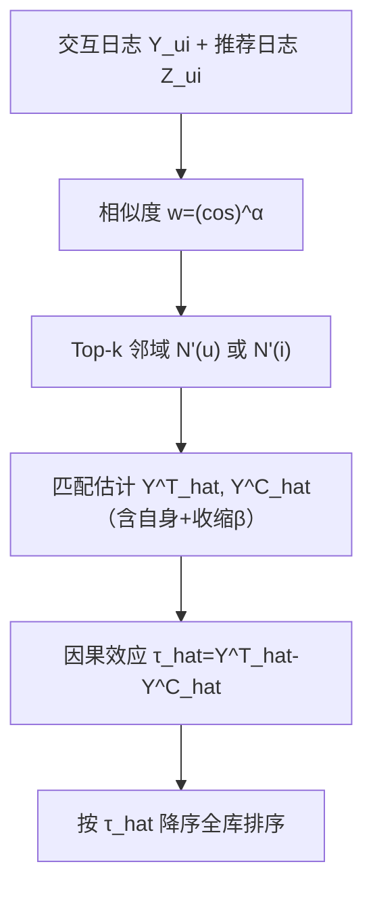

# Causality-Aware Neighborhood Methods for Recommender Systems (因果感知的推荐系统邻域方法)

- **会议/期刊**: ECIR 2021
- **作者与机构**: Masahiro Sato, Janmajay Singh, Sho Takemori, Qian Zhang; Fuji Xerox
- **推荐链路定位**: 精排/排序（全库因果效应排序）
- **研究方向**: 去偏公平与工业架构 / 协同过滤
- **论文原文**: [https://arxiv.org/abs/2012.09442v2](https://arxiv.org/abs/2012.09442v2)
- **开源代码**: 暂未开源

## TL;DR (1分钟核心速览)

针对“推荐带来的真实交互增量”常被普通精度指标高估、IPS 因果排序又因小倾向性高方差的问题，本文把传统用户/物品邻域方法与因果推断中的匹配估计器统一：用邻居在推荐/未推荐条件下的观测结果估计潜在结果，并加入自身观测混合与收缩参数，得到 $\hat{\tau}_{ui}$ 后按因果效应降序全库排序。在 ML-100K/1M 与 Dunnhumby 半合成数据上，CP@10 相对最优基线约提升 5%，且对倾向性不均更稳健。

## Background & Motivation (背景与核心矛盾)

- **主流范式**: 推荐通常优化点击/购买精度，但业务真正关心的是“因为推荐才发生的交互”；已有因果排序工作主要用 IPS 去偏。
- **前人局限**: IPS 依赖倾向性 $P_{ui}$，小倾向性导致高方差；倾向性截断虽降方差却引入偏差。普通邻域 CF 只拟合交互$Y_{ui}$，不区分推荐暴露$Z_{ui}$ 的因果作用。
- **核心洞察 (Key Insight)**: 匹配估计器不需要倾向性，而是用相似个体在相反处理组中的观测结果补全潜在结果；这与邻域推荐“找相似用户/物品”天然同构。
- **本文切入点**: 将 UBN/IBN 的相似度加权预测改造成处理组/对照组的潜在结果估计，并对估计做自身混合与收缩，稳健排序 $\tau_{ui}=Y^{T}_{ui}-Y^{C}_{ui}$。

## Method (核心方法设计)

### 1. 整体框架 (Overall Architecture)

输入为历史交互 $Y_{ui}$与历史推荐日志$Z_{ui}$。先用交互或推荐分配计算用户/物品相似度$w$，取 Top-$k$邻域；然后在$Z=1$与$Z=0$的邻居子集中分别加权平均，估计$\hat{Y}^{T}_{ui}$与$\hat{Y}^{C}_{ui}$。为降低行为随机噪声，把自身$u$或$i$纳入邻域并令$w_{uu}=w_{ii}=1$；再用收缩参数$\beta$压低低相似小邻域估计。最终$\hat{\tau}_{ui}=\hat{Y}^{T}_{ui}-\hat{Y}^{C}_{ui}$，按降序生成全库排序。训练无需梯度反传，主要开销是相似度与 Top-$k$ 邻域构建。

### 2. 关键设计拆解 (Key Designs)

1. **邻域匹配估计（CUBN/CIBN）**: 痛点是把 CF 预测当作因果效应。本文在用户侧写
$\hat{Y}^{T}_{ui}=\frac{\sum_{v\in N'(u)}w_{uv}Z_{vi}Y_{vi}}{\beta_T+\sum_{v\in N'(u)}w_{uv}Z_{vi}}$，
$\hat{Y}^{C}_{ui}$将$Z_{vi}$换为$1-Z_{vi}$；物品侧对称。直觉是：若相似用户在被推荐/未被推荐时结果不同，则该差异可补全当前用户的反事实结果。相似度可用结果$Y$（后缀 -O）或推荐分配$Z$（后缀 -T），权重$w_{uv}=(\cos(u,v))^\alpha$。

2. **自身混合与收缩去噪**: 单次 $Y_{ui}$有随机噪声，且小邻域估计不稳。将自身观测并入邻域并设$w=1$，使估计在“自身结果”和“邻居结果”间折中；在分母加$\beta_T,\beta_C$，当有效邻居权重不足时把$\hat{Y}$拉向 0。实验取$\beta=\beta_T=\beta_C$，最优$\beta>0$，说明收缩不是可有可无的正则，而是因果效应排序的方差控制核心。

3. **训练目标、负采样与推理**: 无常规 BPR/InfoNCE 训练，也不需要负采样；估计器直接由观测日志闭式计算。推理时对每个用户计算所有物品 $\hat{\tau}_{ui}$ 并全库排序；复杂度主要来自相似度矩阵与邻域检索，适合已有推荐日志的工业系统，但全库逐物品计算在超大目录下需近似邻域/倒排加速。

## Experimental Setup & Evaluation Protocol (实验设置与评估协议)

- **数据集与预处理**: 使用 ML-100K、ML-1M 与 Dunnhumby（DH）半合成数据；ML 由矩阵分解预测评分与观测概率，按 $\mu^{T}_{ui}=\sigma(\hat{R}_{ui}-5)$、$\mu^{C}_{ui}=\hat{O}_{ui}$生成潜在结果；倾向性$P_{ui}=\min(1,a(1/\mathrm{rank}_{ui})^b)$，默认每用户约 100 次推荐。无 5-core 过滤。

| 数据集 | #Users | #Items | #Interactions ($Y=1$) | #推荐 ($Z=1$) | ATE |
| :--- | :---: | :---: | :---: | :---: | :---: |
| DH-Original | 2,309 | 1,372 | 35,010 | 483,660 | 0.0044 |
| DH-Personalized | 2,309 | 1,372 | 37,731 | 483,727 | 0.0045 |
| ML-100K | 943 | 1,682 | 92,523 | 94,054 | 0.0735 |
| ML-1M | 6,040 | 3,952 | 985,994 | 603,108 | 0.0981 |

- **数据划分与防穿越**: 训练/验证/测试独立采样；每个 user-item 对训练仅采样一次观测（$n_{\text{train}}=1$），更贴近因果效应不可同时观测的本质。
- **排名评测协议**: 无偏 **Full-Ranking（全库排序）**，按预测因果效应 $\hat{s}_{ui}=\hat{\tau}_{ui}$排序；指标为因果版 CP@n、CDCG、CAR：$\mathrm{CP@}n=\frac{\sum_i \mathbb{I}(\mathrm{rank}_u(\hat{s}_{ui})\le n)\tau_{ui}}{n}$，$\mathrm{CDCG}=\sum_i \frac{\tau_{ui}}{\log_2(1+\mathrm{rank}_u(\hat{s}_{ui}))}$，$\mathrm{CAR}=\frac{1}{|I|}\sum_i \mathrm{rank}_u(\hat{s}_{ui})\tau_{ui}$；CAR 越小越好。
- **对比基线与超参**: Random、Pop、BPR、UBN/IBN、CausE、ULRMF、ULBPR、DLTO、DLCE。无嵌入维度 $d$，主超参为邻域数$k\in\{10,30,100,300,1000,3000,10000\}$、$\alpha\in\{0.33,0.5,1,2,3,5\}$、$\beta\in\{0,0.3,1,3,10,30,100\}$，按验证集逐指标调参；原文未报告显著性检验，采用独立采样评估。

## Key Experimental Results (实验关键数据)

### 1. 主实验对比 (Main Results)

下表取 ML-100K/1M 的代表性结果（完整 DH 见原文）；加粗为各列最优。

| 数据集 | 方法 | CP@10 | CP@100 | CDCG | CAR↓ |
| :--- | :--- | ---: | ---: | ---: | ---: |
| ML-100K | BPR | 0.092 | 0.088 | 14.0 | 61.7 |
| ML-100K | CausE | 0.310 | 0.214 | 16.4 | 34.4 |
| ML-100K | ULBPR | 0.333 | 0.163 | 15.6 | 43.9 |
| ML-100K | DLTO | 0.330 | 0.155 | 15.3 | 53.2 |
| ML-100K | DLCE | 0.330 | 0.215 | 16.6 | 28.8 |
| ML-100K | CUBN-O | 0.349 | **0.218** | **16.9** | 27.2 |
| ML-100K | CUBN-T | **0.350** | **0.218** | 16.8 | **25.9** |
| ML-1M | BPR | 0.102 | 0.103 | 38.1 | 194 |
| ML-1M | CausE | 0.309 | 0.246 | 42.4 | 122 |
| ML-1M | ULBPR | 0.245 | 0.187 | 40.4 | 143 |
| ML-1M | DLTO | 0.289 | 0.202 | 40.5 | 152 |
| ML-1M | DLCE | 0.319 | **0.258** | 42.4 | 119 |
| ML-1M | CUBN-O | 0.334 | **0.258** | **42.7** | **116** |
| ML-1M | CUBN-T | **0.336** | 0.256 | 42.6 | 127 |

**Improv.%**（相对同数据集最优非本文基线）: ML-100K CP@10 $+5.1\%$（0.350 vs 0.333），CAR 降低$10.1\%$（25.9 vs 28.8）；ML-1M CP@10$+5.3\%$（0.336 vs 0.319），CAR 降低$2.5\%$（116 vs 119）。

### 2. 消融实验 (Ablation Study)

去掉自身+邻居混合（-woM）后，CP 类指标明显下降，说明混合观测是降噪关键。

| 数据集 | 变体 | CP@10 | CP@100 | CDCG | CAR↓ |
| :--- | :--- | ---: | ---: | ---: | ---: |
| ML-100K | CUBN-O | 0.349 | 0.218 | 16.9 | 27.2 |
| ML-100K | CUBN-O-woM | 0.310 | 0.194 | 16.6 | 29.0 |
| ML-100K | CUBN-T | 0.350 | 0.218 | 16.8 | 25.9 |
| ML-100K | CUBN-T-woM | 0.311 | 0.194 | 16.6 | 29.0 |
| ML-1M | CUBN-O | 0.334 | 0.258 | 42.7 | 116 |
| ML-1M | CUBN-O-woM | 0.291 | 0.233 | 42.4 | 115 |
| ML-1M | CUBN-T | 0.336 | 0.256 | 42.6 | 127 |
| ML-1M | CUBN-T-woM | 0.294 | 0.237 | 42.4 | 114 |

### 3. 关键实验发现 (Key Findings)

- 邻域方法经因果化后显著优于相同邻域的传统 UBN/IBN 与模型式因果基线；ML-100K 上 CUBN-T 的 CP@10 达 0.350，而 UBN 为 -0.217，说明“按 $Y$排序”与“按$\tau$ 排序”目标错位是核心增益来源。
- 倾向性越不均（$b$ 增大），DLCE 明显退化，而 CUBN-O/T 更稳；因为匹配估计不依赖逆倾向权重，避免了小倾向性爆炸。
- 收缩 $\beta>0$最优，且 CP@10 的最优$\beta$ 大于 CP@100；小列表对高估噪声更敏感，需更强收缩。混合自身观测主要提升 CP，但在 ML-1M CAR 上未必单调，说明排序位置指标与 top-n 指标存在张力。

## Highlights & Limitations (亮点、对比与审稿批判)

- **与代表作对比 (vs. Prior Work)**: 相比 DLCE 的 IPS 无偏学习，本文用匹配估计器绕开倾向性估计，方差更稳；相比 ULRMF/ULBPR 的启发式标签变换，本文有明确的潜在结果估计式；相比 CausE 的双模型联合训练，本文是闭式邻域估计，部署需推荐日志但无需倾向性。
- **可迁移亮点**: ①把“自身观测”并入邻域并加收缩，可迁移到任何邻域/图召回去噪；②用推荐日志 $Z$ 的相似度构造 -T 变体，可作为暴露感知的用户表征。
- **审稿级局限批判**: ①全库逐物品估计在千万级目录下开销大，需 ANN/倒排近似；②半合成数据依赖生成假设，真实线上因果效应验证不足；③无干预/无多版本假设较强，且 CAR 与 CP 的最优超参不完全一致。

## Rating (四维评分)

- **方法创新性 (Novelty)**: ⭐⭐⭐⭐ （首次把匹配估计器系统引入推荐因果排序，邻域匹配与 CF 的同构洞察清晰）
- **评估协议与实验扎实度 (Protocol & Experiments)**: ⭐⭐⭐⭐ （全库因果指标、半合成生成、倾向性/日志量鲁棒性分析完整，但真实数据有限）
- **写作与数学规范度 (Clarity & Rigor)**: ⭐⭐⭐⭐ （估计式与假设交代清楚，公式简洁；部分指标与超参交互解释可更细）
- **工业落地与复现价值 (Industrial & Practical Value)**: ⭐⭐⭐⭐ （无需倾向性、可直接用日志闭式排序，适合已有推荐日志场景；全库计算需工程加速）

