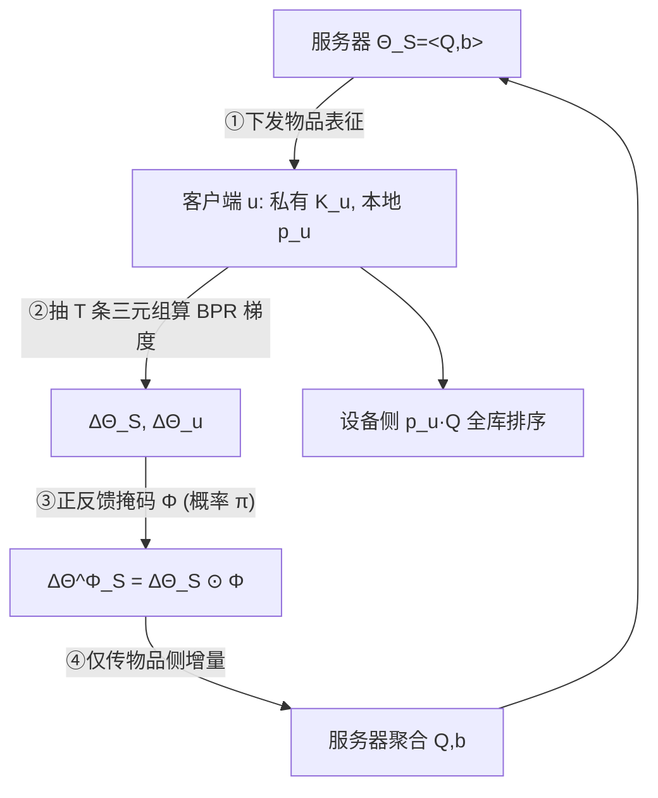

# FedeRank: User Controlled Feedback with Federated Recommender Systems (用户可控反馈的联邦推荐系统)

- **会议/期刊**: ECIR 2021（43rd European Conference on Information Retrieval）
- **作者与机构**: Vito Walter Anelli, Yashar Deldjoo, Tommaso Di Noia, Antonio Ferrara, Fedelucio Narducci（Politecnico di Bari, Italy）
- **推荐链路定位**: 召回（隐式反馈 Top-N 排序的联邦训练）
- **研究方向**: 去偏公平、可信隐私与工业架构 / 协同过滤与双塔召回
- **论文原文**: [https://arxiv.org/abs/2012.11328v3](https://arxiv.org/abs/2012.11328v3)
- **开源代码**: 暂未开源（正文给出项目页 `https://split.to/federank`，未检索到代码仓库）

## TL;DR (1分钟核心速览)

集中式 MF 必须把用户全部隐式反馈上传服务器，且现有联邦 CF（FCF）沿用点式 SVD/ALS 目标，无法做 Top-N 排序、也不防"梯度反解"。FedeRank 把 BPR 成对排序拆成"服务器持物品侧 $\langle Q,b\rangle$+ 设备持用户侧$\langle p_u\rangle$"，并用随机掩码$\Phi$让客户端只以比例$\pi$上传正反馈（负反馈恒发），从而把"披露多少"交给用户。在 3 个真实数据集、时间切分 + 全库排序协议下，$\pi$仅 0.1 即达最优精度的约 92%；真实联邦设定（$T=X^+/|U|$）在 Amazon DM / LibraryThing 上 P@10 相对 BPR-MF 提升 54.4% / 21.4%。

## Background & Motivation (背景与核心矛盾)

- **主流范式**: 隐式反馈召回以 MF + BPR 成对损失为主流，模型集中训练、数据集中在服务器；近年 FL 兴起，联邦 CF 代表作为 FCF（SVD-MF 隐式反馈 + ALS/SGD 混合）。
- **前人局限**: ① FCF 优化的是点式重构误差，与 Top-N 排序目标错位，几乎没有工作做"联邦 learning-to-rank"；② 纯联邦并不能保护隐式反馈——在 BPR 下同一三元组的正/负物品梯度互为反号，服务器只看见非零行就能反解用户的 $K_u$，即"联邦 ≠ 隐私"。
- **核心洞察 (Key Insight)**: 用户"未交互"的物品与负样本不可区分，可视为非敏感信息；真正敏感的是"已消费"正反馈。因此只需对正反馈做随机取舍即可切断反解路径，且用户自己能控制披露比例 $\pi$。
- **本文切入点**: 首次把 BPR 成对目标联邦化，并用掩码算子 $\Phi$ 把数据所有权显式变成一个用户可调超参。

## Method (核心方法设计)

### 1. 整体框架 (Overall Architecture)

服务器 $S$持有全局物品模型$\Theta_S=\langle Q,b\rangle$，每台设备$u$只持有自己的用户向量$\Theta_u=\langle p_u\rangle$与私有交互行$x_u$。每轮通信按 *下发 → 本地优化 → 上传 → 全局聚合* 四步循环：$S$广播最新$\Theta_S$；被选中的客户端从本地$K_u=\{(u,i,j)\mid x_{ui}=1\wedge x_{uj}=0\}$抽$T$条三元组算梯度，同时更新本地$p_u$；上传前用掩码$\Phi$裁剪正物品行；$S$端做加权求和更新$Q,b$。推理完全在设备侧用$p_u$与下发的$Q$做点积全库排序，通信量仅$O(|I|F)$。

### 2. 关键设计拆解 (Key Designs)

1. **联邦 BPR 切分（参数边界 = 隐私边界）**：针对集中式 MF 需上传 $X$的痛点，把$\Theta$ 按"物品侧/用户侧"切开，客户端只计算
$\Delta\Theta_u=\sum_{(u,i,j)\in K_u^-}\frac{\partial}{\partial\Theta_u}\ln\sigma(\hat{x}_{uij})$并同样把对$\Theta_S$ 的偏导上传。物理直觉：物品表征本就由全体用户共享统计量决定，天然适合中心聚合；用户向量一旦永不出设备，隐私成本就降到零。

2. **正反馈随机掩码 $\Phi$（核心增量）**：由于$\Delta q_i=-\Delta q_j$（同绝对值反号），服务器可轻易区分消费/未消费。本文引入随机对象$\Phi=\langle Q^\Phi,b^\Phi\rangle$，对出现在$K_u^-$的正物品以概率$\pi$置 1、以$1-\pi$ 置 0，负物品行恒为 1，得
$\Delta\Theta_S^{\Phi}=\Delta\Theta_S\odot\Phi$其中$\odot$为 Hadamard 积。这样正物品行被"随机抹平"，反解退化；同时若把$\Phi$ 扩展为对负物品也发假信息，该机制即等价于 randomized response，可直接衔接本地差分隐私。

3. **本地计算预算 $T$与训练目标**：设置$T=1$（与 BPR 单三元组严格对齐）与$T=X^+/|U|$（真实联邦、本地多步）两档。损失为 BPR pairwise + L2（用户/正物品正则$=lr/20$，负物品$=lr/200$），负样本从用户未交互集合均匀采；每轮仅选$|U^-|=1$个客户端以消除聚合噪声、保证与集中式可比。值得注意：Rendle 曾建议集中式训练须随机打散三元组、避免 user-wise 遍历，而联邦架构**被迫** user-wise，实验却显示$T=X^+/|U|$优于$T=1$，反证了"user-wise 必然损害精度"。

## Experimental Setup & Evaluation Protocol (实验设置与评估协议)

- **数据集与预处理**: 过滤掉交互数 < 20 的冷用户（cold-users），保留 1–5 / 1–10 的评分并二值化为隐式反馈。

| 数据集 | #Users | #Items | #Interactions ($X^+$) | 密度 | 特征/场景说明 |
| :--- | :---: | :---: | :---: | :---: | :--- |
| Amazon Digital Music | 1,835 | 41,488 | 75,932 | ≈0.10% | 音乐，$X^+/|U|=41.4$，极稀疏 |
| LibraryThing | 7,279 | 37,232 | 749,401 | ≈0.28% | 图书，$X^+/|U|=103.0$ |
| MovieLens 1M | 6,040 | 3,706 | 1,000,209 | ≈4.47% | 电影，$X^+/|U|=165.6$，$|U|/|I|$ 比极高 |

- **数据划分与防穿越 (Splitting Strategy)**: 全局 **时间戳 80/20 切分** 训练/测试；训练集内再按用户做时间序 20% 留作验证集（严格防穿越）。
- **排名评测协议 (Ranking Protocol)**: 报告 P@10 / R@10 与列表级多样性 IC@10、Gini@10。论文未显式声明候选集规模与负采样比（疑为全库排序打分），这一点在复现时需谨慎。
- **对比基线与超参设置**: Random、Most Popular、User-kNN、Item-kNN、VAE、BPR-MF（集中式 BPR 原版）、FCF（唯一联邦基线）。隐因子 $F=20$（受联邦端内存约束），学习率网格$\{0.005,\dots,0.5\}$，取前 20 epoch 内最优模型，$\pi\in[0.0,1.0]$ 步长 0.1。

## Key Experimental Results (实验关键数据)

### 1. 主实验对比 (Main Results)

| 方法 | Amazon P@10 | Amazon R@10 | LibraryThing P@10 | LibraryThing R@10 | ML1M P@10 | ML1M R@10 |
| :--- | :---: | :---: | :---: | :---: | :---: | :---: |
| Most Popular | 0.00469 | 0.00603 | 0.05013 | 0.03044 | 0.10224 | 0.03924 |
| User-kNN | 0.01940 | 0.02757 | 0.14193 | 0.10115 | **0.12613** | **0.06701** |
| Item-kNN | **0.02147** | **0.03171** | **0.20214** | **0.14778** | 0.08873 | 0.05475 |
| VAE | 0.01580 | 0.02289 | 0.10834 | 0.07711 | 0.11735 | 0.06192 |
| BPR-MF | 0.00921 | 0.01298 | 0.07009 | 0.04303 | 0.11911 | 0.05817 |
| FCF (联邦) | 0.00839 | 0.01222 | 0.10760* | 0.04392* | 0.10760 | 0.04392 |
| FedeRank ($T=1$) | 0.00610 | 0.00889 | 0.06309 | 0.03738 | 0.11805 | 0.05902 |
| **FedeRank ($T=X^+/|U|$)** | 0.01422 | 0.02060 | 0.08512 | 0.05627 | 0.11599 | 0.05571 |
| **Improv. vs BPR-MF** | **+54.4%** | **+58.7%** | **+21.4%** | **+30.8%** | −2.6% | −4.2% |

（*原文 LibraryThing 的 FCF 行与 MovieLens 行数值完全相同，疑为排版/复制错误，引用时需核对。）

### 2. 消融实验 (Ablation Study)

本文未提供常规"模块删除"式消融，其消融由 **本地计算预算 $T$** 与 **披露比例$\pi$** 两个维度承担：

| 配置 | Amazon P@10 | LibraryThing P@10 | ML1M P@10 | 归因 |
| :--- | :---: | :---: | :---: | :--- |
| $T=1$（对齐 BPR 单步） | 0.00610 | 0.06309 | 0.11805 | 本地仅 1 条三元组，梯度噪声大、收敛不足 |
| $T=X^+/|U|$（真实联邦） | 0.01422 | 0.08512 | 0.11599 | 本地多步 ≈ 一台设备跑完一个 user-wise epoch，收益主要来自优化充分性 |
| $\pi=0.0$（仅负反馈） | 随机水平（低一个数量级） | 同左 | 同左 | 无正信号，退化为 Random |
| $\pi=0.1$ | 达最优值约 92% | 略低于峰值 | ≈最优 | 少量正反馈已足以标定物品价值 |
| $\pi=0.8/0.5(T=1)$、$0.9/1.0(T=X^+/|U|)$| 峰值 | 峰值 | 峰值 | 最高精度并**不**出现在$\pi=1.0$ |

<figure class="paper-figure" markdown="span">
  ![图 1：在 \[0.1, 1\] 范围内不同 π 值下的 F1 性能。深蓝色为 T = 1，浅蓝色为 T = X+/|U|。](../../../../assets/papers/2012.11328v3/figure_1.png)<figcaption>图 1：在 [0.1, 1] 范围内不同 π 值下的 F1 性能。深蓝色为 T = 1，浅蓝色为 T = X+/|U|。</figcaption>
</figure>

### 3. 关键实验发现 (Key Findings)

1. **少量披露即可逼近上限**：$\pi$从 0.0 提到 0.1，Amazon/LibraryThing 的 P@10 直接跃升一个数量级并达到最优值的约 92%；MovieLens 因密度高（4.47%）、$|U|/|I|=1.63$，10% 披露几乎无损。这说明"隐私—精度"曲线在低$\pi$ 区间极其平坦，用户无需全额披露。
2. **$\pi$过高反而降低精度、抬高多样性**：峰值出现在$\pi=0.8$–1.0 之前，继续加大披露后 IC@10 单调上升而精度回落，说明多出的正反馈主要让模型把长尾/不受欢迎物品错误推上前排——即"全量数据未必是最优数据"，与集中式"数据越多越好"的直觉相反。
3. **联邦并未放大流行度偏置**：对比图 3 的各 $\pi$曲线，只有$\pi=0$是例外（退化为随机、IC 虚高）；只要$\pi\ge 0.1$，推荐列表中的物品流行度分布几乎重合，且与数据集真实正反馈量（黑虚线）形状一致。即模型能"吸收"初始上传分布的扰动，掩码只改变学习过程中的更新频次，不改变最终曝光结构——这是此前 factorization 模型未被揭示的性质。

## Highlights & Limitations (亮点、对比与审稿批判)

- **与代表作对比 (vs. Prior Work)**: 相比 FCF（点式 SVD-MF + ALS/SGD，无法做 Top-N、无披露控制），FedeRank 是首个联邦 pairwise LTR 方案，且把 $\pi$暴露为接口；相比集中式 BPR-MF，它在低计算预算下略逊（$T=1$时仅 67%/88% 水平），但在真实联邦预算（$T=X^+/|U|$）下反超 20%–59%。
- **可迁移亮点**: ① "梯度反号 → 反解三元组"这一攻击面分析可迁移到所有 pairwise/对比学习联邦推荐；② 用"未交互=非敏感"的信息分级来定义掩码粒度，是数据最小化的轻量工程实现。
- **审稿级局限批判**: ① 每轮只聚合 $|U^-|=1$个客户端，本质是串行 SGD，"联邦"的通信效率优势完全未验证；② 评测协议未交代候选集规模与负采样比，P@10 在极稀疏数据（0.1%）上仅 0.01 量级，与 kNN 类基线仍有差距；③$\pi$的最优值随数据集漂移（0.5–1.0），文中未给出选取准则；④ 无形式化隐私预算（$\varepsilon$）分析，DP 兼容性仅是"可衔接"的论述；⑤ LibraryThing 的 FCF 行疑似数据错误，削弱可复现信心。

## Rating (四维评分)

- **方法创新性 (Novelty)**: ⭐⭐⭐⭐ （首个联邦 BPR 框架，且首次指出成对梯度反号导致的三元组反解风险，掩码算子 $\Phi$ 简洁且可接 DP）
- **评估协议与实验扎实度 (Protocol & Experiments)**: ⭐⭐⭐ （时间切分 + 三数据集 + $\pi$ 全扫描较扎实，但无标准组件消融、候选集协议缺失、FCF 数值疑似错误）
- **写作与数学规范度 (Clarity & Rigor)**: ⭐⭐⭐⭐ （四步通信流程与 Eq.1–6 推导清晰，隐私动机解释到位；缺乏复杂度与隐私预算的形式化）
- **工业落地与复现价值 (Industrial & Practical Value)**: ⭐⭐⭐ （仅传物品侧增量、通信量 $O(|I|F)$、$F=20$内存友好，天然契合端侧部署；但$|U^-|=1$ 的串行设定离真实大规模联邦仍有距离，且无开源代码）

