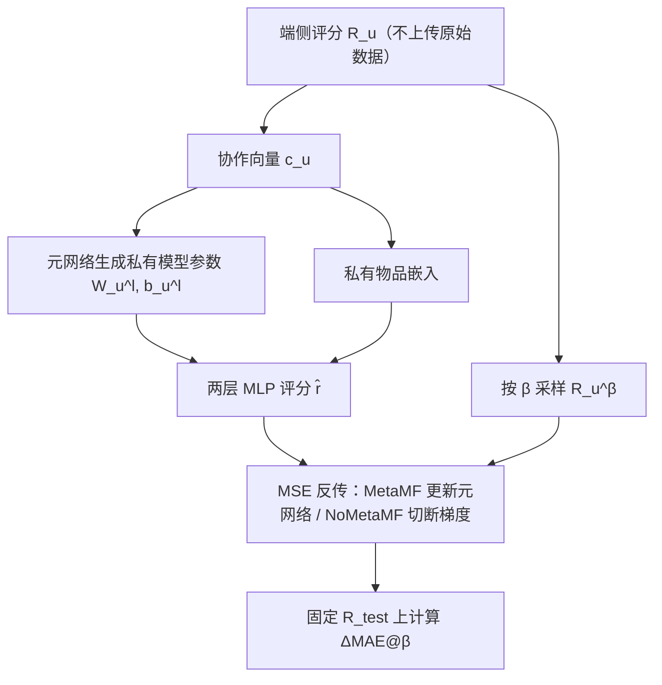
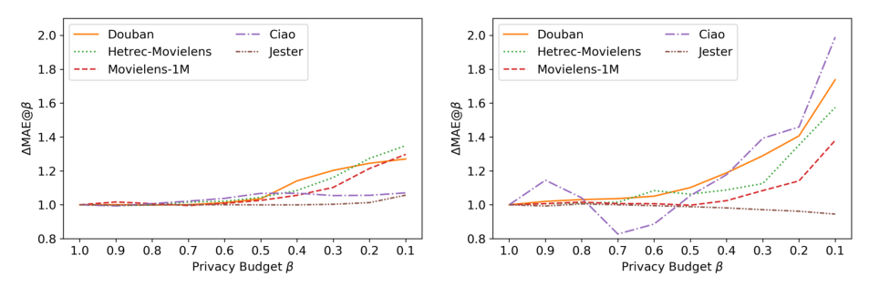
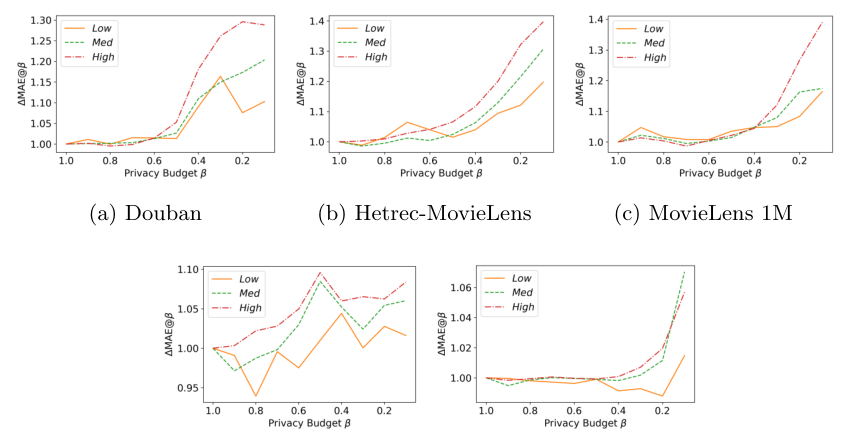

# Robustness of Meta Matrix Factorization Against Strict Privacy Constraints (元矩阵分解在严格隐私约束下的鲁棒性研究)

- **会议/期刊**: ECIR 2021, Reproducibility Track
- **作者与机构**: Peter Muellner, Dominik Kowald (Know-Center GmbH, Graz); Elisabeth Lex (TU Graz)
- **推荐链路定位**: 精排（评分预测）/ 联邦端侧个性化建模
- **研究方向**: 去偏公平、可信隐私与工业架构 / 协同过滤与双塔召回
- **论文原文**: [https://arxiv.org/abs/2101.06927v2](https://arxiv.org/abs/2101.06927v2)
- **开源代码**: [https://github.com/pmuellner/RobustnessOfMetaMF](https://github.com/pmuellner/RobustnessOfMetaMF)

## TL;DR (1分钟核心速览)

本文针对 MetaMF（Lin 等，联邦+元学习的矩阵分解）的两个未解问题：结果能否复现、以及当用户只肯共享极少量评分（严格隐私预算）时是否还能用。作者在 Douban/Hetrec-MovieLens/MovieLens 1M/Ciao/Jester 五数据集上复现了 MAE（误差 <2%），并提出隐私预算 $\beta$采样流程与相对度量$\Delta\mathrm{MAE}@\beta$，配合去掉元学习的对照模型 NoMetaMF 做消融。结论：$\beta\approx0.5$是性能崩塌临界点，元学习在$\beta\le0.5$ 时把精度衰减压住；且评分很多的活跃用户在隐私收紧后反而比冷门用户跌得更狠。

## Background & Motivation (背景与核心矛盾)

- **主流范式**: 联邦学习让原始交互不出端侧，元学习（超网络）用极少量数据快速生成个性化假设；MetaMF 将二者结合，为用户各自生成一个私有评分预测模型。
- **前人局限**: MetaMF 原文自陈其关键短板是**对数据稀疏的敏感性**——而"用户扣留数据"正是隐私保护下的常态；此外原文未给出可严格对齐的随机种子与超参细节，复现存在红灯。
- **核心洞察 (Key Insight)**: 若把"用户愿意共享的评分占比"显式参数化为隐私预算 $\beta$，则隐私强度与数据稀缺度被统一成同一根坐标轴，模型的鲁棒性就可以被逐点测量；而元学习恰恰是"用少量数据快速适应"的机制，理应在此坐标轴上兑现优势。
- **本文切入点**: 用同一份代码+同一套超参复现原文，再人为构造 $\beta\in\{1.0,\dots,0.1\}$ 的十档数据，横向对照 MetaMF 与 NoMetaMF，把"元学习是否必需"变成可观测事实。

## Method (核心方法设计)

### 1. 整体框架 (Overall Architecture)

MetaMF 的闭环分三步：先在联邦侧聚合出**协作向量** $\mathbf{c}_u$（概括该用户与其他用户的共现信息，不含原始评分）；再由**元网络**（超网络）以$\mathbf{c}_u$为输入，一次性前向生成该用户私有评分模型的逐层权重与偏置；并并行产出该用户的私有物品嵌入；最后用这套"私人定制"的两层 MLP + 私有嵌入对目标物品打分。训练以 MSE 为目标反传，梯度穿过元网络更新超参数。本文在此之上加装两条旁路：一条把元网络梯度**人为切断**得到 NoMetaMF（结构不变、只失学习能力），另一条按$\beta$ 对每个用户的评分做无放回采样生成训练集，从而把"隐私强度"变成可控变量并在固定测试集上算相对误差。推理阶段仍是标准的内积式打分，无额外解码开销。

### 2. 关键设计拆解 (Key Designs)

1. **元网络参数生成（MetaMF 的承重墙）**：痛点是个性化模型参数随用户数线性膨胀、且新用户无数据可训。超网络把"生成权重"当作一次前向：$\mathbf{h}=\mathrm{ReLU}(\mathbf{W}^{*}_{h}\mathbf{c}_u+\mathbf{b}^{*}_{h})$，$\mathbf{W}^{l}_{u}=\mathbf{U}^{*}_{W^{l}_{u}}\mathbf{h}+\mathbf{b}^{*}_{W^{l}_{u}}$，偏置$\mathbf{b}^{l}_{u}$同理。直觉上$\mathbf{c}_u$相似$\Rightarrow$ $\mathbf{h}$相似$\Rightarrow$ 生成参数相近，协同信息因此被"注入"到每人一套的权重里，形成嵌入空间中的簇。

2. **NoMetaMF 反事实对照（本文的因果探针）**：原文另有 MetaMF-SM（全体共享一个模型），但那只混淆了"共享 vs 私有"。本文的 NoMetaMF 保留每用户私有模型、只**关闭穿过元网络的反传**，使 $\mathbf{W}^{*}_{h},\mathbf{U}^{*}_{W^{l}_{u}},\mathbf{b}^{*}_{W^{l}_{u}}$ 冻结不学。这样"个性化能力"与"元学习能力"被正交拆开，才能干净地归因鲁棒性来源。

3. **隐私预算采样与 $\Delta\mathrm{MAE}@\beta$（可迁移的评估算子）**：对每个$u$无放回抽取$\mathcal{R}^{\beta}_{u}\subseteq\mathcal{R}_{u}$满足$|\mathcal{R}^{\beta}_{u}|/|\mathcal{R}_{u}|=\beta$，且保证每人至少留 1 条；随后$\mathrm{MAE}@\beta=\frac{1}{|\mathcal{R}_{test}|}\sum|\hat{r}-r|$，$\Delta\mathrm{MAE}@\beta=\mathrm{MAE}@\beta/\mathrm{MAE}@1.0$。由于是相对量纲，可跨数据集横向比较鲁棒性——这是原文没有的度量工具。训练目标仍为$\mathcal{L}=\mathrm{MSE}$，无负采样（回归任务）。

## Experimental Setup & Evaluation Protocol (实验设置与评估协议)

- **数据集与预处理**: 五个数据集均沿用原文处理，无 5-core 过滤；Jester 评分为本文新引入并线性缩放至 $[1,5]$ 以对齐量纲。

| 数据集 | #Users | #Items | #Interactions | 密度 | 场景说明 |
| :--- | :---: | :---: | :---: | :---: | :--- |
| Douban | 2,509 | 39,576 | 893,575 | 0.90% | 每物品均 22.6 条，跨域书影音 |
| Hetrec-MovieLens | 2,113 | 10,109 | 855,598 | 4.00% | 每物品均 85.6 条 |
| MovieLens 1M | 6,040 | 3,706 | 1,000,209 | 4.47% | 每物品均 269.8 条，稠密 |
| Ciao | 7,373 | 105,096 | 282,619 | 0.04% | 每物品均 2.7 条，极稀疏 |
| Jester | 73,421 | 100 | 4,136,360 | 56.30% | 每物品均 41,363.6 条，本文新增 |

- **数据划分与防穿越**: 随机 80%/10%/10% 训练/验证/测试，**不做交叉验证**；四个原数据集直接复用 Lin 等给出的划分，Jester 由本文随机切分。所有 $\beta$档位共享同一$\mathcal{R}_{test}$，避免测试集漂移。
- **排名评测协议**: 本文为**评分预测（回归）任务**，不做 Full-Ranking 或 Sampled Ranking，报告 MAE 与 MSE；训练负采样策略为"无"。
- **对比基线与超参设置**: 不做任何调参，完全沿用原文参数、优化器与维度设置；对照模型为 NoMetaMF（本文构造）与原文的 MetaMF-SM。用户分组的显著性采用单尾 $t$-检验（$\alpha=0.05$记 `*`，$\alpha=0.0001$ 记 `****`）。

## Key Experimental Results (实验关键数据)

### 1. 主实验对比 (Main Results)

| 数据集 | MAE (复现 / 原文) | MSE (复现 / 原文) | 复现判定 |
| :--- | :---: | :---: | :---: |
| Douban | 0.588 / 0.584 | 0.554 / 0.549 | 一致 |
| Hetrec-MovieLens | 0.577 / 0.571 | 0.587 / 0.578 | 一致 |
| MovieLens 1M | 0.687 / 0.687 | 0.765 / 0.760 | 一致 |
| Ciao | 0.774 / 0.774 | **1.125 / 1.043** | MSE 失败（+7.9%） |
| Jester（新增） | 0.856 / — | 1.105 / — | 原文无值 |

第二支柱实验是 $\beta$扫描下的 MetaMF 与 NoMetaMF 对照（图 2）：两者在$\beta>0.5$时曲线近乎重合，$\beta\le0.5$后 NoMetaMF 的$\Delta\mathrm{MAE}@\beta$ 上升斜率明显更陡，尤其 Douban、Hetrec-MovieLens、MovieLens 1M 三集。

<figure class="paper-figure" markdown="span">
  <figcaption>图 2：(a) MetaMF 和 (b) NoMetaMF（其中元学习被禁用）上的 ∆MAE@β 测量值。特别是在小隐私预算下，MetaMF 的准确率比 NoMetaMF 稳定得多（RQ2a）。</figcaption>
</figure>

### 2. 消融实验 (Ablation Study)

| 变体 | 元学习 | 每用户私有模型 | 低 $\beta$下$\Delta\mathrm{MAE}@\beta$ | 一阶权重 t-SNE 簇结构 |
| :--- | :---: | :---: | :--- | :--- |
| MetaMF | ✔ | ✔ | $\beta\le0.5$ 后仅缓慢上升 | 保持良好簇（可解释为协同） |
| NoMetaMF（w/o 元学习） | ✘ | ✔ | 同 $\beta$ 下上升幅度显著更大 | 簇结构消失，退化为散点 |
| MetaMF-SM（原文） | ✔ | ✘（共享） | 原文未报告 | 原文未报告 |

用户分组在 $\beta=1.0$ 下的 MAE（表 2）：

| 数据集 | Low（最少评分 5%） | Med（中位数附近 5%） | High（最多评分 5%） |
| :--- | :---: | :---: | :---: |
| Douban`*` | 0.638 | 0.582 | **0.571** |
| Hetrec-MovieLens`****` | 0.790 | 0.603 | **0.581** |
| MovieLens 1M`****` | 0.770 | 0.706 | **0.673** |
| Ciao | 0.773 | 0.771 | **0.766** |
| Jester`****` | 1.135 | 0.855 | **0.811** |

### 3. 关键实验发现 (Key Findings)

1. **复现基本过关，但误差指标的选择本身有信息量**：五集 MAE 偏差均 <2%，唯 Ciao 的 MSE 高 0.082。作者归因于 Ciao 每物品仅 2.7 条评分，随即 batch 抽样方差极大，而 MSE 对离群值平方敏感——这提醒工程侧：在极稀疏数据上做回归评测应以 MAE 为主指标，MSE 会被批次噪声主导。
2. **元学习是低预算鲁棒性的必要构件，而非可有可无的装饰**：$\beta>0.5$时 MetaMF 与 NoMetaMF 差异可忽略，但$\beta\le0.5$后 NoMetaMF 的$\Delta\mathrm{MAE}@\beta$ 陡升，同时其权重嵌入 t-SNE 图中定义的簇完全消失——说明元网络冻结后，协作信息无法被"写进"每用户参数，个体模型退化为互不相干的独立拟合。
3. **隐私公平性出现反转，这是最反直觉的一条**：$\beta=1.0$时 High 组显著优于 Low（ML-1M：0.673 vs 0.770，$p<0.0001$），但随$\beta$下降，High 组精度跌幅最大，Low 组几乎持平（图 4）。解释是 MetaMF 对高活跃用户给出了**强个性化**，其收益建立在大量数据之上，一旦数据被扣留则损失惨重；而 Ciao/Jester 上每用户仅 38/56 条评分，本身就近似 Low 组分布，故对低预算天然免疫。结论：隐私约束会把"数据富有者"的既有优势收回，系统需要在低$\beta$ 时主动降个性化强度。

<figure class="paper-figure" markdown="span">
  <figcaption>图 4：MetaMF 在 (a) Douban、(b) Hetrec-MovieLens、(c) MovieLens 1M、(d) Ciao 和 (e) Jester 数据集上针对所有三个用户组的 ∆MAE@β 测量值。特别是图 (a)、(b)、(c) 表明 High 对小隐私预算敏感。相反，Low 可承受高度隐私，因为其推荐准确率仅略微下降（RQ2b）。</figcaption>
</figure>

## Highlights & Limitations (亮点、对比与审稿批判)

- **与代表作对比 (vs. Prior Work)**: 相比 Lin 等的 MetaMF 原文，本文不改模型只改**实验设计**——引入隐私预算变量与 NoMetaMF 反事实对照，把"元学习有用"从断言变成可测；相比原文的 MetaMF-SM（混淆共享与元学习），NoMetaMF 的拆解更干净；相比一般联邦推荐复现工作，其对 $\Delta\mathrm{MAE}@\beta$ 的相对量纲设计使跨数据集鲁棒性首次可比。
- **可迁移亮点**: (i) $\Delta\mathrm{MAE}@\beta$ 这种"相对基线归一化的衰减曲线"可直接搬到冷启动、跨域、长尾场景做鲁棒性体检；(ii) "只切断梯度、不改结构"的反事实消融范式，适合检验任何超网络/生成式参数化模块的真实贡献。
- **审稿级局限批判**: (i) 每档 $\beta$只做了一次采样、一套超参、单一随机划分，$\Delta\mathrm{MAE}@\beta$缺少置信区间与多种子方差，Ciao 的 MSE 争议本身也印证了单次运行的脆弱性；(ii) 隐私建模过于理想化——$\beta$ 只是"共享条数比例"，未考虑差分隐私噪声、投毒攻击或用户非随机地挑选共享条目，而随机无放回采样恰恰是隐私风险最低的一种，结论外推需谨慎。

## Rating (四维评分)

- **方法创新性 (Novelty)**: ⭐⭐⭐ （模型本身零改动，创新集中在 $\Delta\mathrm{MAE}@\beta$ 度量与 NoMetaMF 反事实设计，属实验方法论贡献而非算法贡献）
- **评估协议与实验扎实度 (Protocol & Experiments)**: ⭐⭐⭐⭐ （五数据集覆盖从 0.04% 到 56.3% 密度谱、用户三分组带显著性检验、消融与可视化互补，但无交叉验证与多种子方差是硬伤）
- **写作与数学规范度 (Clarity & Rigor)**: ⭐⭐⭐⭐ （超网络三式与 $\Delta\mathrm{MAE}@\beta$ 定义清晰，算法 1 可直接照抄复现；对不可复现项的归因（batch 方差 + MSE 敏感性）写得诚实且有据）
- **工业落地与复现价值 (Industrial & Practical Value)**: ⭐⭐⭐ （代码与三组用户划分已开源于 GitHub/Zenodo，联邦+元学习范式对端侧推荐有参考价值，但全文无推理时延、通信开销与线上 A/B 数据）

