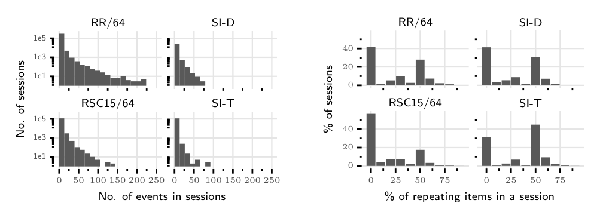
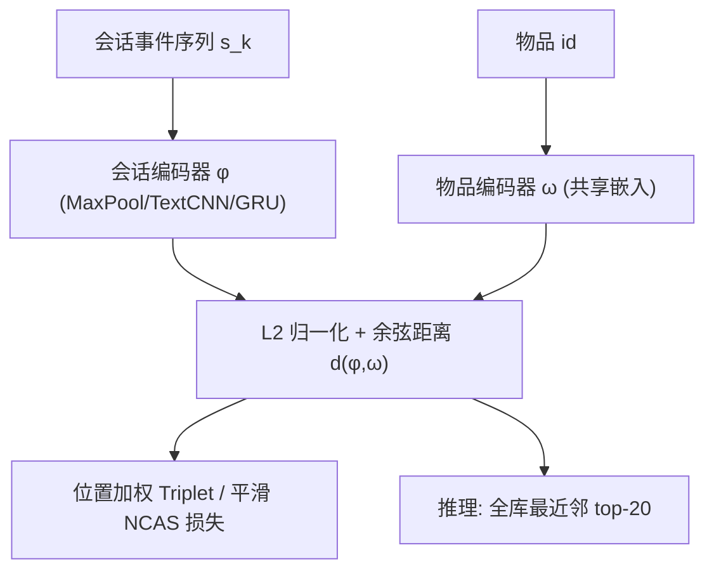

# Metric Learning for Session-based Recommendations (面向会话推荐的度量学习)

- **会议/期刊**: ECIR 2021
- **作者与机构**: Bartłomiej Twardowski（CVC-UAB / 华沙理工大学）、Paweł Zawistowski（华沙理工大学）、Szymon Zaborowski（Sales Intelligence）
- **推荐链路定位**: 召回（会话级候选生成，兼容 KNN 近邻检索管道）
- **研究方向**: 序列与会话推荐 / 协同过滤与向量检索
- **论文原文**: [https://arxiv.org/abs/2101.02655v1](https://arxiv.org/abs/2101.02655v1)
- **开源代码**: [https://github.com/btwardow/dml4rec](https://github.com/btwardow/dml4rec)

## TL;DR (1分钟核心速览)

本文针对会话推荐中"深度序列模型 + pairwise LTR 训练复杂却仍打不过邻域方法"的痛点，提出 SML：把会话 $\phi(s_k)$与物品$\omega(i)$ 映射到同一余弦度量空间，用度量学习损失（位置加权 Triplet、平滑 NCAS）训练、用最近邻检索推理。在 Full-Ranking@20、四数据集协议下，SML 在 RSC15/64 上 REC@20 达 0.5248（较 VSKNN +4.8%）、SI-T 上与 VSKNN 持平（0.7463 vs 0.7455），且推荐覆盖度接近 VSKNN 的两倍。

## Background & Motivation (背景与核心矛盾)

- **主流范式**: GRU4Rec/Caser 类 RNN/CNN 编码会话序列，配 BPR、TOP1 等 pairwise learning-to-rank 损失做 next-item 打分排序；但复现研究表明 VSKNN 这类"相似会话 + 时间衰减加权"的邻域启发式在多个基准上依旧难被超越。
- **前人局限**: (1) pairwise LTR 只约束"正项比负项靠前"的相对关系，完全忽略正负项之间的距离关系，且 sigmoid 会持续推动已排序正确的样本、缺乏语料库级 margin 控制；(2) 序列模型参数多、依赖小 batch 内负采样，在会话短、重复率高（图 1 显示多数会话事件数 <10、重复物品比例高）的数据分布下增益有限。
- **核心洞察 (Key Insight)**: 若评分定义为同一空间内余弦距离 $\hat{y}_{s,i}=1-d(\phi(s_k),\omega(i))$，则 BPR/TOP1 与 Triplet 可写成同构形式（原文式 5–7），三者差别仅在于 rectifier 与 sigmoid 的非线性选择、以及是否建模正负项间关系。因此可直接借用深度度量学习成熟的采样与损失工具替换 LTR。
- **本文切入点**: 共享物品/会话嵌入 + 度量损失 + 极简编码器（MaxPool/TextCNN/GRU），推理即在全库嵌入上做最近邻 top-n 检索。

<figure class="paper-figure" markdown="span">
  <figcaption>图1：各数据集的会话长度分布（左）和重复项目（右）。</figcaption>
</figure>

## Method (核心方法设计)

### 1. 整体框架 (Overall Architecture)

模型统一为 $\hat{y}_{s_k,i}=d(\phi(s_k),\omega(i))$：会话编码器$\phi$接收会话事件序列（各数据集仅有 item id），物品编码器$\omega$为 tanh 前馈层，两者输出均 L2 归一化到$\mathbb{R}^{400}$的共享空间，用余弦距离作为不相似度。训练时把一条会话随机切分，前段作输入$s_k$、后段物品作正样本$i_p$，等量随机负样本$i_n$ 在每个 epoch 开始时重采样；以 Triplet 或 NCAS 损失端到端更新两个编码器。推理阶段无需打分网络，直接把会话嵌入与全库物品嵌入做近邻检索，取 top-20 输出排序列表，因此天然复用现成的 KNN/ANN 检索设施。

### 2. 关键设计拆解 (Key Designs)

1. **位置加权 Triplet + Anchor-Swap**：针对 LTR 只看相对序、忽略会话内多正样本重要性的问题，对会话中第 $j$个正样本赋权$w_j=\sqrt{1/(1+j)}$，使靠前的正样本产生更大梯度幅度：
$\mathcal{L}=\frac{1}{|S|}\sum_{s_k\in S}\sum_{j}w_j\max\!\big(0,\ d(\phi(s_k),\omega(i_p))-d(\phi(s_k),\omega(i_n))+m\big)$并引入 swap 技巧$d'_{kn}=\min(d_{kn},d_{pn})$，把 anchor 与正样本互换，从而把关起正负项关系的那一项也纳入优化——这正是 BPR/TOP1 结构上缺失的部分。直觉上 rectifier 使已满足 margin 的样本梯度归零，避免 sigmoid 的"过度优化"。

2. **NCAS：排序化的邻域成分分析损失**：直接在距离上做 softmax 会因距离尺度随嵌入漂移而训练不稳，作者把 NCA 改造为"距离作 logits + 标签平滑"的 KL 形式：
$p(i_j|s_k)=\frac{\exp(-d(\phi(s_k),\omega(i_j)))}{\sum_{i_j\in Z}\exp(-d(\phi(s_k),\omega(i_j)))},\quad \mathcal{L}_{NCAS}=\frac{1}{|S|}\sum_{s_k}\mathrm{KL}\big(p(i|s_k)\,\|\,p'(i)\big)$其中$p'(i)=(1-\epsilon)p(i)+\epsilon/N$、$\epsilon=0.3$，本质上让同一个 batch 内的正负样本互相竞争，天然带"批内多负样本 + 软标签"的效果，在物品池大（RSC15/64，17K items）时比 Triplet 更稳定。

3. **训练目标、负采样与推理开销**：总损失即上述 Triplet 或 NCAS 之一；负采样为**均匀随机**（每个正样本配同数量负例，每 epoch 重采），未用 hard negative mining，理由是实验发现 CV 领域常见的 margin/swap 组合在会话推荐下并非稳定增益。超参：Adam、$lr=0.001$、$d=400$、$m=0.3$、batch 32、每会话 8 正 8 负、最多 150 epoch + 早停。在线推理仅需一次会话编码 + 一次全库近邻检索，复杂度$O(|\mathcal{I}|d)$，与物品数线性相关、与会话长度无关。

## Experimental Setup & Evaluation Protocol (实验设置与评估协议)

- **数据集与预处理**: 全部 e-commerce 域，仅保留出现 $\ge 5$ 次的物品（`5-core`），并剔除单事件会话：

| 数据集 | #Items(原始) | #Sessions(原始) | #Events(原始) | 说明 |
| :--- | :---: | :---: | :---: | :--- |
| RR/5 | 32K (117K) | 64K (380K) | 242K (606K) | RetailRocket，重复物品比例最高 |
| RSC15/64 | 17K (34K) | 118K (1.7M) | 495K (6.6M) | RecSys Challenge 2015 的 1/64 采样 |
| SI-T | 2K (2K) | 114K (119K) | 305K (315K) | 私有电商数据 #1，物品池最小 |
| SI-D | 3K (3K) | 25K (34K) | 94K (106K) | 私有电商数据 #2（品类不同） |

- **数据划分与防穿越 (Splitting Strategy)**: 按时间顺序取**最后 10% 会话**作测试集（RR/5 采用 5 折划分），训练集内的会话再随机切分构造 (输入, 正样本) 对。
- **排名评测协议 (Ranking Protocol)**: `Full-Ranking（全库未交互物品排序）`，指标截断 @20；MRR@20 与 HR@20 采用 **no look-ahead** 设置，仅下一真实交互项作为 ground truth（与 GRU4Rec/VSKNN 协议对齐）。MAP/PREC/REC 亦在 top-20 列表上计算。
- **对比基线与超参设置**: POP、SPOP、MARKOV-1、SKNN、VSKNN、GRU4Rec+ 共 6 个基线，覆盖流行度、马尔可夫、邻域与会话神经网络四类；所有方法嵌入维度统一 $d=400$；未报告显著性检验（$p$ 值缺失，属评估短板）。

## Key Experimental Results (实验关键数据)

### 1. 主实验对比 (Main Results)

| 方法 | SI-T REC/MRR | SI-D REC/MRR | RSC15/64 REC/MRR | RR/5 REC/MRR |
| :--- | :---: | :---: | :---: | :---: |
| POP | 0.3600 / 0.1369 | 0.2040 / 0.0655 | 0.1075 / 0.0292 | 0.0181 / 0.0058 |
| MARKOV-1 | 0.2433 / 0.1965 | 0.2582 / 0.1741 | 0.3011 / 0.1771 | 0.1557 / 0.1162 |
| SPOP | 0.6384 / 0.5724 | 0.5180 / 0.4263 | 0.2879 / 0.2205 | 0.3773 / **0.3985** |
| GRU4Rec+ | 0.5948 / 0.5437 | 0.4966 / 0.3043 | 0.4009 / 0.2752 | 0.4559 / 0.3237 |
| SKNN | 0.5609 / 0.5640 | 0.5942 / 0.4321 | 0.4780 / 0.2522 | **0.4704** / 0.3370 |
| VSKNN | 0.7455 / **0.6088** | **0.6499** / **0.4483** | 0.5009 / 0.2879 | 0.4632 / 0.3395 |
| **Best SML** | **0.7463** / 0.6050 | 0.6401 / 0.4468 | **0.5248** / **0.2884** | 0.4673 / 0.3340 |
| `Improv.` (vs 最强基线) | +0.1% | −1.5% | **+4.8%** | −0.7% |

### 2. 消融实验 (Ablation Study)

SI-T 数据集上逐项开关（共享嵌入 / 采样器 / 归一化 N、margin M、swap S）：

| 配置 (共享嵌入-采样-损失) | RNN REC@20 | RNN MRR@20 | MaxPool REC@20 | MaxPool MRR@20 |
| :--- | :---: | :---: | :---: | :---: |
| True / Pos-Neg / N-M | **0.7435** | **0.5973** | **0.7402** | **0.5978** |
| True / Pos-Neg / N | 0.7377 | 0.5973 | 0.7340 | 0.5932 |
| True / Pos-Neg / N-M-S | 0.7371 | 0.5908 | 0.7359 | 0.5888 |
| False / Pos-Neg / N | 0.6565 | 0.5746 | 0.6508 | 0.5727 |
| False / Pos-Neg / N-M | 0.6341 | 0.5783 | 0.6192 | 0.5767 |
| False / Pos-Neg / N-M-S | 0.6192 | 0.5678 | 0.6247 | 0.5796 |
| False / **滑动窗口** / N-M-S | 0.0022 | 0.0006 | 0.0525 | 0.0191 |

### 3. 关键实验发现 (Key Findings)

1. **共享物品/会话嵌入是最大增益源**：去掉 common embedding 后 RNN 的 REC@20 由 0.7435 跌至 0.6565（−11.7%）、MaxPool 由 0.7402 跌至 0.6508，收益远超 margin、归一化、anchor-swap 等损失内部技巧（后者差异均 <1%）。
2. **损失函数选择取决于物品池规模**：17K 物品的 RSC15/64 上平滑 NCAS 全面领先（REC@20 0.5248 vs Triplet 0.5126，+2.4%），而 2K 物品的 SI-T 上 Triplet 略优（0.7463 vs 0.7195），说明"批内竞争式"损失需要足够大的候选池才发挥优势。
3. **序列编码器并非瓶颈，采样策略才是**：MaxPool 与 GRU/CNN 差距极小（RR/5 上 MaxPool-NCAS 0.4673 vs RNN-NCAS 0.4609），而改用滑动窗口采样直接崩塌至 REC@20 = 0.0022；此外 SML 在 SI 数据集上推荐出 1,542 / 2,542 个唯一物品（全库 2K/3K），是 VSKNN 的 2 倍以上，流行度偏置显著更低。

## Highlights & Limitations (亮点、对比与审稿批判)

- **与代表作对比 (vs. Prior Work)**: 相较 GRU4Rec（重序列建模 + TOP1/BPR），本文用同构性证明"损失形式而非网络深度"才是关键，并用 MaxPool 在多数设定下达到相当水平；相较 VSKNN，本文将邻域检索从"手工会话相似度"升级为"可学习嵌入空间"，在 RSC15/64 上取得 +4.8% REC 且覆盖度翻倍，但 RR/5 这类高重复率数据集仍被 SKNN/SPOP 的"重复推荐 + 流行度补全"策略压制。
- **可迁移亮点**: (1) 用 $1-d$把 pairwise LTR 与 metric loss 统一的推导，可低成本地为任意双塔召回模型替换损失函数；(2) 位置权重$w_j=\sqrt{1/(1+j)}$ 的会话内多正样本加权，可直接迁移到长序列多目标召回。
- **审稿级局限批判**: (1) 训练依赖每 epoch 重采样与固定 8 正 8 负，论文自承"采样对效果与 GPU 开销影响巨大"，却未给出采样量与性能的敏感性曲线；(2) 评估缺显著性检验，且 SI-T/SI-D 为 2020 年私有数据、无统计口径披露，SI-T 上 +0.1% 的"最优"很可能不显著；另外 no look-ahead 只测下一项，未报告多步（look-ahead）场景下的表现。

## Rating (四维评分)

- **方法创新性 (Novelty)**: ⭐⭐⭐ （核心贡献是把 LTR 与 metric learning 做形式化对齐并给出排序化 NCAS，机制本身源自 CV/IR 成熟工具，重组多于原创）
- **评估协议与实验扎实度 (Protocol & Experiments)**: ⭐⭐⭐ （四数据集 + Full-Ranking + 完整消融较规范，但无显著性检验、两个私有数据集不可复现）
- **写作与数学规范度 (Clarity & Rigor)**: ⭐⭐⭐⭐ （式 5–7 的同构推导清晰、符号统一，方法模块化易读，个别超参设定（如 margin 取值敏感性）说明略简）
- **工业落地与复现价值 (Industrial & Practical Value)**: ⭐⭐⭐⭐ （代码开源、架构轻量，推理退化为一次近邻检索可复用现有 ANN 管道，唯一工程代价是每 epoch 重采样与内存管理）

