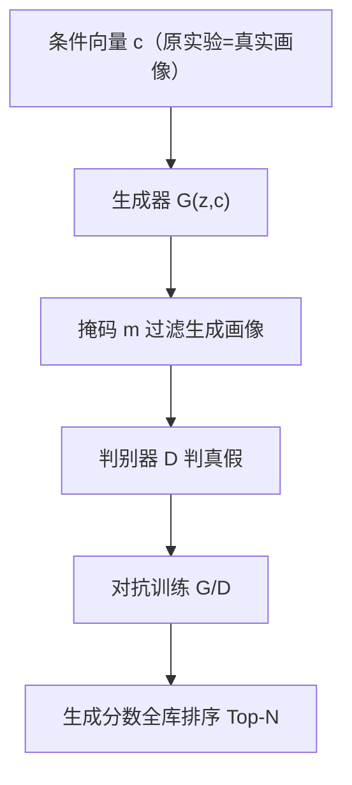
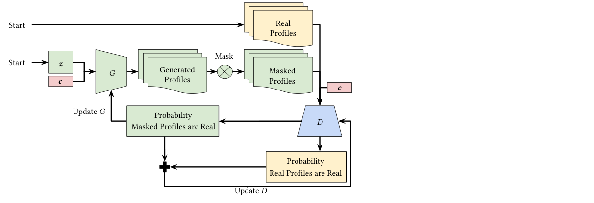

# An Evaluation Study of Generative Adversarial Networks for Collaborative Filtering（面向协同过滤的 GAN 评估研究）

- **会议/期刊**: ECIR 2022
- **作者与机构**: Fernando B. Pérez Maurera, Maurizio Ferrari Dacrema, Paolo Cremonesi；Politecnico di Milano / ContentWise
- **推荐链路定位**: 召回/排序（生成式用户画像打分）
- **研究方向**: 协同过滤与双塔召回 / 评估复现
- **论文原文**: [论文原文链接](https://arxiv.org/abs/2201.01815v2)
- **开源代码**: [开源代码仓库链接](https://github.com/recsyspolimi/ecir-2022-an-evaluation-of-GAN-for-CF)

## TL;DR (1分钟核心速览)

本文针对 CFGAN 及其家族（TagRec、MTPR、CRGAN）的**可复现性与可复现评估**：原实验去掉随机噪声、直接用真实画像作条件向量，使生成器易学成恒等映射，退化为自编码器。作者在 Ciao/ML100K/ML1M 的 Top-N 排序协议下，用 30 次重复、贝叶斯调参和早停复现；CFGAN 数值稳定但不及调优 EASE R——ML1M@20 NDCG 最佳 CFGAN 0.3799，EASE R 0.4192（+10.34%），训练耗时高两个数量级。

## Background & Motivation (背景与核心矛盾)

- **主流范式**: CFGAN 用生成器生成个性化用户/物品画像，判别器区分真假画像，再按生成分数做 Top-N 推荐；后续 TagRec、CRGAN、MTPR 等沿用该框架。
- **前人局限**: 原实验把真实用户画像作为条件向量 $c$，且去掉随机噪声$z$；这给恒等解留下空间，生成器可只重建输入而不学习新偏好。原论文还缺少早停/停止准则，网格搜索规模超过$3\times10^8$ 组，难以复现。
- **核心洞察 (Key Insight)**: 条件向量与噪声不是装饰项——当 $c=x$且$z$缺失时，$G(c)\approx c$ 可同时骗过判别器并最小化重建，CFGAN 实际退化为自编码器。
- **本文切入点**: 不改核心算法，先复现原代码，再补齐早停与贝叶斯调参，在统一 Top-N 协议下对比准确率、超越准确率与可扩展性。

## Method (核心方法设计)

### 1. 整体框架 (Overall Architecture)

CFGAN 由全连接生成器 $G$与判别器$D$组成：输入为条件向量$c$（原实验即真实画像）与可选噪声$z$，$G$输出画像分数，经掩码$m$逐元素过滤后与真实画像一起送入$D$；$D$判别真假，$G$骗过$D$。user-based 生成用户画像，item-based 生成物品画像；ZR/PM/ZP 分别改生成损失与掩码。训练后取$G$ 输出分数对全库物品排序取 Top-N。本文不改核心算法，而是复现原代码、补齐早停/贝叶斯调参，并在统一 Top-N 协议下与 8 个调优基线对比准确率、覆盖度、多样性与训练/推理时间。

<figure class="paper-figure" markdown="span">
  <figcaption>图 1：CFGAN 的训练过程。G、D、z 和 c 分别为生成器网络、判别器网络、随机噪声和条件向量。真实画像未加掩码。</figcaption>
</figure>

### 2. 关键设计拆解 (Key Designs)

1. **条件向量与退化风险**：痛点在于 $c$ 与目标画像同源时，恒等映射是最短路径。对抗目标可写为  
   $\min_G\max_D V(D,G)=\mathbb{E}_{x\sim p_{data}}[\log D(x|c)]+\mathbb{E}_{z\sim p_z}[\log(1-D(G(z,c)|c))]$。  
   若 $c=x$且$z$缺失，$G(c)=c$即可让$D$ 难以区分；生成器因此更像 AE，泛化与鲁棒性受损。
2. **随机噪声与早停**：原实验去掉 $z$会压缩输入空间，假设用户画像不变，遇到数据漂移不稳健。本文把$z\sim\mathcal{N}(0,1)$与$c$ 拼接，并测试噪声维度为输入维度的 50%/100%/200%；同时用验证集 NDCG 早停，替代手工指定 epoch。
3. **训练目标、负采样与推理效率**：总损失即条件 GAN 对抗损失；训练无 BPR 式负采样，ZR 对未交互样本置零，PM 将真实画像与随机未见物品混合。推理时一次生成画像后全库排序；ML1M 上 CFGAN 训练约 25–40 分钟，而 EASE R 约 24 秒。

## Experimental Setup & Evaluation Protocol (实验设置与评估协议)

- **数据集与预处理**: 沿用原文提供的 train/test 划分；未额外声明 5-core 过滤。Ciao 为原文子采样版且正文未列统计，故不臆造。

| 数据集 | #Users | #Items | #Interactions | 稀疏度/密度 | 特征/场景说明 |
| :--- | :---: | :---: | :---: | :---: | :--- |
| Ciao (sub.) | — | — | — | — | 原文子采样版；原代码实际训练 iZR，报告为 iZP |
| ML100K | 943 | 1,682 | 100,000 | 6.30% | 用户-物品隐式交互 |
| ML1M | 6,040 | 3,706 | 1,000,000 | 4.47% | 用户-物品隐式交互 |

- **数据划分与防穿越 (Splitting Strategy)**: 原论文 train/test；调参时从 train 中随机留出 20% 作 validation，最终用 train+validation 重训，测试集只用于最终评估。
- **排名评测协议 (Ranking Protocol)**: Top-N 排序评测，按原文/代码对候选物品打分排序；未采用采样负例评估（可视为全物品排序）。指标为 PREC、REC、MRR、NDCG@5/20，并补充 Novelty、Item Coverage、Div. MIL/Gini/Shannon。
- **对比基线与超参设置**: 基线含 TopPop、UserKNN CF、ItemKNN CF、RP3beta、PureSVD、SLIM ElasticNet、MF BPR、EASE R。CFGAN 共 18 个模型（3 数据集×2 模式×3 变体）；贝叶斯搜索 16 次初始+50 次候选，按 NDCG@10 选参；隐藏层 1–4、隐特征 50–300、lr $1e^{-4}$–$5e^{-3}$、batch 32–256、Adam+sigmoid。原文未报告显著性检验。

## Key Experimental Results (实验关键数据)

### 1. 主实验对比 (Main Results)

ML1M@20，粗体为全表最优；CFGAN 最佳为 uZR。EASE R 较最佳 CFGAN NDCG +10.34%，SLIM +8.53%。

| 模型 | PREC | REC | MRR | NDCG | Cov.Item |
| :--- | ---: | ---: | ---: | ---: | ---: |
| TopPop | 0.1552 | 0.1146 | 0.3852 | 0.1938 | 0.0299 |
| UserKNN CF | 0.2891 | 0.2570 | 0.6595 | 0.3888 | 0.3286 |
| ItemKNN CF | 0.2600 | 0.2196 | 0.6254 | 0.3490 | 0.2097 |
| RP3beta | 0.2758 | 0.2385 | 0.6425 | 0.3700 | 0.3427 |
| PureSVD | 0.2913 | 0.2421 | 0.6333 | 0.3783 | 0.2439 |
| SLIM ElasticNet | 0.3119 | 0.2695 | 0.6724 | 0.4123 | 0.3153 |
| MF BPR | 0.2485 | 0.2103 | 0.5753 | 0.3242 | 0.3126 |
| **EASE R** | **0.3171** | **0.2763** | **0.6795** | **0.4192** | 0.3338 |
| CFGAN iZR | 0.2862 | 0.2547 | 0.6312 | 0.3770 | 0.4123 |
| CFGAN iZP | 0.2407 | 0.1742 | 0.5230 | 0.2972 | 0.4894 |
| CFGAN uZR | 0.2955 | 0.2473 | 0.6222 | 0.3799 | 0.2167 |
| CFGAN uZP | 0.2764 | 0.2342 | 0.6208 | 0.3620 | 0.1833 |

### 2. 消融实验 (Ablation Study)

RQ2 的“变体消融”在 ML1M@20；Reference 为原文报告，非同一调参/早停协议。ES=早停，NO-ES=无早停，CC=用户/物品类别条件，RN-X=噪声维度。

| 变体 | PREC | NDCG | Cov.Item | 说明 |
| :--- | ---: | ---: | ---: | :--- |
| iZP Reference | 0.3090 | 0.4060 | — | 原文报告 |
| iZP ES | 0.2407 | 0.2972 | 0.4894 | 调参+早停 |
| iZP NO-ES | 0.2494 | 0.3111 | 0.4041 | 无早停 |
| iZP CC | 0.0384 | 0.0507 | 0.0296 | 条件改为类别 |
| iZP RN-3020 | 0.2059 | 0.2475 | 0.3995 | 加噪声 |
| iZP RN-12080 | 0.1304 | 0.1471 | 0.5076 | 更大噪声 |
| uZR ES | 0.2955 | 0.3799 | 0.2167 | 最佳 CFGAN |
| uZR CC | 0.1459 | 0.1831 | 0.0291 | 条件改为类别 |

### 3. 关键实验发现 (Key Findings)

- **可复现但数值略低**：ML1M NDCG 复现均值 0.4035±0.0016，原文 0.4060（−0.62%）；ML100K 0.4207 vs 0.4330（−2.84%）；Ciao 因原代码训练 iZR 而报告 iZP、超参不可复现，无法直接对齐。30 次运行方差很小，说明 CFGAN 数值稳定。
- **退化风险被数据坐实**：iZP 把条件改为类别后 NDCG 从 0.2972 跌至 0.0507（−82.94%），说明当前架构无法有效利用“非目标画像”条件；早停把 iZP 训练从 1200 epoch 降到 645 epoch，训练时间 −46.25%，NDCG 仅 −4.47%。
- **调优简单基线更强**：EASE R NDCG 0.4192、SLIM 0.4123，均高于最佳 CFGAN uZR 0.3799；CFGAN 训练 25–40 分钟，EASE R 约 24 秒。CFGAN 的 iZR 在 Novelty 0.0542、Coverage 0.4123、Div. Gini 0.1459 上更高，但准确率不足，u-based 变体覆盖率尤其低。

## Highlights & Limitations (亮点、对比与审稿批判)

- **与代表作对比 (vs. Prior Work)**: 原文 CFGAN 主张生成式画像的推荐优势；本文指出其评估条件向量与噪声设置使模型趋近 AE。与 Dacrema 等的“调优基线”评估一致：复杂神经模型未必胜过 SLIM/EASE R。
- **可迁移亮点**: 条件向量绝不能等于待生成目标；生成式推荐应保留随机噪声并报告数据漂移鲁棒性；早停与贝叶斯调参应成为 GAN4Rec 的默认协议。
- **审稿级局限批判**: 仅在 3 个较小数据集、CPU 环境验证，未覆盖大规模工业场景；指出条件向量问题但未给出可行新架构，CC 实验是负结果。另缺少显著性检验，Ciao 子采样统计与原始超参不透明也削弱外部效度。

## Rating (四维评分)

- **方法创新性 (Novelty)**: ⭐⭐⭐（评估研究非新算法，但“真实画像条件+无噪声导致退化为 AE”的批判有洞察）
- **评估协议与实验扎实度 (Protocol & Experiments)**: ⭐⭐⭐⭐⭐（30 次重复、贝叶斯调参、早停、准确率+超越准确率+时间，复现严谨）
- **写作与数学规范度 (Clarity & Rigor)**: ⭐⭐⭐⭐（对抗目标与退化逻辑清楚，但部分统计与完整结果放在补充材料）
- **工业落地与复现价值 (Industrial & Practical Value)**: ⭐⭐⭐⭐（开源可复现，提醒工业界勿盲目上 GAN；但小数据集 CPU 结论需大规模验证）

