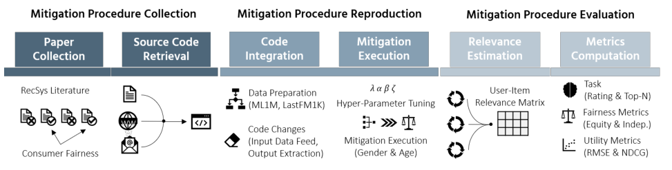

# Consumer Fairness in Recommender Systems: Contextualizing Definitions and Mitigations (推荐系统中的消费者公平性：定义与缓解措施的情境化对照)

- **会议/期刊**: ECIR 2022（第 44 届欧洲信息检索大会）
- **作者与机构**: Ludovico Boratto, Gianni Fenu, Mirko Marras, Giacomo Medda（意大利卡利亚里大学数学与计算机科学系）
- **推荐链路定位**: 重排 / 训练期正则（覆盖 Pre-/In-/Post-Processing 三类干预）
- **研究方向**: 去偏公平、可信隐私与工业架构 / 多任务学习与列表级重排
- **论文原文**: [https://arxiv.org/abs/2201.08614v2](https://arxiv.org/abs/2201.08614v2)
- **开源代码**: [https://github.com/jackmedda/C-Fairness-RecSys](https://github.com/jackmedda/C-Fairness-RecSys)

## TL;DR (1分钟核心速览)

消费者公平（Consumer Fairness）领域已堆积大量互不可比的 notion / metric / 缓解算子，每篇论文只与"什么都不做"的 Base 模型比较，导致从业者无法判断谁真正有效。本文系统扫描顶会顶刊，筛出 15 篇消费者公平缓解工作、成功复现 8 篇（53%），在统一协议（ML-1M / LFM-1K、性别与年龄二值分组、NDCG@10 与 RMSE、DP 与 KS 双公平度量）下成对训练 Base 与 Mit 模型。结论：缓解对效用的冲击普遍在 ±0.01 量级（近乎免费），但仅极少数方法显著降偏，且降 DP 不等于降 KS；差异影响甚至常常有利于少数群体。

## Background & Motivation (背景与核心矛盾)

- **主流范式**: 按干预位置分为三类——预处理（重采样训练集 [Ekstrand]、注入伪用户 [Rastegarpanah]）、训练期正则（SLIM 邻域平衡 [Burke]、LBM 共聚类 [Frisch]、独立性正则 [Kamishima]、对抗过滤 [Wu]）、后处理（重排 [Li]、分数校正 [Ashokan & Haas]）。
- **前人局限其一**: 每篇工作自选数据集、划分方式、公平度量（CES / EPS-CHI / GEI / Theil / DP / KS 等十余种），彼此之间不存在可比的共同分母，"我的方法更好"只能相对于无缓解基线成立。
- **前人局限其二**: 复现门槛高。15 篇中仅 8 篇能拿到可运行源码（TR 任务 4/8、RP 任务 4/7），且大量代码与特定数据集硬耦合，缺少模块化，无法迁移到其他模型。
- **核心洞察 (Key Insight)**: 公平性并非单一标量。以"效用均等（equity，用 DP 刻画组间效用差）"与"分数独立（independence，用 KS 刻画预测分数分布与敏感属性的统计独立）"两类正交 notion 同时度量，会发现缓解算子往往只改善其中一侧。
- **本文切入点**: 不做新算法，而是构建"共同分母"——统一数据管线 + 统一超参搜索 + 统一度量，把 8 个缓解器放进同一张实验台做交叉对照，回答 RQ1（效用是否受损）、RQ2（是否真降偏）、RQ3（谁被伤害）。

## Method (核心方法设计)

### 1. 整体框架 (Overall Architecture)

流程为：文献筛选 → 复现可行性判定 → 数据与标签统一化 → Base/Mit 成对训练 → 效用与公平双轴度量 → 三问归因。筛选标准要求论文同时满足"面向推荐系统""提出缓解过程""目标为接收推荐的终端用户"；含 provider 公平但兼及消费者的工作被纳入。复现判定要求源码可运行、且仅需最小改动即可接受新数据集并导出最终推荐结果，仅有骨架代码者判为不可复现。数据侧将所有敏感属性强制二值化（因现有缓解器几乎只支持二分类），年龄按相邻区间合并使两组人数尽量均衡；交互侧对 LastFM 同一艺人多次播放做聚合、以播放次数作为评分代理并做 log 归一化映射到 $[1,5]$。所有模型在相同网格搜索预算下分别训练 Base 与 Mit 版本，度量由本文自建脚本统一计算，避免原论文度量实现差异。

<figure class="paper-figure" markdown="span">
  <figcaption>图 1：方法。我们系统性地收集论文并获取其源代码。我们处理评估协议中使用的数据集，按照各缓解措施的要求对其进行格式化，并统一缓解结果的格式。我们在有/无缓解措施的情况下训练原论文中包含的推荐模型，并计算目标推荐任务的公平性与效用指标。</figcaption>
</figure>

### 2. 关键设计拆解 (Key Designs)

1. **双轴公平度量的正交刻画（equity vs. independence）**：痛点在于原论文各自使用不可比的公平指标。本文统一为两个可迁移量——效用均等用人口统计均等 $\mathrm{DP} = u(G_0) - u(G_1)$，其中 $u(\cdot)$在 TR 任务取 NDCG@10、在 RP 任务取 RMSE；分数独立用 Kolmogorov–Smirnov 统计量$ \mathrm{KS} = \sup_{x} |F_{G_0}(x) - F_{G_1}(x)| $，$F_G$ 为组内预测相关性分数（或预测评分）的经验分布函数。前者作用于"结果效用"，后者作用于"打分分布"，因此二者天然可解耦——这正是本文发现"降 DP 不降 KS"的度量学根源。
2. **DP 符号的语义化解读（RQ3 的关键设计）**：差异影响的方向必须结合任务语义才能判定受害者。TR 任务中效用越高越好，故 $\mathrm{DP} > 0$表示多数群体被优待、少数群体受损；而 RP 任务中 RMSE 越低越好，故$\mathrm{DP} > 0$反而意味着多数群体误差更大、少数群体被优待。作者据此在两张任务表上分别按符号判读受损群体，从而避免"DP 为正即歧视少数"的常见误读。DP 的显著性用 Mann–Whitney 检验（$p<0.05$记 `*`，$p<0.01$ 记 `∧`），KS 直接使用其统计量本身。
3. **评估控制变量与推理开销**：本文不引入新损失函数，其"目标函数"是控制变量法——对每个 (数据集, 敏感属性, 缓解论文) 三元组，固定同一份 train/valid/test 划分、同一超参网格与同一批基模型，仅切换是否启用缓解算子。推理开销取决于算子类型：后处理类（Li 的重排、Ashokan 的分数校正）在打分后追加一次线性开销，可在线部署；预处理类（Ekstrand 重采样、Rastegarpanah 伪用户注入）需重训全模型；训练期对抗类（Wu 的图对抗过滤）需额外判别器前向，开销最高，作者亦指出其在大规模数据上难以承受。

## Experimental Setup & Evaluation Protocol (实验设置与评估协议)

- **数据集与预处理**: 入选条件为"至少被一篇复现论文使用 + 含至少一个敏感属性 + 评分量 ≥ 20 万"。

| 数据集 | #Users | #Items | #Interactions | 稀疏度/密度 | 特征/场景说明 |
| :--- | :---: | :---: | :---: | :---: | :--- |
| ML-1M | 6,040 | 3,952 | 1,000,209 | 密度 4.19% | 电影；性别（M 71.7% / F 28.3%）、年龄（<35 56.6% / ≥35 43.4%） |
| LFM-1K | 268 | 51,609 | 200,586 | 密度 1.45% | 音乐；性别（M 57.8% / F 42.2%）、年龄（<25 57.8% / ≥25 42.2%） |

- **数据划分与防穿越 (Splitting Strategy)**: 采用**逐用户比例划分**——每个用户最近 20% 交互进测试集（有时间戳按时间取最近，无时间戳随机取），其余进训练集；需要验证集时再从训练集按同样方式切 10%。该设计保证测试交互严格晚于训练交互，规避时间穿越；不同于常见的 Leave-One-Out。
- **排名评测协议 (Ranking Protocol)**: TR 任务用二值相关性的 NDCG@10，RP 任务用 RMSE。原文未显式声明候选集构造方式，实际沿用各模型返回的 top-10 列表，属于**模型自产列表评估**而非全库 Full-Ranking，也未做额外负采样，这一点削弱了跨模型 NDCG 的绝对可比性。
- **对比基线与超参设置**: 基模型覆盖非个性化（TopPopular、AvgRating）、记忆型（ItemKNN、UserKNN）、矩阵分解（BiasedMF、PMF、FunkSVD、ALS、LMaFit）、学习排序（NCF、LBM、SLIM-U）、图模型（GCN/FairGo）与会话模型（STAMP）共 6 大族。每个模型做独立网格搜索，Base 与 Mit 使用同一搜索空间与预算；显著性检验为 Mann–Whitney（DP）与 KS 统计量本身，阈值 $p<0.05$/$p<0.01$。

## Key Experimental Results (实验关键数据)

### 1. 主实验对比 (Main Results)

Top-N 推荐（性别分组，Base → Mit，加粗为该列最优）：

| 缓解方法 (基模型) | ML-1M NDCG↑ | ML-1M DP↓ | ML-1M KS↓ | LFM-1K NDCG↑ | LFM-1K DP↓ | LFM-1K KS↓ |
| :--- | :---: | :---: | :---: | :---: | :---: | :---: |
| Burke (SLIM-U) | 0.084 → 0.084 | 0.022 → 0.028 | 0.032 → 0.115 | 0.348 → 0.301 | −0.128 → 0.072 | 0.010 → 0.142 |
| Frisch (LBM) | 0.044 → 0.021 | 0.006 → **0.004** | 0.013 → 0.025 | 0.144 → 0.212 | −0.035 → −0.058* | 0.120 → 0.126 |
| Li (BiasedMF) | 0.112 → 0.112 | 0.016 → 0.013 | 0.033 → **0.006** | 0.246 → 0.245 | −0.076 → −0.049* | 0.026 → **0.001** |
| Li (NCF) | 0.120 → 0.120 | 0.018 → 0.015 | 0.024 → **0.006** | 0.204 → 0.202 | −0.046 → **−0.023** | 0.017 → **0.001** |
| Li (PMF) | 0.123 → 0.123 | 0.020 → 0.015 | 0.026 → **0.006** | 0.163 → 0.164 | −0.069 → −0.049* | 0.035 → **0.001** |
| Ekstrand (UserKNN) | 0.137 → 0.131 | 0.031 → 0.024 | 0.074 → 0.052 | 0.406 → 0.411 | −0.110 → −0.106 | 0.067 → 0.067 |
| Ekstrand (TopPopular) | 0.110 → 0.104 | 0.035 → 0.030 | 0.007 → 0.007 | 0.312 → 0.321 | −0.085 → −0.102* | 0.001 → 0.002 |

评分预测（性别分组）：

| 缓解方法 (基模型) | ML-1M RMSE↓ | ML-1M DP↓ | ML-1M KS↓ | LFM-1K RMSE↓ | LFM-1K DP↓ | LFM-1K KS↓ |
| :--- | :---: | :---: | :---: | :---: | :---: | :---: |
| Kamishima (PMF-BDist) | 0.863 → 0.870 | −0.029 → −0.046 | 0.056 → **0.032** | 1.172 → 1.179 | 0.014 → 0.029* | 0.067 → 0.029 |
| Rastegarpanah (ALS) | 0.894 → 0.890 | −0.034 → −0.034 | 0.035 → 0.033 | 1.490 → 1.189 | 0.145 → 0.029 | 0.036 → 0.114 |
| Ashokan (ALS-Par) | 0.867 → 0.868 | −0.030 → −0.029 | 0.056 → 0.034 | 1.145 → **1.146** | 0.016 → **0.018** | 0.047 → **0.017*** |
| Wu (FairGo-GCN) | 0.895 → 0.892 | −0.038 → −0.034 | 0.048 → 0.045 | 1.609 → 1.283 | 0.151 → 0.038 | 0.113 → 0.113 |
| Ekstrand (ItemKNN) | 0.865 → 0.882 | −0.034 → **−0.026*** | 0.055 → 0.056 | 1.218 → 1.230 | 0.037 → 0.035* | 0.064 → 0.072 |

### 2. 消融实验 (Ablation Study)

本文无组件消融，其等价分析是**两类公平 notion 的交叉一致性**（下表取自上文各表的 Base → Mit 变化方向）：

| 缓解 (模型, 设定) | ΔDP | ΔKS | 一致性判定 |
| :--- | :---: | :---: | :--- |
| Li (BiasedMF, ML-1M 性别) | 0.016 → 0.013 (↓) | 0.033 → 0.006 (↓) | 双赢：DP 与 KS 同降 |
| Kamishima (PMF-BDist, ML-1M 性别) | −0.029 → −0.046 (\|·\|↑) | 0.056 → 0.032 (↓) | 冲突：KS 降但 DP 反升 |
| Rastegarpanah (ALS, LFM-1K 性别) | 0.145 → 0.029 (↓) | 0.036 → 0.114 (↑) | 冲突：DP 大降但 KS 恶化 3 倍 |
| Ekstrand (ItemKNN, LFM-1K 年龄) | 0.010 → 0.020 (↑) | 0.133 → 0.118 (↓) | 冲突：重采样反而加剧 DP |
| Wu (FairGo-GCN, LFM-1K 性别) | 0.151 → 0.038 (↓) | 0.113 → 0.113 (—) | 单边：仅降 DP，KS 完全不变 |

### 3. 关键实验发现 (Key Findings)

1. **去偏近乎"免费"，但收益极不均衡**：ML-1M 上 TR 的 NDCG 波动仅 ±0.006（性别）/ ±0.003（年龄），RP 的 RMSE 波动 ±0.017 / ±0.013；LFM-1K 因数据更稀疏波动放大到 ±0.018（年龄 NDCG）。反例集中在 SLIM-U 经 Burke 缓解后 LFM-1K 年龄 NDCG 从 0.348 崩到 0.207（−0.141），以及 ALS / GCN 经 Rastegarpanah / Wu 处理后 RMSE 反而大幅下降 0.301–0.332（因伪用户与对抗过滤同时改善了稀疏性），说明"效用-公平权衡"并非普适规律。
2. **只有少数算子真正降偏，且几乎不同时改善两类公平**：Li 的重排在 ML-1M 上把三个基模型的 KS 从 0.024–0.033 压到 0.006（降幅约 75%），且 NDCG 分毫未动，是唯一"零效用代价 + 双度量受益"的方法；Kamishima 与 Ashokan(parity) 主要降 KS（≥0.019 性别 / ≥0.039 年龄），对 DP 作用有限甚至反向；Ekstrand 的重采样在 LFM-1K 上对 TopPopular 性别 DP（0.085 → 0.102）与 ItemKNN/UserKNN 年龄 DP（≥0.06）产生**负向**效果。
3. **差异影响不必然伤及少数群体，方向由任务语义决定**：ML-1M 的 TR 中 DP 全为正（少数群体 10/10 显著受损），但 LFM-1K 的 TR 中多数群体反而在 7/10 情形下显著受损；RP 中 ML-1M 性别属性上多数群体被优待（DP 全为负且显著），而年龄属性上少数群体在两个数据集上均被优待。这直接证伪了"DP 符号即可判定受害者"的朴素假设。

## Highlights & Limitations (亮点、对比与审稿批判)

- **与代表作对比 (vs. Prior Work)**: 相较 Burke [2018]、Kamishima [2018]、Li [2021] 等单点提出型工作，本文首次把 8 个算子放到同一分母下；相较常规 benchmark（如 FairGo 自带评测），本文不绑定单一基模型族，而是横跨非个性化到图模型 6 族，因而能暴露"同一算子在 KNN 上有效、在 GCN 上失效"的模型依赖性。
- **可迁移亮点**: ①DP 符号需结合任务效用方向解读的规范，可直接用于任何 ranking / rating 混合评测；②"Base-Mit 成对训练 + 固定超参网格"的控制变量范式，可迁移到去噪、跨域迁移等同样缺乏统一评测的子领域。
- **审稿级局限批判**: ①仅 8/15 复现率意味着结论对未复现的 7 篇（含多篇高影响力工作）不具备覆盖性，存在选择性偏差；②NDCG 基于模型自产 top-10 列表而非全库 Full-Ranking，跨模型绝对数值不可比，且 LFM-1K 仅 268 用户，统计功效薄弱；③所有敏感属性被强制二值化，与性别/年龄的真实多元性冲突，可能系统性低估某些缓解器的效果；④未做任何线上 A/B 或长期生态影响评估，"离线降偏即线上受益"仍是未验证假设。

## Rating (四维评分)

- **方法创新性 (Novelty)**: ⭐⭐⭐ （不提出新算法，但"双 notion 正交对照 + DP 符号语义化"的分析框架本身具有方法论新意）
- **评估协议与实验扎实度 (Protocol & Experiments)**: ⭐⭐⭐⭐ （统一划分、统一网格、Mann–Whitney 显著性检验齐备，8 个算子 × 2 数据集 × 2 属性 × 2 任务覆盖充分；扣分于 top-10 列表评估与 LFM-1K 规模）
- **写作与数学规范度 (Clarity & Rigor)**: ⭐⭐⭐⭐ （RQ 驱动、观察点（Observation 1–3）逐条对应实验表格，符号统一；不足在于未给出各缓解算子的形式化定义，读者需回查原论文）
- **工业落地与复现价值 (Industrial & Practical Value)**: ⭐⭐⭐⭐⭐ （开源完整管线含各论文适配脚本，直接回答"该选哪个去偏方案"，对工业界公平性治理的选型价值极高）

