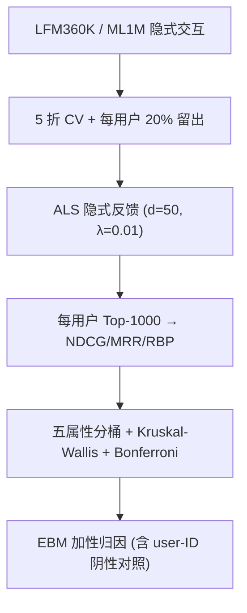
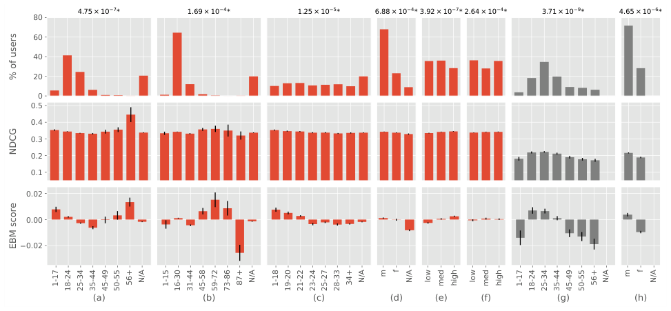
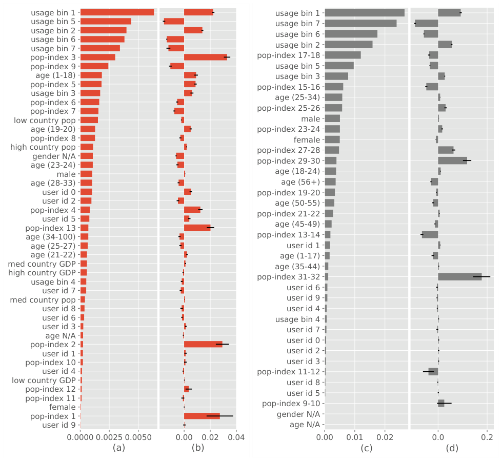

# Revisiting Popularity and Demographic Biases in Recommender Evaluation and Effectiveness (再审视推荐评测与效果中的流行度与人口统计偏置)

- **会议/期刊**: ECIR 2022
- **作者与机构**: Nicola Neophytou (University of Manchester), Bhaskar Mitra (Microsoft), Catherine Stinson (Queen's University)
- **推荐链路定位**: 离线评测诊断（Top-N 召回/排序效果的公平性评估）
- **研究方向**: 去偏公平与可信推荐 / 冷启动与长尾推荐
- **论文原文**: [https://arxiv.org/abs/2110.08353v1](https://arxiv.org/abs/2110.08353v1)
- **开源代码**: [https://github.com/benfred/implicit](https://github.com/benfred/implicit)（模型实现；数据清洗脚本见论文脚注 bens-blog-code）

## TL;DR (1分钟核心速览)

离线推荐评测通常只报告全体用户的平均 NDCG，掩盖了不同用户群体之间的效用差距。本文复现 Ekstrand 等人的性别/年龄差异结论，并把分析扩展到国家、**使用量 (usage)** 与自创的 **pop-index** 三个属性上。在 LFM360K 与 ML1M 上用 ALS 隐式反馈模型做 5 折交叉验证 + 每用户 20% 留出、每用户生成 1000 条推荐，以 NDCG/MRR/RBP 与 Kruskal-Wallis 检验评估，并用 EBM 做特征归因。结果显示：等用户数分桶后效用随年龄**单调下降**（$p=1.25\times10^{-5}$），男性高于女性（$p=4.65\times10^{-6}$@ML1M），国家代表性越高效用越高；而 usage 与 pop-index 才是性能的最强预测因子（$p$低至$10^{-43}\sim10^{-166}$ 量级），可将部分"人口差异"解释为表征不足。

## Background & Motivation (背景与核心矛盾)

- **主流范式**: 以 ALS/BPR 等隐式反馈模型为对象，在 LFM360K、ML1M 上做离线 Top-N 评测，按人口属性分桶后比较组间平均效用。
- **前人局限**: (1) Ekstrand 等人只用原始**不等宽年龄桶**，各组用户数极度偏斜，小样本桶使检验功效不足，"无趋势"可能只是统计假象；(2) 只覆盖年龄与二值性别，未控制 usage、内容流行度等强混淆变量，无法判断效用差异来自"人口属性"还是"表征量"。
- **核心洞察 (Key Insight)**: 分桶策略本身会改变结论——改成等用户数分桶后，年龄与效用的负相关才显现；同时 usage 与 pop-index 在 EBM 中的重要性远超所有人口属性，且这两者在人口群体间分布显著不均（如 34+ 用户 24% 落在最低 usage 桶，而 1–18 岁仅 11%）。
- **本文切入点**: 用"多分桶敏感性分析 + 新增混淆属性 + 可解释加性归因模型 + 阴性对照特征"四件事，把相关性分析做得更接近可归因。

## Method (核心方法设计)

### 1. 整体框架 (Overall Architecture)

本文不提出新模型，而提出一套**可复现的公平性诊断协议**：在固定 ALS 推荐器（`implicit` 库，$d=50$、$\lambda=0.01$、30 次迭代）上做 5 折交叉验证，每折为每个用户留出 20% 交互作测试集，生成 1000 条推荐后计算用户级 NDCG/MRR/RBP；随后按年龄（三种分桶）、性别、国家（按用户数/按 GDP）、usage、pop-index 五种属性分桶，对组间 NDCG 做 Kruskal-Wallis 检验并施加 Bonferroni 校正；最后用 EBM 以用户属性为特征、以该用户 NDCG 为标签做加性归因，并插入一个**本应无预测力**的对照特征（user-ID 末位数字）验证流程有效性。

### 2. 关键设计拆解 (Key Designs)

1. **年龄的三重分桶敏感性分析（破解统计功效陷阱）**：前人只用原始不规则年龄桶，桶内样本悬殊。本文并行采用 (i) 原始桶、(ii) 等宽 15 年桶、(iii) 等用户数桶。只有在 (iii) 下才浮现单调趋势 $\overline{\mathrm{NDCG}}(a_1)>\overline{\mathrm{NDCG}}(a_2)>\cdots$（$a$ 为年龄桶序号）。直觉很直接：把"组间差异检验"从受样本量支配的量，转换为受真实效应支配的量。

2. **pop-index：刻画"用户口味主流度"的 h-index 类比指标**：流行度偏置研究通常只用物品侧统计，缺少用户侧聚合量。本文定义

$$\mathrm{pop}(u)=\max\Big\{p\in[1,|\mathcal{I}_u|]:\ \tfrac{1}{|\mathcal{I}_u|}\sum_{i\in\mathcal{I}_u}\mathbb{I}\big[\mathrm{deg}(i)\ge \tfrac{p}{100}|\mathcal{U}|\big]\ \ge\ \tfrac{p}{100}\Big\}$$

即"该用户听过的物品中，至少有 $p\%$同时被$p\%$的全体用户交互过"的最大$p$。它把用户的口味主流程度压缩为一个可与 usage 正交比较的整数，从而把"主流用户是否被更好服务"从定性讨论变成可检验假设。

3. **训练目标与推理开销 / EBM 归因**：推荐器沿用标准隐式 ALS 加权平方损失 $\min\|\mathbf{R}\odot(\mathbf{P}\mathbf{Q}^{\top})\|$（置信度$c_{ui}=1+\alpha r_{ui}$），负样本由全库未交互隐式处理，无显式负采样。EBM 采用加性形式$g(\hat{y})=\beta_0+\sum_j f_j(x_j)$，每个$f_j$ 为可读的阶梯/样条函数，无需后验解释器；推理成本极低（仅一次全库内积排序 + 若干分组统计），在单机上即可完成全部实验，正是其可被工业侧"低成本跑一遍"的关键。

## Experimental Setup & Evaluation Protocol (实验设置与评估协议)

- **数据集与预处理**:

| 数据集 | #Users | #Items | #Interactions | 稀疏度 | 特征/场景说明 |
| :--- | :---: | :---: | :---: | :---: | :--- |
| LFM360K | 358,868 | 292,385 | 17,535,605 | 99.98% | 音乐；`user.getTopArtists()` 榜单快照（"播放列表"）；含 gender(67%M/24%F/9%缺失)、age(20%缺失)、country(无缺失)；**剔除听过 ≤40 位艺人的用户（约 10%）** |
| ML1M | 6,040 | 3,952 | 1,000,209 | 95.81% | 电影；5 星评分；含 gender/age/occupation，**无 country**；天然所有用户 ≥20 评分 |

- **数据划分与防穿越**: 5 折交叉验证 + 每用户随机留出 20% 交互作测试集（非全局时间戳切分，存在轻微时序穿越，作者未讨论）；LFM360K 每折测试 5,000 名随机抽样用户，ML1M 每折 1,208 人。冷启动用户经上述 ≤40 艺人规则剔除。
- **排名评测协议**: 每用户生成 **Top-1000** 候选（从全库未交互物品中排序，无负采样比，属近 Full-Ranking 的截断评测），指标为 NDCG、MRR、RBP；组间显著性用 **Kruskal-Wallis**（非参数、不假设正态）+ **Bonferroni** 多重检验校正，n/a 组不参与检验；显著性水平 $p<0.01$。
- **对比基线与超参设置**: 无模型基线对比（属分析型论文），对照对象是 Ekstrand 等的原始结论；嵌入维度 $d=50$、正则$\lambda=0.01$、30 次迭代（`implicit` 默认值，未调参）；EBM 经 InterpretML 实现，两种设置：各因素等量采样用户 / 全库用户。

## Key Experimental Results (实验关键数据)

### 1. 主实验对比 (Main Results)

论文的"主表"是**分属性组间效用对比**（趋势 + Kruskal-Wallis $p$ 值，NDCG 为主指标）：

| 属性 (数据集) | 分桶方式 | NDCG 组间趋势 | KW $p$ (NDCG) | MRR/RBP 是否一致 | 与原研究关系 |
| :--- | :--- | :--- | :---: | :---: | :--- |
| 年龄 (LFM360K) | 原始桶 (Ekstrand) | 组间差异显著，无单调性 | $4.75\times10^{-7}$ | 一致 | 复现 ✔ |
| 年龄 (LFM360K) | 等宽 15 年 | 显著差异 | $1.69\times10^{-4}$ | 一致 | 新增 |
| 年龄 (LFM360K) | **等用户数** | **随年龄单调下降** | $1.25\times10^{-5}$ | 一致 | **新增（关键）** |
| 性别 (LFM360K) | 二值 | 男 > 女 | $6.88\times10^{-4}$ | MRR/RBP 不显著 | 复现 ✔ |
| 国家 (LFM360K) | 按用户数 低/中/高 | **代表性越高，效用越高** | $3.92\times10^{-7}$ | 一致 | 新增 |
| 国家 (LFM360K) | 按 GDP 低/中/高 | 无单调趋势 | $2.64\times10^{-4}$ | MRR/RBP 不一致 | 新增 |
| 年龄 (ML1M) | 预设年龄段 | 显著差异 + 下降趋势 | $3.71\times10^{-9}$ | MRR 不显著 | 复现 ✔ |
| 性别 (ML1M) | 二值 | 男 > 女 | $4.65\times10^{-6}$ | MRR 不显著 | 复现 ✔ |
| **对照特征** | user-ID 末位 0–9 | **无差异** | 不显著 | 不显著 | 流程有效性验证 ✔ |

<figure class="paper-figure" markdown="span">
  <figcaption>图 1：按人口统计变量比较不同分桶策略、指标和数据集下的推荐效用。红色图表示 LFM360K 数据集，灰色图表示 ML1M。对于年龄，我们考虑 Ekstrand 等的原始分桶方案（a 和 g），以及等范围分桶（b）和等用户数分桶（c）。（d）和（h）分别表示 LFM360K 和 ML1M 的性别。（e）和（f）分别表示 LFM360K 中按用户数排序和按 GDP 排序的国家。每列上方报告基于 NDCG 的 Kruskal-Wallis 显著性检验 p 值。</figcaption>
</figure>

### 2. 消融实验 (Ablation Study)

以"移除/替换关键分析组件"的方式做敏感性消融：

| 配置 | 观察结果 | 结论 |
| :--- | :--- | :--- |
| w/o 等用户数分桶（仅保留原始桶） | 年龄趋势被掩盖，只见"显著"不见方向 | 分桶策略是结论的必要条件 |
| w/o pop-index（仅用 usage） | 无法区分"主流口味"与"交互多"两种优势来源 | pop-index 提供正交解释力 |
| w/o EBM 阴性对照特征 | 无法排除流程本身引入的伪显著 | 对照特征是可信度基石 |
| usage 分桶 (LFM360K) | NDCG 随 usage 上升，但**最低桶高于次低桶**（$p=2.26\times10^{-156}$） | 存在淘汰/自选择效应 |
| pop-index 分桶 (LFM360K) | **U 形**：主流与极小众用户都更好 | 重复收听可"作弊" |
| pop-index 分桶 (ML1M) | **单调上升**（$p=1.19\times10^{-5}$） | 需推荐新物品时主流口味占优 |
| EBM 特征排序 (LFM360K / ML1M) | usage ≻ pop-index ≻ 年龄 ≻ 国家 ≻ 性别 | 表征量比人口属性更重要 |

<figure class="paper-figure" markdown="span">
  <figcaption>图 3：EBM 分析中排序后的特征及其得分。在（a）和（c）中，每个因素抽样相同数量的用户。在（b）和（d）中使用完整数据库。</figcaption>
</figure>

### 3. 关键实验发现 (Key Findings)

1. **分桶策略决定结论方向**：原始年龄桶下仅得到 $p=4.75\times10^{-7}$的"存在差异"；换成等用户数桶后，LFM360K 的 NDCG 随年龄呈**单调下降**（$p=1.25\times10^{-5}$），说明 Ekstrand 等未观察到趋势是小样本桶导致的统计功效损失，而非效应不存在。
2. **usage 的解释力碾压人口属性**：EBM 中 usage 分桶在所有特征中排名第一，其组间 NDCG 检验 $p$低至$10^{-43}\sim10^{-166}$；而性别在 LFM360K/ML1M 仅$6.88\times10^{-4}$/$4.65\times10^{-6}$，相差数个数量级。同时表 1 显示 34+ 岁用户 24% 位于最低 usage 桶（1–18 岁仅 11%）、女性 11% 位于最高 usage 桶（男性 16%），即"弱势群体"与"低表征群体"高度共线。
3. **数据集语义改写流行度结论**：ML1M 上 pop-index 与效用单调正相关，而 LFM360K 上呈 U 形——因为 LFM360K 记录的是可重复收听的"最爱艺人"，模型可通过重复推荐历史物品轻松拿到高分；ML1M 必须推荐未见过的电影。这提示**流行度偏置的度量强依赖交互语义**，跨数据集外推需谨慎。

## Highlights & Limitations (亮点、对比与审稿批判)

- **与代表作对比 (vs. Prior Work)**: 相比 Ekstrand 等（两数据集、年龄+性别、单分桶），本文增加三数据集属性维度、三套分桶、EBM 归因与阴性对照，把"是否存在差异"推进到"差异由什么驱动"；相比 Mehrotra 等在搜索场景发现的"低满意度用户反而高分"悖论，本文在 LFM360K 最低 usage 桶复现了类似异常，并给出"淘汰 + 注册冷启动物品"两种可能解释。
- **可迁移亮点**: (1) **pop-index** 可直接作为长尾/流行度分桶的通用诊断指标，用于检验推荐器是否只服务主流口味；(2) **阴性对照特征**（本应无预测力的 user-ID 末位）应成为公平性显著性检验的标准动作，可低成本发现统计流程伪显著。
- **审稿级局限批判**: (1) 全篇仅一个 ALS 配置（$d=50$、$\lambda=0.01$、30 iters、未调参），结论对模型族与超参的稳健性未知，深度学习序列模型是否呈现同样趋势尚未验证；(2) 分析纯为相关性，缺乏干预与时间序列数据：无法区分"效用低导致少用"与"少用导致效用低"，而作者自己承认这是核心因果缺口；LFM360K 仅含各用户 Top 艺人快照而非完整曝光日志，曝光偏置与位置偏置被混入其中，可能同时放大 usage 与 pop-index 的效应估计。

## Rating (四维评分)

- **方法创新性 (Novelty)**: ⭐⭐⭐ （无新模型，但诊断学贡献实在：pop-index 类比 h-index 有新意，多分桶敏感性 + 阴性对照的方法论价值高于算法价值）
- **评估协议与实验扎实度 (Protocol & Experiments)**: ⭐⭐⭐⭐ （5 折 CV + 每用户 20% 留出 + Top-1000 + 三指标 + KW 检验 + Bonferroni 校正 + EBM 全库/等采样双设置，复现严谨；扣分在于单模型单超参、无时间切分）
- **写作与数学规范度 (Clarity & Rigor)**: ⭐⭐⭐⭐ （RQ1–RQ3 组织清晰，pop-index 定义紧凑，图表自洽；但部分 $p$ 值与误差棒未在正文逐项给出，AUC 级细节需回看原图）
- **工业落地与复现价值 (Industrial & Practical Value)**: ⭐⭐⭐⭐ （基于开源 `implicit` 与 InterpretML，全流程单机可跑，可直接嵌入上线前的公平性体检报告；但缺乏因果干预手段，线上 A/B 与长期留存影响仍需另行验证）

