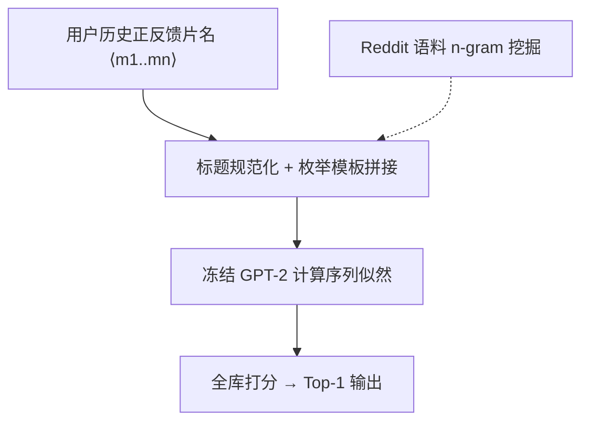

# Zero-Shot Recommendation as Language Modeling (以语言建模实现零样本推荐)

- **会议/期刊**: ECIR 2022
- **作者与机构**: Damien Sileo, Wout Vossen, Robbe Raymaekers (KU Leuven)
- **推荐链路定位**: 召回（零样本全库打分）
- **研究方向**: 大语言模型推荐 / 冷启动与长尾推荐
- **论文原文**: [https://arxiv.org/abs/2112.04184v1](https://arxiv.org/abs/2112.04184v1)
- **开源代码**: [Colab Notebook](https://colab.research.google.com/drive/1f1mlZ-FGaLGdo5rPzxf3vemKllbh2esT?usp=sharing)（仅实验脚本，无工程级实现）

## TL;DR (1分钟核心速览)

本文提出**完全不需要 `(user, item, interaction)` 结构化三元组**的推荐范式：把用户喜欢的若干片名拼成一句自然语言提示 `Movies like ⟨m1⟩,…,⟨mn⟩,⟨mi⟩`，直接用**冻结**的 GPT-2 对该序列的似然作为相关性分数 $\hat R_{u,i}=P_\Theta(p_{u,i})$，并据此对全库排序。评估采用 MovieLens-1M 上「1 正 + 4 负」的 1-of-5 排序协议（MAP@1）。结果显示：零训练 GPT-2-base（117M）在训练用户数 <50 时、GPT-2-medium（345M）在 <100 时即超过用 BPR 训练的同域矩阵分解，同时显著优于 BERT-NSP 探针（MAP@1 约 +0.05）。

## Background & Motivation (背景与核心矛盾)

- **主流范式**: 协同过滤（矩阵分解/BPR）依赖 `(USER, ITEM, INTERACTION)` 三元组，基于内容的方法依赖 `(ITEM, FEATURES)` 对；二者都需要**昂贵且有监督信号的结构化数据采集**（打分、点击、标注）。
- **前人局限**: ①工业冷启动场景下用户数极少，BPR 类模型几乎无法收敛（图 3 中训练用户趋近 0 时准确率跌至随机水平）；②Penha et al. 用 BERT 的 Next Sentence Prediction 做探针，但 NSP 是**判别式**目标，可利用的仅是"话语连贯性"这类浅层特征，并非真正的物品相似度知识，且只有 BERT 系模型提供 NSP 头。
- **核心洞察 (Key Insight)**: 网页文本里天然存在大量"相似物品并列枚举"，如 Reddit 上的 *"Films like Beyond the Black Rainbow, Lost River, Suspiria…"*。生成式 LM 在 WebText 上预训练时已经隐式拟合了这种共现分布，因此**一句枚举提示的似然本身就是一个物品相似度打分器**。
- **本文切入点**: 不做任何微调/适配，把推荐降维为"给一句提示算概率"，并**从语料中挖掘真实句式**来决定模板，而非人工拍脑袋设计。

## Method (核心方法设计)

### 1. 整体框架 (Overall Architecture)

整个流程没有可训练参数：取用户历史中 $n$个正反馈片名 → 经标题规范化（去年份、改写后置冠词，`Matrix, The (1999)` → `The Matrix`）以对齐网页文本表面形式 → 按语料挖掘出的枚举模板拼成提示$p_{u,i}$→ 送入冻结 GPT-2 计算逐 token 对数似然并累乘 → 对候选集所有物品打分取 Top-1。训练阶段仅存在于 BPR 基线；本文主模型训练开销为零，推理开销为$O(|\mathcal{I}|\cdot L)$ 次前向。

### 2. 关键设计拆解 (Key Designs)

1. **提示即打分函数（Prompt-as-Scorer）**: 前人需要训练一个 $f(u,i)\to \mathbb{R}$的参数化映射；本文直接令$\hat R_{u,i}=P_\Theta(p_{u,i})=\prod_{t}P_\Theta(w_t\mid w_{<t})$，$\Theta$完全冻结。有效性的物理直觉是：若$m_i$ 与用户已看片单在语义上同属一类，则该片名出现在枚举句末尾的条件概率天然更高——**打分过程等价于测量"这个片名接在这串片名后面有多自然"**。
2. **语料驱动的模板挖掘（Corpus-Mined Prompt）**: 作者统计 2015-05 Reddit 评论中（>900k 词）含电影名的 3–6 gram，最高频为 `⟨m⟩ and ⟨m⟩`(387)、`⟨m⟩,⟨m⟩,⟨m⟩`(232)、`Movies like ⟨m⟩`(196)、四元枚举(85)、`Movies similar to ⟨m⟩`(25)。据此确定枚举式模板 `<m1>,...,<mn>,<mi>` 优于 Penha et al. 的 `if you like …, you will like …`（后者与网页真实分布不符，MAP@1 差距约为 0.05–0.07，即 >20% 相对提升）。**关键不是"模板很重要"（图 1 显示它并非决定性因素），而是"用目标域语料统计共现句式"这一可复用方法论**。
3. **训练目标与推理开销**: 本文模型无损失函数可写（$\Theta$冻结，仅用式$\mathcal{L}_{LM}=-\log\sum_i P(w_i\mid w_{i-k..i-1};\Theta)$的前向值）；对照基线 BPR 用标准 pairwise ranking loss，$d=10$、lr=0.001（Cornac 默认配置，作者称调参后无显著变化）。推理是纯似然打分而非自回归解码生成（定性分析显示贪心解码会产出 `Jackass 2`、`A Feast for Crows` 等非法或非电影续写），因此**必须对全库每个候选做一次前向**，无缓存机制。

## Experimental Setup & Evaluation Protocol (实验设置与评估协议)

- **数据集与预处理**（MovieLens-1M，正负按分数阈值硬切分，中间评分丢弃）：

| 数据集 | #Users | #Items | #Interactions | 稀疏度 | 特征/场景说明 |
| :--- | :---: | :---: | :---: | :---: | :--- |
| ML-1M 原始 | 6,040 | 3,090 | 1,000,209 | 密度 ≈5.4% | 评分 0.5–5，无文本特征 |
| ML-1M 过滤后 | 2,716 | 3,090 | — | — | 保留 ≥21 条正评 & ≥4 条负评用户 |

  正样本定义 $r\ge 4.0$，负样本$r\le 2.5$，$2.5<r<4.0$ 直接丢弃；随机取 20% 用户（≈543）为测试用户。
- **数据划分与防穿越 (Splitting Strategy)**: **用户级划分**（User-level hold-out，20% 测试用户），而非时间戳切分；每用户固定预留 **1 正 + 4 负** 作评测集，**5 条正评**放入提示（图 2 实验则改为 0/1/2/3/5/10/15/20 条）。仅 BPR 使用剩余 80% 训练用户，LM 全程零样本，因此不存在穿越问题。
- **排名评测协议 (Ranking Protocol)**: 明确属于 **Sampled Ranking（1 正 vs 4 负，1-of-5）**，不是 Full-Ranking 全库排序——随机基线 MAP@1 = 0.20。指标只用 **MAP@1**（首名命中率），未报告 Recall@K 或 NDCG。
- **对比基线与超参**: ①BPR（$d=10$，lr=0.001，训练用户数从 0 扫到 500）；②BERT-base / BERT-large NSP（$\hat R_{u,i}=\text{BERT}_{\text{NSP}}(p_u,\langle m_i\rangle)$）；③GPT-2-base(117M) / GPT-2-medium(345M)。**未报告任何显著性检验（无$p$ 值、无置信区间、无多随机种子方差）**。

## Key Experimental Results (实验关键数据)

> 原文仅以折线图（图 1–3）呈现结果，下表数值为对图中曲线的近似读数（±0.01–0.02），用于呈现趋势与量级对比。

### 1. 主实验对比 (Main Results)

| 模型 | 训练用户数 | MAP@1 (≈) | 相对随机基线 | 备注 |
| :--- | :---: | :---: | :---: | :--- |
| 随机 / 空提示（流行度先验） | 0 | 0.20 / 0.21 | — | 空提示已高于随机，说明 LM 编码了流行度 |
| BPR ($d=10$) | 0 → 500 | 0.21 → **0.37** | +85% | 需 500 用户才到峰值，随用户数单调上升 |
| BERT-base NSP (110M) | 0 | 0.23 | +15% | 判别式探针，增益有限 |
| BERT-large NSP (340M) | 0 | 0.27 | +35% | 换大模型仍有提升 |
| **GPT-2-base (117M)** | 0 | **0.30** | **+50%** | 与 BPR 交叉点 ≈ 50 用户 |
| **GPT-2-medium (345M)** | 0 | **0.33** | **+65%** | 与 BPR 交叉点 ≈ 100 用户（`Improv.` 项内最优） |

### 2. 消融实验 (Ablation Study)

| 消融/变体 | 设置 | MAP@1 (≈) | Δ |
| :--- | :--- | :---: | :---: |
| 完整模型 | 枚举模板 + $n=5$ + GPT-2-base | 0.30 | — |
| w/o 语料模板 | `if you like ⟨m1..mn⟩, you will like ⟨mi⟩` | ~0.24 | **-0.06** |
| w/o 任何示例 | 空提示（仅 `<m>`） | ~0.21 | **-0.09** |
| $n$变化 |$n=1$/$n=3$/$n=5$/$n=20$ | 0.25 / 0.28 / 0.30 / 0.29 | 先升后平、方差增大 |
| 模型规模 | GPT-2-base → medium | 0.30 → 0.33 | +0.03 |

### 3. 关键实验发现 (Key Findings)

1. **模板工程是"次重要但不可忽略"的因子**：语料挖掘的枚举模板相对 `if you like…, you will like…` 提升约 0.06 MAP@1（≈25% 相对），但四种模板 MAP@1 全部落在 0.21–0.28 的窄区间内——真正决定性能的是"用似然打分"这一范式本身，而非模板细节。
2. **提示示例数存在"边际收益拐点"**：$n$从 1 增至 5 带来约 +0.05 MAP@1 后即饱和，$n=20$ 反而轻微下降且跨用户方差显著放大；更关键的是**空提示已达 0.21（高于随机 0.20）**，证明 LM 的"先验偏好"主要是流行度而非个性化——个性化增益完全来自片名列表。
3. **生成式似然 ≫ 判别式 NSP**：同等参数预算下（GPT-2-base 117M vs BERT-base 110M）MAP@1 为 0.30 vs 0.23（+30% 相对），说明"建模词表分布"比"判别两句是否连贯"更能捕获物品语义相似；但 GPT-2-base/medium 的交叉点（50/100 用户）也把本方法的适用边界钉死在**极冷启动区间**，超过 100 用户后 BPR 全面反超。

## Highlights & Limitations (亮点、对比与审稿批判)

- **与代表作对比 (vs. Prior Work)**: ①vs **Penha et al. (BERT-NSP)**：本文用生成式似然替代判别式 NSP，不依赖特定预训练头，且首次与标准推荐模型做了同协议对比（原工作仅为"知识探针"）；②vs **BPR**：本质区别是不学习任何用户/物品嵌入，用 345M 参数的语言先验替代 500 用户的交互统计；③vs 后续 **P5/TIGER 类 LLM4Rec**：本文是"零参数更新 + 手动模板"的最原始形态，缺少指令微调与语义 ID 化。
- **可迁移亮点**: ①**从目标域语料挖掘提示模板**（n-gram 共现统计）可低成本迁移到任一"物品常被自然语言提及"的域（书籍、餐厅、音乐）；②**空提示作为流行度先验基线**是一个极简的 sanity check，可用于量化"个性化增益 vs 先验增益"的分解。
- **审稿级局限批判**: ①**评估协议过窄**：1 正 4 负的 1-of-5 采样排序把任务退化为选择题，随机基线高达 0.20，且仅报 MAP@1、无 Full-Ranking/NDCG@K、无显著性检验、未报告多 seed 方差，结论稳健性存疑；②**推理成本未讨论**：需对 3,090 个候选逐一遍历前向（无负采样、无预计算缓存、无 ANN），在线部署成本 $O(|\mathcal{I}|\cdot L)$ 不可接受，作者对此完全未做复杂度分析；③**标题/称号规范化是隐藏的强假设**，"物品名必须能被 LM 当作自然语言短语吞下"这一前提在电商 SKU、短视频场景基本不成立；④图 3 中更大模型反而无进一步提升，作者以"过拟合"解释但未给证据。

## Rating (四维评分)

- **方法创新性 (Novelty)**: ⭐⭐⭐⭐ （首次把"生成式 LM 序列似然"直接当作推荐打分器并与 CF 同协议对撞，范式意义大于技术深度，无理论/谱分析支撑）
- **评估协议与实验扎实度 (Protocol & Experiments)**: ⭐⭐ （仅 1-of-5 采样排序 + 单一 MAP@1 指标，无显著性检验、无多 seed 方差，结果只以折线图呈现无表格）
- **写作与数学规范度 (Clarity & Rigor)**: ⭐⭐⭐⭐ （提示定义与打分公式极简清晰，语料挖掘流程可复现；但缺少推理复杂度分析与形式化问题定义）
- **工业落地与复现价值 (Industrial & Practical Value)**: ⭐⭐⭐ （Colab 脚本可一键复现，模板挖掘思路易迁移；但全库前向打分与"物品名须为自然语言"的双重约束限制了真实系统部署）

