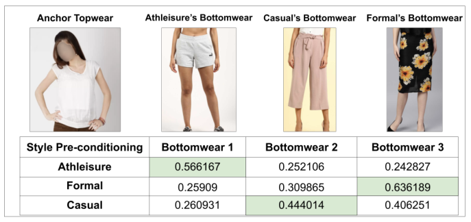
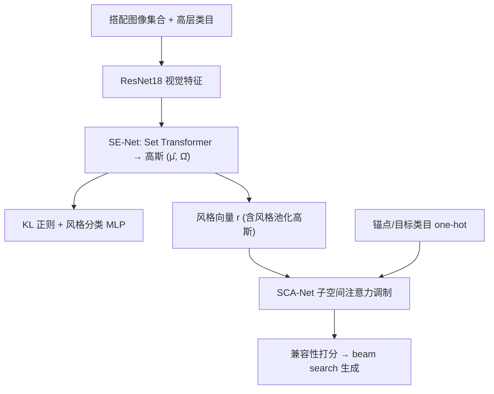
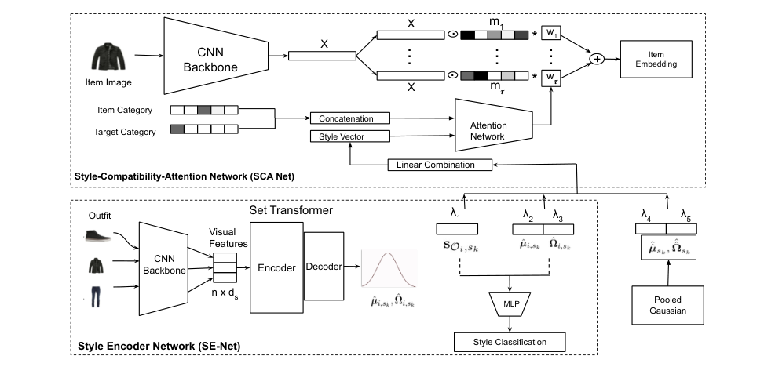

# Recommendation of Compatible Outfits Conditioned on Style (风格条件化的兼容搭配推荐)

- **会议/期刊**: ECIR 2022
- **作者与机构**: Debopriyo Banerjee, Lucky Dhakad, Harsh Maheshwari, Muthusamy Chelliah, Niloy Ganguly, Arnab Bhattacharya（IIT Kharagpur / Flipkart Internet / Leibniz University Hannover）
- **推荐链路定位**: 生成式端到端（搭配补全 + 风格条件搭配生成）
- **研究方向**: 多模态推荐 / 生成式推荐
- **论文原文**: [论文原文链接](https://arxiv.org/abs/2203.16161v1)
- **开源代码**: 暂未开源

## TL;DR (1分钟核心速览)

现有搭配推荐只学"单品是否兼容"，忽视用户在真实场景里先有明确风格（formal/casual/party）这一前提，导致同一上装只能生成主导风格的搭配。本文提出 SATCORec：用 Set Transformer 把整条搭配编码成风格隐空间中的高斯分布（KL 正则保证空间平滑），再将该风格向量注入 CSA-Net 的子空间注意力，实现风格条件的兼容性打分，并用 beam search 支持风格混合生成。在约 10 万条自建搭配数据集（70:20:10 划分）上，FITB(HN) 53.32、Compat-AUROC(SN) 96.47 均略优于 CSA-Net，而风格熵 1.09 vs Theme Matters 0.61（+79%）、风格 MRR 0.884 vs 0.621 优势显著。

## Background & Motivation (背景与核心矛盾)

- **主流范式**: 搭配推荐以"兼容性学习"为核心，用 CNN 提视觉特征 + 类别 one-hot，借子空间注意力（CSA-Net）或类型感知度量（TypeAware）判断单品是否可共现，再用 beam search 补全搭配。
- **前人局限**: ① CSA-Net / TypeAware / BPR-DAE 完全无视显式风格，生成结果被训练集中主导风格"劫持"；② Theme Matters 虽引入主题注意力，但依赖细粒度类目（长裙/迷你裙），模型规模随细类目数指数膨胀，且仍需富属性标注。
- **核心洞察 (Key Insight)**: 搭配是**无序变长集合**而非序列，因此风格应由集合级（set-level）表征建模；且"先无风格生成、再分类筛选"在候选空间上极低效——风格应作为条件直接进入兼容性算子。
- **本文切入点**: 只用"高层类目 + 单品图像 + 搭配级风格标签"这一最贴近电商实际可得性的监督，把风格编码为连续隐分布并注入注意力权重。

<figure class="paper-figure" markdown="span">
  <figcaption>图1. 给定用户喜欢的一件上装，风格引导方法能够根据多种风格（运动休闲、正式和休闲）生成搭配，而与风格无关的兼容性模型通常只会根据主导风格生成搭配。数值表示每件单品的风格条件兼容性分数。注意，对于给定风格，与该风格对应的下装获得最高分。</figcaption>
</figure>

## Method (核心方法设计)

### 1. 整体框架 (Overall Architecture)

输入一条搭配的图像集合与 6 个高层类目，ResNet18（仅微调最后卷积块 + 一层 FC，$d=64$）提视觉特征；SE-Net 用 Set Transformer（SAB，$d_z=32$、2 head）把集合映射为搭配专属高斯$(\hat{\mu},\hat{\Omega})$，经 KL 正则与风格分类监督后输出风格向量$r$；SCA-Net 将$r$ 与锚点/目标类目 one-hot 一起送入注意力网络，生成 5 个子空间权重并加权掩码嵌入，得到风格条件的兼容性打分；推理时给定父单品 + 模板 + 目标风格，用 beam search 逐位补全，风格向量线性插值即可混合两种风格。

<figure class="paper-figure" markdown="span">
  <figcaption>图2. SATCORec 的架构。下方模块结合 SE-Net 与风格分类器，并单独训练。将一套搭配中的单品图像输入 CNN 以提取视觉特征，随后这些特征被送入 Set transformer 以输出高斯分布。风格分类器使用随机样本或该高斯分布的参数进行训练。将这两者的线性组合与风格特定池化高斯分布的参数一起作为特征传入 SCA Net 模块，该模块通过注意力学习兼容性。</figcaption>
</figure>

### 2. 关键设计拆解 (Key Designs)

1. **SE-Net：把搭配风格建模为高斯隐分布而非单点嵌入**：痛点是用单条参考搭配做条件时，生成阶段（仅有父单品）根本无参考搭配可编码。做法是让 Set Transformer 输出对角高斯的均值与方差，$O_i|s_k \sim \mathcal{N}(\hat{\mu}_{i,s_k},\hat{\Omega}_{i,s_k})$，并以$\mathcal{L}_{Style}=\mathrm{KL}\big(\mathcal{N}(\hat{\mu},\hat{\Omega})\,\|\,\mathcal{N}(0,1)\big)$ 拉向标准正态。直觉上这既保证同风格搭配簇内紧凑，又让不同风格簇之间留有平滑过渡带（图 3 的 t-SNE 从碎片化变为连续流形），从而支持后续风格插值。
2. **风格向量构造与全局池化高斯**：为兼顾"单搭配特异性"与"无参考搭配时的可用性"，作者把随机采样 $s_{O_i,s_k}$、搭配级参数$(\hat{\mu},\hat{\Omega})$与按风格聚合的池化参数$(\hat{\hat{\mu}}_{s_k},\hat{\hat{\Omega}}_{s_k})$做带权拼接，$r_{O_i,s_k}=[\lambda_1 s+\lambda_2\hat{\mu}+\lambda_4\hat{\hat{\mu}},\ \lambda_3\hat{\Omega}+\lambda_5\hat{\hat{\Omega}}]$，不同$\lambda$ 取值派生 r / p / (p+g) / (r+gm) / (pm+gm) 五个变体。采样项提供类内多样性、池化项提供风格先验，这也是 SATCORec-p 在补全准确率上最强的原因。
3. **风格调制注意力 + 双重三元组损失与推理开销**：把 CSA-Net 的 $f^{s_k}_{O_i,a}=\sum_{j=1}^{\tau}(x\odot m_j)\times\omega_{j,r_{O_i,s_k}}$中的注意力权重从"类目驱动"改为"类目 + 风格向量共同驱动"，即风格直接重加权视觉子空间；损失在$\mathcal{L}_{compat}=\max(0,D^{s_k}_{P}-D^{s_k}_{N}+m)$之外新增$\mathcal{L}_{stylecompat}=\max(0,D^{s_k}_{P}-D^{s_q}_{P}+m)$，惩罚"用错风格"的错配，总损失为四项加权和（权重 1 : 0.5 : 0.05，margin 0.3）。SE-Net 先训练后冻结，SCA-Net 仅训三元组，生成侧为 beam search 近似，无需全组合枚举，线上可做到单父单品 × k 风格的并行打分。

## Experimental Setup & Evaluation Protocol (实验设置与评估协议)

- **数据集与预处理**: 自建电商女装西式搭配集，两阶段标注（专家标 5k 条 → 属性相似度替换 + 人工核验扩至 ~10 万条），8 种风格 × 6 个高层类目；**不使用**细粒度类目训练（仅用于构造 hard negative 与评测）。

| 数据集 | #Users | #Items | #Interactions(搭配数) | 稀疏度/密度 | 特征/场景说明 |
| :--- | :---: | :---: | :---: | :---: | :--- |
| 自建 Western-wear（Train） | 未提供 | 未提供 | 69,538 | — | 8 风格，Athleisure/Winter 占多数 |
| Valid | — | — | 9,934 | — | 同分布 |
| Test | — | — | 19,869 | — | 总计约 99.3k 搭配 |

- **数据划分与防穿越 (Splitting Strategy)**: 搭配级 **比例划分 70:20:10**（非 Leave-One-Out、非时间戳切分），搭配为独立样本单元，无用户级穿越控制。
- **排名评测协议 (Ranking Protocol)**: 采用 **Sampled Ranking**——每个位置随机替换单品构造负例，分 `soft negative`（同类目内采样）与 `hard negative`（细粒度子类目内采样），每搭配重复 5 次负采样取均值；指标为 FITB 与 Compatibility AU-ROC。此外自定 **Style Entropy**（同一锚点下 top-6 搭配的风格分布熵，衡量风格覆盖广度）、**风格 MRR / Avg Rank / Top-k 命中**、**Parent-Child Top-1 准确率** 与 **判别性细类目选择率**。
- **对比基线与超参设置**: TypeAware、BPR-DAE、TransNFCM、Theme Matters、CSA-Net 共 5 个 SOTA；全部统一 ResNet18 骨干、$d=64$、同一 6 类目输入；Adam，SCA-Net batch 32 triplets、lr$1\times10^{-5}$、5 个子空间；未报告显著性检验（表中为 5 次重复的标准差）。

## Key Experimental Results (实验关键数据)

### 1. 主实验对比 (Main Results)

| Method | FITB(HN) | FITB(SN) | AUROC(HN) | AUROC(SN) | Style Entropy |
| :--- | :---: | :---: | :---: | :---: | :---: |
| TypeAware | 30.70 | 34.85 | 52.62 | 55.51 | 0.49 |
| BPR-DAE | 31.16 | 31.21 | 55.83 | 55.76 | 0.43 |
| TransNFCM | 31.53 | 36.47 | 51.84 | 57.78 | 0.50 |
| Theme Matters | 38.53 | 63.20 | 85.40 | 93.85 | 0.61 |
| CSA-Net | 53.14 | 67.05 | 94.42 | 96.30 | 0.48 |
| SATCORec-r | **53.32** | 66.63 | 94.47 | 95.99 | **1.09** |
| SATCORec-p | 52.06 | **67.31** | **94.78** | **96.47** | 0.97 |
| Improv.% (vs 最强基线) | +0.34% | +0.39% | +0.38% | +0.18% | **+78.7%** |

风格侧指标（表 4）：SATCORec-r 风格 MRR 0.8844、正确风格排第 1 命中 80.94%、top-3 95.00%、平均排名 1.4，均远优于 Theme Matters（0.6213 / 42.37 / 76.51 / 2.5）；SATCORec-p 在 Parent-Child Top-1 上最强（Bottom→Top 86.65、Top→Bottom 77.33 vs Theme Matters 57.92 / 50.32）。

### 2. 消融实验 (Ablation Study)

| 变体（$\lambda$ 配置差异） | FITB(HN) | FITB(SN) | AUROC(HN) | AUROC(SN) | 说明 |
| :--- | :---: | :---: | :---: | :---: | :--- |
| SATCORec-r（仅采样 $s$） | **53.32** | 66.63 | 94.47 | 95.99 | 保留搭配级不确定性 |
| SATCORec-p（仅 $\hat{\mu},\hat{\Omega}$） | 52.06 | **67.31** | **94.78** | **96.47** | 保留搭配级分布参数 |
| SATCORec-(pm+gm)（+ 池化） | 49.73 | 63.02 | 90.96 | 92.25 | 引入全局先验后下降 |
| SATCORec-(r+gm)（采样 + 池化） | 47.61 | 60.70 | 88.88 | 91.34 | 两源混杂、丢弃搭配级方差 |
| SATCORec-(p+g)（参数 + 池化） | 46.56 | 61.03 | 88.41 | 90.10 | 最差，风格过平滑 |

### 3. 关键实验发现 (Key Findings)

1. **兼容性提升微弱、风格可控性提升巨大**：相对 CSA-Net，FITB(HN) 仅 +0.18 个点（53.14→53.32）、AUROC(HN) +0.05，但风格熵从 0.48 跃至 1.09（+127%），说明风格向量基本不损伤视觉兼容性，却把"同一锚点可覆盖的风格数"从近乎单一扩到近 6 种。
2. **不确定性建模是主因，池化先验是负担**：去掉搭配级方差（-(p+g)、-(r+gm)）后 FITB(HN) 从 53.32 掉到 46.56–47.61（−6.7~−5.7 点），证明"分布而非点表征"是关键；而加入风格池化项一律掉点，表明池化抹平了类内风格差异。
3. **风格条件能真正改变选品而非仅改排序**：判别性细类目选择率总体 34.27（r）/32.96（p）vs 最强基线 CSA-Net 25.38、Theme Matters 21.39，且在 Party（50.56 vs 34.63）与 Formal（47.26 vs 35.44）上差距最大，说明模型会主动输出塑造风格的细类目（如派对裙装）而非跨风格热门款（如牛仔裤）。

## Highlights & Limitations (亮点、对比与审稿批判)

- **与代表作对比 (vs. Prior Work)**: 相比 CSA-Net（无风格、纯类目驱动注意力），本文以极小代价（+0.2 点兼容性）换取风格条件能力；相比 Theme Matters（细类目监督 + 模型随类目数指数增长），本文只用 6 个高层类目，参数量与类目数解耦；相比 Singhal 等用自编码器隐式建模风格，本文显式给出可采样、可插值的风格分布，支持风格混合生成。
- **可迁移亮点**: ① 把"集合级条件"用 Set Transformer→高斯+KL 变成可插值的控制向量，可迁移到多模态会话/场景条件推荐；② 用 $\max(0,D^{s_k}_P-D^{s_q}_P+m)$ 惩罚"条件错配"，是把条件正确性写进度量学习的通用范式。
- **审稿级局限批判**: ① **评估不可复现**：核心结果全部基于未公开的自建 10 万搭配集，且为 Sampled Ranking（同位置负采样），无 Full-Ranking、无公开基准（如 Polyvore），也未做显著性检验，0.2 点级提升缺乏统计说服力；② 生成环节仍为传统 beam search 近似，未优化全局最优；SE-Net 需先独立训练再冻结，两阶段耦合且对 $\lambda$、KL 权重（0.05）明显敏感（不同变体差 7 个点），工程调参成本高。

## Rating (四维评分)

- **方法创新性 (Novelty)**: ⭐⭐⭐⭐ （首次将 Set Transformer + 高斯隐空间用于搭配风格条件化，并用双重三元组把风格约束写进度量，思路清晰有新意，但组件级创新多于理论突破）
- **评估协议与实验扎实度 (Protocol & Experiments)**: ⭐⭐⭐ （指标设计丰富且风格侧论证有力，但自建未公开数据集 + Sampled Ranking + 无显著性检验，主表兼容性增益仅 0.2–0.4 点，说服力受限）
- **写作与数学规范度 (Clarity & Rigor)**: ⭐⭐⭐⭐ （公式简洁、变体定义以 $\lambda$ 表格化很清晰，但符号略拥挤、缺少复杂度与参数量分析）
- **工业落地与复现价值 (Industrial & Practical Value)**: ⭐⭐⭐ （真实电商场景动机强、仅需高层类目与图像，落地门槛低；但无开源代码、两阶段训练与负采样/beam search 细节不足，复现成本偏高）

