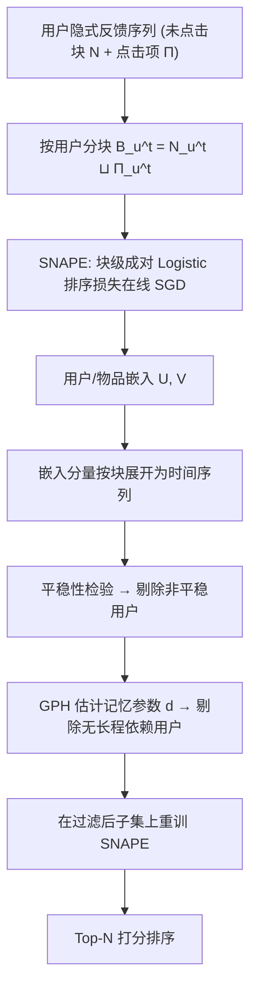
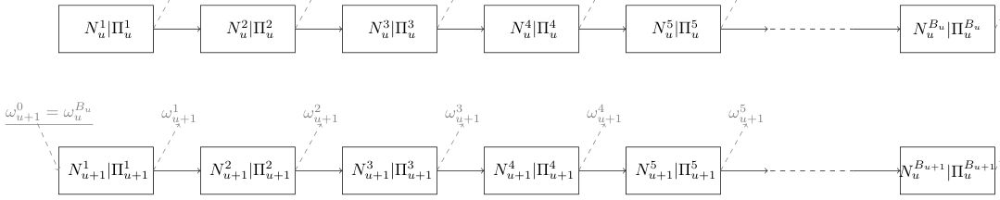
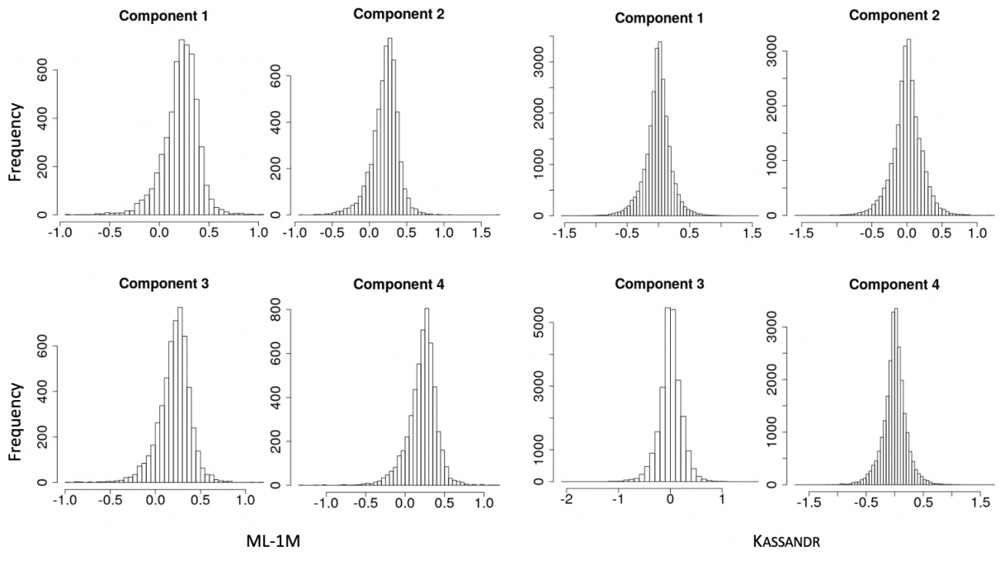

# Recommender Systems: When Memory Matters (推荐系统：当记忆起作用时)

- **会议/期刊**: ECIR 2022 (第 44 届欧洲信息检索会议)
- **作者与机构**: Aleksandra Burashnikova (Skoltech / Univ. Grenoble-Alpes)、Marianne Clausel (Univ. Lorraine)、Massih-Reza Amini (Univ. Grenoble-Alpes)、Yury Maximov (Los Alamos National Lab)、Nicolas Dante (Univ. Lorraine)
- **推荐链路定位**: 召回（表示学习与 Top-N 排序打分）
- **研究方向**: 序列与会话推荐 / 交互去噪
- **论文原文**: [https://arxiv.org/abs/2112.02242v1](https://arxiv.org/abs/2112.02242v1)
- **开源代码**: 暂未开源（原文仅承诺 "will be made available for research purpose"）

## TL;DR (1分钟核心速览)

本文质疑"全部隐式反馈等权可信"这一默认假设：作者用时间序列分析中的**平稳性**与**长程依赖 (long memory)** 刻画每个用户交互序列的可预测性，先提出按"若干未点击项 + 一个点击项"分块、逐用户块级更新的在线算法 SNAPE（同时利用正负反馈），再叠加 MOSAIC 记忆感知步骤——用 GPH 估计记忆参数 $d$ 后剔除"行为不持久"的用户并重训。在按时间 80/20 划分的 ML-1M、Kasandr、Pandor 上，MOSAIC 在两大稀疏数据集上 MAP@5 相比 SNAPE 再涨 7.0% 与 9.2%，但仅用不到 1% 的用户。

## Background & Motivation (背景与核心矛盾)

- **主流范式**: GRU4Rec / Caser 等序列模型只对"已点击"正反馈序列建模，并隐含假设用户兴趣是**齐次、持续**的，从而可以套用带记忆的平稳神经网络。
- **前人局限**: 其一，BPR 类方法在全体交互上随机抽三元组，忽略展示上下文与"同一用户内未点击块"的局部偏好结构；其二，把所有用户一视同仁地喂入训练，而现实中的大量用户反馈本身是 erratic 的噪声源。
- **核心洞察 (Key Insight)**: 若把每个用户的嵌入向量按交互块展开成时间序列 $X=\{X_t\}$，其统计性质可用宽平稳（一阶矩、协方差时移不变）与长程依赖（谱密度$f(\lambda)\sim\lambda^{-2d},\ d\in(0,1/2)$）来度量；$d$ 越接近 0.5，历史信息对未来的预测力越强，该用户越"可学"。
- **本文切入点**: 与其改网络结构，不如**改训练数据**——先训一遍拿到嵌入轨迹，用统计检验筛出"平稳 + 长记忆"的用户子集再重训。

## Method (核心方法设计)

### 1. 整体框架 (Overall Architecture)

模型不使用任何 RNN/CNN，而是维护用户/物品的低维嵌入 $\omega=(U,V)$，按用户在线推进：对每个用户$u$，把按时间排序的交互切成$B_u+1$个块，每块由一个未点击集合$\mathcal{N}_u^t$后接一个点击集合$\Pi_u^t$构成，块到即做一次 SGD 更新，用户$u$的最后权重直接热启动用户$u+1$。SNAPE 收敛后，把每个用户的嵌入分量按块展开成时间序列，先做平稳性筛选，再用 GPH 估计记忆参数$d$，剔除$d\notin(0,1/2)$ 的用户，最后在剩余子集上重跑 SNAPE 得到 MOSAIC。

<figure class="paper-figure" markdown="span">
  <figcaption>图 1：横轴表示按时间排序的项目上的交互序列。权重 ωt 的每次更新</figcaption>
</figure>

### 2. 关键设计拆解 (Key Designs)

1. **块级正负反馈成对损失 (SNAPE)**：针对 BPR 全局随机采样丢失"展示上下文"、且无正反馈用户几乎抽不到的问题，改为在一个块内对 $\Pi_u^t\times\mathcal{N}_u^t$全体配对求平均损失$\hat{\mathcal{L}}_{B_u^t}=\frac{1}{|\Pi_u^t||\mathcal{N}_u^t|}\sum_{i\in\Pi_u^t}\sum_{i'\in\mathcal{N}_u^t}\ell_{u,i,i'}$，其中$\ell_{u,i,i'}=\log\big(1+e^{-y_{u,i,i'}U_u^{\top}(V_i-V_{i'})}\big)+\lambda(\|U_u\|_2^2+\|V_i\|_2^2+\|V_{i'}\|_2^2)$，$y_{u,i,i'}=\pm1$。直觉是：同一屏/同一时段被同时展示却未点击的项，才是最有信息量的负样本，块内配对天然实现了"上下文硬负采样"。
2. **记忆参数估计与用户过滤 (MOSAIC)**：把嵌入分量视为时序，用周期图 $I(\lambda_k)=\frac{1}{N}\big|\sum_{t=1}^{N}X_te^{it\lambda_k}\big|^2$在 Fourier 频率上做对数周期图回归，得 GPH 估计$\hat{d}(m)=\frac{\sum_{k=1}^{m}(Y_k-\bar{Y})\log I(\lambda_k)}{\sum_{k=1}^{m}(Y_k-\bar{Y})^2}$，$Y_k=-2\log|1-e^{i\lambda_k}|$。仅保留"四个分量均平稳"且随后"分量均 LRD"的用户。直觉：$d$是"历史记忆衰减速度"的定量刻度，$d\to0$ 表示交互近似白噪声，此类用户的梯度只会污染共享物品嵌入。
3. **训练目标与推理开销**：总目标即块级正则化成对 Logistic 损失的经验和，**无需额外负采样器**（负样本由真实未点击块免费提供）；推理为标准内积 Top-N 检索，过滤步骤只发生在训练侧，线上不增加任何延迟，代价是 MOSAIC 需要训练两遍。

## Experimental Setup & Evaluation Protocol (实验设置与评估协议)

- **数据集与预处理**: ML-1M 将评分 $\ge 4$ 视为正反馈、其余为负；Kasandr 为 Kelkoo 广告曝光/点击；Pandor 为 Purch 网站一月内广告曝光/点击。无 5-core 过滤，仅按记忆准则筛用户（括号内为过滤后用户数）：

| 数据集 | #Users (过滤后) | #Items | #Interactions (train / test) | 稀疏度 | 平均正/负反馈 |
| :--- | :---: | :---: | :---: | :---: | :---: |
| ML-1M | 6,040 (2,102) | 3,706 | 797,758 / 202,451 | 0.9553 | 95.27 / 70.46 |
| Kasandr | 2,158,859 (2,029) | 291,485 | 12,509,509 / 3,335,208 | 0.9999 | 2.42 / 51.93 |
| Pandor | 177,366 (1,721) | 9,077 | 1,579,716 / 493,663 | 0.9987 | 1.32 / 10.36 |

- **数据划分与防穿越 (Splitting Strategy)**: **按用户时间戳切分**——每用户最早的 80% 交互训练、最近 20% 测试，训练/测试保持同一用户集合，因此不存在未来信息泄漏；但**冷用户无法被评估**。
- **排名评测协议 (Ranking Protocol)**: 面向个性化 Top-N 推荐，报告 MAP@K 与 NDCG@K（$K=5,10$）；原文未显式声明是 Full-Ranking 还是采样排序（只说明测试集含真实正负反馈），对比 SNAPE 与 MOSAIC 时严格共用同一测试集。
- **对比基线与超参设置**: BPR（无序列、全局三元组）、Caser（CNN 时序卷积）、GRU4Rec（会话 GRU），三者均只用正反馈；嵌入维度 $k$、正则系数$\lambda$ 由交叉验证选取。

## Key Experimental Results (实验关键数据)

### 1. 主实验对比 (Main Results)

| 模型 | ML-1M MAP@5 | ML-1M MAP@10 | Kasandr MAP@5 | Kasandr MAP@10 | Pandor MAP@5 | Pandor MAP@10 |
| :--- | :---: | :---: | :---: | :---: | :---: | :---: |
| BPR | 0.852 | 0.819 | 0.316 | 0.337 | 0.431 | 0.448 |
| Caser | 0.701 | 0.677 | 0.136 | 0.149 | 0.201 | 0.224 |
| GRU4Rec | 0.761 | 0.736 | 0.636 | 0.637 | 0.318 | 0.332 |
| SNAPE | **0.854** | **0.821** | 0.730 | 0.730 | 0.457 | 0.472 |
| MOSAIC | 0.839 | 0.808 | **0.781** | **0.780** | **0.499** | **0.509** |
| Improv. (最优 vs 最强基线) | +0.2% | +0.2% | **+22.8%** | **+22.4%** | **+15.8%** | **+13.6%** |

NDCG 侧结论一致：MOSAIC 在 Kasandr 上 NDCG@5/@10 达 **0.786 / 0.809**（SNAPE 0.754 / 0.780，GRU4Rec 0.670 / 0.693），在 Pandor 上为 **0.567 / 0.647**（SNAPE 0.552 / 0.634），ML-1M 上则 0.774 / 0.875 略低于 SNAPE 的 0.789 / 0.885。

### 2. 消融实验 (Ablation Study)

| 变体 | ML-1M MAP@5 | Kasandr MAP@5 | Pandor MAP@5 | 保留用户比例 | 相对 SNAPE |
| :--- | :---: | :---: | :---: | :---: | :---: |
| w/o 负反馈 (GRU4Rec) | 0.761 | 0.636 | 0.318 | 100% | -10.9% / -12.9% / -30.4% |
| SNAPE (w/o 记忆过滤) | **0.854** | 0.730 | 0.457 | 100% | — |
| + 仅平稳性过滤 | — | — | — | 34.8% / 5.9% / 2.3% | — |
| MOSAIC (平稳 + LRD) | 0.839 | **0.781** | **0.499** | 34.8% / 0.72% / 0.97% | -1.8% / **+7.0%** / **+9.2%** |

### 3. 关键实验发现 (Key Findings)

1. **正负反馈建模比网络结构更重要**：不使用任何序列神经网络的 SNAPE 在 Kasandr 上 MAP@5 比 GRU4Rec 高 **14.8%**、在 Pandor 上高 **43.7%**，说明"真实未点击块作负样本"的收益在极度稀疏（稠密度 $10^{-4}$ 量级、人均正反馈仅 1.3–2.4 条）场景下远大于时序编码器。
2. **删掉 99% 的用户反而更强**：Kasandr 从 2,158,859 人筛到 2,029 人（0.09%）、Pandor 从 177,366 筛到 1,721 人（0.97%），MAP@5 仍分别提升 7.0% 与 9.2%，印证"绝大多数用户交互近似白噪声，对共享物品嵌入只贡献梯度冲突"。
3. **收益取决于数据本身的记忆强度**：ML-1M 的记忆参数中位数约 **0.2**，Kasandr 约 **0.0**，因此过滤在 ML-1M 上删掉 65% 用户后反而掉 1.8%（0.854 → 0.839），在 Kasandr 上却大涨——该过滤是**数据集相关**的操作而非普适增益。

<figure class="paper-figure" markdown="span">
  <figcaption>图 2：ML-1M（左）和 Kasandr（右）的嵌入序列的记忆参数随频率的分布。</figcaption>
</figure>

## Highlights & Limitations (亮点、对比与审稿批判)

- **与代表作对比 (vs. Prior Work)**: 与 BPR 的本质差异在于"以块为单位、块内全配对"替代"全局随机三元组"；与 Caser / GRU4Rec 的差异在于显式吃负反馈、且不做序列神经编码；与常规数据清洗（去异常值/去噪标签）的差异在于用**时序统计量 $d$** 给出可解释、可量化的用户级可信度，而非启发式阈值。
- **可迁移亮点**: (1) "未点击块 + 点击项"的块式负采样可直接插入任意双塔/序列模型的 batch 构造中；(2) 用 GPH 估计嵌入轨迹的记忆参数 $d$ 作为一种**无需标签的数据价值打分**，可迁移到样本重加权、课程学习或数据蒸馏的样本选择环节。
- **审稿级局限批判**: (1) 过滤后 99% 用户被丢弃，但测试集仍是**全量用户**的最近 20% 交互，等于用 0.09% 的用户训练去服务全体用户，存在严重的训练/服务分布错配，且未报告被剔除用户上的性能；(2) 全流程需训练两遍 + 逐用户 GPH 回归，在千万级交互上开销大，且"四个分量平稳、$d\in(0,1/2)$"等阈值缺乏敏感性分析，$k$ 维嵌入只检查 4 个分量亦无理论依据；(3) 未声明 Full-Ranking 协议、无显著性检验，MAP 差距 0.2%（ML-1M）不足以支撑结论。

## Rating (四维评分)

- **方法创新性 (Novelty)**: ⭐⭐⭐⭐ （把长程依赖记忆参数引入用户级数据筛选，视角新颖且给出可解释的量化指标，但学习器本身仍是经典成对 Logistic 排序）
- **评估协议与实验扎实度 (Protocol & Experiments)**: ⭐⭐ （三个数据集含两个大规模真实集，但未声明 Full-Ranking/采样协议、无显著性检验，且测试集与过滤后训练集用户分布不一致）
- **写作与数学规范度 (Clarity & Rigor)**: ⭐⭐⭐ （平稳性与谱密度定义清晰、GPH 公式完整，但关键阈值与滤除比例缺乏推导，算法伪码与正文细节略有脱节）
- **工业落地与复现价值 (Industrial & Practical Value)**: ⭐⭐⭐ （线上零额外推理开销、负样本"免费"获取，工程友好；但双遍训练与逐用户时序回归成本高，且源码尚未公开）

