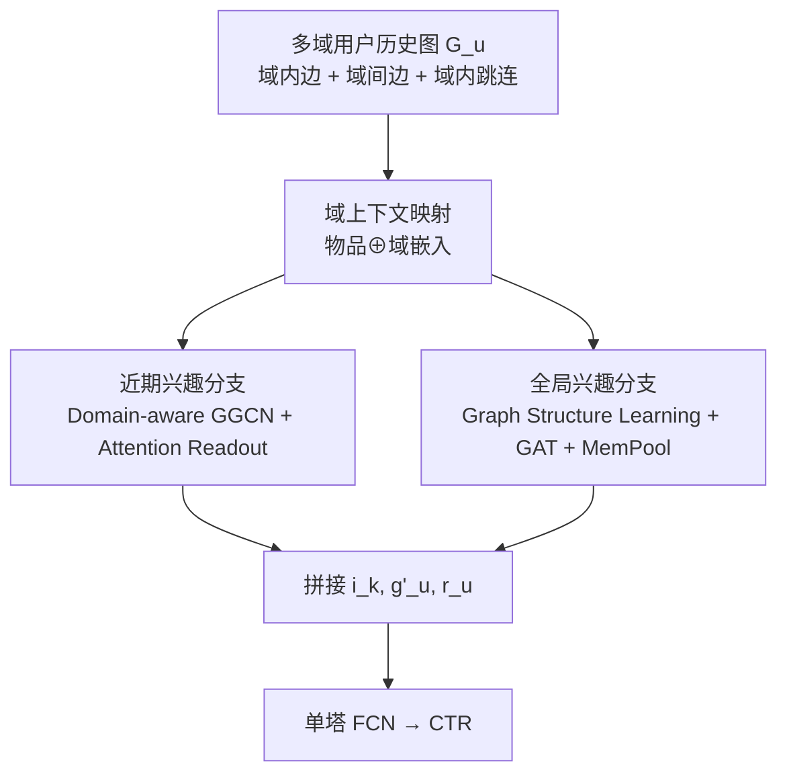
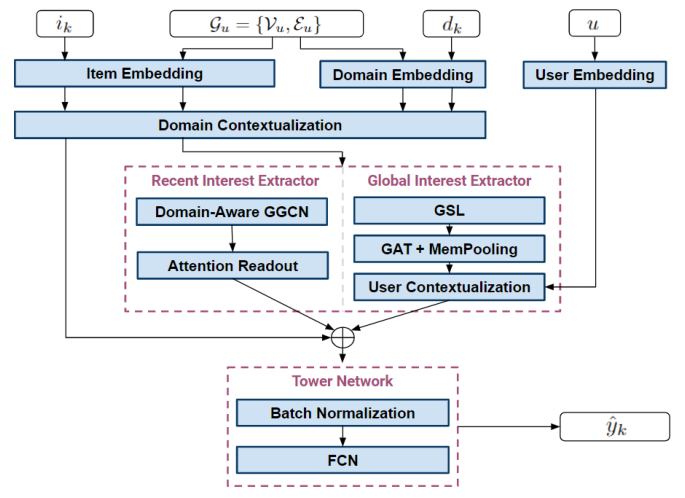

# Exploiting Graph Structured Cross-Domain Representation for Multi-Domain Recommendation (利用图结构跨域表征的多域推荐)

- **会议/期刊**: ECIR 2023, full paper track
- **作者与机构**: Alejandro Ariza-Casabona (Universitat de Barcelona)；Bartlomiej Twardowski (CVC/UAB, Huawei)；Tri Kurniawan Wijaya (Huawei Ireland Research Center)
- **推荐链路定位**: 精排 / CTR 预估
- **研究方向**: 跨域与多场景推荐 / 图神经网络与知识图谱推荐
- **论文原文**: [https://arxiv.org/abs/2302.05990v2](https://arxiv.org/abs/2302.05990v2)
- **开源代码**: [https://github.com/alarca94/magrec](https://github.com/alarca94/magrec)（FGNN 基线：[https://github.com/RuihongQiu/FGNN](https://github.com/RuihongQiu/FGNN)）

## TL;DR (1分钟核心速览)

针对多域推荐（MDR）中“把域当独立输入”导致域间时序交互丢失的问题，MAGRec 将用户多域历史构造成含域内跳连与域间边的交互图，双分支分别提取近期域感知兴趣和长期全局兴趣，并用单塔 FCN 输出 CTR。在 Amazon 5-core 的 2/3/6/13 域、按域负采样评测下，Amazon-2d AUC 达 0.885，较 MMoE 的 0.867 提升约 2.1%；13 域 AUC 0.815，优于 DIEN 的 0.797。

## Background & Motivation (背景与核心矛盾)

- **主流范式**: MDR 常借用 MTL 思路，以 Shared-Bottom/MMoE 或 STAR/MAMDR 的域共享塔+域特定塔建模多域 CTR；另一路用 CDR 图模型迁移源域知识。
- **前人局限**: ① `Disjoint History` 按域切分历史，完全切断域间兴趣流动；② MTL/MDR 多聚焦分类塔与训练策略，输入侧仍依赖简单 domain indicator，难以表达域间结构。
- **核心洞察 (Key Insight)**: 用户跨域行为天然形成“域内序列 + 域间跳转”的图；近期兴趣与长期核心偏好应分而治之，前者需域感知消息传递，后者需跨域物品相似度聚类去噪。
- **本文切入点**: 不改复杂分类塔，转而把多域历史图作为一等输入，用 `Interacting History` 保留跨域序列并加域内跳连，避免无关域在 k-hop 传播中形成兴趣瓶颈。

## Method (核心方法设计)

### 1. 整体框架 (Overall Architecture)

输入用户 $u$、候选物品$i_k$、候选域$d_k$及多域历史图$G_u$；节点为物品，边含域内/域间时序连接。先做域上下文映射，将物品与域嵌入融合到共享空间；随后双分支并行：近期兴趣分支用域感知 GGCN + 注意力读出得到$\vec{r}_u$，全局兴趣分支用图结构学习 + GAT + MemPool 得到$\vec{g}_u$，再经用户上下文残差得$\vec{g}'_u$。最后拼接$(\vec{i}_k,\vec{g}'_u,\vec{r}_u)$ 送入单塔 FCN，输出点击概率，训练用 BCE。

<figure class="paper-figure" markdown="span">
  <figcaption>图 1. MAGRec 示意图。MAGRec 从上下文化多域用户历史图表示中提取近期兴趣和全局兴趣。近期兴趣提取器从聚焦于最后一次用户-物品交互的域内和域间交互中学习跨域序列模式。全局兴趣提取器通过图结构学习和局部图池化技术学习物品相关性及其与长期用户核心偏好的亲和度。</figcaption>
</figure>

### 2. 关键设计拆解 (Key Designs)

1. **域上下文 + Interacting History（把域间关系变成图结构）**：原 MDR 用 disjoint history 或单一 domain indicator，域间信号被切断或混淆。MAGRec 先做 $\vec{i}'_j=\mathbf{W}_d(\vec{i}_j\|\vec{d}_j)$，把物品映射到域共享空间；再把跨域扁平序列加域内跳连，形成 `Interacting History`。直觉是既保留跨域兴趣流动，又给低相关域保留“绕路”，避免消息传递被无关域稀释。

2. **近期兴趣提取器 RIE（域感知门控图卷积）**：跨域消息不应等权传播。以源/目标域嵌入算边权 $e_{z,j}=\langle\mathbf{W}_{src}\vec{d}_z,\mathbf{W}_{trg}\vec{d}_j\rangle$，堆叠$L$层 GGCN 后，以最后一次交互节点为 query 做注意力读出$\alpha_j=\mathrm{softmax}_j(\mathbf{W}_{l2}\sigma(\mathbf{W}_{l1}(\vec{h}^{(L)}_j\|\vec{h}^{(L)}_N))^T)$，$\vec{r}_u=\sum_{j}\alpha_j\vec{h}^{(L)}_j$。直觉：让相关域传更多信息，并把读出聚焦在“刚刚发生的行为”上。

3. **全局兴趣提取器 GIE + 单塔训练（按物品相似度跨域聚类）**：长期历史含噪，GIE 用多头余弦核学习新邻接 $A^h_{j,z}=\mathrm{Kernel}(\mathbf{W}^h_{gsl}\vec{i}'_j,\mathbf{W}^h_{gsl}\vec{i}'_z)$，以阈值$\gamma=0.5$稀疏化得$A'_{j,z}=\mathbb{I}[A_{j,z}\ge\gamma]$，再经 GAT + MemPool 得$\vec{g}_u$，并做$\vec{g}'_u=\mathbf{W}_u(\vec{g}_u\|\vec{u})$。直觉：相似物品跨域拉近，池化出时间无关的核心偏好。训练目标为 BCE：$\mathcal{L}=-\frac{1}{N}\sum[y\log\hat{y}+(1-y)\log(1-\hat{y})]$；训练负采样按域随机 CTR 生成未交互负例；推理时每用户构图 + 2 层 GGCN/GAT/MemPool，单塔 FCN 使参数不随域数线性膨胀。

## Experimental Setup & Evaluation Protocol (实验设置与评估协议)

- **数据集与预处理**: Amazon 5-core review，组合 4 个 2 域 + 3/6/13 域共 7 个分区；保留用户已有评论为正样本，对未交互物品按域随机 CTR 负采样以模拟域差异。序列滑窗长度 5–80。

| 数据集 | #Users | #Items | #Train | #Val | #Test | 场景 |
| :--- | ---: | ---: | ---: | ---: | ---: | :--- |
| Amazon-2a | 153,658 | 55,089 | 1,766,478 | 267,805 | 267,884 | 2 域 |
| Amazon-2b | 290,631 | 105,609 | 3,593,621 | 610,585 | 610,537 | 2 域 |
| Amazon-2c | 188,539 | 59,978 | 2,245,655 | 348,101 | 347,917 | 2 域 |
| Amazon-2d | 254,736 | 95,394 | 3,009,960 | 555,399 | 555,701 | 2 域 |
| Amazon-3 | 113,144 | 33,193 | 1,443,804 | 220,155 | 220,109 | 3 域 |
| Amazon-6 | 444,737 | 170,815 | 7,580,825 | 1,397,290 | 1,395,688 | 6 域 |
| Amazon-13 | 500,569 | 212,241 | 7,105,872 | 1,380,084 | 1,379,630 | 13 域 |

- **数据划分与防穿越**: 每用户按时间做 6:2:2 的 `per-user temporal split`，滑窗构造 next-item CTR 样本，测试集严格晚于训练/验证。
- **排名评测协议**: 非 `Full-Ranking`，而是 `Sampled CTR 二分类`：正样本为真实评论，负样本从未交互物品中按域随机 CTR 采样；报告 LogLoss 与 AUC。
- **对比基线与超参**: 单域 WDL/DIN/DIEN、会话图 FGNN、MTL 的 SB/MMoE、MDR 的 STAR/MAMDR；用户/物品嵌入 64，域嵌入 128，FCN [128,64]，Adam，lr $1e^{-3}$，batch 512，7 次运行取均值/方差；MAGRec 为 2 层 GGCN、1 层 GAT（2 heads）、3 层 MemPooling（[32,10,1] centroids）。

## Key Experimental Results (实验关键数据)

### 1. 主实验对比 (Main Results)

| 模型 | Amazon-2d LogLoss↓ | Amazon-2d AUC↑ | Amazon-13 AUC↑ |
| :--- | ---: | ---: | ---: |
| WDL | 0.416 | 0.850 | 0.663 |
| DIN | 0.405 | 0.857 | 0.791 |
| DIEN | 0.420 | 0.851 | 0.797 |
| FGNN | 0.448 | 0.831 | 0.775 |
| SB | 0.412 | 0.853 | 0.661 |
| MMoE | 0.393 | 0.867 | 0.683 |
| STAR | 0.443 | 0.833 | 0.760 |
| MAMDR | 0.432 | 0.855 | 0.772 |
| **MAGRec** | **0.369** | **0.885** | **0.815** |

Improv.：2d LogLoss 较 MMoE 降低 6.1%，2d AUC 提升 2.1%；13d AUC 较 DIEN 提升 2.3%、较 MAMDR 提升 5.6%。

### 2. 消融实验 (Ablation Study)

| 变体 | LogLoss↓ | AUC↑ |
| :--- | ---: | ---: |
| w/o RIE | 0.460 | 0.808 |
| w/o GIE | 0.371 | 0.884 |
| w/o DC | 0.370 | 0.885 |
| **Full MAGRec** | **0.369** | **0.885** |

### 3. 关键实验发现 (Key Findings)

1. **近期兴趣分支是主增益来源**：去掉 RIE 后 Amazon-2d LogLoss 从 0.369 恶化到 0.460、AUC 从 0.885 掉到 0.808；而 GIE/DC 各只带来约 0.001–0.002 的边际收益，说明“域感知的近期序列聚合”是跨域 CTR 的关键。
2. **多域扩展性优于 MTL/MDR 塔结构**：在 3/6/13 域上 MAGRec AUC 为 0.819/0.836/0.815，均高于最强单域基线 DIEN 的 0.807/0.825/0.797；13 域时 STAR/MAMDR 分别仅 0.760/0.772，体现单塔+输入图建模对域数增长更稳健。
3. **输入图表示本身带来大幅收益**：在 Amazon-2a 上，`Interacting History` 相比 `Disjoint`/`Flattened` 分别带来约 26.5%/0.5% 的 MAGRec 提升；FGNN 因缺少域上下文机制无法吃满该收益，反向证明域感知消息传递与域内跳连的必要性。

## Highlights & Limitations (亮点、对比与审稿批判)

- **与代表作对比 (vs. Prior Work)**: STAR/MAMDR 在分类塔和训练策略上做域归一化/域协商，MAGRec 则把域结构放进输入图；FGNN 只有会话图、无域边；MMoE 把域当任务而非输入分布。MAGRec 与 STAR/MAMDR 理论上可互补。
- **可迁移亮点**: `Interacting History` 的“跨域扁平序列 + 域内跳连”可直接迁移到多场景序列推荐；域嵌入作边权、最后交互作 query 的读出，也适合多业务 CTR 精排。
- **审稿级局限批判**: ① 评估为按域随机 CTR 负采样的二分类 CTR，不是全库 `Full-Ranking`，会高估/偏移真实 Top-K 排序价值；② 每用户构图 + GAT/MemPool 的推理延迟、内存开销未报告，13 域热图也仅给均值，缺线上 A/B 与稀疏域分层显著性分析。

## Rating (四维评分)

- **方法创新性 (Novelty)**: ⭐⭐⭐⭐ （把域间边、域内跳连与近期/全局双分支统一进 MDR 输入图，机制清晰，但并非全新范式。）
- **评估协议与实验扎实度 (Protocol & Experiments)**: ⭐⭐⭐ （覆盖 2–13 域、7 次运行、消融与输入表征分析；但负采样 CTR 非全库排序，缺分层/线上验证。）
- **写作与数学规范度 (Clarity & Rigor)**: ⭐⭐⭐⭐ （模块、公式与超参交代清楚；复杂度、延迟与负采样偏差分析不足。）
- **工业落地与复现价值 (Industrial & Practical Value)**: ⭐⭐⭐⭐ （单塔 FCN 避免多域塔参数爆炸，代码与数据分区开源；仍需补线上延迟与部署验证。）

