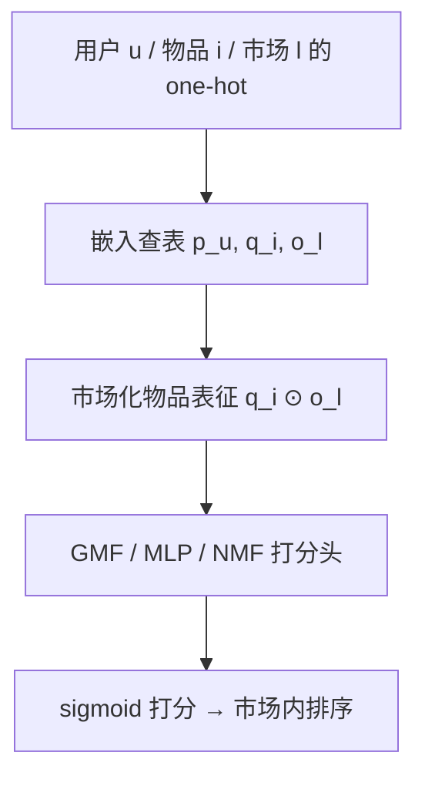
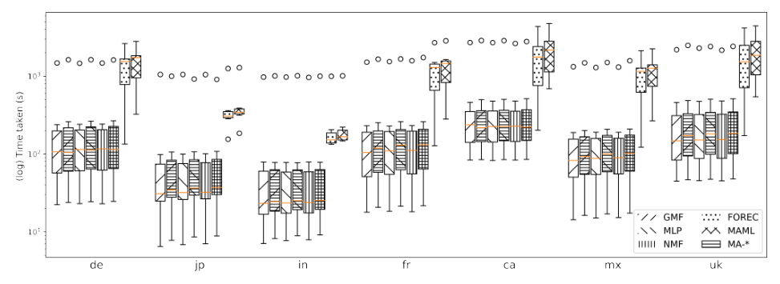

# Market-Aware Models for Efficient Cross-Market Recommendation (面向高效跨市场推荐的市场感知模型)

- **会议/期刊**: ECIR 2023
- **作者与机构**: Samarth Bhargav, Mohammad Aliannejadi, Evangelos Kanoulas（University of Amsterdam）
- **推荐链路定位**: 召回 / 粗排（MF 与神经矩阵分解打分层）
- **研究方向**: 跨域与多场景推荐 / 协同过滤
- **论文原文**: [https://arxiv.org/abs/2302.07130v1](https://arxiv.org/abs/2302.07130v1)
- **开源代码**: [https://github.com/samarthbhargav/efficient-xmrec](https://github.com/samarthbhargav/efficient-xmrec)

## TL;DR (1分钟核心速览)

跨市场推荐 (CMR) 需要借助高资源源市场提升低资源目标市场的推荐效果，此前 SOTA（Bonab 等的 MAML/FOREC）把每个市场当作一个任务做元学习，双循环 + 二阶导数导致训练昂贵且新数据到来必须重跑元训练。本文提出市场感知 (Market-Aware, MA) 模型：仅额外学习一个市场嵌入 $\mathbf{o}_l$，用$\mathbf{o}_l \odot \mathbf{q}_i$ 把物品表征"本土化"，其余骨干（GMF/MLP/NMF）完全不变。在 XMarket-Electronics 的 Leave-One-Out + 99 负采样 nDCG@10 协议下，MA 在 AVG 配对场景 18/21 组设置超过市场无关模型，训练时间仅为元学习模型的 15%；全局统一建模时 MA-NMF++ 在 7 个市场中 6 个超过 MAML/FOREC。

## Background & Motivation (背景与核心矛盾)

- **主流范式**: CDR 假设用户重叠、物品跨域不同；CMR 正相反——**物品池跨市场共享、用户集合各市场独立**，因此可直接迁移"物品偏好"而非用户表征。现有强基线是把各市场视作 MTL 中的 task，用 MAML 学共享初始化，再用 FOREC 做 fork → 冻结 → 目标市场微调。
- **前人局限**: 一是 MAML 需内外双循环与二阶梯度，训练开销巨大；二是每来一批源市场新数据，必须重跑元训练 + fork + 微调，工程上难以增量更新；三是元学习只是**隐式**地适应市场，模型内部仍只有一套全市场共用的物品向量。
- **核心洞察 (Key Insight)**: 同一件商品在不同国家市场的语义与热度分布并不一致（如电子配件在 de 与 jp 的偏好差异），单一物品向量无法同时表达；而"跨市场共有行为 + 市场特异行为"可以像 CDR 中的 contextual invariants 一样被**解耦**为两个因子。
- **本文切入点**: 不做任务级元学习，改做因子级建模——把市场当成一个可学习向量，通过逐元素乘积把共享物品向量投影成市场专属向量，一次训练即可服务所有市场。

## Method (核心方法设计)

### 1. 整体框架 (Overall Architecture)

输入为用户 $u$、物品$i$与所属市场$l$的 one-hot 编码，分别查表得到$\mathbf{p}_u,\mathbf{q}_i,\mathbf{o}_l$（三者同维$d=8$）。核心交互只有一步：用$\mathbf{o}_l$逐元素缩放$\mathbf{q}_i$得到市场化物品表征，再送入原本的 GMF、MLP 或 NMF 打分头输出$\hat{y}_{ui}$，以 BCE 端到端训练（用户嵌入与市场嵌入互不作用，仅物品侧被调制）。推理时对目标市场用户用该市场对应的$\mathbf{o}_l$ 重算物品向量并排序；新增市场只需新增一个 8 维向量，无需重训主干。整体为"共享物品空间 + 市场旋钮"的轻量适配范式。

### 2. 关键设计拆解 (Key Designs)

1. **市场嵌入调制物品表征 (Market-Adapted Item Representation)**：痛点在于跨市场共享向量抹平了市场差异，而 MAML 需靠昂贵微调才隐式获得市场特化。本文改为显式因子分解，把打分写成 $\hat{y}_{ui}=\sigma\big(\mathbf{h}^\top(\mathbf{p}_u \odot (\mathbf{o}_l \odot \mathbf{q}_i))\big)$；对 MLP 骨干则把首层输入改为$\mathbf{m}_0=[\mathbf{p}_u ; \mathbf{o}_l \odot \mathbf{q}_i]$。直觉上$\mathbf{o}_l$相当于在物品隐空间上施加一个"市场相关的各向异性缩放"，让同一 item 在不同市场拥有不同邻域结构，而跨市场共有信号仍由共享的$\mathbf{q}_i$ 承载。
2. **NMF 双路的双市场注入 (MA-NMF)**：NMF 有 GMF 与 MLP 两条支路，MA 版本对二者同时注入，即 $\mathbf{m}_{GMF}=\mathbf{p}^2_u \odot (\mathbf{o}_l \odot \mathbf{q}^2_i)$与$\mathbf{m}_0=[\mathbf{p}^1_u ; \mathbf{q}^1_i \odot \mathbf{o}_l]$。这样线性内积支路获得市场解耦能力，非线性支路获得市场条件的特征交叉起点，两者互补；由于$\mathbf{o}_l$只有$d$维，整套改造对参数量的扰动仅为$t \times D$（配对实验中仅 16 个参数，而最小模型也有 19,929 个参数），排除了"涨点来自参数变多"的质疑。
3. **训练目标与效率**：总损失为二元交叉熵 $\mathcal{L}=-\sum_{(u,i)\in\mathcal{D}^+}\big[y_{ui}\log\hat{y}_{ui}+(1-y_{ui})\log(1-\hat{y}_{ui})\big]$，每正样本配 4 个均匀采样负例，Adam、25 epoch、batch 1024、$L_2$正则$\lambda=10^{-7}$，超参直接沿用 Bonab 等以保证公平。推理侧零额外开销（与 market-unaware 相同）；训练侧因无内外双循环与二阶梯度，整体耗时仅为 MAML/FOREC 的 15%，且支持"来新数据直接继续训练"的增量更新。

<figure class="paper-figure" markdown="span">
  <figcaption>图1：在所有源市场上为目标市场训练模型所需的时间，其中时间采用对数刻度。MA 与市场无关模型所需的训练时间相近，而元学习模型所需的训练时间显著更长。</figcaption>
</figure>

## Experimental Setup & Evaluation Protocol (实验设置与评估协议)

- **数据集与预处理**: 唯一公开 CMR 数据集 XMarket 的 Electronics 子集，共 8 个市场，`us` 仅作源市场，其余 7 个轮流作目标市场。

| 市场 | #Users | #Items | #Interactions | 说明 |
| :--- | :---: | :---: | :---: | :--- |
| us | 35,916 | 31,125 | 364,339 | 仅作源市场（最大） |
| ca | 5,675 | 5,772 | 55,045 | 目标市场之一 |
| uk | 4,847 | 3,302 | 44,515 | 目标市场之一 |
| fr | 2,396 | 1,911 | 22,905 | 目标市场之一 |
| de | 2,373 | 2,210 | 22,247 | 目标市场之一 |
| mx | 1,878 | 1,645 | 17,095 | 目标市场之一 |
| jp | 487 | 955 | 4,485 | 稀疏市场 |
| in | 239 | 470 | 2,015 | 最稀疏市场 |

- **数据划分与防穿越**: 每个市场独立的 `Leave-One-Out` 划分（最后一件交互作 test、倒数第二件作 valid），非全局时间戳切分；配对实验中"最佳源市场"由验证集选出后再报测试集，避免用测试集选源。
- **排名评测协议**: `Sampled Ranking`，验证/测试阶段每用户抽 **99 个负例**（正负比 1:99），指标 nDCG@10（HR@10 趋势一致），显著性用 paired two-sided t-test + Bonferroni 校正（$p<0.05$）。
- **对比基线与超参设置**: 单市场模型（GMF/MLP/NMF）、跨市场 `++` 变体、元学习基线 MAML 与 FOREC、以及 MA 变体；嵌入维度 $d=8$，MLP 结构 `[16,64,32,16,8]`，MAML 快学习率$\beta=0.1$、20 shots。配对实验中将源市场数据**下采样**到目标市场规模以消除数据量混杂；全局实验则全量拼接不做下采样。

## Key Experimental Results (实验关键数据)

### 1. 主实验对比 (Main Results)

**配对 AVG 设置**（对多个源市场取平均，nDCG@10，加粗为该市场最优）：

| 方法 | de | jp | in | fr | ca | mx | uk |
| :--- | :---: | :---: | :---: | :---: | :---: | :---: | :---: |
| GMF++ | 0.2045 | 0.0916 | 0.1891 | 0.2026 | 0.1937 | 0.4204 | 0.3222 |
| MLP++ | 0.2836 | 0.1653 | 0.4376 | 0.2704 | 0.2905 | 0.5274 | 0.4346 |
| NMF++ | 0.2927 | **0.1826** | 0.4403 | 0.2844 | 0.2844 | 0.5367 | **0.4379** |
| MAML | 0.2808 | 0.1770 | 0.4320 | 0.2785 | 0.2794 | 0.5288 | 0.4296 |
| FOREC | 0.2835 | 0.1758 | 0.4345 | 0.2816 | 0.2772 | 0.5302 | 0.4330 |
| MA-GMF++ | 0.2148 | 0.1079 | 0.2013 | 0.2022 | 0.2203 | 0.4283 | 0.3327 |
| MA-MLP++ | 0.2909 | 0.1741 | **0.4502** | 0.2805 | **0.3073** | 0.5311 | 0.4349 |
| MA-NMF++ | **0.3055** | 0.1824 | 0.4471 | **0.2893** | 0.3002 | **0.5387** | 0.4370 |

**全局 (Global) 设置**（全市场统一训练，nDCG@10）：

| 方法 | de | jp | in | fr | ca | mx | uk |
| :--- | :---: | :---: | :---: | :---: | :---: | :---: | :---: |
| GMF++ | 0.3166 | 0.1781 | 0.4535 | 0.2884 | 0.2921 | 0.5245 | 0.4481 |
| MLP++ | 0.3268 | 0.2127 | 0.4479 | 0.2953 | 0.3048 | 0.5376 | 0.4491 |
| NMF++ | 0.3262 | 0.1930 | **0.4796** | 0.3030 | 0.2851 | 0.5340 | 0.4476 |
| MAML | 0.3281 | 0.1860 | 0.4736 | 0.3022 | 0.2836 | 0.5317 | 0.4474 |
| FOREC | 0.3249 | 0.1956 | 0.4778 | 0.3033 | 0.2947 | 0.5409 | 0.4474 |
| MA-MLP++ | 0.3158 | 0.2195 | 0.4398 | 0.2958 | **0.3178** | 0.5258 | 0.4535 |
| MA-NMF++ | **0.3442** | **0.2212** | 0.4602 | **0.3052** | 0.3112 | **0.5536** | **0.4604** |

### 2. 消融实验 (Ablation Study)

论文未设独立消融章节，但"移除市场嵌入"恰等价于 `++` 变体，可视为天然消融（Δ = MA − 对应 market-unaware）：

| 骨干（AVG 配对） | de | jp | in | fr | ca | mx | uk | 胜出市场数 |
| :--- | :---: | :---: | :---: | :---: | :---: | :---: | :---: | :---: |
| GMF++ → MA-GMF++ | +0.0103 | +0.0163 | +0.0122 | −0.0004 | +0.0266 | +0.0079 | +0.0105 | 6/7 |
| MLP++ → MA-MLP++ | +0.0073 | +0.0088 | +0.0126 | +0.0101 | +0.0168 | +0.0037 | +0.0003 | 7/7 |
| NMF++ → MA-NMF++ | +0.0128 | −0.0002 | +0.0068 | +0.0049 | +0.0158 | +0.0020 | −0.0009 | 5/7 |
| 全局 MA-NMF++ vs NMF++ | +0.0180 | +0.0282 | −0.0194 | +0.0022 | +0.0261 | +0.0196 | +0.0128 | 6/7 |
| 训练耗时比（vs MAML/FOREC） | ≈15% | ≈15% | ≈15% | ≈15% | ≈15% | ≈15% | ≈15% | — |

### 3. 关键实验发现 (Key Findings)

1. **市场嵌入的收益是"稳健性"而非"点峰爆发"**：AVG 场景下 MA 相对同骨干提升在 **21 组设置中赢 18 组**，但单点增量普遍在 0.003–0.027 nDCG@10 之间；而 BST（已知最佳源市场）场景下 MA-NMF++ 仅在 ca 显著超过 NMF++，说明**选源仍然比选模型更重要**，MA 的价值主要体现在源市场未知时无需逐个试错。
2. **显式建模市场优于隐式元学习，且成本断崖式下降**：全局设置下 MA-NMF++ 在 7 个市场中 6 个超过 MAML 与 FOREC（de 0.3442 vs 0.3281，uk 0.4604 vs 0.4474，ca 0.3112 vs 0.2836，mx 0.5536 vs 0.5317），唯一失手的 `in`（0.4602 vs 0.4796）恰是最稀疏市场（仅 239 用户），说明小样本下共享主干仍占主导、市场向量欠训练。
3. **市场数据量越大，MA 优势越明显**：ca/uk/mx 三个较大市场在全局模式下几乎全面显著胜出（Bonferroni 校正后仍显著），而 jp/in 结果震荡——市场嵌入的秩与可分性依赖该市场的交互量；这同时解释了为什么在只新增 16 个参数的极低代价下仍能普遍涨点，参数预算并非收益来源。

## Highlights & Limitations (亮点、对比与审稿批判)

- **与代表作对比 (vs. Prior Work)**: 相比 Bonab 等的 MAML/FOREC（task 级、双循环、二阶梯度、需 fork+freeze+fine-tune 三步），本文是**因子级**适配：一次前向即完成市场条件化，训练时间 15%、支持增量更新；相比 Roitero 等的"局部 vs 全局模型"策略研究，本文给出了可插拔的具体算子而非训练策略枚举；相比 CDR 的对抗/相似度迁移方法，本文明确区分"C 端物品共享、U 端用户不重叠"这一 CMR 特有假设。
- **可迁移亮点**: (1) 用 $\mathbf{o}_l$ 逐元素调制物品侧表征，可直接插到任意双塔/序列骨干上作为**场景/业务线 token**（对应多场景推荐中的场景偏置项），成本近乎为零；(2) "AVG / BST / Global"三层评测组织方式值得在跨域工作中复用，可把"选源不确定性"与"模型能力"解耦评估；(3) 未来零样本市场可用相似市场嵌入替代，是低资源新市场冷启动的现成路径。
- **审稿级局限批判**: (1) 评测仅有一个数据集（Electronics）且 $d=8$ 极小、超参全部继承前作未调优，MA 的真实上界可能被低估，同时也缺少多随机种子方差报告；(2) 排序协议为 99 负例采样而非 Full-Ranking，负例数变化是否会改变市场间排名未验证；(3) 交互仅用逐元素乘积，本质是**对角线性调制**，无法表达"市场 × 物品类别"的交叉非线性（作者亦将其列为未来工作）；(4) 未做冷启动/新市场零样本实验，市场嵌入的稀疏性风险（如 `in` 市场失手）未被系统分析。

## Rating (四维评分)

- **方法创新性 (Novelty)**: ⭐⭐⭐ （市场嵌入 + 逐元素调制的想法相当朴素、接近多场景推荐中的场景偏置，但"以因子级适配替代 task 级元学习"的问题重构清晰，且有参数量与耗时两组证据闭环）
- **评估协议与实验扎实度 (Protocol & Experiments)**: ⭐⭐⭐⭐ （AVG/BST/Global 三层设置 + Bonferroni 校正 t 检验 + 参数量对照，逻辑严密；扣分在于单一数据集、99 负例采样排序与缺多种子方差）
- **写作与数学规范度 (Clarity & Rigor)**: ⭐⭐⭐⭐ （三个 MA 变体的公式与骨干一一对应、记号统一，效率分析给出参数量级推算；但对 $\mathbf{o}_l$ 的表达能力缺乏理论刻画）
- **工业落地与复现价值 (Industrial & Practical Value)**: ⭐⭐⭐⭐⭐ （代码开源、改动仅一行算子、训练成本与 market-unaware 持平、支持增量上线，是最容易进生产环境的跨市场方案之一）

