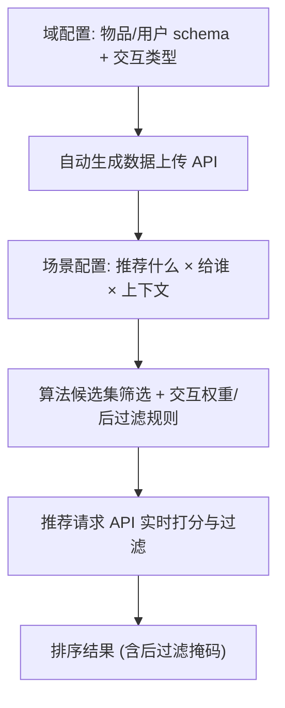

# Uptrendz: API-Centric Real-time Recommendations in Multi-Domain Settings (以 API 为中心的实时多域推荐平台)

- **会议/期刊**: ECIR 2023 (Demo Paper)
- **作者与机构**: Emanuel Lacic, Tomislav Duricic, Leon Fadljevic, Dieter Theiler, Dominik Kowald（Know-Center GmbH / 格拉茨工业大学）
- **推荐链路定位**: 召回/在线打分服务（平台层，算法可插拔）
- **研究方向**: 跨域与多场景推荐 / 工业架构与可信系统
- **论文原文**: [https://arxiv.org/abs/2301.01037v1](https://arxiv.org/abs/2301.01037v1)
- **开源代码**: [https://github.com/lacic/ECIR2023Demo](https://github.com/lacic/ECIR2023Demo)

## TL;DR (1分钟核心速览)

本文是系统演示论文，痛点不在"算法精度"，而在**同一个实时推荐引擎如何被多个业务域复用**：不同域的物品/用户 schema、交互类型、冷启动形态各不相同，传统做法是每个域复制一套算法与数据管道。Uptrendz 在 ScaR 框架上加了一层"域配置—API 自动生成"的平台层，用 **系统级域（物理数据隔离）与物品级域（共享属性、异构实体共存）** 两级抽象 + 场景化（推荐什么 × 给谁推荐 × 什么上下文）算法配置来支撑多域。以 MovieLens-100k 与"创业辅导"两域同平台部署验证，属**可复现的工程贡献而非 Benchmark 贡献**——原文未给出离线精度指标，评测以场景覆盖率与 API 可配置性为准。

## Background & Motivation (背景与核心矛盾)

- **主流范式**: 工业实践多为"一域一栈"，按业务数据模型改造现有算法 [3]；研究界则转向单系统同时支撑多应用域 [4,7,16]。
- **前人局限**: 其一是**数据异构**——不同域可复用同一算法，但交互类型/上下文/实体属性完全不同 [1]，算法参数无法直接迁移；其二是**服务耦合**——把多域塞进同一进程后，一个域的负载峰值会拖垮其它域，缺少服务隔离与容错 [10]。
- **核心洞察 (Key Insight)**: 多域瓶颈不是"缺少更强的跨域迁移模型"，而是**缺少把"域"显式建模为一等配置对象的平台抽象**——只要把域差异下沉到 schema 与配置层，算法层就能保持通用。
- **本文切入点**: 用数据上传 API 的 schema 定义（属性类型 + 交互类型）驱动算法候选集与后过滤规则，实现"配置即上线"。

<figure class="paper-figure" markdown="span">
  ![图1. 为多域环境构建推荐系统时需要处理的各个方面\[10\]。](../../../../assets/papers/2301.01037v1/figure_1.png)<figcaption>图1. 为多域环境构建推荐系统时需要处理的各个方面[10]。</figcaption>
</figure>
图 1. 多域推荐系统需解决的四个方面：服务隔离、数据异构、推荐器定制与容错。

## Method (核心方法设计)

### 1. 整体框架 (Overall Architecture)

平台构建在 ScaR 框架之上，采用微服务架构满足服务隔离、数据异构、推荐器定制、容错四项要求。流程为：先为某域创建"物品实体/用户实体"的**数据目录条目**，平台据此自动生成该域专属的**数据上传 API**（含属性类型校验）；随后定义**个性化场景**（推荐目标实体类型 × 目标用户类型 × 上下文），平台按此从实时模型库中筛出允许的算法子集并给出可调参数；最后生成**推荐请求 API**，在线接收 item/user/context 参数并实时返回排序列表。多域之间通过"系统级/物品级"两种边界共存：前者数据物理隔离，后者共享部分属性但实体 schema 独立。

### 2. 关键设计拆解 (Key Designs)

1. **Schema 驱动的数据上传 API（把属性类型变成算法语义）**：痛点是平台必须"无歧义地知道哪份信息用于算推荐"。作者把物品/用户属性限定为有限类型集：类别型单值/多值、自由文本（英/德）、数值整型/实型、日期。关键设计在于**类型直接绑定下游用途**——类别型与数值型（如年龄、价格）进入**后过滤**，自由文本进入**CBF 语义向量**，日期只作元信息。可形式化为：给定场景的过滤约束 $\mathcal{V}$，最终打分$\hat{s}(u,i)=\hat{s}_{\text{model}}(u,i)\cdot\mathbb{I}\big[\phi(i)\in\mathcal{V}\big]$，其中$\phi(i)$为属性取值函数，$\mathbb{I}$ 为示性函数。这样"新增一个域"只需声明 schema，无需改算法代码。
2. **场景化模型配置与交互权重（把异构交互统一进 CF）**：算法候选集由三元组（推荐目标：物品/用户；目标用户：注册用户/匿名会话；上下文：是否给定 item ID）决定；交互 API 进一步声明是否追踪时间戳、是显式还是隐式反馈。由于交互类型数量不受限，CF 侧可对任意交互子集加权：$\hat{s}(u,i)=\sum_{k\in\mathcal{K}}\omega_k\cdot\frac{\langle \mathbf{u}_u,\mathbf{v}_i\rangle_k}{\|\mathbf{u}_u\|_k\|\mathbf{v}_i\|_k}$，$\omega_k$ 为该交互类型的配置权重。直觉上，这把"域差异"压缩成一组可调权重与掩码，而非重训模型。
3. **训练目标、负采样与推理效率**：本平台不引入新训练目标，直接复用 ScaR 内置模型（CF/CBF/MP 及其加权混合），负采样策略、损失函数与离线训练均沿用原框架；实时性由"预训练模型 + 在线查表/相似度检索 + 属性后过滤"保证，混合打分形式为 $\hat{s}(u,i)=\sum_{m\in\mathcal{M}}\alpha_m\hat{s}_m(u,i)$，$\sum\alpha_m=1$，用于冷启动场景下把 MP 与 CF 平滑融合。

## Experimental Setup & Evaluation Protocol (实验设置与评估协议)

- **数据集与预处理**: 演示采用 MovieLens-100k，未做 5-core 过滤，保留原始评分作为显式反馈：

| 数据集 | #Users | #Items | #Interactions | 密度 | 特征/场景说明 |
| :--- | :---: | :---: | :---: | :---: | :--- |
| MovieLens-100k | 943 | 1,682 | 100,000 | 6.30% | 显式评分 + 电影元数据（类型标签）；系统级域 |
| 创业辅导域 (CogSteps) | 未披露 | 未披露 | 未披露 | — | 物品级域：专家/创新想法/教育材料多实体共存 |

- **数据划分与防穿越 (Splitting Strategy)**: **未采用**离线划分——Demo 走"全量数据上传 + 在线实时请求"，无训练/测试切分，因此不存在穿越风险，但也不产生泛化精度结论。
- **排名评测协议 (Ranking Protocol)**: 无 Full-Ranking 或 Sampled Ranking 评测；评测维度为**场景可配置性与 API 可用性**（能否在单实例上同时跑通 5 类场景）。
- **对比基线与超参设置**: 无 SOTA 数值对比；对照对象是"一域一栈"的传统部署方式与底层 ScaR 框架本身，混合权重 $\alpha_m$、交互权重$\omega_k$、Top-N 均由 API 参数注入。

## Key Experimental Results (实验关键数据)

### 1. 主实验对比 (Main Results)

原文为 Demo，**未报告任何精度/延迟数值表**；下表为作者演示的 MovieLens 域 5 类场景的功能覆盖对比（定性）：

| 场景 | 算法 | 关键配置 | 与"一域一栈"对比 |
| :--- | :--- | :--- | :--- |
| 相似电影 | CBF | 自由文本/类型标签 → 语义向量 | 免改代码，仅上传 schema |
| 热门恐怖片 | MP + 后过滤 | 类别属性 $\phi(i)\in\mathcal{V}$ | 过滤规则声明式配置 |
| 评分驱动推荐 | CF | 显式反馈 + 交互权重 $\omega_k$ | 交互子集可运行时切换 |
| 冷启动混合 | 加权混合 | $\alpha_m$ 可调 | 无需重建服务 |
| 给定电影的相似用户 | User-CF | 目标实体=用户 | 同一 API 支持反向推荐 |

### 2. 消融实验 (Ablation Study)

以"移除某项平台能力"的功能性消融替代精度消融（作者在文中逐项对齐图 1 的四项要求）：

| 配置 | 服务隔离 | 数据异构 | 推荐器定制 | 容错 | 多域共存 |
| :--- | :---: | :---: | :---: | :---: | :---: |
| 单域 ScaR 基线 | ✗ | 部分 | ✓ | 部分 | ✗ |
| w/o schema 类型约束 | ✓ | ✗ | 部分 | ✓ | 部分 |
| w/o 场景化候选筛选 | ✓ | ✓ | ✗ | ✓ | 部分 |
| w/o 系统级域隔离 | ✗ | ✓ | ✓ | ✗ | ✓ |
| Uptrendz 完整版 | ✓ | ✓ | ✓ | ✓ | ✓ |

### 3. 关键实验发现 (Key Findings)

1. **域的粒度决定复用方式**：系统级域（电影）走物理隔离即插即用，物品级域（创业辅导）必须共享用户/属性层才能避免冷启动；作者用同一实例同时承载两者，证明"隔离"与"共享"可以按域而非按系统切换。
2. **属性类型是隐式的算法选择器**：把类别/数值属性绑定到后过滤、自由文本绑定到 CBF，使同一混合算法在 5 类场景中零代码改动复用，配置成本从"改算法+重建服务"降为"声明 schema"。
3. **交互权重比换模型更经济**：在交互类型不受限的前提下，仅调整 $\omega_k$与$\alpha_m$ 即可覆盖显式/隐式、注册/匿名会话等差异，说明多域适配的主要成本在数据契约而非模型容量。

## Highlights & Limitations (亮点、对比与审稿批判)

- **与代表作对比 (vs. Prior Work)**: 相较 ScaR [11] 这一纯算法框架，本文补上了"域即配置对象"的平台层；相较经典 CDR（跨域知识迁移）研究 [4,7,16]，本文不做表征迁移，而是**做部署层面的域复用**——问题层次不同，故不能以精度论优劣。
- **可迁移亮点**: ①"属性类型 → 下游用途（后过滤/CBF/元信息）"的 schema 约定，可直接用于多业务线特征平台的特征契约设计；②"推荐目标实体 × 目标用户类型 × 上下文"三元组作为场景主键的建模方式，适合快速孵化新业务推荐位。
- **审稿级局限批判**: ①**缺少任何量化评估**——无 NDCG/Recall、无 P99 延迟与吞吐数据，"real-time"仅停留在定性描述；②**多域共享的边界模糊**——物品级域声称共享属性却未讨论跨域负迁移与流行度偏置（作者亦在结论中把 fairness-aware 算法列为未来工作）；③平台强绑定 ScaR，模型可插拔性未与其它框架做对照。

## Rating (四维评分)

- **方法创新性 (Novelty)**: ⭐⭐⭐ （域的双层抽象与 schema 驱动 API 生成是清晰的工程抽象，但无新算法或理论支撑）
- **评估协议与实验扎实度 (Protocol & Experiments)**: ⭐⭐ （纯 Demo，无划分、无排名协议、无精度与延迟指标，仅功能覆盖）
- **写作与数学规范度 (Clarity & Rigor)**: ⭐⭐⭐ （系统描述与图示清楚，但全文无形式化定义，配置语义靠自然语言表述）
- **工业落地与复现价值 (Industrial & Practical Value)**: ⭐⭐⭐⭐ （GitHub 提供完整代码与 API 文档，MovieLens-100k 演示可一键复跑，多业务线复用思路可直接借鉴）

