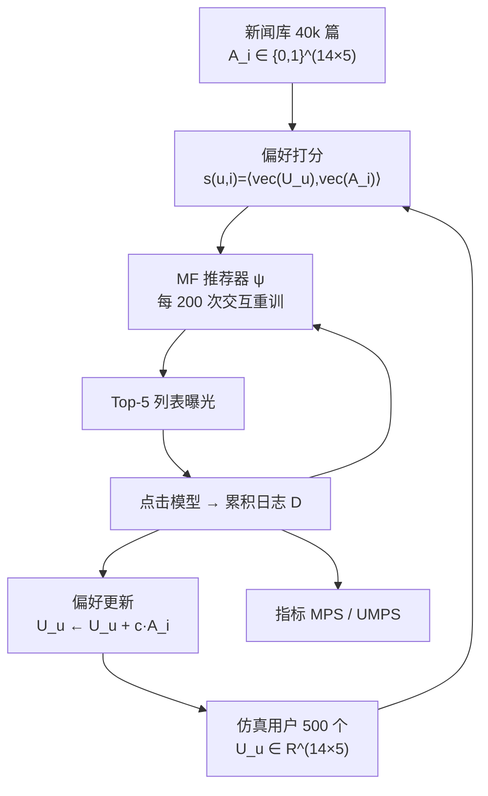

# Evolution of Filter Bubbles and Polarization in News Recommendation (新闻推荐中过滤气泡与极化的演化)

- **会议/期刊**: ECIR 2023
- **作者与机构**: Han Zhang, James Caverlee (Texas A&M University); Ziwei Zhu (George Mason University)
- **推荐链路定位**: 重排 / 闭环反馈系统级评估（推荐器本体为 MF 召回打分）
- **研究方向**: 去偏公平、可信隐私与工业架构 / 协同过滤
- **论文原文**: [https://arxiv.org/abs/2301.10926v1](https://arxiv.org/abs/2301.10926v1)
- **开源代码**: 暂未开源

## TL;DR (1分钟核心速览)

现有过滤气泡研究几乎都是**静态快照或短窗口**，无法回答"气泡多快形成、会不会自愈、干预能否长期奏效"。本文把新闻推荐建模为**偏好可塑的闭环动力系统**：4 万篇带「主题×立场」标注的新闻 + 500 个由 Pew 政治类型学生成的仿真用户，跑 4 万次交互、每 200 次交互重训 MF，共 200 个 epoch。结论是：即便把用户说服系数设为 $c=0$（用户完全免疫推荐影响），5 个用户组中仍有 4 组的平均政治立场绝对值单调外扩；开启$c=0.03$ 后极化显著加速且**内在偏好 UMPS 同步漂移**；SOTA 校准重排（Steck 2018）只能压低斜率，无法改变漂移方向。

## Background & Motivation (背景与核心矛盾)

- **主流范式**: 用一次性离线交互日志度量推荐的立场曝光偏差，代表工作包括校准推荐（Calibrated Rec）、立场平衡重排与正则化训练；评价指标是单轮列表的立场分布与理想分布的 KL/距离。
- **前人局限**: ① **静态设定**把用户偏好当常量，切断了"推荐 → 点击 → 偏好被改写 → 下一轮推荐"的自增强回路，无法区分"算法放大"与"用户自身漂移"；② **短期窗口**（一次会话或数天）观察不到气泡的饱和、振荡与不可逆性，因此无法判断干预是"治愈"还是"止痛"。
- **核心洞察 (Key Insight)**: 把用户偏好表示为可累加的**主题×立场矩阵**，就能用一个标量 $c$精确解耦两种机制——纯粹的算法反馈回路效应（$c=0$）与推荐对用户的说服效应（$c>0$）。作者发现前者单独就足以致极化，这推翻了"极化主要由用户易感性驱动"的隐含假设。
- **本文切入点**: 不复用静态日志，而是构造一个可重复、可干预、可长程演化的**新闻推荐沙盒**，用双指标（读了什么 / 信了什么）分离行为层与偏好层的演化轨迹。

## Method (核心方法设计)

### 1. 整体框架 (Overall Architecture)

系统由三个可分离部件构成：**新闻侧**用二值效用矩阵 $A_i\in\{0,1\}^{14\times 5}$编码文章覆盖的主题（14 类：堕胎、环境、枪支、医保、移民等）与立场（$-2$极自由 →$+2$极保守，每档 8000 篇）；**用户侧**用偏好矩阵$U_u\in\mathbb{R}^{14\times 5}$编码该用户对每个主题各立场的倾向强度，由 Pew 九类政治类型学中选取的 5 类各生成 100 人；**推荐器**用基础 MF 学习$\hat{s}(u,i)$。流程为：先随机曝光 140 篇（每主题 10 篇）完成 bootstrap 并训练首个模型，随后进入 4 万次交互循环——随机用户请求 Top-5 列表、按偏好分数概率点击、点击日志并入$D$、按影响系数更新其偏好矩阵，每 200 次交互全量重训一次，共 200 个 epoch，全程重复 10 次取均值。

### 2. 关键设计拆解 (Key Designs)

1. **主题×立场双矩阵可解释打分（把"立场"变成可加算子）**：常规隐向量模型只能给出不可解释的相似度，无法度量"读了多极端的内容"。本文将用户与文章都展开为同构矩阵，偏好分数取向量化内积 $s(u,i)=\langle \mathrm{vec}(U_u),\mathrm{vec}(A_i)\rangle$，点击概率随$s$ 单调递增。该设计的物理直觉是：立场偏好是**可分解到主题粒度**的，用户对"堕胎-极自由"和"税收-极保守"可以有不同强度，这正是度量极化的前提。

2. **偏好可塑的闭环影响算子（分离算法效应与说服效应）**：静态研究把偏好冻结，无法刻画回路的自增强。本文引入单一标量 $c$，每当用户点击文章$i$即执行$U_u \leftarrow U_u + c\cdot A_i$，$c$越大越易被说服。由于$A_i$是二值矩阵，该更新等价于"在被读文章的主题-立场格点上做一次均匀加成"，因此$c=0$ 时系统退化为**纯算法反馈回路**，成为天然的反事实对照组——这是全文最重要的实验设计。

3. **双指标 MPS / UMPS 与训练目标**：为区分"行为层读了什么"与"偏好层信了什么"，定义迭代 $t$的阅读立场均值$MPS_t=\sum_{p=1}^{5}y_{u_t,p}\cdot stance(p)\big/\sum_{p=1}^{5}y_{u_t,p}$，以及用户内在偏好强度$UMPS=\sum_{s=-2}^{2}\sum_{t=1}^{14}s\cdot U_u(t,s)$。推荐器以隐式反馈 MF 的点积打分 + 二分类/排序损失训练，负样本来自未交互文章（原文未披露具体采样比例），每 200 次交互用全量累积日志$D$ 全量重训，无增量更新，推理为单次 Top-5 排序。

## Experimental Setup & Evaluation Protocol (实验设置与评估协议)

| 数据集/资源 | 规模 | 标注粒度 | 稀疏/分布说明 |
| :--- | :---: | :--- | :--- |
| 新闻文章 | 40,000 篇 | 14 主题 × 5 立场（$-2$…$+2$），每档 8,000 篇，可多主题 | 立场分布严格均匀，天然排除流行度偏置干扰 |
| 仿真用户 | 500 人 | 5 类 Pew 类型学（solid liberal / opportunity democrats / bystanders / market skeptic republicans / core conservatives），每类 100 人 | 每类用户的 $U_u$ 由 Pew 问卷对该主题的态度分布采样生成 |
| 交互日志 | 40,000 次请求 × 5 篇 = 200,000 次曝光 | 二值点击 | bootstrap 阶段每用户曝光 140 篇作为初始训练集 |

- **数据划分与防穿越 (Splitting Strategy)**: 无传统 train/test 划分，采用**在线时序仿真**：模型在 $t$时刻只用$t$ 之前累积的点击日志训练，每 200 次交互全量重训一次，天然避免未来信息泄漏；评测本身即为 200 个 epoch 的滚动序列。
- **排名评测协议 (Ranking Protocol)**: 不做离线 Top-K 精度评测，而是**闭环 Top-5 列表曝光 + 概率点击模型**的行为级评估，指标为按用户组聚合的 MPS 与 UMPS 随 epoch 的演化曲线；所有实验重复 10 次取平均以消除用户采样与曝光随机性。
- **对比基线与超参设置**: 推荐器仅使用基础 MF（继承自 Zhu et al. 的新闻推荐仿真设定）；干预基线为 SOTA 静态方法 **Calibrated Recommendation (Steck, 2018)**——对 MF 输出列表重排，使其立场分布逼近 bootstrap 阶段学到的"理想分布"；核心超参为影响系数 $c\in\{0, 0.03\}$。

## Key Experimental Results (实验关键数据)

### 1. 主实验对比 (Main Results)

原文以曲线图（图 2–5）呈现结果，未给出数值表格；下表按趋势方向归纳，$\nearrow$表示偏离 bootstrap 理想立场的绝对值增大（更极端），$\rightarrow$ 表示基本稳定。

| 观测指标 | 实验条件 | solid liberal | opportunity dem. | bystanders | market skeptic rep. | core cons. |
| :--- | :--- | :---: | :---: | :---: | :---: | :---: |
| 理想基线 (bootstrap MPS) | 随机曝光 | 基准 | 基准 | 基准 | 基准 | 基准 |
| MPS（读了什么） | $c=0$纯算法回路 |$\nearrow$|$\nearrow$|$\rightarrow$|$\nearrow$|$\nearrow$ |
| MPS（读了什么） | $c=0.03$完整闭环 |$\nearrow\nearrow$|$\nearrow\nearrow$|$\rightarrow$|$\nearrow\nearrow$|$\nearrow\nearrow$ |
| UMPS（信了什么） | $c=0.03$完整闭环 |$\nearrow$|$\nearrow$|$\rightarrow$|$\nearrow$|$\nearrow$ |
| MPS（读了什么） | $c=0.03$+ Calibrated |$\nearrow$(减缓) | — | — | — |$\nearrow$(减缓) |

### 2. 消融实验 (Ablation Study)

| 变体 | MF 重训回路 | 偏好可塑 $c$ | 校准干预 | 阅读立场外扩 | 内在偏好漂移 | 是否可逆 |
| :--- | :---: | :---: | :---: | :---: | :---: | :---: |
| Bootstrap 随机曝光（下界参照） | ✗ | 0 | ✗ | 无 | 无 | — |
| w/o 偏好可塑（$c=0$） | ✓ | 0 | ✗ | 有（4/5 组） | 无（定义上） | — |
| Full model（$c=0.03$） | ✓ | 0.03 | ✗ | 强 | 有 | 否 |
| Full + Calibrated 重排 | ✓ | 0.03 | ✓ | 减弱但持续 | 有 | 否 |

### 3. 关键实验发现 (Key Findings)

1. **算法反馈回路本身即为充分致极化条件**：$c=0$ 时用户偏好被冻结、完全免疫推荐影响，5 组中仍有 4 组 MPS 绝对值持续外扩。归因是 MF 在闭环下不断把"已点击的极端内容"的邻域物品打高分，曝光分布自我强化，说明**仅靠"不改用户"的假设无法为平台免责**。
2. **说服效应是加速器而非必要条件，且会造成不可逆的偏好漂移**：$c=0.03$时外扩速率明显高于$c=0$（图 3 vs 图 2），同时 UMPS 曲线同步向极端移动（图 4），即用户"真的信了"。这意味着静态评估中测得的偏好与动态系统中演化出的偏好是两个不同对象，历史日志训练的模型会系统性低估极端化程度。
3. **极化风险与初始立场强度强正相关，校准干预只改变斜率不改变方向**：中间派 `bystanders` 在两种 $c$ 下几乎不动——因其偏好矩阵分散，点积打分对任何单一立场都不占优，曝光天然均衡；而两端群体漂移最剧。Calibrated 重排（图 5）把漂移速率压低，但 200 epoch 后仍单调外扩，根因是**目标分布取自 bootstrap**，而用户偏好已漂移，理想分布本身失配。

## Highlights & Limitations (亮点、对比与审稿批判)

- **与代表作对比 (vs. Prior Work)**: 相比 Zhu et al. 的静态气泡度量（一次性比较不同算法的立场曝光分布）与 Steck 的校准推荐（单轮列表分布对齐），本文的本质区别在于**把评估对象从"列表"换成"轨迹"**：前者回答"这次推荐偏不偏"，本文回答"偏多久会不可逆"。相较基于真实日志的观察性研究，仿真设定的优势是能做 $c=0$ 的反事实对照，这是真实数据永远无法提供的。
- **可迁移亮点**: ① "单一标量控制影响强度 + 双指标分离行为层/偏好层"的实验范式可直接迁移到短视频沉迷、电商价格敏感度、信息茧房等任何存在闭环反馈的场景；② 用 bootstrap 分布作为"理想分布"锚点，可作为动态校准方法的标准评测协议。
- **审稿级局限批判**: ① **规模与真实性受限**：仅 500 个仿真用户、单一 MF 推荐器、均匀立场分布，未覆盖神经推荐器（NRMS/Transformer4Rec）、流行度偏置与真实用户异质性，结论的生态效度存疑；② **关键超参与实现未披露**：负采样策略、MF 维度、点击模型的噪声参数均缺失，且 $c=0.03$为人为设定，未做$c$ 的敏感性扫描，因此"多快极化"这一核心结论缺乏稳健性边界；③ 校准干预只测了一种方法、只在两端群体上报告，缺少与其他去偏手段（正则化、多样性约束、探索式 bandit）的横向对比。

## Rating (四维评分)

- **方法创新性 (Novelty)**: ⭐⭐⭐⭐ （不提出新模型，但"偏好可塑闭环 + $c=0$ 反事实对照"的实验设计本身即是方法论贡献，把过滤气泡从静态度量推进到动力系统视角）
- **评估协议与实验扎实度 (Protocol & Experiments)**: ⭐⭐⭐ （时序仿真与 10 次重复严谨，但仅单一 MF 基线、无 $c$ 敏感性分析、结果全以曲线呈现且未给数值表，可比性与可复现性打折）
- **写作与数学规范度 (Clarity & Rigor)**: ⭐⭐⭐⭐ （$A_i$/$U_u$ 双矩阵与 MPS/UMPS 定义简洁自洽，影响算子一目了然；但对点击模型、重训策略与负采样的描述过于依赖被引文献）
- **工业落地与复现价值 (Industrial & Practical Value)**: ⭐⭐⭐ （沙盒可作为平台侧"长期效应压力测试"的低成本工具，但未开源、规模偏小，距离线上部署仍有距离；其"静态校准在闭环中失效"的结论对工业界最具警示价值）

