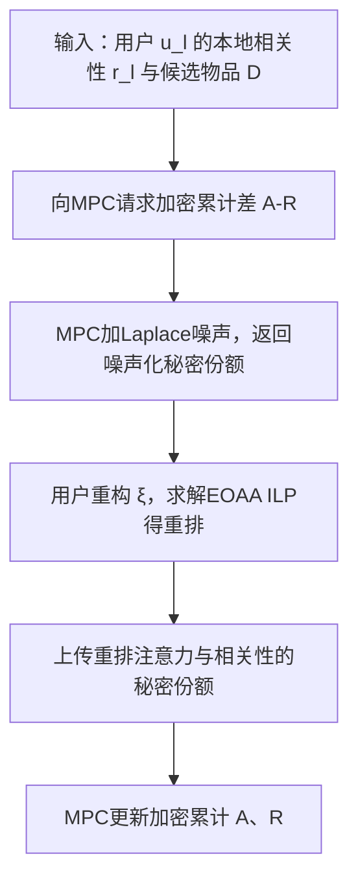

# Privacy-Preserving Fair Item Ranking (隐私保护公平物品排序)

- **会议/期刊**: ECIR 2023
- **作者与机构**: Jia Ao Sun, Sikha Pentyala, Martine De Cock, Golnoosh Farnadi；Mila / Université de Montréal / University of Washington / Ghent University / HEC Montréal
- **推荐链路定位**: 重排（后处理式 reranking）
- **研究方向**: 去偏公平、可信隐私与工业架构
- **论文原文**: [https://arxiv.org/abs/2303.02916v1](https://arxiv.org/abs/2303.02916v1)
- **开源代码**: 暂未开源

## TL;DR (1分钟核心速览)

面向“公平重排必须集中用户评分、泄露偏好/Top-k/顺序”的痛点，本文将EOAA重排ILP拆成用户本地计算与MPC服务器维护的加密累计量，并对释放的累计不公平度加Laplace噪声实现DP。在三个真实数据集、$\epsilon\in[0.5,10^5]$下，NDCG始终保持在$[0.8,1]$，且相对无公平重排降低物品不公平。

## Background & Motivation (背景与核心矛盾)

- **主流范式**: 公平重排多采用后处理：Biega等EOAA在中心服务器上顺序求解ILP，使物品累计注意力$A_i$与累计相关性$R_i$成比例。
- **前人局限**: 中心化需明文收集全部用户排序，泄露(P1)全物品偏好、(P2)Top-k物品、(P3)Top-k顺序；纯MPC虽可端到端保密，但通信与计算开销不可扩展。
- **核心洞察 (Key Insight)**: 每个用户本地已有相关性$r_l$与候选集，只缺前序用户累计的$A^{l-1}-R^{l-1}$。
- **本文切入点**: 将累计量拆成MPC秘密份额，释放差值时加Laplace噪声，用户本地解ILP后回传份额更新。

## Method (核心方法设计)

### 1. 整体框架 (Overall Architecture)

输入为隐私保护SVD模型给出的用户$u_l$对$n$个物品的相关性$r_l$。MPC服务器维护加密累计注意力与相关性$[[A]]$、$[[R]]$；用户$u_l$请求$A^{l-1}-R^{l-1}$，服务器加DP噪声后返回秘密份额。用户重构$\xi$，在本地以质量约束$\theta$求解EOAA ILP，得到重排$\rho_l^*$与$\hat w^*$，再上传$[[\hat w^*]]$、$[[\hat r]]$，服务器更新累计量，进入下一位用户。

### 2. 关键设计拆解 (Key Designs)

1. **加密累计状态，只释放差值**：中心式EOAA需要$A_i^{l-1}$与$R_i^{l-1}$，这正是跨用户敏感聚合。MPC服务器仅保存$[[A]]$、$[[R]]$，初始为0；用户完成重排后上传$[[\hat w^*]]$、$[[\hat r]]$，服务器执行$[[A]]\leftarrow[[A]]+[[\hat w^*]]$、$[[R]]\leftarrow[[R]]+[[\hat r]]$。用户与服务器均不见其他用户明文排序。

2. **DP噪声释放$A-R$**：即使只释放累计差，早期用户仍可能反推前序用户。服务器计算$[[A^{l-1}-R^{l-1}]]$后加$\mathrm{Lap}(b)$，$b=\frac{\Delta f}{\epsilon/(nL)}$；敏感度$\Delta f=\max(|\hat w_{\max}-\hat r_{\min}|,|\hat w_{\min}-\hat r_{\max}|)$，在归一化几何注意力与$\hat r\in[0,1]$下取$\Delta f=1$。总预算按$nL$次查询分摊，低$\epsilon$时噪声随$nL/\epsilon$放大。

3. **本地ILP重排与质量约束**：用户以$\xi=A^{l-1}-R^{l-1}+\mathrm{Lap}(b)$为代理，求解$\min_X\sum_i\sum_j|A_i^{l-1}+\hat w_j-(R_i^{l-1}+\hat r_i^l)|X_{i,j}$，并约束前$k$项$\sum_{j=1}^k\sum_i\frac{2\hat r_i^l-1}{\log_2(j+1)}X_{i,j}\ge\theta\mathrm{DCG}(\rho_l)@k$。正缩放$\epsilon/L$不改变最优排列；本文无端到端训练损失与负采样，推理为每用户一次ILP。

## Experimental Setup & Evaluation Protocol (实验设置与评估协议)

- **数据集与预处理**: 使用三个真实评分数据集；原文未报告`5-core`等过滤，直接以全量评分训练SVD。统计如下：

| 数据集 | #Users | #Items | #Interactions | 密度 | 特征/场景说明 |
| :--- | :---: | :---: | :---: | :---: | :--- |
| Amazon Digital Music | 478,235 | 266,414 | 836,006 | 0.00066% | 显式评分1–5 |
| Book Crossing | 77,805 | 185,973 | 433,671 | 0.0030% | 显式评分1–10 |
| MovieLens-1M | 6,040 | 3,706 | 1,000,209 | 4.47% | 显式评分1–5 |

- **数据划分与防穿越**: 原文未报告Leave-One-Out、比例划分或时间切分；SVD在全量评分上训练，再对用户序列做后处理重排评估，因此不存在常规离线切分协议。
- **排名评测协议**: 不是全库`Full-Ranking`，也不是采样负例排序；在每用户固定$n=100$候选集内做全排序，报告序列级unfairness与相对原排序的NDCG，质量阈值为$\theta=0.8$。
- **对比基线与超参设置**: 仅三类对照：Centralized no fairness、Centralized w/fairness（Biega EOAA）、本文Private；未提供5–8个SOTA基线或显著性检验。SVD由Surprise训练，Gurobi解ILP，$k=100,\Delta f=1$，$\epsilon\in\{0.5,1,10,100,1000,10000,100000\}$；MP-SPDZ，$q=2^{64}$，2PC passive adversary。

## Key Experimental Results (实验关键数据)

### 1. 主实验对比 (Main Results)

原文仅以图2曲线呈现，未给精确数值表，以下为可核实的趋势与边界，故不臆造百分比：

| 设置 | 隐私机制 | Unfairness↓ | NDCG↑ | 可核实结论 |
| :--- | :--- | :--- | :--- | :--- |
| Centralized no fairness | 无 | 最高 | 1.000 | 无偏置缓解基准 |
| Centralized w/fairness | 无 | 最低 | $\ge0.8$ | EOAA公平上界 |
| Proposed $\epsilon=0.5$| MPC+DP | 低于无公平、高于中心公平 |$[0.8,1]$ | 强隐私，噪声代价最大 |
| Proposed $\epsilon=1$| MPC+DP | 略降 |$[0.8,1]$| 低$\epsilon$仍受噪声影响 |
| Proposed $\epsilon=10$| MPC+DP | 继续下降 |$[0.8,1]$| 公平性随$\epsilon$回升 |
| Proposed $\epsilon=100$| MPC+DP | 接近中心公平 |$[0.8,1]$ | 中高隐私预算 |
| Proposed $\epsilon=1000$| MPC+DP | 接近中心公平 |$[0.8,1]$ | 噪声影响减弱 |
| Proposed $\epsilon=10^4/10^5$| MPC+DP | 趋近最低 |$[0.8,1]$| 高$\epsilon$逼近中心公平 |

### 2. 消融实验 (Ablation Study)

原文无独立消融表；按机制维度对照如下：

| 对照/消融 | 输入隐私 | 输出隐私 | 公平/质量 | 说明 |
| :--- | :---: | :---: | :--- | :--- |
| Centralized no fairness | 否 | 否 | 公平最差，NDCG=1 | 不重排 |
| Centralized w/fairness | 否 | 否 | 公平最好，NDCG$\ge0.8$ | EOAA中心式 |
| MPC-only（概念对照） | 是 | 否 | 与中心公平等价 | 精确但开销不可扩展 |
| Proposed full | 是 | 是 | 公平改善，NDCG$\ge0.8$ | MPC+DP |
| Proposed $\epsilon=0.5$ | 是 | 是 | 噪声最大，公平代价最高 | 强DP |
| Proposed $\epsilon=10^5$ | 是 | 是 | 接近中心公平 | 弱DP |

### 3. 关键实验发现 (Key Findings)

- **效用边界稳定**：在Amazon、Book Crossing、MovieLens-1M上，$\epsilon$从0.5扫到$10^5$，NDCG始终位于$[0.8,1]$，说明DP扰动未突破$\theta=0.8$的质量约束。
- **公平-隐私存在可量化代价**：噪声尺度$b=nL\Delta f/\epsilon$随$n,L$线性放大、随$\epsilon$反比缩小；低$\epsilon$时$A-R$被强扰动，公平性改善明显弱于中心公平重排，高$\epsilon$才逼近中心式EOAA。
- **运行时可接受但非无感**：中心式重排约0.67秒/用户（$n=100$，$L=6040$平均）；2PC passive下每客户端额外少于5秒，3PC passive可少于1秒，离线阶段可预计算，但$L$个用户顺序执行仍是吞吐瓶颈。

## Highlights & Limitations (亮点、对比与审稿批判)

- **与代表作对比 (vs. Prior Work)**: 相比Biega等EOAA，本文不向中心服务器暴露任何用户排序；相比纯MPC方案，混合DP释放避免了对全部ILP计算做昂贵加密；相比既有DP/联邦/同态加密LTR工作，本文首次把“物品端公平”与“用户端隐私”放进同一重排流程。
- **可迁移亮点**: “加密累计状态 + 噪声化差值释放 + 本地后处理”可迁移到其他序列级公平/曝光控制任务；敏感度可在明文预计算，适合离线/在线拆分部署。
- **审稿级局限批判**: 评估仅覆盖每用户$n=100$候选集与$L=3000/6040$用户，未做全库排序、统计显著性检验或大规模线上A/B；顺序依赖使MPC与ILP延迟随用户数累积，低$\epsilon$下公平性代价较明显，且暂无开源代码。

## Rating (四维评分)

- **方法创新性 (Novelty)**: ⭐⭐⭐⭐ （首次将EOAA物品公平重排与MPC+DP结合，机制组合有明确增量）
- **评估协议与实验扎实度 (Protocol & Experiments)**: ⭐⭐⭐ （三个真实数据集与$\epsilon$扫描较完整，但仅图2曲线、无显著性检验与全库排序）
- **写作与数学规范度 (Clarity & Rigor)**: ⭐⭐⭐⭐ （ILP、敏感度与DP预算分配交代清楚，但符号密度较高、实验数值呈现不足）
- **工业落地与复现价值 (Industrial & Practical Value)**: ⭐⭐⭐ （2PC额外延迟小于5秒且可离线预计算，但顺序执行、MPC运维与无开源代码限制落地）

