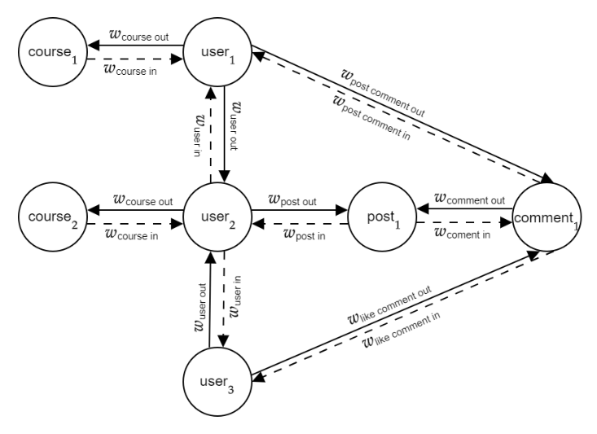
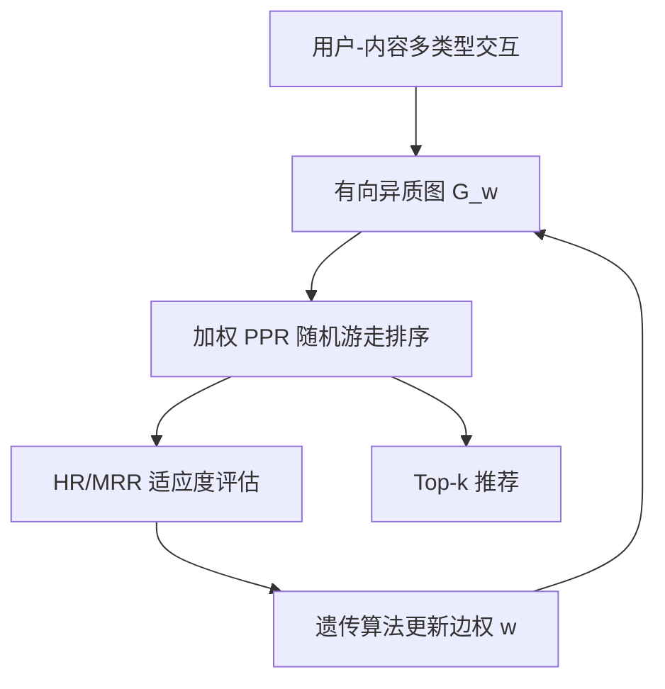

# Graph-based Recommendation for Sparse and Heterogeneous User Interactions (稀疏异质用户交互的图推荐)

- **会议/期刊**: ECIR 2023
- **作者与机构**: Simone Borg Bruun、Kacper Kenji Leśniak 等；University of Copenhagen、FullBrain
- **推荐链路定位**: 召回（全库 PPR 排序）
- **研究方向**: 图神经网络与知识图谱推荐 / 冷启动与长尾推荐
- **论文原文**: [论文原文链接](https://arxiv.org/abs/2301.11009v1)
- **开源代码**: [开源代码仓库链接](https://github.com/simonebbruun/genetically)

## TL;DR (1分钟核心速览)

面向小数据与稀疏异质交互，本文把用户所有行为建成有向异质图，用 PPR 排序候选，并以遗传算法学习不同边型的进出权重。在无 `5-core` 过滤、时间留一/末段划分与全库排序下，教育社交集 MRR@5 较最佳基线提升 6.7%，保险集小样本优于 NGCF。

## Background & Motivation (背景与核心矛盾)

- **主流范式**: 当前图推荐多依赖 GNN、矩阵分解或元路径游走，通常假设百万级交互与充足训练样本。
- **前人局限**: ① NeuMF/NGCF 等神经模型在小数据上欠拟合，常需 `5-core` 过滤；② PathRank/IPF/MLCG 等异质图方法依赖预定义路径、上下文层或手工边权，难以自动适配不同业务。
- **核心洞察 (Key Insight)**: 用户发帖、评论、点赞、报案等非推荐物行为同样携带偏好信号；不同边型对目标物品的贡献应由排序指标驱动学习，而非人工设定。
- **本文切入点**: 构建包含所有交互类型的有向异质图，用 PPR 传播偏好，再用遗传算法搜索边型权重。

<figure class="paper-figure" markdown="span">
  <figcaption>图 1：社交网络中异质图的示例。</figcaption>
</figure>

图 1 给出教育社交网络的异质图示例：用户、课程、帖子、评论等节点通过不同行为边相连，非课程行为也可为课程推荐提供多跳证据。

## Method (核心方法设计)

### 1. 整体框架 (Overall Architecture)

输入是用户与课程、帖子、评论、保险产品等多类内容的所有行为；按行为类型建立有向异质图，同一对节点多种行为合并为多类型边并赋予独立进出权重。对每个目标用户运行加权 PPR，得到全图内容排序；以验证集 MRR 为遗传算法适应度，迭代选择、交叉、变异边型权重，收敛后固定权重上线，仅对新用户做一次 PPR 幂迭代并取 Top-k。

### 2. 关键设计拆解 (Key Designs)

1. **全交互有向异质图（All-Interaction Heterogeneous Graph）**：前人只把用户-物品交互入图，本文把发帖、评论、点赞、关注、报案等全部行为入图；边型映射为正值权重 $W(\phi((i,j)))=w_{i,j}>0$，进出边分别建模。直觉是稀疏场景下，非推荐物行为可补充用户兴趣证据，且行为方向性有语义差异。

2. **加权 PPR 排序（Weighted Personalized PageRank）**：在加权有向图上，从用户 $s$出发做$\alpha$-discounted 随机游走，按边权归一化转移：
$\pi=(1-\alpha)\mathbf{P}^{\top}\pi+\alpha\mathbf{e}_s,\quad P_{i,j}=\frac{w_{i,j}}{\sum_{k\in O(i)}w_{i,k}}\mathbb{I}\{j\in O(i)\}$
PPR 值即候选内容排序分数，可多跳聚合异质行为信号；相比只按共同物品定义相似用户，更能利用间接连通性。

3. **遗传算法学边权与训练/推理**：边权不手工设定，基因向量长度为边型数 $|R|$，以验证集 MRR 为适应度：
$w^\ast=\arg\max_{w}\mathrm{MRR}(\mathrm{PPR}(G_w))$
通过选择、均匀交叉、10% 变异搜索权重，无需可微目标；无负采样。在线仅固定权重做一次/用户 PPR 幂迭代，GA 完全离线，适合小数据场景。

## Experimental Setup & Evaluation Protocol (实验设置与评估协议)

- **数据集与预处理**: 无 `5-core` 过滤，保留极稀疏真实交互。

| 数据集 | #Users | #Items | #Interactions | 稀疏度/密度 | 特征/场景说明 |
| :--- | :---: | :---: | :---: | :---: | :--- |
| Educational social network | 878 | 1605（388 门课） | 5088 | 稀疏度 0.996 | 关注课程/用户、发帖、评论、点赞、评分、加入大学；推荐课程 |
| Insurance | 53569 | 55（16 个物品） | 432249 | 稀疏度 0.853 | 购买/点击电商、个人账户、理赔、信息页；推荐保险物品 |

- **数据划分与防穿越 (Splitting Strategy)**: 教育集对每名有 >1 次课程交互用户做 `Leave-One-Out` 时间留一，删除留出课程之后的行为防泄漏；保险集用最近 10% 购买事件作测试，之前行为作训练；验证集按同法从训练集构造。
- **排名评测协议 (Ranking Protocol)**: `Full-Ranking` 全候选排序，过滤已关注课程及不满足附加险条件的物品；非采样负例排序。指标 HR@5/10、MRR@5/10；保险集因仅 16 个推荐物品用 HR@3、MRR@3。
- **对比基线与超参设置**: MostPopular、UB-KNN、SVD、NeuMF、NGCF、Uniform Graph、User Study Graph；PPR $\alpha=0.3$（教育）/$0.4$（保险），UB-KNN$k=60/80$，SVD$d=30/10$；GA 种群 10、基因范围$[0.01,2]$、变异 10%。显著性：MRR 用 ANOVA、HR 用 McNemar，$p<0.05$。

## Key Experimental Results (实验关键数据)

### 1. 主实验对比 (Main Results)

| 方法 | 教育 MRR@5 | 教育 MRR@10 | 教育 HR@5 | 教育 HR@10 | 保险 MRR@3 | 保险 HR@3 |
| :--- | :---: | :---: | :---: | :---: | :---: | :---: |
| Most Popular | 0.0797 | 0.0901 | 0.1978 | 0.2729 | 0.4982 | 0.6791 |
| SVD | 0.3639 | 0.3767 | 0.5275 | 0.6209 | 0.5787 | 0.7399 |
| NeuMF | 0.3956 | 0.4110 | 0.5604 | 0.6740 | 0.5937 | 0.7448 |
| UB-KNN | 0.4304 | 0.4456 | 0.6172 | 0.7271 | 0.6238 | 0.7569 |
| NGCF | 0.4471 | 0.4592 | 0.6245 | 0.7143 | **0.6517** | **0.8043** |
| Uniform Graph | 0.4600 | 0.4735 | 0.6300 | 0.7289 | 0.6263 | 0.7730 |
| User Study Graph | 0.4162 | 0.4330 | 0.5952 | 0.7179 | - | - |
| Genetically Directed | **0.4907±0.0039** | **0.5045±0.0037** | **0.6505±0.0052** | **0.7520±0.0055** | 0.6435±0.0029 | 0.7875±0.0044 |

相对各数据集最佳基线：教育集 MRR@5 提升 **6.7%**、MRR@10 提升 **6.5%**、HR@5 提升 **3.3%**、HR@10 提升 **3.2%**；保险集 MRR@3 较 NGCF 低 **1.3%**、HR@3 低 **2.1%**，但小样本下反超。

### 2. 消融实验 (Ablation Study)

| 变体 | 教育 MRR@5 | 教育 HR@10 | 保险 MRR@3 | 保险 HR@3 |
| :--- | :---: | :---: | :---: | :---: |
| Uniform Graph（权重全 1） | 0.4600 | 0.7289 | 0.6263 | 0.7730 |
| User Study Graph（手工权重） | 0.4162 | 0.7179 | - | - |
| Genetically Undirected（进出同权） | 0.4809 | 0.7509 | 0.6339 | 0.7760 |
| Genetically Directed（完整） | **0.4907** | **0.7520** | **0.6435** | **0.7875** |

### 3. 关键实验发现 (Key Findings)

1. **方向性与学习权重均有效**：教育集完整模型 MRR@5 0.4907，较 Uniform Graph 0.4600 提升 6.7%，较 Undirected 0.4809 提升 2.0%；保险集较 Undirected 提升 1.5%，说明进出边分离建模必要。
2. **小样本鲁棒性突出**：保险集 10% 训练时，完整模型 MRR@3 0.6267 vs. NGCF 0.5937（+5.6%）；25% 时 0.6353 vs. 0.6030（+5.4%）；但 100% 时 NGCF 0.6517 反超 0.6435，表明方法胜在低数据区间。
3. **权重具业务可解释性且稳定**：教育集“用户关注课程”入边权重达 1.88，“用户关注用户”出边 0.95；保险集“信息页物品点击”出边 1.60、“电商服务点击”1.21，均与购买路径一致；不同采样规模下相对重要性基本稳定，可离线定期重训。

## Highlights & Limitations (亮点、对比与审稿批判)

- **与代表作对比 (vs. Prior Work)**: 相比 Uniform Graph，本文学习边型权重；相比 User Study Graph，数据驱动权重显著更优；相比 PathRank/IPF/MLCG，不依赖预定义元路径或上下文层；相比 NGCF/NeuMF，在极小数据下更稳。
- **可迁移亮点**: 把非推荐物行为纳入异质图；用排序指标驱动的启发式搜索优化不可微图权重；线上固定权重，降低推理更新成本。
- **审稿级局限批判**: ① GA 需反复 PPR 评估，训练开销随边型/种群增长，未报告大规模扩展性；② 仅两个真实场景，保险集仅 16 个推荐物品，HR 偏饱和，且无线上 A/B 与更现代图推荐基线。

## Rating (四维评分)

- **方法创新性 (Novelty)**: ⭐⭐⭐⭐ （将全交互异质图、PPR 与遗传算法结合，边权学习思路新颖，但非深度表征突破）
- **评估协议与实验扎实度 (Protocol & Experiments)**: ⭐⭐⭐⭐ （时间留一/末段划分、全库排序、显著性检验与采样鲁棒性较完整，但数据集仅两个）
- **写作与数学规范度 (Clarity & Rigor)**: ⭐⭐⭐⭐ （PPR 与 GA 流程清晰、符号简洁；复杂度与 GA 收敛性分析偏少）
- **工业落地与复现价值 (Industrial & Practical Value)**: ⭐⭐⭐ （代码与数据开源、适合 SME 小数据冷启动；GA 离线调参成本与大规模图扩展仍需验证）

