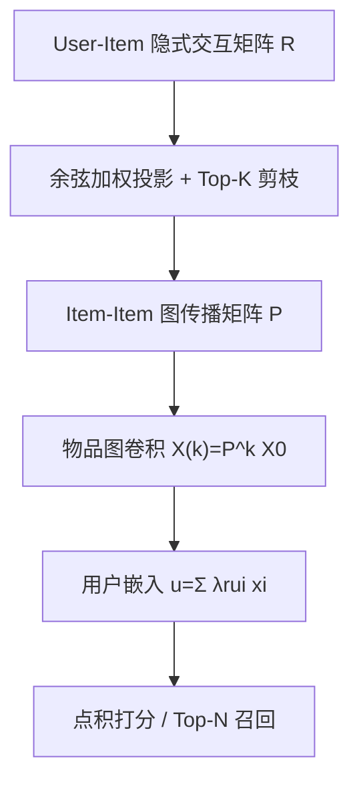
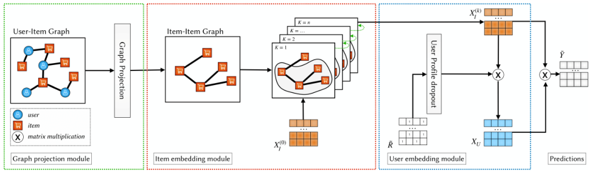

# Item Graph Convolution Collaborative Filtering for Inductive Recommendations (物品图卷积协同过滤：面向归纳式推荐)

- **会议/期刊**: ECIR 2023（LNCS 13980, pp. 249–263）
- **作者与机构**: Edoardo D’Amico, Khalil Muhammad, Elias Tragos, Barry Smyth, Neil Hurley, Aonghus Lawlor；Insight Centre for Data Analytics, Dublin
- **推荐链路定位**: 召回（CF 检索/排序打分）
- **研究方向**: 图神经网络与知识图谱推荐 / 冷启动与长尾推荐
- **论文原文**: [https://arxiv.org/abs/2303.15946v1](https://arxiv.org/abs/2303.15946v1)
- **开源代码**: [https://github.com/damicoedoardo/IGCCF](https://github.com/damicoedoardo/IGCCF)

## TL;DR (1分钟核心速览)

针对 GCN 推荐将用户嵌入设为可训练 one-hot 参数、新用户必须重训的转导式痛点，IGCCF 只依赖隐式交互：先将 user-item 二部图经余弦加权投影为 item-item 图并 top-K 剪枝，再以 \(P^kX_0\) 做物品图卷积，用户嵌入由历史物品嵌入加权求和得到。训练用 BPR 与 user-profile dropout。在四个数据集上，其 NDCG@20/Recall@20 全面超过 LightGCN 等转导基线，Amazon 约提升 15.8%/9.6%，且对未见用户保持稳定归纳性能。

## Background & Motivation (背景与核心矛盾)

- **主流范式**: NGCF、LightGCN 等把 user-item 交互视为二部图，通过图卷积平滑节点嵌入；但用户嵌入通常是随机初始化并全程训练的自由参数。
- **前人局限**: ① 新用户或新交互到来时，转导模型需重训才能生成用户表示；② 依赖 side information 的方法在冷启动场景常无特征可用，且难以实时更新。
- **核心洞察 (Key Insight)**: 用户偏好可由其历史物品表示组合得到，因此无需显式用户参数；真正需要学习的是能编码高阶物品关联的物品嵌入。
- **本文切入点**: 将二部图投影为带权 item-item 图，在物品侧做图卷积，用户侧仅做加权池化，从结构上实现用户归纳。

## Method (核心方法设计)

### 1. 整体框架 (Overall Architecture)

IGCCF 由三模块构成：图投影模块把 user-item 二部图转为 item-item 同质图，边权为物品交互向量的余弦相似度，并按每个物品保留 top-K 强边；物品嵌入模块在该图上做线性图卷积，得到高阶平滑后的物品表示；用户嵌入模块不再训练用户参数，而是用用户历史物品嵌入的加权和实时构造用户向量。训练以 BPR 成对损失优化物品嵌入，并对用户历史做 dropout 正则；推理时仅需物品嵌入与用户交互列表即可打分。

<figure class="paper-figure" markdown="span">
  <figcaption>图 1：模型架构。</figcaption>
</figure>

### 2. 关键设计拆解 (Key Designs)

1. **余弦加权 item-item 图投影 + top-K 剪枝**：朴素 one-mode 投影只保留“是否共享用户”，丢失共现频率；本文令 \(w_{ij}=\frac{\mathbf{r}_i\cdot\mathbf{r}_j}{\|\mathbf{r}_i\|\|\mathbf{r}_j\|}\)，并对每个物品仅保留相似度最高的 K 条边。强边保留高频共现，剪枝则抑制过平滑与训练开销。
2. **物品侧图卷积**：将余弦相似度矩阵直接作为传播矩阵 \(P\)，有 \(X^{(k)}=PX^{(k-1)}=P^kX_0\)，等价于以 k 跳邻居的加权组合更新物品表示。相比 LightGCN 在二部图上传播，本文把高阶关联压缩到物品图，且不引入用户自由参数。
3. **用户加权池化与训练目标**：用户表示为 \(\mathbf{x}_u=\sum_{i\in I}\lambda_{ui}r_{ui}\mathbf{x}_i\)，文中取均匀权重，矩阵形式为 \(U=(R\odot\Lambda)X\)。损失为 BPR：\(\mathcal{L}_{BPR}=\sum_{(u,i^+,i^-)}-\ln\sigma(\hat{y}_{ui^+}-\hat{y}_{ui^-})+\lambda\|\Theta\|_2^2\)，负样本为未观测交互；user-profile dropout 在构造用户向量前随机丢弃 \(\tilde R\) 中条目，迫使模型依赖多物品共识。推理仅需点积 \( \hat{y}_{ui}=\mathbf{x}_u^\top\mathbf{x}_i\)，新用户即时可算。

## Experimental Setup & Evaluation Protocol (实验设置与评估协议)

- **数据集与预处理**: 统一 \(k\)-core=10；LastFM 为音乐收听，ML1M/Amazon 将评分 \(\ge3\) 视为正反馈，Gowalla 为 check-in。

| 数据集 | #Users | #Items | #Interactions | 密度 | 场景 |
| :--- | :---: | :---: | :---: | :---: | :--- |
| LastFM | 1,797 | 1,507 | 6,376 | 0.24% | 音乐收听 |
| ML1M | 6,033 | 3,123 | 834,449 | 4.43% | 电影评分 |
| Amazon | 13,455 | 8,360 | 234,521 | 0.21% | 电子产品 |
| Gowalla | 29,858 | 40,988 | 1,027,464 | 0.08% | LBS check-in |

- **数据划分与防穿越**: 转导实验按用户随机 80%/10%/10% 划分 train/val/test，调参后合并 train+val 重训；归纳实验留出 10% 用户完全不参与训练，用其余 90% 用户的交互训练，再用新用户 90% 历史构造嵌入、10% 预测。
- **排名评测协议**: 指标为 Recall@5/20、NDCG@5/20。正文未显式披露候选规模；按所引 NGCF/LightGCN 常用脚本，疑似每用户 1 正 + 99 负的 `Sampled Ranking`，训练负采样为 BPR 未观测采样，严格复现应以代码为准。
- **对比基线与超参**: BPR-MF、iALS、PureSVD、FISM、NGCF、LightGCN；嵌入维度 64、batch 1024、Adam、网格搜索；未见显著性检验报告。

## Key Experimental Results (实验关键数据)

### 1. 主实验对比 (Main Results)

下表为转导设置下 NDCG@20 / Recall@20；粗体为最优，末行为相对最强基线的 `Improv.%`。

| 模型 | LastFM | ML1M | Amazon | Gowalla |
| :--- | :---: | :---: | :---: | :---: |
| BPR-MF | 0.3027/0.4206 | 0.3173/0.2723 | 0.0419/0.0888 | 0.1125/0.1833 |
| iALS | 0.3085/0.4227 | 0.3410/0.2893 | 0.0432/0.0876 | 0.1013/0.1667 |
| PureSVD | 0.2498/0.3438 | 0.3369/0.2883 | 0.0294/0.0631 | 0.1032/0.1861 |
| FISM | 0.2978/0.4139 | 0.3188/0.2805 | 0.0424/0.0865 | 0.1191/0.1925 |
| NGCF | 0.3085/0.4299 | 0.3309/0.2821 | 0.0436/0.0926 | 0.1156/0.1896 |
| LightGCN | 0.3157/0.4379 | 0.3319/0.2864 | 0.0455/0.0978 | 0.1279/0.2049 |
| **IGCCF** | **0.3207/0.4405** | **0.3456/0.2954** | **0.0527/0.1072** | **0.1373/0.2203** |
| **Improv.%** | +1.58/+0.59 | +1.35/+2.11 | +15.82/+9.61 | +7.35/+7.52 |

### 2. 消融实验 (Ablation Study)

| 设置 | LastFM | ML1M | Amazon | Gowalla |
| :--- | :---: | :---: | :---: | :---: |
| w/o 图卷积 (\(k=0\)) | -6.0% | -1.5% | -26.0% | -31.0% |
| w/o user-profile dropout | -4.4% | -3.0% | -10.5% | -1.5% |
| w/o top-K（弱边全保留） | 下降且训练更慢 | 同左 | 同左 | 同左 |
| Full（K=20）NDCG@20 | 0.3207 | 0.3456 | 0.0527 | 0.1373 |

### 3. 关键实验发现 (Key Findings)

1. **无需用户参数也能 SOTA**：IGCCF 在四个数据集上均超 LightGCN，Amazon NDCG@20 从 0.0455 升至 0.0527（+15.8%），说明显式用户嵌入并非性能必要条件。
2. **图卷积收益与数据密度负相关**：最稀疏的 Gowalla（0.08%）获得约 31% 增益，Amazon 约 26%，而稠密 ML1M 仅约 1.5%，高阶物品关联对稀疏场景更关键。
3. **正则与剪枝共同稳住稀疏图**：user-profile dropout 在 Amazon 带来约 10.5% NDCG@20 增益；top-K=20 最优，既缓解过平滑又降低训练时间；训练用户比例降至 50% 时，seen/unseen 用户性能差距仍很小。

## Highlights & Limitations (亮点、对比与审稿批判)

- **与代表作对比**: 相比 LightGCN，IGCCF 把卷积搬到 item-item 图并取消用户嵌入，天然支持新用户；相比 PureSVD/FISM，它显式利用高阶共现图，而非仅做矩阵分解或物品池化。
- **可迁移亮点**: “用户=历史物品加权池化”可直接用于冷启动召回；top-K 相似图剪枝与 user-profile dropout 可迁移到其他 GCN 召回模型。
- **审稿级局限批判**: ① 用户权重固定为均匀，未建模时间衰减与交互强度；② 主实验提升在稠密 ML1M/LastFM 较小，且未报告显著性；③ 候选排序协议披露不足，top-K 与 dropout 超参敏感度仍待更完整分析。

## Rating (四维评分)

- **方法创新性 (Novelty)**: ⭐⭐⭐⭐ （取消用户自由参数、以 item-item 图卷积实现归纳推荐，机制简洁且有明确动机）
- **评估协议与实验扎实度 (Protocol & Experiments)**: ⭐⭐⭐ （四数据集+转导/归纳双设置较完整，但候选协议与显著性检验披露不足）
- **写作与数学规范度 (Clarity & Rigor)**: ⭐⭐⭐⭐ （传播矩阵、用户池化与 BPR 目标定义清晰，复杂度分析直观）
- **工业落地与复现价值 (Industrial & Practical Value)**: ⭐⭐⭐⭐ （开源代码、O(I) 空间与免重训新用户更新，对冷启动召回有直接价值）

