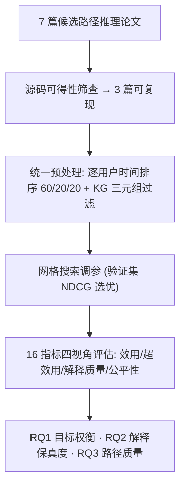

# Knowledge is Power, Understanding is Impact: Utility and Beyond Goals, Explanation Quality, and Fairness in Path Reasoning Recommendation (知识即力量，理解即影响：路径推理推荐中的效用与超效用目标、解释质量与公平性)

- **会议/期刊**: ECIR 2023（第 45 届欧洲信息检索大会）
- **作者与机构**: Giacomo Balloccu, Ludovico Boratto, Christian Cancedda, Gianni Fenu, Mirko Marras（卡利亚里大学、都灵理工大学）
- **推荐链路定位**: 召回 / 可解释重排（推荐列表 + 推理路径同步产出）
- **研究方向**: 图神经网络与知识图谱推荐 / 去偏公平与可信推荐
- **论文原文**: [https://arxiv.org/abs/2301.05944v1](https://arxiv.org/abs/2301.05944v1)
- **开源代码**: [https://github.com/giacoballoccu/rep-path-reasoning-recsys](https://github.com/giacoballoccu/rep-path-reasoning-recsys)

## TL;DR (1分钟核心速览)

路径推理推荐长期陷于"协议割裂 + 只报效用"的评估泥潭：随机划分与时间划分混用、数据集各自为政，无人追问它是否牺牲了覆盖度、解释保真度与群体公平。本文系统扫描 7 篇顶会论文、成功复现 3 篇（PGPR/CAFE/UCPR），在 ML1M 与 LFM1M 上用时间切分 60/20/20 与 16 项指标统一评测。结论：三者在 NDCG 上与知识感知基线无显著差异（$p>0.05$），却把惊喜度从 0.29 拉到 0.78（ML1M，+169%），同时覆盖度下滑 44%、最佳覆盖度差距达 54.9%。

## Background & Motivation (背景与核心矛盾)

- **主流范式**: 以 KG 上的多跳路径为监督信号训练智能体（RL 游走或路径语言模型），在给出推荐的同时把路径实例化为模板化文本解释，如"因为你看了导演 A 的《电影 1》"。
- **前人局限**: 其一，原始实验划分从 `70-0-30` 随机切分到 `60-20-20` 时间切分不一，数据集以 Amazon 子集为主，跨方法不可比；其二，评估几乎只报 NDCG/HR/Recall，无人系统考察覆盖度、惊喜度、解释保真度与双边公平性。
- **核心洞察 (Key Insight)**: 路径推理的"解释生成"机制本质上是 KG 连通性的硬约束——只有存在可达路径的物品才能被推荐并解释，因此效用天花板之外必然隐藏覆盖度与公平性的系统性代价。
- **本文切入点**: 不做新模型，而是建立"混合复现（replication + reproduction）"公共评估场：用原作者代码跑其方法，用自建流水线统一预处理与指标计算。

## Method (核心方法设计)

### 1. 整体框架 (Overall Architecture)

本文的"方法"是一套可复现评估协议而非网络结构。流程为：先按关键词扫描 CIKM/ECIR/KDD/RecSys/SIGIR/WSDM/WWW 等会议与期刊，筛出 7 篇同时满足"KG 方法 + 可产出推理路径"的论文；再逐一索取源码，仅当代码可运行且仅需少量修改即可接入新数据集时判为可复现（3/7 成功，其余 3 篇无源码、1 篇依赖 MCG 已下线）。随后统一预处理、统一调参（验证集 NDCG 网格搜索）、统一计算 16 项指标，并针对效用权衡、解释保真度、路径质量三个 RQ 展开分析。

### 2. 关键设计拆解 (Key Designs)

1. **三元组与交互的公共对齐（保证跨方法可比）**：原始各方法对 KG 的用法各异，若放任则指标不可比。作者只保留"头实体为物品、尾实体为外部实体"的三元组，并删除出现频率低于 3% 的关系类型以控制稀疏性；同时剔除不在 KG 中的物品及其交互。直觉是：只有所有方法共享同一可游走子图，覆盖度与保真度的差异才归因于算法本身而非图规模。

2. **四视角 16 指标度量体系（把"解释"与"公平"变成可算的数）**：解释保真度定义为可解释推荐物品占比，公平性采用人口统计均等的成对绝对差：

$$FID@k=\frac{1}{|\mathcal{U}|}\sum_{u\in\mathcal{U}}\frac{\left|\{i\in L_u^{k}:\exists\,\pi\in\mathcal{P}_{u,i}\}\right|}{k},\qquad \Delta_{m}=\left|m(\mathcal{G}_1)-m(\mathcal{G}_2)\right|$$

其中 $\mathcal{P}_{u,i}$为连接用户历史与推荐物品$i$的推理路径集合，$m(\mathcal{G})$为群体$\mathcal{G}$（性别/年龄）在某指标上的均值；提供方公平则以提供者（导演/歌手）分组计算曝光度$EXP$ 的组间绝对差。这样"解释是否覆盖全列表""不同性别用户是否被同等对待"从定性讨论变为可与 NDCG 并列汇报的标量。

3. **复现边界与调参控制**：为避免"调参不公"污染结论，所有方法在同一验证集上以 NDCG 为唯一选参准则做网格搜索，并允许在原始论文给定范围外适度扩展网格以适配新数据集；统计显著性用 t 检验比较"路径推理类"与"知识感知类"两组方法（每组 3 个），并明示样本量小导致结论仅为初步性质。

## Experimental Setup & Evaluation Protocol (实验设置与评估协议)

- **数据集与预处理**: 选用同时可获取用户与提供者敏感属性的两个公开集；LFM1B 因原方法可扩展性差，均匀采样为 LFM1M（用户 ≥20 交互、物品 ≥10 交互），规避冷启动。

| 数据集 | #Users | #Items | #Interactions | 密度 | KG 实体/三元组 | 说明 |
| :--- | :---: | :---: | :---: | :---: | :---: | :--- |
| ML1M | 6,040 | 2,984 | 932,295 | 0.05 | 13,804 / 193,089 | 电影；DBpedia KG；导演为提供者 |
| LFM1M | 4,817 | 12,492 | 1,091,275 | 0.01 | 17,492 / 219,084 | 音乐；Freebase KG；歌手为提供者 |

- **数据划分与防穿越 (Splitting Strategy)**: 对每个用户按时间排序后做 `60/20/20` 时间切分（最老 60% 训练、次 20% 验证、最近 20% 测试），严格避免未来交互泄漏，适配非平稳兴趣漂移。
- **排名评测协议 (Ranking Protocol)**: 报告 $k=10$ 的推荐列表指标（NDCG、MRR 采用二值相关性与 base-2 对数折扣）；原文未显式说明是否采用全库排序或负采样比例，构成本协议的一处透明度缺口（见局限）。
- **对比基线与超参设置**: 基线为三个**不可解释**的知识感知模型——嵌入类 CKE、CFKG 与传播类 KGAT；Embedding 维度与网格取值随原论文敏感超参设定并适度扩展；显著性以 $p<0.05$ 为界。

## Key Experimental Results (实验关键数据)

### 1. 主实验对比 (Main Results)

| 方法 | ML1M NDCG↑ | ML1M SER↑ | ML1M DIV↑ | ML1M COV↑ | ML1M PF↓ | LFM1M NDCG↑ | LFM1M SER↑ | LFM1M DIV↑ | LFM1M COV↑ | LFM1M PF↓ |
| :--- | :---: | :---: | :---: | :---: | :---: | :---: | :---: | :---: | :---: | :---: |
| CKE | **0.29** | 0.26 | 0.10 | 0.70 | 0.19 | **0.40** | 0.82 | 0.18 | **0.91** | 0.18 |
| CFKG | 0.26 | 0.11 | 0.11 | 0.16 | 0.25 | 0.13 | 0.04 | 0.27 | 0.02 | 0.34 |
| KGAT | **0.29** | 0.29 | 0.10 | **0.75** | 0.19 | 0.37 | 0.79 | 0.19 | 0.89 | 0.18 |
| PGPR | 0.28 | **0.78** | 0.42 | 0.42 | 0.27 | 0.31 | 0.81 | 0.54 | 0.20 | 0.32 |
| UCPR | 0.26 | 0.53 | 0.42 | 0.25 | 0.22 | 0.34 | **0.94** | 0.57 | 0.41 | 0.22 |
| CAFE | 0.26 | 0.63 | **0.44** | 0.21 | 0.36 | 0.15 | 0.75 | **0.58** | 0.11 | 0.36 |

> 与最强知识感知基线的相对变化：ML1M 惊喜度 $0.78$vs$0.29$（**+169%**）、多样性$0.44$vs$0.11$（**+300%**）、覆盖度$0.42$vs$0.75$（**−44%**）；LFM1M 覆盖度$0.41$vs$0.91$（**−54.9%**）。效用维度全部$p>0.05$（NDCG$p=0.33/0.77$），仅惊喜度（ML1M$p=0.011$）与多样性（$p\approx 0$）显著。

<figure class="paper-figure" markdown="span">
  ![图1. 推荐效用与效用之外目标的比较 \[RQ1\]。](../../../../assets/papers/2301.05944v1/figure_1.png)<figcaption>图1. 推荐效用与效用之外目标的比较 [RQ1]。</figcaption>
</figure>

### 2. 消融实验 (Ablation Study)

复现研究无组件消融，此处以"解释保真度随列表长度衰减"与"路径质量画像"两组拆解替代：

| 方法 | FID@10 | FID@20 | FID@50 | FID@100 | LIR↑ | LID↑ | SEP↑ | PTD↑ | PTC↑ |
| :--- | :---: | :---: | :---: | :---: | :---: | :---: | :---: | :---: | :---: |
| PGPR (ML1M) | 1.00 | 0.99 | 0.99 | 0.78 | **0.44** | **0.84** | 0.43 | 0.12 | 0.03 |
| CAFE (ML1M) | **1.00** | **1.00** | **1.00** | **1.00** | 0.34 | 0.16 | **0.75** | **0.33** | **0.73** |
| UCPR (ML1M) | 0.61 | 0.34 | 0.14 | 0.07 | 0.40 | 0.82 | 0.35 | 0.24 | 0.01 |
| PGPR (LFM1M) | 0.98 | 0.74 | 0.31 | 0.15 | 0.49 | 0.77 | 0.61 | 0.30 | 0.05 |
| UCPR (LFM1M) | 0.99 | 0.98 | 0.68 | 0.35 | 0.49 | **0.84** | 0.67 | **0.42** | 0.24 |

### 3. 关键实验发现 (Key Findings)

1. **效用已饱和，差异全在"超效用"维度**：三类路径推理方法与 KGAT/CKE 的 NDCG 差距不超过 0.03 且不显著（$p=0.33$），但惊喜度与多样性分别显著高出 1.7 倍与 3 倍（$p=0.011$与$p\approx 0$）——路径推理的真正价值不在"更准"，而在"更意外、更不重复"。
2. **解释能力与覆盖度存在硬权衡，且高度依赖设计选择**：CAFE 靠训练时预先指定列表长度、自适应扩展邻域搜索空间实现 $FID@100=1.00$的稳定保真，代价是 ML1M NDCG 仅 0.26、覆盖度 0.21；而 UCPR 在 ML1M 上$FID@10$ 已跌至 0.61，说明"多视图需求组合 + 重聚焦"机制对 KG 连通性高度敏感。
3. **提供方公平与效用解耦，消费方公平普遍存在但幅度低**：CFKG 效用最差（ML1M NDCG 0.26）却拿到次优提供方公平（0.25）；路径推理方法在性别/年龄组上的效用差距普遍低于 0.02，但覆盖度不公平度最高达 0.084（PGPR），且 UCPR 在解释保真度上的组间差距达 0.12，推测由人口属性样本不均衡驱动。

## Highlights & Limitations (亮点、对比与审稿批判)

- **与代表作对比 (vs. Prior Work)**: 相较 PGPR/CAFE/UCPR 原文仅报 NDCG/HR 的自证式评测，本文首次把它们与 KGAT/CKE/CFKG 置于同一时间切分、同一 KG 子图下横向对照；相较常规 benchmark 论文，其独特贡献是把"解释保真度"与"提供方曝光公平"量化为可与效用并列的指标。
- **可迁移亮点**: 其一，`FID@k` 的"可解释物品占比"定义可直接移植到任何带解释生成的推荐系统（含 LLM 推荐的理由生成覆盖率）；其二，"头实体限定为物品"的 KG 裁剪策略是跨方法可比性的低成本通用做法，值得作为 benchmark 标准件。
- **审稿级局限批判**: 其一，协议未交代候选集构造方式（全库排序还是采样排序、负采样比例），也未报告方差与置信区间，6 个方法的 t 检验样本量过小，统计效力存疑；其二，7 篇候选仅复现 3 篇、且仅 2 个电影/音乐数据集、$k$ 固定为 10，Amazon 电商域与冷启动场景缺席，结论外推性受限；此外 CAFE 需在训练时预知列表长度，实际工业场景中列表长度动态变化时其保真度优势将不可用。

## Rating (四维评分)

- **方法创新性 (Novelty)**: ⭐⭐⭐ （无新模型，但"解释保真度 + 双边公平"的四视角度量组合在路径推理领域属首次系统化，问题定义本身有贡献）
- **评估协议与实验扎实度 (Protocol & Experiments)**: ⭐⭐⭐⭐ （时间切分 + 16 指标 + t 检验 + 三个不可解释基线，协议统一度高；扣分于候选集构造未披露、方法样本量仅 6）
- **写作与数学规范度 (Clarity & Rigor)**: ⭐⭐⭐⭐ （指标定义表清晰、RQ 与实验一一对应；但核心公式仅止于指标层，缺复杂度与路径搜索开销分析）
- **工业落地与复现价值 (Industrial & Practical Value)**: ⭐⭐⭐⭐⭐ （代码与预处理、提供者敏感属性全部开源，直接给出"要保真度选 CAFE、要惊喜度选 PGPR、要覆盖度回退 KGAT"的选型决策依据）

