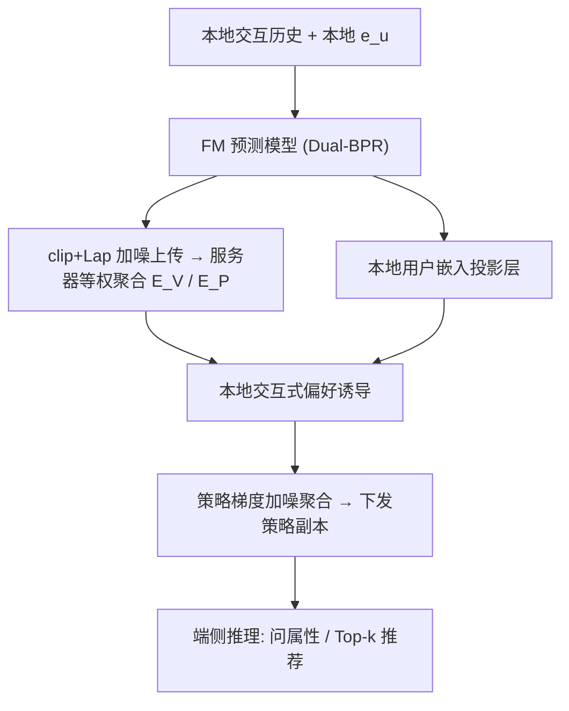
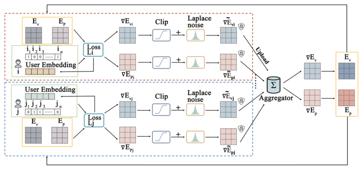
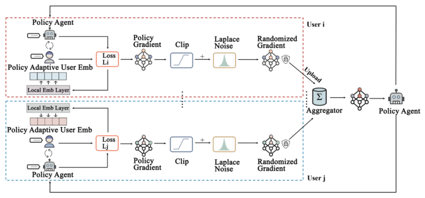
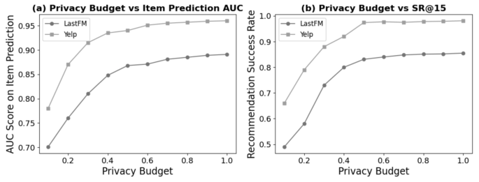

# Federated Conversational Recommender System (联邦对话推荐系统)

- **会议/期刊**: ECIR 2024
- **作者与机构**: Allen Lin, Jianling Wang, James Caverlee (Texas A&M University); Ziwei Zhu (George Mason University)
- **推荐链路定位**: 端到端多轮交互式推荐（历史兴趣预训练 + 在线对话策略）
- **研究方向**: 对话推荐与智能体仿真 / 可信隐私与去偏
- **论文原文**: [https://arxiv.org/abs/2503.00999v1](https://arxiv.org/abs/2503.00999v1)
- **开源代码**: 暂未开源

## TL;DR (1分钟核心速览)

现有 CRS 集中式收集"人类可读"的显式偏好（如"我要奥斯汀的素食餐厅"），一旦泄露即可反推财务状况、政治立场与健康状况。本文先提出三条隐私保护准则（信息本地性 / 贡献匿名性 / 交互与推荐本地性），再提出 FedCRS：用联邦学习 + 本地差分隐私把历史兴趣估计（FM+Dual-BPR）与交互式偏好诱导（REINFORCE 策略智能体）两阶段全部去中心化，并用本地用户嵌入投影层缓解联邦 RL 的环境异质性。在 LastFM / Yelp 的模拟用户会话协议下，SR@15 达 0.831 / 0.974，仅比非隐私 SOTA CRIF 低约 4.0% / 1.2%。

## Background & Motivation (背景与核心矛盾)

- **主流范式**: EAR / SCPR / UNICORN / FPAN / CRIF 均采用"集中式两阶段"——先用 FM 类预测模型从交互历史学用户/物品/属性嵌入，再用 RL 策略智能体决定"继续问属性还是直接推荐"，全部原始交互与对话日志上传服务器。
- **前人局限**: ① 静态推荐场景的隐私方案（噪声注入交互矩阵、拆分本地/全局嵌入）只保护实值交互矩阵，无法保护对话中显式陈述的语义偏好；② 少数联邦推荐工作不保证用户级 LDP，或无法推广到"交互 + 推荐都必须在端侧"的对话设定。
- **核心洞察 (Key Insight)**: 对话推荐的信息泄露面比静态推荐更宽——不仅是评分矩阵，还包括属性级、可解释的自然语言偏好；因此"上传梯度"仍不够，梯度同样可被逆向（gradient inversion）。
- **本文切入点**: 把两个阶段的所有**个人数据与个人梯度**都留在端侧，仅上传经裁剪+Laplace 扰动的模型梯度，同时用本地投影层补偿联邦 RL 的环境异质性。

## Method (核心方法设计)

### 1. 整体框架 (Overall Architecture)

FedCRS 分两阶段闭环。**阶段一（去中心化历史兴趣估计）**：服务器下发客户端无关的物品矩阵 $\mathbf{E}_V$与属性矩阵$\mathbf{E}_P$，每个客户端用自己的交互历史与**永不上传**的本地用户嵌入$\mathbf{e}_u$计算三份梯度——$\nabla\mathbf{e}_u$本地更新，$\nabla\mathbf{E}_V^u$、$\nabla\mathbf{E}_P^u$经裁剪+加噪后上传，服务器等权平均并更新全局矩阵后回传。**阶段二（去中心化交互偏好诱导）**：服务器初始化 MLP 策略智能体，客户端在本地与用户多轮交互采集 state-action-reward 轨迹，用 REINFORCE 计算策略梯度，同样加噪上传聚合；同时每个客户端训练一个**本地用户嵌入投影层**把$\mathbf{e}_u$ 映射为策略自适应状态，该层参数永不上传。收敛后把预测模型与策略副本下发到端侧，推理完全本地完成。

<figure class="paper-figure" markdown="span">
  <figcaption>图1：去中心化历史兴趣估计阶段的整体流程，3 提出的框架</figcaption>
</figure>
<figure class="paper-figure" markdown="span">
  <figcaption>图2：去中心化交互式偏好诱导阶段的整体流程</figcaption>
</figure>

### 2. 关键设计拆解 (Key Designs)

1. **Dual-BPR 的双负样本集设计（保证属性条件下的可排序性）**：传统 BPR 只采样随机未交互负例，但在对话中用户已声明偏好 $P_u$，模型必须能在"同样满足$P_u$的候选集"内正确排序。故预测打分保留 FM 形式$y(u,v,P_u)=\mathbf{e}_u^{\top}\mathbf{e}_v+\sum_{p_i\in P_u}\mathbf{e}_v^{\top}\mathbf{e}_{p_i}$，损失拆成两部分：$D_1$（常规随机负例）与$D_2$（**属性同样匹配$P_u$的难负例**），$\mathcal{L}=\sum_{D_1}-\ln\sigma(\Delta y)+\sum_{D_2}-\ln\sigma(\Delta y)+\lambda_\theta\|\theta\|^2$。$D_2$ 项迫使嵌入学到细粒度属性差异，否则一旦收敛到"属性匹配即可推荐"，多轮询问的信息增益归零。

2. **裁剪+Laplace 的用户级 LDP 与隐私预算显式可控**：上传梯度仍可被逆向。对任意待上传梯度矩阵 $\nabla\mathbf{E}$：$M(\nabla\mathbf{E})=\mathrm{clip}(\nabla\mathbf{E},\delta)+\mathrm{Lap}(0,\lambda)$。基于 Laplace 密度比推导得$\epsilon=\Delta/\lambda$，而裁剪把$l_1$敏感度约束为$\Delta\le 2\delta$，于是$\epsilon\le 2\delta/\lambda$——**隐私预算成为可直接由两个超参调度的工程旋钮**（本文取$\delta=0.0025$、$\lambda=0.01$，即$\epsilon=0.5$）。同一算子复用于策略梯度，形成统一的用户级保证。

3. **本地用户嵌入投影层 + 异构联邦 RL 训练目标**：单一全局策略在"有人只看类型、有人只看导演"的异构环境下必然次优。故状态定义为 $\mathbf{s}_u=\mathbf{s}_{emb}\oplus\mathbf{s}_{hist}$，其中$\mathbf{s}_{emb}=\tanh(\mathbf{W}^{(u)}\mathbf{e}_u+\mathbf{b}^{(u)})$，$\mathbf{s}_{hist}$为已问属性的 one-hot；动作为$a=\arg\max\mathrm{Softmax}(\mathrm{ReLU}(\mathbf{W}^{(2)}\mathrm{ReLU}(\mathbf{W}^{(1)}\mathbf{s}_u+\mathbf{b}^{(1)})+\mathbf{b}^{(2)}))$。本地目标$J(\theta)_u=\frac{1}{N}\sum_i\sum_t\gamma^t r(s_{i,t},a_{i,t})$，梯度用 REINFORCE，奖励设计为$r_{suc}=1$、$r_{ask}=0.25$、$r_{quit}=-1$，$\gamma$显式惩罚冗长对话。$\mathbf{W}^{(u)},\mathbf{b}^{(u)}$只在端侧更新，既是个性化也是额外隐私层。注意$\eta_2=1.5$、$\eta_3=2$远大于$\eta_1=0.01$，因为梯度已被裁到极小量级。

## Experimental Setup & Evaluation Protocol (实验设置与评估协议)

| 数据集 | #Users | #Items | #Interactions | 属性数 | 场景说明 |
| :--- | :---: | :---: | :---: | :---: | :--- |
| LastFM | 1,801 | 7,432 | 76,693 | 33 | 音乐人推荐 |
| Yelp | 27,675 | 70,311 | 1,368,606 | 590 | 商家推荐（层级属性预处理） |

- **数据划分与防穿越**: 过滤交互数 $<10$ 的用户，按 **7:2:1 比例划分** train/val/test（非时间序切分，存在未来信息泄漏风险）。
- **排名评测协议**: **既非 Full-Ranking 也非 Sampled Ranking**，而是**模拟用户会话协议**——以测试集真实交互 $(u,v)$的$P_v$作为 oracle 属性集，随机抽一个属性作初始请求，系统循环"问属性—用户回答"，命中真值$v$ 或达最大轮数即终止；指标为累积成功率 **SR@15** 与平均轮数 **AT**。嵌入质量另用 item 预测 **AUC** 单独评估。
- **对比基线与超参**: 8 个全集中式 CRS 基线（AbsGreedy、MaxEnt、CRM、EAR、SCPR、UNICORN、FPAN、CRIF），嵌入维度 $d=64$，策略隐藏层 64 维。**未报告显著性检验**。

## Key Experimental Results (实验关键数据)

### 1. 主实验对比 (Main Results)

| 方法 | LastFM SR@15↑ | LastFM AT↓ | Yelp SR@15↑ | Yelp AT↓ |
| :--- | :---: | :---: | :---: | :---: |
| AbsGreedy | 0.222 | 13.48 | 0.264 | 12.57 |
| MaxEnt | 0.283 | 13.91 | 0.921 | 6.59 |
| CRM | 0.325 | 13.75 | 0.923 | 6.25 |
| EAR | 0.429 | 12.88 | 0.957 | 5.74 |
| SCPR | 0.465 | 12.86 | 0.973 | 5.67 |
| UNICORN | 0.535 | 11.82 | 0.984 | 5.33 |
| FPAN | 0.631 | 10.16 | 0.979 | 5.08 |
| **CRIF (非隐私 SOTA)** | **0.866** | **9.17** | **0.986** | **4.35** |
| **FedCRS (本文)** | 0.831 | 9.54 | 0.974 | 4.92 |

FedCRS 相对最强非隐私基线 CRIF：LastFM SR@15 $-4.0\%$、AT$+4.0\%$；Yelp SR@15$-1.2\%$、AT$+13.1\%$。

### 2. 消融实验 (Ablation Study)

| 配置 | LastFM SR@15↑ | LastFM AT↓ | Yelp SR@15↑ | Yelp AT↓ |
| :--- | :---: | :---: | :---: | :---: |
| w/ Random Embeddings | 0.251 | 13.96 | 0.327 | 12.05 |
| w/ CRIF Embeddings | 0.784 | 10.14 | 0.951 | 5.73 |
| w/o Local Embedding Layer | 0.722 | 11.07 | 0.919 | 6.14 |
| **FedCRS 完整模型** | **0.831** | **9.54** | **0.974** | **4.92** |

### 3. 关键实验发现 (Key Findings)

1. **去中心化嵌入反而优于集中式**：消融中把 FedCRS 学到的嵌入换成 CRIF 的，LastFM SR@15 从 0.831 掉到 0.784（$-5.7\%$）、AT 从 9.54 升到 10.14；随机嵌入则崩到 0.251。原因是式 (4)(5) 的**等权平均**让每个用户对目标函数等权，抑制了集中式训练中"活跃用户主导梯度"的偏差——隐私代价被这一副作用意外对冲。
2. **策略智能体是真正的短板**：固定同一套嵌入、只换策略时 CRIF 略优于 FedCRS，说明性能损失主要来自联邦 RL；去掉本地投影层后 LastFM SR@15 从 0.831→0.722（$-13.1\%$）、AT 9.54→11.07，直接量化了"环境异质性"对统一策略的伤害，验证了$\mathbf{s}_{emb}$ 的必要性。
3. **隐私预算存在 0.5 的饱和拐点**：SR@15 与嵌入 AUC 随 $\epsilon$单调上升，但$\epsilon>0.5$后斜率明显递减；故取$\epsilon=0.5$（$\delta=0.0025$、$\lambda=0.01$）作为隐私-效用最优点，是全文唯一的显式权衡证据。

<figure class="paper-figure" markdown="span">
  <figcaption>图4：不同隐私预算对训练预测模型或策略智能体有效性的影响</figcaption>
</figure>

## Highlights & Limitations (亮点、对比与审稿批判)

- **与代表作对比**: 相较 EAR/SCPR/UNICORN/FPAN 这些同样"FM+RL 两阶段"的 CRS，FedCRS 不改推荐主干、只改**训练与部署的数据流拓扑**，因此可直接套在现有 CRS 上；相较静态隐私推荐（拆分嵌入、交互矩阵加噪），本文首次把保护对象从"评分矩阵"扩展到"对话中显式陈述的属性偏好"，并在两个阶段共用同一个 $M(\cdot)$ 算子。
- **可迁移亮点**: ① "等权联邦聚合天然缓解活跃用户主导"这一观察可迁移到长尾/冷启动场景的梯度重加权设计；② 端侧本地投影层是解决联邦 RL 环境异质性的轻量方案（单层 MLP，参数不上传），可直接用于联邦多场景推荐。
- **审稿级局限批判**: ① **实验说服力偏弱**——仅 2 个数据集、7:2:1 随机划分（非时间序，测试集属性可能泄漏）、无显著性检验，且论文 Table 4 出现与本文完全无关的 Ensemble Avg / DCN 的 warm/cold 结果，属明显排版错误；② **通信开销未被处理**——LastFM 每轮 1.8 MB、Yelp 每轮 17 MB，完全依赖"未来工作"中的梯度压缩；③ 隐私预算 $\epsilon$ 只对单轮做形式化证明，多轮联邦训练的**组合隐私（composition）**未讨论，实际端到端保证弱于宣称；④ 会话评估依赖模拟用户，真实用户对"被问多少轮"的耐心未建模。

## Rating (四维评分)

- **方法创新性 (Novelty)**: ⭐⭐⭐⭐ （首个系统化定义 CRS 隐私准则并给出两阶段全去中心化方案，但 FM+Dual-BPR+REINFORCE 主干完全沿用 EAR/CRIF，创新集中在数据流与隐私算子）
- **评估协议与实验扎实度 (Protocol & Experiments)**: ⭐⭐⭐ （模拟会话 SR@15/AT 协议符合 CRS 惯例、消融较完整，但仅 2 数据集、随机划分、无显著性检验，且 Table 4 内容错配）
- **写作与数学规范度 (Clarity & Rigor)**: ⭐⭐⭐⭐ （LDP 的密度比推导与 $\epsilon\le 2\delta/\lambda$ 的敏感度界定清晰，两阶段公式符号统一；但多轮组合隐私缺失）
- **工业落地与复现价值 (Industrial & Practical Value)**: ⭐⭐⭐ （框架可插拔、隐私预算可调，但 Yelp 级数据每轮 17 MB 通信与端侧 RL 训练开销在移动端难以承受，且未开源）

