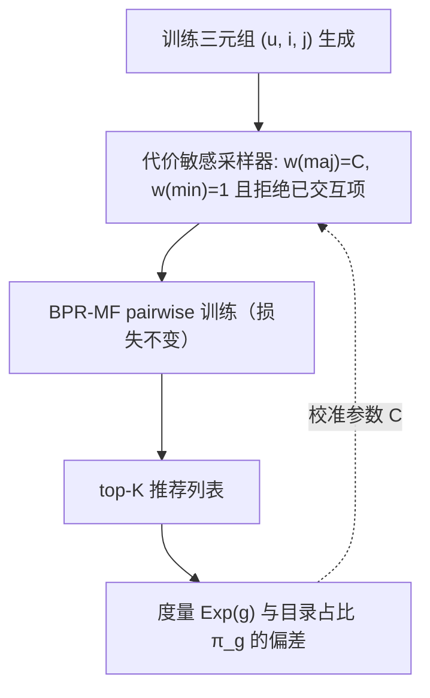

# A Cost-Sensitive Meta-Learning Strategy for Fair Provider Exposure in Recommendation (面向推荐中提供者公平曝光的代价敏感元学习策略)

- **会议/期刊**: ECIR 2024（第 46 届欧洲信息检索大会）
- **作者与机构**: Ludovico Boratto, Giulia Cerniglia, Mirko Marras, Alessandra Perniciano, Barbara Pes（意大利卡利亚里大学）
- **推荐链路定位**: 精排（BPR-MF pairwise 模型的训练期采样层）
- **研究方向**: 去偏公平、可信隐私与工业架构 / 协同过滤（负采样理论）
- **论文原文**: [https://arxiv.org/abs/2401.13566v1](https://arxiv.org/abs/2401.13566v1)
- **开源代码**: [meta-learning-strategy-fair-provider-exposure](https://github.com/alessandraperniciano/meta-learning-strategy-fair-provider-exposure)

## TL;DR (1分钟核心速览)

本文针对**双边市场中的提供者组曝光不公**：少数群体条目在目录中占 6.3%，却在 top-10 推荐中只拿到 1.4% 曝光。作者不改编排模型，而是把公平目标前移到**训练三元组采样**——用代价敏感（cost-sensitive）元学习给多数群体负样本赋权 $C$，把负样本集里少数群体占比压回与正样本、目录一致的水平。在 ML-1M 与 COCO 上按时间切分、以二元 NDCG 评估，ML-1M 取$C{=}2.0$ 时 top-10 女性提供者曝光由 1.4% 升至 6.0%（目录 6.3%），NDCG 恒为 0.07 无损。

## Background & Motivation (背景与核心矛盾)

- **主流范式**: 提供者公平多在**排序后重排**层解决——LFRank、FA*IR、FOE IR、GDE、MMR 等对初始列表做可见性/曝光配额调整。
- **前人局限一（位置失明）**: 纯多样化重排方法（MMR 类）只约束"列表内比例"，忽略位置偏置，少数组条目常被挪到列表尾部，实际曝光仍低。
- **前人局限二（可用性差）**: 部分方法依赖 rank-aware 质量指标，或需要全体用户反馈；而 GDE 类方法复杂度与用户数、条目数线性相关，难以扩展到大目录；MMR 类在同等协议下报告 5%–20% 的效用损失。
- **核心洞察 (Key Insight)**: 曝光失衡的根因在**训练数据分布本身**。ML-1M 中女性提供者条目在负样本中占 6.4%，但在正样本中仅 3.4%（训练交互 3.6%、目录 6.3%）——BPR 被反复要求"把女性条目压得比正样本更低"，自然学出低曝光。
- **本文切入点**: 只需把负样本（或正样本）的类别权重调平，使采样后的组占比与目录占比一致，模型输出的曝光即自动回归公平水平，且不触碰损失函数与网络结构。

## Method (核心方法设计)

### 1. 整体框架 (Overall Architecture)

框架极简：沿用 Elliot 中的标准 BPR-MF，仅在其**三元组生成器**上插入一层代价敏感采样器。给定用户 $u$与正样本$i$，负样本$j$不再从全库均匀抽取，而是按类别权重（多数组$C$、少数组$1$）加权抽取，并对命中用户已交互条目的样本做拒绝重采。训练结束后直接在 top-$K$列表上度量各组曝光$\mathrm{Exp}(g)$与目录占比$\pi_g$的偏差，人工校准$C$ 形成闭环。由于改动发生在数据侧而非模型侧，任何 pairwise 模型（BPR、margin-ranking 类）都能直接套用。

### 2. 关键设计拆解 (Key Designs)

1. **类别重加权负采样（把公平约束写进采样分布）**：痛点是从均匀采样得来的负样本集本身有偏（6.4% vs 3.4%）。做法是对条目 $i$赋权$w(i)=C$（多数组）或$1$（少数组），则少数组在负样本中的期望占比为
$$\pi^-_{\text{min}}(C)=\frac{\pi^-_{\text{min}}}{\pi^-_{\text{min}}+C\,(1-\pi^-_{\text{min}})}$$
$C{=}1$退化为原始 bootstrap 均匀采样。直觉：$C$相当于给"被过度采样"的多数类加了一份"误判代价"，使其在负样本中的出现频率下降、从而削弱模型对少数类的压制。以 ML-1M 验证：$\pi^-_{\text{min}}{=}0.064$、$C{=}2$ 得 3.27%，真实结果 3.2%，与正样本 3.4% 对齐。
2. **方向自适应（NEG / POS 双通道）**：若偏置主要来自负样本（ML-1M），压多数类负样本即可；若正样本也偏（COCO 正样本仅 7.5%、目录 12.7%），负样本侧压到极限（$C{=}5$）曝光仍为 2.2%，此时需反转通道——在**正样本**侧提升少数类权重。因正样本取自各用户自身历史，其组占比是用户相关的非线性量，原文未给闭式解，$C$ 由实验标定。
3. **训练目标、负采样与推理开销**：损失完全不变，
$$\mathcal{L}=-\sum_{(u,i,j)\sim\tilde{\mathcal{D}}}\ln\sigma\big(\hat{y}_{ui}-\hat{y}_{uj}\big)+\lambda\|\boldsymbol{\Theta}\|_2^2$$
改的只是经验分布 $\tilde{\mathcal{D}}$（$P(j)\propto w(j)$）；无额外负采样策略、无 hard negative。推理与基线同构，仅一次内积排序；采样侧因拒绝重采，每个三元组期望尝试$1/q_u$次（$q_u$为用户未交互条目比例），开销与用户数、条目数**解耦**——这正是相较 MMR（复杂度随$|U|,|I|$ 增长）的关键工程优势。

## Experimental Setup & Evaluation Protocol (实验设置与评估协议)

- **数据集与预处理**:

| 数据集 | #Users | #Items | #Interactions | 少数组（女性提供者）条目占比 | 场景与过滤 |
| :--- | :---: | :---: | :---: | :---: | :--- |
| ML-1M | 6,040 | 3,876 | 998,539 | 6.30% | 电影，导演=提供者；条目至少 10 次交互，多导演仅取第一导演 |
| COCO | 73,022 | 34,442 | 520,531 | 12.70% | 在线课程，讲师=提供者；课程与学习者各至少 5 次交互（5-core 风格） |

- **数据划分与防穿越**: 全局**时间戳切分**——最近 20% 测试、次近 20% 验证、其余训练，属严格防穿越设定。
- **排名评测协议**: 报告 NDCG（二元相关性、base-2 对数折扣）；**原文未声明候选集为全库 Full-Ranking 还是采样排序**，这是协议描述上的空白（且 0.07/0.02 的量级暗示候选集或为全库且相关性稀疏，读者难以复核）。
- **公平度量**: $\mathrm{Exp}(g)=\frac{1}{|U|K}\sum_{u}\sum_{k=1}^{K}\mathbb{I}[\mathrm{grp}(r_{u,k})=g]$，目标为目录占比$\pi_g$（equity 原则，非均等分配）；偏差记为$|\mathrm{Exp}(g)-\pi_g|$。
- **对比基线与超参**: 基线仅"同模型 + 均匀采样"（$C{=}1.0$）；嵌入维$d{=}10$、均匀初始化$[0,1]$、SGD 学习率 0.001、10 轮。**未与 LFRank / FA*IR / FOE IR / GDE / MMR 做任何数字对比**（作者以 MMR 掉点 5%–20% 作为间接论据），亦无显著性检验与多次随机种子方差。

## Key Experimental Results (实验关键数据)

### 1. 主实验对比 (Main Results)

因原文未跑外部基线，主表给出**同模型下代价参数 $C$的扫描结果**（$C{=}1.0$ 即基线，加粗为最贴近目录目标的配置，`Improv.` 为 top-10 曝光相对基线的变化）：

| 数据集 | 加价通道 | $C$ | NDCG | 负样本女性% | 正样本女性% | Exp@10 | Exp@20 | Improv.(Exp@10) |
| :--- | :---: | :---: | :---: | :---: | :---: | :---: | :---: | :---: |
| ML-1M | — (基线) | 1.0 | 0.07 | 6.4% | 3.4% | 1.4% | 2.7% | — |
| ML-1M | NEG | 1.2 | 0.07 | 5.3% | 3.4% | 2.5% | 2.8% | +78.6% |
| ML-1M | NEG | **2.0** | 0.07 | **3.2%** | 3.4% | **6.0%** | 3.9% | **+328.6%** |
| ML-1M | NEG | 3.0 | 0.07 | 2.2% | 3.4% | 6.8% | 4.5% | +385.7% |
| COCO | — (基线) | 1.0 | 0.02 | 12.7% | 7.5% | 0.0% | 0.0% | — |
| COCO | NEG | 2.0 | 0.02 | 6.6% | 7.5% | 0.0% | 0.4% | 0.0% |
| COCO | NEG | 5.0 | 0.02 | 2.9% | 7.5% | 2.2% | 2.2% | 从零到有 |
| COCO | POS | 1.2 | 0.02 | 12.7% | 10.5% | 2.1% | 6.9% | 从零到有 |
| COCO | POS | **3.0** | 0.02 | 12.7% | **12.3%** | **12.2%** | 11.9% | **从零到有** |

### 2. 消融实验 (Ablation Study)

原文无传统 "w/o 模块" 消融，此处等价给出**校正通道 × 成本强度**的消融（目标：$\pi_{\text{ML-1M}}{=}6.3\%$、$\pi_{\text{COCO}}{=}12.7\%$，$\Delta$ 为 top-10 曝光与目录目标的绝对偏差，越小越好）：

| 变体 | 数据集 | 负样本女性% | 正样本女性% | Exp@10 | $\Delta$ |
| :--- | :--- | :---: | :---: | :---: | :---: |
| 无校正 ($C{=}1$) | ML-1M | 6.4% | 3.4% | 1.4% | 4.9 pp |
| NEG $C{=}2$（推荐） | ML-1M | 3.2% | 3.4% | 6.0% | **0.3 pp** |
| NEG $C{=}3$（过校正） | ML-1M | 2.2% | 3.4% | 6.8% | 0.5 pp |
| 无校正 ($C{=}1$) | COCO | 12.7% | 7.5% | 0.0% | 12.7 pp |
| NEG 极限 $C{=}5$ | COCO | 2.9% | 7.5% | 2.2% | 10.5 pp |
| POS $C{=}2$ | COCO | 12.7% | 10.9% | 5.3% | 7.4 pp |
| POS $C{=}3$（推荐） | COCO | 12.7% | 12.3% | 12.2% | **0.5 pp** |

### 3. 关键实验发现 (Key Findings)

1. **公平几乎零效用代价**：全部 $C$ 设置下 NDCG 恒为 0.07（ML-1M）与 0.02（COCO），与 MMR 类方法报告的 5%–20% 掉点形成鲜明反差，说明把公平性写进采样分布比写进重排目标更"便宜"。
2. **校正方向必须匹配偏置来源，否则调整无效**：ML-1M 的偏置集中在负样本（6.4% vs 3.4%），NEG $C{=}2$即把偏差压到 0.3 pp；COCO 负样本侧压到$C{=}5$曝光仍只有 2.2%（$\Delta{=}10.5$pp），因为其正样本本身也偏（7.5% vs 12.7%），必须切换到 POS 通道才把$\Delta$ 打到 0.5 pp。
3. **头部公平不等于列表公平，且 $C$需精确标定**：ML-1M$C{=}2$时 Exp@10 为 6.0%，但 Exp@20 仅 3.9%——列表越深、少数组越被稀释，说明只在头部达标会掩盖中后段失衡；同时$C{=}3$时 Exp@10 已冲到 6.8%，超过目录占比 6.3%，即存在过校正风险，而论文未给出$C$ 的解析选取规则。

## Highlights & Limitations (亮点、对比与审稿批判)

- **与代表作对比 (vs. Prior Work)**: 相对 LFRank / FA*IR 等基于可见性的重排，本文显式处理**位置偏置**（以 top-$K$曝光度量而非名次配额）；相对 GDE，无需全体用户反馈且复杂度与$|U|$、$|I|$ 解耦；相对 MMR，不损失效用。真正的差异在于"改数据不改模型"，代价是作用点从结果端挪到了训练端，无法对单个已上线模型做即插即用的推理期干预。
- **可迁移亮点**: ①「检查三元组内的组占比」这一诊断动作可直接用于任何 pairwise 训练管线的公平体检——正负样本组分布不一致往往比最终指标更早暴露问题；②类别重加权 + 拒绝采样是一行级改动，可套用到 BPR / margin loss / 双塔召回等任意负采样环节。
- **审稿级局限批判**: ①**实验证据链薄弱**——无外部 SOTA 公平基线、无显著性检验、无多种子方差、单一时间切分，且 NDCG 量级（0.07 / 0.02）与候选集构成均未交代，公平增益的可信度受限；②**方法与术语折扣**——所谓 "meta-learning" 实质是代价敏感重采样，$C$只能人工网格搜索，COCO 的 POS 变体甚至缺少从$\pi_g$到$C$ 的闭式映射，工业部署时校准成本与拒绝采样开销未见量化；③细节严谨性问题：正文将目录女性占比写作 6.4%，Table 1 为 6.30%，二者不一致。

## Rating (四维评分)

- **方法创新性 (Novelty)**: ⭐⭐⭐ （把提供者公平转译为负采样类别权重，视角轻巧且可解释，但本质是重加权，缺少理论或谱分析支撑）
- **评估协议与实验扎实度 (Protocol & Experiments)**: ⭐⭐ （时间切分规范、观察敏锐，但无 SOTA 基线、无显著性检验、NDCG 协议描述含糊且量级异常）
- **写作与数学规范度 (Clarity & Rigor)**: ⭐⭐⭐ （采样伪代码清晰、曝光指标定义明确，但 $p$ 向量的归一语义与 POS 通道映射表述模糊，目录占比数值前后不一致）
- **工业落地与复现价值 (Industrial & Practical Value)**: ⭐⭐⭐⭐ （开源代码与预处理数据齐全，模型侧零改动、复杂度与规模解耦，是极低成本的训练期公平调节旋钮）

