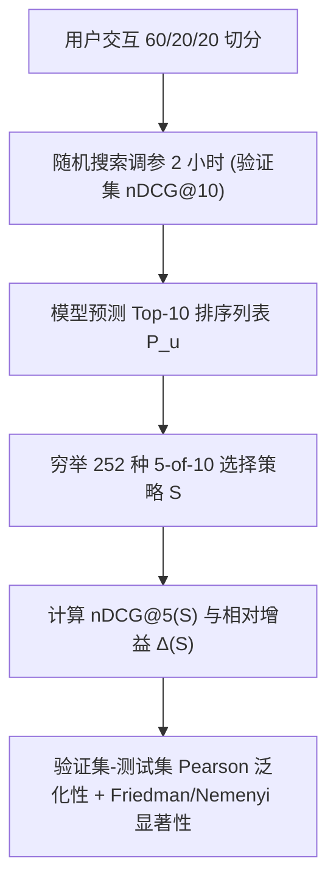

# Revealing the Hidden Impact of Top-N Metrics on Optimization in Recommender Systems (揭示 Top-N 指标对推荐系统优化过程的隐性影响)

- **会议/期刊**: ECIR 2024 (Full Paper Track)
- **作者与机构**: Lukas Wegmeth, Tobias Vente, Lennart Purucker (University of Siegen 智能系统组 / Uni Freiburg)
- **推荐链路定位**: 精排输出后的评估与重排环节（评测协议层）
- **研究方向**: 去偏公平、可信隐私与工业架构 / 多任务学习与列表级重排
- **论文原文**: [https://arxiv.org/abs/2401.08444v1](https://arxiv.org/abs/2401.08444v1)
- **开源代码**: 论文声明仓库 `https://code.isg.beel.org/scoring-optimizer`（检测到的 GitHub 链接实为 Sketchfab 数据集仓库，非本文实现）

## TL;DR (1分钟核心速览)

本文质疑一个从未被检验的隐含假设：用 `nDCG@n` 做超参优化时，必须只取模型预测的**前 n 个**物品。作者把"取哪 n 个物品"抽象为**选择策略 (selection strategy)**，在 20 个数据集、11 个算法上穷举 $\binom{10}{5}=252$ 种策略。结论：确实存在优于 top-n 的策略（约占 0.01%），但最大增益仅 <0.4%（隐式）/ <1.5%（显式），且最优的约 43% 策略之间**无统计显著差异**——top-n 截断在平均意义上是安全的。

## Background & Motivation (背景与核心矛盾)

- **主流范式**: 推荐系统以 grid/random/Bayesian 搜索调参，目标函数是 `nDCG@n`、`Precision@n` 这类阈值型排序指标；而算法内部优化的是平方误差或 BPR/交叉熵损失。
- **前人局限**: 已有工作只盯着"训练损失 vs 目标指标"这一层不一致（如定制/学习损失函数）；却忽略了**第二层不一致**——`nDCG@10` 只对前 10 个物品算分，而前 10 是被另一个损失函数训练出的权重所决定的，真正"适配 nDCG"的物品可能排在第 11 位之后被白白丢弃。
- **核心洞察 (Key Insight)**: 只取 top-n 等价于默认**概率排序原则 (PRP)** 对所有用户平均成立。若该假设不成立，则超参优化在选择候选配置时会被系统性误导，进而污染论文报告的所有指标。
- **本文切入点**: 不改模型、不改损失，而是把"评估取样"当作可搜索变量，用穷举实验量化其影响上限。

## Method (核心方法设计)

### 1. 整体框架 (Overall Architecture)

给定用户 $u$的预测排序列表$P_u$，定义选择策略$S$为从$P_u$中挑出任一$n$元子集用于计算阈值型指标。实验设定$|K|=10$（只看前 10 个候选）与$n=5$，因此每个 (用户, 算法, 数据集) 组合有 252 种策略可穷举。流程为：五折交叉验证切分 → 在验证集上用随机搜索调参 2 小时（保证各算法处于合理超参点）→ 在验证集与测试集上遍历 252 种策略 → 用相对增益、Pearson 相关性与 Friedman/Nemenyi 检验回答两个 RQ。

### 2. 关键设计拆解 (Key Designs)

1. **选择策略形式化与相对增益指标**：痛点是把"评估"当成无参数操作，无法量化偏差。本文显式定义策略集合与相对增益

$$\Delta(S)=\frac{\mathrm{nDCG}@n(S)-\mathrm{nDCG}@n(S_{\text{top-}n})}{\mathrm{nDCG}@n(S_{\text{top-}n})},\quad \mathrm{nDCG}@n(S)=\frac{1}{|\mathcal{U}|}\sum_{u}\frac{1}{\mathrm{IDCG}_u}\sum_{i\in S(P_u)}\frac{\mathrm{rel}_{ui}}{\log_2(\mathrm{rank}_i+1)}$$

直觉：$\Delta(S)>0$即说明 top-n 截断在"偷走"性能，$|K|$ 固定时策略空间有限可穷举，从而把"是否存在隐性偏差"变成可判定的枚举问题。

2. **验证集↔测试集的策略可迁移性检验**：即使测试集上存在更优策略，若其在验证集上不可识别就毫无工程价值。作者对每个算法的 252 个 $\Delta(S)$ 计算验证/测试 Pearson 相关系数，作为"能否通过调评估协议真实获益"的必要条件——这一步把纯描述性分析升级为可操作的决策依据。

3. **训练/推理开销与统计检验**：无训练损失改动，训练成本与原算法一致；额外成本全在评估端——单个数据集穷举约需 **1 CPU 年**（64 核 AMD EPYC 7452 集群并行），这是本文最大的复现门槛。显著性用 Friedman 检验（$p<0.05$）确认策略间存在差异，再用 Nemenyi 事后检验给出临界差异，作者亦承认方法数过多时 Nemenyi 理论前提可能不严格成立。

## Experimental Setup & Evaluation Protocol (实验设置与评估协议)

- **数据集与预处理**: 12 个隐式 + 8 个显式反馈数据集，覆盖 shopping / music / movies / articles / social / locations 六域；统一做 `5-core` 剪枝；显式评分按"大于最大评分的 60%"二值化为交互。代表性子集如下：

| 数据集 | #Users | #Items | #Interactions | 稀疏度 | 类型/域 |
| :--- | :---: | :---: | :---: | :---: | :--- |
| Adressa One Week | 146,635 | 2,441 | 2,020,328 | 99.44% | 隐式 / 新闻 |
| Citeulike-a | 5,536 | 15,429 | 200,180 | 99.77% | 隐式 / 论文 |
| Gowalla | 64,115 | 164,532 | 2,018,421 | 99.98% | 隐式 / 位置 |
| Spotify-Playlists | 15,146 | 337,256 | 8,718,742 | 99.83% | 隐式 / 音乐 |
| Yoochoose | 1,283,296 | 27,995 | 10,195,058 | 99.97% | 隐式 / 电商 |
| MovieLens-1M | 6,038 | 3,307 | 835,789 | 95.81% | 显式 / 电影 |
| MovieLens-100k | 943 | 1,203 | 81,697 | 92.80% | 显式 / 电影 |
| Jester3 | 34,884 | 140 | 777,118 | 84.09% | 显式 / 笑话 |

- **数据划分与防穿越**: 五折交叉验证 + 每用户交互**随机比例划分** 60%/20%/20%（训练/验证/测试），无时间戳切分，因此不含时序穿越控制。
- **排名评测协议**: 全部为 `Full-Ranking` 风格的全库打分后截断，但**评测取样**由选择策略决定（5-of-10）；负样本即全库未交互物品。主指标 nDCG，副指标 Precision（结论一致）。
- **对比基线与超参设置**: 9 个算法 + 2 个基线（MostPop、Random）：Implicit 库的 ALS、Logistic MF、BPR、Item-kNN（Cosine/TF-IDF/BM25），LensKit 的 Implicit MF、User-kNN、Item-kNN；随机搜索空间以各库默认值为中心。

## Key Experimental Results (实验关键数据)

### 1. 主实验对比 (Main Results)

原文主结论以聚合分布图呈现，下表汇总各算法维度上的关键定量证据（Pearson 为验证/测试策略性能相关性，越接近 1 说明策略可迁移）：

| 算法 | Pearson（隐式） | Pearson（显式） | 是否存在优于 top-n 的策略 |
| :--- | :---: | :---: | :---: |
| Implicit MF (LensKit) | 0.998 | 0.988 | 是（幅度极小） |
| User-based kNN | **0.999** | 0.990 | 是 |
| Item-based kNN | 0.998 | **0.994** | 是 |
| Alternating Least Squares | **0.999** | 0.986 | 是 |
| BPR | 0.995 | 0.966 | 是 |
| Logistic MF | 0.995 | 0.983 | 是 |
| Item-kNN + Cosine | **0.999** | 0.990 | 是 |
| Item-kNN + TF-IDF | 0.998 | 0.992 | 是 |
| Item-kNN + BM25 | **0.999** | 0.992 | 是 |
| MostPop (基线) | 0.994 | **0.995** | 是（但排序本身劣质） |
| Random (基线) | 0.004 | −0.064 | 是（纯随机，无泛化） |
| **最大相对增益 Δ** | **< 0.4%** | **< 1.5%** | top-n 平均最优 |

### 2. 消融/敏感性分析 (Sensitivity & Ablation)

| 分析维度 | 设置 | 结果 | 结论 |
| :--- | :--- | :--- | :--- |
| 选择策略数量 | 5-of-10 → 252 种 | 仅约 0.01% 策略超过 top-n | 优势极稀疏 |
| 显著性检验 | Friedman + Nemenyi ($p<0.05$) | 最优约 43% 策略间无显著差异 | 大多数选择"等价可用" |
| 度量切换 | nDCG → Precision | 结论不变（算法/域/数据集层面均一致） | 非指标特异现象 |
| 基线行为 | Random / MostPop | Random 完全不可迁移；MostPop 的 top-n 常次优 | 排好序后截断才有效 |
| 域内一致性 | articles(隐式) / movies(显式) | 最优策略随数据集/算法变化，无域级规律 | 偏差来源不可先验预测 |
| 候选窗口 | $|K|=10$vs 更小窗口 | 作者推断$|K|=8$ 左右可能已足够 | 穷举可进一步降本 |

### 3. 关键实验发现 (Key Findings)

1. **top-n 平均最优，偏差存在但可忽略**：非 top-n 策略的最好情况仅带来 <0.4%（隐式）/ <1.5%（显式）相对 nDCG 提升，且统计检验显示最优的约 43% 策略彼此无显著差异——意味着为"多拿 0.3%"去搜策略在代价上完全不划算（单个数据集需约 1 CPU 年）。
2. **策略性能高度可迁移，但可迁移 ≠ 可获益**：所有非基线算法的 Pearson 相关系数均 >0.99（隐式）/ >0.96（显式），说明验证集上找到的最优策略能在测试集复现；然而 Random 基线 Pearson 仅 0.004/−0.064，说明该可迁移性依赖模型确实学到了有效排序。
3. **对重排实践的直接推论**：既然 top-n 与排名稍后的邻近物品在指标上无显著差异，则重排算法若只在 top-n 邻域内置换（为多样性/公平性牺牲少量精度），其 nDCG 损失很可能落在统计噪声内——这为工业重排"以精度换公平"提供了定量安全边际。

## Highlights & Limitations (亮点、对比与审稿批判)

- **与代表作对比 (vs. Prior Work)**: 与"学习/定制更匹配 nDCG 的损失函数"一类工作（如 Rank-Normalized Loss、可学习损失）互补——那些方法修正**训练端**，本文检验**评估取样端**；与去偏/重排工作（如公平性重排、随机采样 top-k 评估）不同，本文把"取哪 n 个"当变量而非约束，并首次给出大规模统计证据。
- **可迁移亮点**: ①"验证/测试策略 Pearson 相关性"这一诊断指标，可直接用于检验任何"评估协议改动"（如采样负样本、位置去偏加权）是否可上线；②将评测协议视为可搜索超参、并用 Friedman+Nemenyi 做等价类划分的分析范式。
- **审稿级局限批判**: ①计算成本极高（约 20 CPU 年总量），且仅考察 $|K|=10, n=5$ 单一设定，结论能否外推到 `nDCG@100` 或真实曝光深度未知；②算法覆盖面偏传统 CF（且 Nemenyi 在 252 个比较对象下理论前提不严格），缺少神经/图/序列乃至 LLM 推荐模型的验证，而这类模型排序尾部行为可能显著不同。

## Rating (四维评分)

- **方法创新性 (Novelty)**: ⭐⭐⭐ （问题提法本身新颖——把评估取样形式化为策略空间并对 PRP 假设做实证否证，但技术工具是穷举 + 经典统计检验，无新模型）
- **评估协议与实验扎实度 (Protocol & Experiments)**: ⭐⭐⭐⭐⭐ （20 数据集 × 11 算法 × 252 策略 + Friedman/Nemenyi 显著性 + 双指标交叉验证，规模在该类研究中罕见）
- **写作与数学规范度 (Clarity & Rigor)**: ⭐⭐⭐⭐ （策略定义与相对增益公式简洁清晰，对 $|K|=10,n=5$ 的选取动机交代充分；不足是主结果大量依赖散点/箱线图，缺少数值表，并对 Nemenyi 适用性自陈保留）
- **工业落地与复现价值 (Industrial & Practical Value)**: ⭐⭐⭐ （结论对工业界是"定心丸"——不必改动 top-n 评估流程，可放心做邻域重排；但穷举成本与仅覆盖传统 CF 限制了直接落地）

