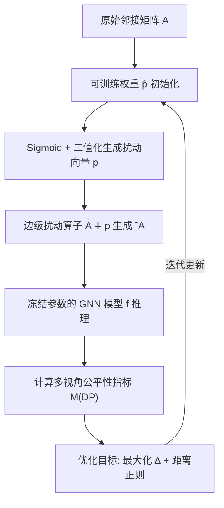

# Robustness in Fairness against Edge-level Perturbations in GNN-based Recommendation (图推荐系统在边级扰动下的公平性鲁棒性研究)

- **会议/期刊**: ECIR 2024
- **作者与机构**: Ludovico Boratto, Gianni Fenu, Mirko Marras, Giacomo Medda (卡拉利亚大学), Francesco Fabbri (Spotify)
- **推荐链路定位**: 训练后评估 / 鲁棒性测评（非召回/精排等传统链路）
- **研究方向**: 去偏公平、可信隐私与工业架构 / 图神经网络与知识图谱推荐
- **论文原文**: [论文原文链接](https://arxiv.org/abs/2401.13823v2)
- **开源代码**: [开源代码仓库链接](https://github.com/jackmedda/CPFairRobust)

## TL;DR (1分钟核心速览)

针对图推荐系统在攻击下的**公平性鲁棒性**缺乏系统研究这一痛点，本文提出在用户-物品二分图上进行边级增删扰动，将扰动过程建模为最大化群体公平性差异的可微优化任务。在三个数据集与三个 GNN 模型上的白盒评估表明：消费者侧公平性极易被极少量扰动破坏（DP 差异可超 1000%），而供应商侧公平性受初始高不公平限制；边删除比边添加更具破坏力，揭示了现有推荐鲁棒性评估协议的严重局限。

## Background & Motivation (背景与核心矛盾)

- **主流范式**: 推荐系统鲁棒性研究多集中于抵御假用户投毒攻击，评估标准仅关注攻击前后推荐**效用（Accuracy/Utility）**的变化。
- **前人局限**: 现有评估协议无法捕捉攻击对**超越精度的属性（如群体公平性）**的影响——整体效用可能保持稳定，但跨群体的推荐性能差异可能已严重恶化；且缺乏对消费者与供应商双侧公平性在攻击下表现的系统性对比。
- **核心洞察 (Key Insight)**: 图神经网络（GNN）的预测高度依赖邻接矩阵的拓扑结构，少量边级扰动即可通过消息传递机制放大，进而剧烈改变特定群体的曝光与推荐效用。
- **本文切入点**: 将“鲁棒性”概念从单纯的效用保持扩展至**公平性保持（Robustness in Fairness）**，通过最大化公平性差异的扰动目标，系统量化 GNN 推荐在边级攻击下的公平性脆弱度。

## Method (核心方法设计)

### 1. 整体框架 (Overall Architecture)

框架以用户-物品二分图 $A$为输入，核心在于一个**可微的边级扰动模块**。该模块维护可训练权重$\hat{p}$，经 sigmoid 与二值化生成扰动向量，对$A$进行增（$\u2215\text{Add}$）或删（$\u2215\text{Del}$）操作得到扰动图$\tilde{A}$。GNN 推荐模型$f$在**冻结参数**的前提下接收$\tilde{A}$进行推理，输出推荐列表并计算多视角公平性指标$M$（即人口统计均等 DP）。通过最大化扰动前后的公平性差异$\Delta$ 并辅以扰动距离正则化，引导扰动过程寻找最破坏公平性的边集组合。

### 2. 关键设计拆解 (Key Designs)

1. **鲁棒性公平形式化与扰动目标**：将 $(\gamma, \epsilon)$-鲁棒性定义推广至公平性，目标是寻找扰动边集$\tilde{E}$使公平性差异$\Delta$ 最大化。优化目标为最小化负公平性差异与扰动距离的加权和：
   $\min_{\hat{p}} - \left[ M(f(\tilde{A}, W; \hat{p}), A) - M(f(A, W), A) \right] + \lambda \| \Gamma(\tilde{A}, A) \|_2^2$
   **直觉**：直接以“破坏公平性”为攻击方向，将鲁棒性评估转化为可微的优化问题，而非盲目破坏效用。

2. **边级二值扰动机制**：将候选边空间扩展至全图，引入可训练权重 $\hat{p}$，通过 sigmoid 二值化得到$\{0,1\}$扰动向量$p$，直接替换对应邻接矩阵条目：
   $\tilde{A}_{u,i} = p_j \text{ (若 } (u,i) \in \tilde{E} \text{) 否则 } A_{u,i}$
   **直觉**：精准聚焦用户-物品交互边，避免扰动自环或同侧边，既保证扰动的物理意义（模拟真实交互篡改/伪造），又支持端到端梯度反传定位关键攻击边。

3. **多视角公平性度量与评估范围**：定义消费者侧的 CP（基于 NDCG 的排序感知效用）与 CS（基于 Precision 的排序无关效用），以及供应商侧的 PE（曝光）与 PV（可见性）。
   **直觉**：PE 与 PV 的优化评估范围从常规 top-$k$扩展至$10\%$的目录大小，避免因$k$ 过小导致梯度信号缺失，确保能捕捉到长尾群体的曝光变化。

## Experimental Setup & Evaluation Protocol (实验设置与评估协议)

- **数据集与预处理**：使用 ML1M（电影）、LF1K（音乐）、INS（保险），移除交互数少于 5 的消费者。供应商按流行度分为短头/长尾组，比例 $|I_1|/|I_2|=1:4$。

| 数据集 | #Users | #Items | #Interactions | 稀疏度/密度 | 特征/场景说明 |
| :--- | :---: | :---: | :---: | :---: | :--- |
| ML1M | 6,040 | 3,706 | 1,000,209 | ~4.4% | 电影，按年龄/性别划分消费者组 |
| LF1K | 268 | 51,609 | 200,586 | ~1.4% | 音乐，稀疏音乐推荐场景 |
| INS | 346 | 20 | 1,879 | ~2.7% | 保险，小样本密集场景 |

- **数据划分与防穿越 (Splitting Strategy)**: 按交互时间戳升序排列，采用 **7:1:2 比例划分** 训练/验证/测试集，验证集用于选模型，测试集用于优化扰动目标。
- **排名评测协议 (Ranking Protocol)**: **白盒推理阶段评估**。不重新训练模型，而是冻结 GNN 参数，仅将扰动后的邻接矩阵 $\tilde{A}$代入前向传播，计算公平性差异$\Delta$与相对变化$\Delta/M$。
- **对比基线与超参设置**: 选取三种代表性 GNN 模型 GCMC（自编码器）、LightGCN（线性消息传递）、NGCF（特征变换+非线性激活）。扰动训练 200 epochs，早停阈值 0.001。

## Key Experimental Results (实验关键数据)

### 1. 主实验对比 (Main Results)

原文未提供传统基线对比表，而是以扰动实验为核心，下表提炼其核心扰动观察结果（基于图 1 与图 2）：

| 扰动类型 | 评估视角 | 观察对象 | 核心观察与最大影响幅度 |
| :--- | :--- | :--- | :--- |
| **边删除 $\u2215\text{Del}$** | 消费者 (CS/CP) | LGCN @ ML1M | **破坏力最强**，CS 的 DP 相对差异（$\Delta/M$）**超过 1000%**；INS 上甚至超 **10000%** |
| **边删除 $\u2215\text{Del}$** | 供应商 (PE/PV) | INS / ML1M | 能有效影响供应商侧，尤其在 INS 上呈系统性攻击效果 |
| **边添加 $\u2215\text{Add}$** | 消费者 (CS) | GCMC @ ML1M | 结果波动大，部分场景甚至降低不公平（负$\Delta$），整体破坏力弱于删除 |
| **全部扰动** | 消费者/供应商 | NGCF | **鲁棒性最强**，多数场景 $\Delta$ 接近零，受扰动影响最小 |

### 2. 消融实验 (Ablation Study)

原文通过对比不同模型、扰动类型及指标设置进行有效性分析，下表为关键组件/设计验证：

| 实验设置 | 评估视角 | 核心结果 | 归因 |
| :--- | :--- | :--- | :--- |
| **冻结参数 vs 重新训练** | 通用 | 冻结参数下攻击效果显著，验证了白盒推理评估的有效性 | 避免了重训练平滑扰动，最大化了扰动的直接干扰 |
| **PE/PV 评估范围 = 10% 目录** | 供应商 | 成功捕捉长尾组曝光变化，梯度信号更完整 | 突破了传统 top-k 过窄导致的优化盲区 |
| **边删除 vs 边添加** | 消费者/供应商 | 删除操作成功率显著高于添加 | 删边直接切断历史交互，比加伪边更易扭曲消息传递 |
| **NGCF 特征变换** | 通用 | NGCF 对扰动最不敏感 | 非线性激活与特征变换增强了模型的局部平滑性与抗噪性 |

### 3. 关键实验发现 (Key Findings)

1. **消费者公平性极度脆弱**：极少量边删除即可使消费者侧（尤其是排序无关的 CS）的不公平性激增超 1000%，暴露出当前 GNN 推荐在保护弱势消费者群体方面的严重缺陷。
2. **供应商侧受初始不公平限制**：原始模型在供应商侧已呈现高不公平（PE 接近上限），导致边扰动难以进一步显著放大其不公平性，说明攻击效果受限于模型的原始基线偏差。
3. **模型结构决定鲁棒性上限**：NGCF 凭借消息传递中的非线性激活，表现出最强的公平性鲁棒性；而 LightGCN 的纯线性聚合使其在消费者侧面对边删除时极易被攻破。

## Highlights & Limitations (亮点、对比与审稿批判)

- **与代表作对比 (vs. Prior Work)**: 区别于传统投毒攻击仅关注效用下降，本文首次系统性地将**公平性**纳入鲁棒性评估维度，填补了推荐系统在“超越精度”属性鲁棒性研究的空白。
- **可迁移亮点**: 提出的“冻结参数+邻接矩阵替换”的白盒评估范式，可直接迁移至评估其他超越精度属性（如可解释性、可信度）在扰动下的稳定性，无需重训练。
- **审稿级局限批判**: ① 仅覆盖三种经典 GNN 模型，未涉及更复杂的超图或异构图推荐；② 评估局限于白盒场景，假设攻击者掌握图结构与模型参数，未探索灰盒/黑盒条件下的公平性鲁棒性。

## Rating (四维评分)

- **方法创新性 (Novelty)**: ⭐⭐⭐⭐ （首次将鲁棒性概念系统拓展至公平性维度，提出可微的边级扰动优化目标，概念清晰且切中痛点。）
- **评估协议与实验扎实度 (Protocol & Experiments)**: ⭐⭐⭐⭐ （覆盖消费者与供应商双侧共 4 种公平性指标，数据集与模型选择合理，定量与定性分析结合紧密。）
- **写作与数学规范度 (Clarity & Rigor)**: ⭐⭐⭐⭐ （对鲁棒性形式化定义与扰动机制推导严谨，公平性指标的可微近似交代清晰，逻辑连贯。）
- **工业落地与复现价值 (Industrial & Practical Value)**: ⭐⭐⭐ （提供了完整开源代码与评估框架，但白盒假设在真实工业黑盒场景中部署受限，直接防御手段仍需进一步研究。）

