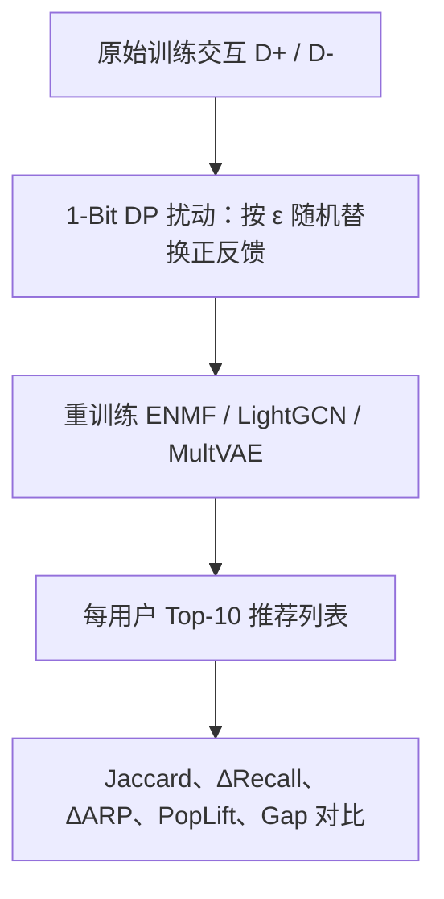

# The Impact of Differential Privacy on Recommendation Accuracy and Popularity Bias (差分隐私对推荐准确率与流行度偏差的影响)

- **会议/期刊**: ECIR 2024（IR4Good Track）
- **作者与机构**: Peter Müllner, Elisabeth Lex, Markus Schedl, Dominik Kowald；Know-Center GmbH、TU Graz、JKU Linz、LIT
- **推荐链路定位**: 训练数据隐私扰动 + Top-10 推荐列表评估
- **研究方向**: 去偏公平、可信隐私与工业架构
- **论文原文**: [论文原文链接](https://arxiv.org/abs/2401.03883v2)
- **开源代码**: [开源代码仓库链接](https://github.com/pmuellner/ImpactOfDP)

## TL;DR (1分钟核心速览)

本文不提出新推荐模型，而是系统实证 1-Bit 差分隐私（DP）训练数据扰动对 ENMF、LightGCN、MultVAE 的影响。在 MovieLens 1M、LastFM、Amazon Grocery 三数据集、每用户 60/20/20 留出与 Top-10 列表评估下，ε=0.1 时几乎所有用户推荐改变、Recall 至少下降 37.39%，ARP/PopLift 显著上升，且长尾偏好用户受损更重。

## Background & Motivation (背景与核心矛盾)

- **主流范式**: 协同过滤依赖大量行为数据，常以高斯/拉普拉斯输入扰动、1-Bit 机制等 DP 手段在训练数据层加噪，以缓解评分泄露与敏感属性推断风险。
- **前人局限**: 已有工作主要确认“隐私—准确率”权衡，但未回答两个问题：DP 到底影响哪些用户？除准确率外，DP 如何改变推荐列表的流行度分布与群体公平？
- **核心洞察 (Key Insight)**: 随机噪声对稀疏长尾正反馈的破坏远强于对热门物品的破坏，模型在证据被削弱后更倾向回退到流行物品，可能产生“穷者愈穷”的流行度偏差放大效应。
- **本文切入点**: 固定 1-Bit DP 机制，对三种代表性 CF 模型重训练，扫描多个 ε，并用 Jaccard、∆Recall、∆ARP、PopLift 与 Gap 同时量化用户级与群体级影响。

## Method (核心方法设计)

### 1. 整体框架 (Overall Architecture)

实验闭环为：原始隐式反馈按用户 60/20/20 划分；仅对训练集正反馈执行 1-Bit DP 随机替换；在扰动后数据上重训练 ENMF、LightGCN、MultVAE；对测试用户生成 Top-10 列表；最后对比无 DP 与有 DP 的推荐列表差异、准确率变化和流行度偏差。超参数先在无 DP 验证集上调优，再固定用于各 ε 条件，避免噪声与调参混淆。

### 2. 关键设计拆解 (Key Designs)

1. **1-Bit DP 输入扰动（核心隐私算子）**：痛点是对二值隐式反馈需自然匹配的 DP 机制。对正反馈以 $Pr[f_{u,i}\in D^+_{DP}]=\frac{e^\epsilon}{e^\epsilon+1}$保留，对负/缺失反馈以$\frac{1}{e^\epsilon+1}$ 注入正集；并为每个正样本随机采一个负样本以控制计算开销。ε 越小，正反馈被随机替换或混入假阳性的概率越高，长尾物品的稀疏证据越易被淹没。
2. **影响度量：列表差异 + 相对变化**：用 Jaccard 距离 $J(u)=1-\frac{|R(u)\cap R_{DP}(u)|}{|R(u)\cup R_{DP}(u)|}$判定用户是否受影响；以$\Delta\mu(u)=\frac{\mu_{DP}(u)-\mu(u)}{\mu(u)}$ 聚合 Recall、ARP、PopLift 的相对变化。该设计把“推荐是否变了”和“变好/变坏多少”解耦，便于定位 DP 的系统性影响。
3. **群体级流行度偏差审计**：ARP 衡量推荐列表平均物品流行度，$ARP(u)=\frac{1}{|R(u)|}\sum_{i\in R(u)}\phi(i)$；PopLift 将 ARP 与用户画像流行度$\Gamma(u)$对比，Gap 衡量$U_{low}$与$U_{high}$ 的 PopLift 绝对差。该审计直接检验 DP 是否对长尾偏好用户产生差异化伤害。

### 3. 训练目标、负采样与推理效率

本文不引入新损失，三种模型均沿用原训练目标：ENMF 使用负权重方案，LightGCN 使用 BPR 类损失并做 1:1 均匀负采样，MultVAE 使用多项似然重构目标。每个模型在 5 个随机种子下重训练并取均值；推理仍为 Top-10 排序。由于需对每个 ε 重训练一次，计算开销主要来自 ε 扫描与 5 次重复训练，而非在线推理。

## Experimental Setup & Evaluation Protocol (实验设置与评估协议)

- **数据集与预处理**:

| 数据集 | #Users | #Items | #Interactions | 稀疏度/密度 | 特征/场景说明 |
| :--- | :---: | :---: | :---: | :---: | :--- |
| MovieLens 1M | 6,038 | 3,533 | 575,281 | 2.70% | 电影评分，20-core 用户过滤，阈值 3.58 |
| LastFM User Groups | 2,999 | 78,799 | 348,437 | 0.15% | 音乐收听，20-core 用户过滤，阈值 1.13 |
| Amazon Grocery & Gourmet | 3,222 | 6,839 | 72,176 | 0.33% | 杂货零售，5-core 物品过滤，阈值 4.24 |

- **数据划分与防穿越 (Splitting Strategy)**: 每用户按 60%/20%/20% 划为训练/验证/测试；超参数仅在无 DP 验证集上调优，DP 只作用于训练集，测试集不注入噪声。
- **排名评测协议 (Ranking Protocol)**: 评估各用户 Top-10 推荐列表，使用 ranking-agnostic Recall、ARP、PopLift；原文未明确全库排序或采样候选池，仅说明 LightGCN 训练时 1:1 均匀负采样。
- **对比基线与超参设置**: 覆盖神经矩阵分解 ENMF、图卷积 LightGCN、变分自编码器 MultVAE；Embedding 维度 $d$ 为 32/64/128（按模型与数据集网格搜索），ε∈{5,4,3,2,1,0.1,0.01}，5 个随机种子平均；未报告显著性检验。

## Key Experimental Results (实验关键数据)

### 1. 主实验对比 (Main Results)

下表保留无 DP 基线指标，并给出 ε=0.1 时的受影响用户比例与平均 Jaccard 距离；加粗为各数据集无 DP 最优值。

| 数据集 | 模型 | Recall↑ | ARP↓ | PopLift↓ | ε=0.1 受影响用户 | ε=0.1 平均 Jaccard |
| :--- | :--- | :---: | :---: | :---: | :---: | :---: |
| MovieLens 1M | ENMF | **0.1697** | 0.2172 | 0.7084 | 100.00% | 0.8183 |
| MovieLens 1M | LightGCN | 0.1669 | **0.1958** | **0.5405** | 99.99% | 0.8300 |
| MovieLens 1M | MultVAE | 0.1694 | 0.1990 | 0.5657 | 100.00% | 0.8447 |
| LastFM | ENMF | **0.0971** | 0.0836 | 1.8816 | 100.00% | 0.8058 |
| LastFM | LightGCN | 0.0925 | 0.0800 | 1.7585 | 100.00% | 0.8490 |
| LastFM | MultVAE | 0.0835 | **0.0576** | **0.9864** | 100.00% | 0.9250 |
| Amazon Grocery | ENMF | **0.0932** | **0.0180** | **0.5143** | 100.00% | 0.9743 |
| Amazon Grocery | LightGCN | 0.0836 | 0.0259 | 1.1796 | 100.00% | 0.9360 |
| Amazon Grocery | MultVAE | 0.0643 | 0.0199 | 0.6734 | 100.00% | 0.9635 |

ε=0.1 时，跨全部模型的总体相对变化为：MovieLens 1M 的 ∆Recall 至少 −37.39%、∆ARP 至少 +19.75%、∆PopLift 至少 +36.16%；LastFM 分别为 −48.00%、+47.00%、+28.49%；Amazon 为 −57.10%、+132.85%、+128.38%。

### 2. 消融/敏感性实验 (Ablation Study)

本文无模型组件消融，核心敏感性因子是隐私预算 ε。下表汇总 ε 从 5 到 0.1 的跨模型、跨数据集范围。

| ε | 受影响用户比例 | 平均 Jaccard 范围 | 准确率趋势 | 流行度偏差趋势 |
| :---: | :---: | :---: | :--- | :--- |
| 5 | 97.40%–100.00% | 0.4207–0.9204 | Amazon 已开始下降，ML/LastFM 轻微波动 | 轻微上升 |
| 2 | 99.64%–100.00% | 0.5757–0.9447 | 普遍下降 | 上升 |
| 1 | 99.95%–100.00% | 0.6858–0.9567 | 明显下降 | 明显上升 |
| **0.1** | **99.99%–100.00%** | **0.8058–0.9743** | **ML/LastFM/Amazon 至少降 37.39/48.00/57.10%** | **ARP 升 19.75/47.00/132.85%，PopLift 升 36.16/28.49/128.38%** |

### 3. 关键实验发现 (Key Findings)

- **几乎全员受影响，而非少数用户**: ε=0.1 时各模型/数据集受影响用户均接近 100%，平均 Jaccard 达 0.8058–0.9743，意味着 Top-10 中超过一半物品与无 DP 推荐不同；ε=5 时也已有 97.40%–100% 用户被改变。
- **准确率—隐私权衡极陡，且小画像数据集更脆弱**: ε=0.1 时 Recall 在 MovieLens、LastFM、Amazon 至少下降 37.39%、48.00%、57.10%；Amazon 平均画像仅 22.40，ε=5 即出现下降，说明稀疏小画像对 DP 噪声更敏感。
- **流行度偏差被放大，并呈“穷者愈穷”**: ε=0.1 时 ARP 至少上升 19.75%–132.85%，PopLift 上升 28.49%–128.38%；以 MovieLens 的 ENMF 为例，$U_{low}$的 PopLift 从 1.0923 升至 1.5276，$U_{high}$ 仅从 0.4800 升至 0.6445，Gap 从 0.6124 扩至 0.8831，长尾偏好用户被更严重地推向热门物品。

## Highlights & Limitations (亮点、对比与审稿批判)

- **与代表作对比 (vs. Prior Work)**: 相较 Zhu 等“最小化噪声”与 Xin/Jaakkola“只保护部分用户”的准确率导向工作，本文不优化 DP 机制，而是首次系统拆解 DP 对“哪些用户变、准确率降多少、流行度偏差如何变”的三层影响；相较 Yang 等的公平后处理，本文进一步把 Popularity Bias 与用户群体差异纳入隐私审计。
- **可迁移亮点**: 可用 Jaccard 受影响比例刻画任意隐私扰动的“推荐列表改写率”；用 PopLift/Gap 做隐私机制上线前的群体公平回归测试，避免只盯平均 Recall。
- **审稿级局限批判**: 仅考察 1-Bit 输入扰动与 Top-10 离线评估，未覆盖 DP-SGD、本地 DP 或工业级全库排序；未报告显著性检验，且数据集与模型数量有限，ε 扫描下的重训练成本较高。

## Rating (四维评分)

- **方法创新性 (Novelty)**: ⭐⭐⭐ （核心贡献是系统性实证与群体级审计，而非新模型或新隐私算子，机制新颖度中等但问题重要。）
- **评估协议与实验扎实度 (Protocol & Experiments)**: ⭐⭐⭐⭐ （三数据集×三模型×七档 ε×五种种子较完整，但缺少显著性检验与全库排序协议说明。）
- **写作与数学规范度 (Clarity & Rigor)**: ⭐⭐⭐⭐ （指标定义、Jaccard 判定与相对变化公式清楚，隐私机制与实验流程可复现。）
- **工业落地与复现价值 (Industrial & Practical Value)**: ⭐⭐⭐ （开源代码利于复现，结论对隐私预算选择有直接参考价值，但重训练开销与离线 Top-10 设定限制线上直接部署。）

