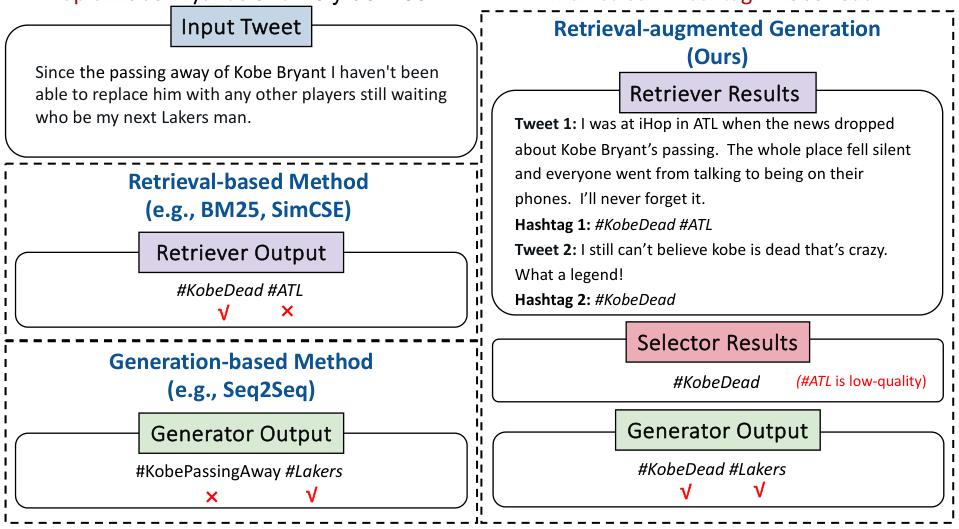
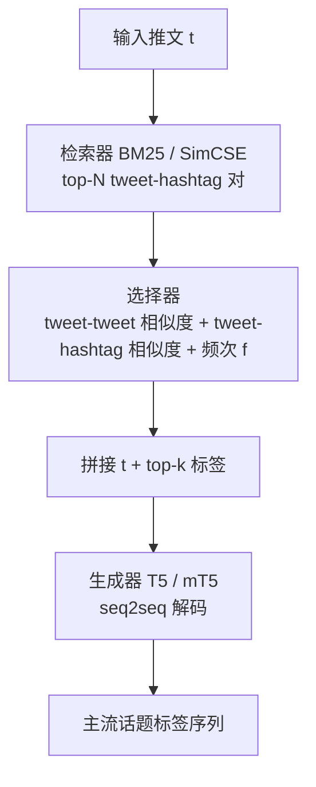
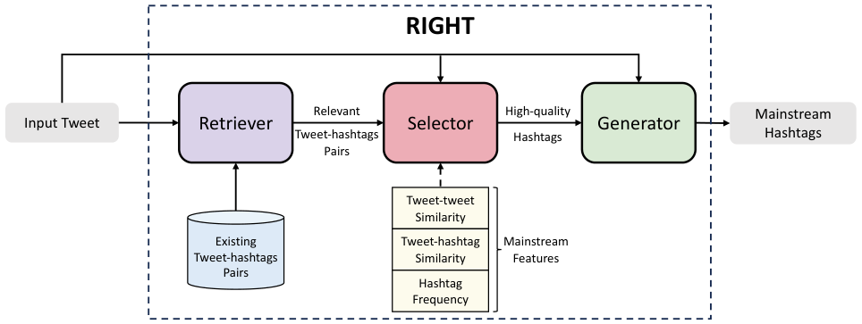

# RIGHT: Retrieval-augmented Generation for Mainstream Hashtag Recommendation (检索增强生成的主流话题标签推荐)

- **会议/期刊**: ECIR 2024 (Full Paper)
- **作者与机构**: Run-Ze Fan, Yixing Fan, Jiangui Chen, Jiafeng Guo, Ruqing Zhang, Xueqi Cheng（中科院计算所 CAS Key Lab of Network Data Science and Technology / UCAS）
- **推荐链路定位**: 端到端生成式（发布前的话题标签推荐）
- **研究方向**: 生成式推荐与离散语义 ID / 大语言模型推荐
- **论文原文**: [https://arxiv.org/abs/2312.10466v1](https://arxiv.org/abs/2312.10466v1)
- **开源代码**: [https://github.com/ict-bigdatalab/RIGHT](https://github.com/ict-bigdatalab/RIGHT)

## TL;DR (1分钟核心速览)

本文针对"主流话题标签推荐"这一任务的双重困境：新推文含新事件、语义难理解；而语义正确的标签未必是大众真正在用的**主流标签**（如 `#KobeDead` 优于同义的 `#KobeDeath`）。作者提出 RIGHT：用 BM25/SimCSE 从全量 tweet-hashtag 语料召回相关标签，用带全局信号（频次+双相似度）的选择器剔除低质标签，再由 T5/mT5 生成最终标签。在 THG/WHG 上 ROUGE-1 达 62.11/70.62、F1@1 提升 2.8%/10.8%，零样本注入 ChatGPT 后 F1@1 分别再涨 12.7%/18.3%，且 10-shot 检索语料即可替代昂贵的人工维护主流标签表。

## Background & Motivation (背景与核心矛盾)

- **主流范式**: 两条路线——(i) 检索式：从人工维护的"主流标签白名单"里检索，天然保证标签是主流的；(ii) 生成式：Seq2Seq（T5/mT5）直接生成，凭预训练知识理解新推文。
- **前人局限**: 检索式的白名单无法覆盖每日新增话题、维护成本极高，且对新事件语义理解弱（BM25 F1@1 仅 5.92/48.20）；生成式虽语义通顺，却**缺乏"什么是主流"的全局统计知识**——ChatGPT 在该任务上 F1@1 反而只有 9.72，低于微调 Seq2Seq 的 29.75。
- **核心洞察 (Key Insight)**: 把"人工精选小词表"换成"自动累积的大规模 tweet-hashtag 对语料"，可零成本更新主流信号；但社媒噪音会让召回的相似推文带上 `#ATL`、`#fx logix` 这类低质标签，直接喂给生成器会误导解码——因此需要一个**低成本的质量提升环节**，而非升级检索器。
- **本文切入点**: 在检索-生成之间插入一个轻量**选择器**，把"话题相关"过滤为"主流可用"，从而在保持检索零维护成本的同时获得白名单级的标签质量。

<figure class="paper-figure" markdown="span">
  <figcaption>图1. 使用不同方法评估话题标签推荐的示意图。</figcaption>
</figure>

## Method (核心方法设计)

### 1. 整体框架 (Overall Architecture)

输入推文 $t$先由检索器在训练集构成的语料$\mathcal{C}=\{(\tilde{t}_i,\tilde{H}_i)\}$上取 top-$N$（$N{=}10$）相似 tweet-hashtag 对及其分数；所有召回标签去重成候选集$\{\tilde{h}_1,\dots,\tilde{h}_M\}$，连同出现频次$f_m$与对应检索分一同送入选择器，按融合分排序取 top-$k$；最后把$k$ 个标签用特殊 token 与原文拼接成 `<t, SEP1, h1, SEP1, ...>` 输入 T5-base（英文）/mT5-small（中文），以 seq2seq 方式解码标签序列，按 `SEP2` 切分得到结果。三模块**分阶段独立训练**，不联合优化。

<figure class="paper-figure" markdown="span">
  <figcaption>图2. 我们的 RIGHT 框架由检索器、选择器和生成器组成。</figcaption>
</figure>

### 2. 关键设计拆解 (Key Designs)

1. **选择器：用"全局频次 + 双相似度"重排主流性 (Mainstream Re-ranking)**：痛点是检索分只反映话题相似，不反映标签是否被大众采纳。作者把 tweet-to-tweet 检索分按标签聚合平均，再叠加 tweet-to-hashtag 对比学习相似度，并用**降尺度频次**放大：

$$s_i=\Big(\tfrac{1}{f_i}\sum_{j=1}^{f_i}\tilde{s}_{i,j}+\ddot{s}_i\Big)\times\big(1+\tfrac{f_i-1}{10}\big)$$

其中 $\ddot{s}_i=S(t,\tilde{h}_i)$。频次项采用$1+\frac{f-1}{10}$而非直接乘$f$，是为了让频次起"温和加权"作用，避免高频垃圾标签（如泛化词）压过语义精准的低频主流标签。

2. **BERT 式扰动难负样本 + 对比学习训练选择器**：真正的难点是同一话题下"语义正确但非主流"的负例稀少。作者对标注标签做不改语义的扰动构造硬负例：同义替换 70%、删词 10%、与相邻词交换 10%、插入同义词 10%，得到 $(t_i,t_i^+,t_i^-)$ 三元组，最小化 InfoNCE：

$$\mathcal{L}_S=-\log\frac{e^{\mathrm{sim}(\mathbf{h}_{t_i},\mathbf{h}_{t_i^+})/\tau}}{\sum_{j=1}^{L}\big(e^{\mathrm{sim}(\mathbf{h}_{t_i},\mathbf{h}_{t_j^+})/\tau}+e^{\mathrm{sim}(\mathbf{h}_{t_i},\mathbf{h}_{t_j^-})/\tau}\big)}$$

$\tau{=}0.05$。这样选择器学到的是"标签表述形态是否主流"（如 `wvd` vs `windows virtual desktop`），而非仅话题匹配。

3. **生成器与训练目标**：生成器以交叉熵微调 $\mathcal{L}_G=\sum_{(I,O)\in\mathcal{D}}-\log p(O\mid I;\theta_G)$，输入序列$I$显式携带 top-$k$候选标签，使模型能"抄写并纠偏"——案例中 Seq2Seq 输出非主流的 `windows virtual desktop`，RIGHT 借助候选中的 `wvd` 成功替换。三模块均无额外负采样（生成器）或仅扰动负采样（选择器），推理时检索$N{=}10$ 条 + 一次 T5 前向，开销与基线 Seq2Seq 同量级。

## Experimental Setup & Evaluation Protocol (实验设置与评估协议)

- **数据集与预处理**: 均为官方媒体/大 V 账号爬取的高质量推文，**无 5-core 过滤**，按原论文给定的 train/val/test 划分；检索语料**只取训练集**（避免标签泄漏）。

| 数据集 | #Train / Val / Test (tweet-hashtag 对) | 平均标签数 | 平均推文长度 | 平均标签长度 | 语言/场景 |
| :--- | :---: | :---: | :---: | :---: | :--- |
| THG | 201,444 / 11,325 / 11,328 | 4.1 | 39.7 | 3.1 | 英文 Twitter，多标签 |
| WHG | 307,401 / 2,000 / 2,000 | 1.0 | 87.1 | 6.6 | 中文微博（人民日报等），单标签 |

- **数据划分与防穿越 (Splitting Strategy)**: 沿用 SEGTRM 的**固定比例划分**（非 Leave-One-Out、非时间戳切分）；检索语料 = 训练集，测试阶段不引入测试推文，属严格防穿越设定。
- **排名评测协议 (Ranking Protocol)**: 非全库排序任务，采用**生成式序列匹配评测**——ROUGE-1/2/L 衡量生成序列与参考序列重叠，F1@$K$按位置$K$ 的前缀集合精确率/召回率计算；仅报 F1@1、F1@5（WHG 因每条仅 1 个标签，F1@5≡F1@1）。
- **对比基线与超参设置**: 检索式 BM25/SimCSE（白名单 top-4 / top-1）；生成式 ChatGPT(gpt-3.5-turbo, zero-shot)、SEGTRM Soft、Seq2Seq(T5-base/mT5-small 复现)；检索器 $N{=}10$，选择器 RoBERTa-Large / Bert-Base-Chinese，$\tau{=}0.05$，生成器 batch 16、lr 网格$\{3e{-}4,1e{-}4,5e{-}5\}$、$k$网格$\{1,3,5,7,9\}$；$^\ast$表示相对所有基线$p<0.05$ 显著。

## Key Experimental Results (实验关键数据)

### 1. 主实验对比 (Main Results)

| 方法 | THG RG-1 | THG RG-2 | THG RG-L | THG F1@1 | THG F1@5 | WHG RG-1 | WHG RG-2 | WHG F1@1 |
| :--- | :---: | :---: | :---: | :---: | :---: | :---: | :---: | :---: |
| BM25 (检索式) | 16.23 | 4.17 | 15.11 | 5.92 | 9.84 | 61.98 | 58.76 | 48.20 |
| SimCSE (检索式) | 28.43 | 10.34 | 26.38 | 12.40 | 15.15 | 59.71 | 55.81 | 47.65 |
| ChatGPT (zero-shot) | 44.60 | 27.67 | 39.29 | 9.72 | 26.08 | 32.27 | 24.54 | 7.90 |
| SEGTRM Soft | 51.18 | 37.15 | 47.05 | 27.17 | 29.02 | 55.51 | 51.28 | 30.72 |
| Seq2Seq | 59.90 | 41.39 | 59.15 | 29.75 | 41.71 | 66.64 | 61.71 | 48.60 |
| RIGHT_ChatGPT | 47.54 | 25.63 | 44.47 | 22.39 | 31.09 | 48.17 | 41.51 | 26.15 |
| RIGHT_BM25 | 61.60 | 43.77 | 60.85 | 30.27 | 42.98 | **70.62** | **66.12** | **53.85** |
| RIGHT_SimCSE | **62.11** | **43.86** | **61.39** | **30.58** | **43.23** | 68.84 | 64.19 | 51.50 |
| **Improv.% (最优)** | **+3.69%** | **+5.97%** | **+3.79%** | **+2.79%** | **+3.64%** | **+5.97%** | **+7.14%** | **+10.80%** |

### 2. 消融实验 (Ablation Study)

THG 数据集（RIGHT_SimCSE 为完整模型）：

| 配置 | RG-1 | RG-2 | RG-L | F1@1 | F1@5 |
| :--- | :---: | :---: | :---: | :---: | :---: |
| RIGHT (完整) | **62.11** | **43.86** | **61.39** | **30.58** | **43.23** |
| w/o Retriever（随机拼 $k$ 个标签） | 59.91 | 41.63 | 59.23 | 29.66 | 41.70 |
| w/o Selector（直接取检索 top-$k$） | 60.49 | 42.06 | 59.76 | 30.22 | 41.95 |
| w/o Generator（直接输出选择器 top-4） | 36.24 | 16.02 | 32.86 | 24.61 | 26.73 |

### 3. 关键实验发现 (Key Findings)

1. **检索/生成范式与语言强相关**：英文标签是"摘要式短语"，稠密语义检索更优（SimCSE 12.40 > BM25 5.92 F1@1）；中文标签多是原文中直接截取的小句，稀疏词匹配反而更强（BM25 48.20 > SimCSE 47.65），且检索器本身的强弱**正比传导**到增强收益（RIGHT_BM25 在 WHG 达 53.85，RIGHT_SimCSE 仅 51.50）。
2. **"主流性"是独立于"语义正确性"的信息维度**：去掉选择器后 RG-1 掉 1.62、F1@5 掉 1.28，而随机替换召回（w/o Retriever）掉 2.20，说明同话题标签"有用但不够用"；更强的证据是 ChatGPT 的 F1@1 从 9.72 → 22.39（+12.67%）、WHG 从 7.90 → 26.15（+18.25%），即**大模型缺的不是语义能力而是主流分布知识**，检索增强可零训练补齐。
3. **生成器不可替代，但检索增强使生成器对召回噪声更鲁棒**：去掉生成器（退化为纯检索选择）RG-1 崩塌至 36.24（−25.87）；而 $k$从 1 增至 7 时 ROUGE-1 持续上升（THG 60.7→62.1）后在$k{=}7$ 收敛，说明多注入候选提高了覆盖主流标签的概率，且生成器能主动忽略 `#fx logix`、`#azure` 等主题漂移噪声。

## Highlights & Limitations (亮点、对比与审稿批判)

- **与代表作对比 (vs. Prior Work)**: 相比白名单式检索方法（BM25/SimCSE on predefined list），本文以"训练集即语料"免除人工维护且支持新话题；相比 Seq2Seq / SEGTRM Soft 等纯生成方法，多出的选择器显式注入全局频次信号，把"语义对但没人用"的失败模式针对性修掉；相比通用 RAG（如 keyphrase generation 的检索增强），本文的关键增量是认识到检索结果本身需要**质量再排序**，而非直接拼接。
- **可迁移亮点**: (i) "降尺度频次" $1+\frac{f-1}{10}$ 作为软先验的写法，可迁移到冷启动标签/语义 ID 的候选重排；(ii) BERT 式扰动构造同话题硬负例，几乎是零成本为"主流 vs 非主流"这类**风格/流行度判别**造监督信号，可复用到 query 改写、标题生成。
- **审稿级局限批判**: (i) 三模块分阶段训练、误差逐级传递，选择器把正确标签排到末尾即导致生成器不采纳（作者自述 <1% 案例），缺乏端到端/co-training；(ii) 评测仅 ROUGE 与 F1@K，与真实线上指标（检索召回率、曝光点击）无关联，且 WHG 仅 2,000 条测试样本、单标签设定使 F1@5 信息量为零；(iii) 检索器选择需按语言人工试错（BM25 vs SimCSE），$k$与$N$ 也需网格搜索，跨语言鲁棒性证据不足。

## Rating (四维评分)

- **方法创新性 (Novelty)**: ⭐⭐⭐⭐ （把 RAG 迁移到主流标签推荐，并以频次软先验 + 扰动硬负例补齐"主流性"这一被忽视维度，思路清晰但模块本身较常规）
- **评估协议与实验扎实度 (Protocol & Experiments)**: ⭐⭐⭐ （双语言双数据集 + 检索/生成/RAG 三类基线齐全、含显著性检验与 $k$ 敏感性，但测试集规模小、仅词面重叠指标、无人工或线上评估）
- **写作与数学规范度 (Clarity & Rigor)**: ⭐⭐⭐⭐ （框架与公式表述干净，选择器打分式与损失定义明确；对分阶段训练与超参搜索空间交代充分，但频次缩放系数的选择缺乏理论或敏感性论证）
- **工业落地与复现价值 (Industrial & Practical Value)**: ⭐⭐⭐⭐⭐ （代码已开源，全流程零人工词表维护，可直接套壳 ChatGPT 得到 10%+ 增益，推理仅一次 T5 前向，工程落地成本极低）

