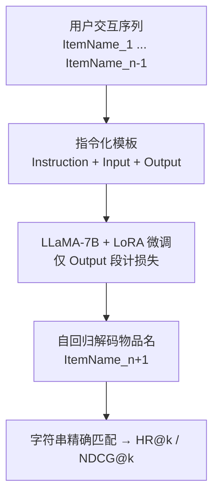

# GenRec: Large Language Model for Generative Recommendation (基于大语言模型的生成式推荐)

- **会议/期刊**: ECIR 2024
- **作者与机构**: Jianchao Ji, Zelong Li, Shuyuan Xu, Wenyue Hua, Yingqiang Ge, Juntao Tan, Yongfeng Zhang（Rutgers University, WINLab/DSL 实验室）
- **推荐链路定位**: 端到端生成式（Generative Retrieval，单阶段产出物品名）
- **研究方向**: 大语言模型推荐 (LLM4Rec) / 生成式推荐与语义 ID
- **论文原文**: [https://arxiv.org/abs/2307.00457v2](https://arxiv.org/abs/2307.00457v2)
- **开源代码**: [https://github.com/rutgerswiselab/GenRec](https://github.com/rutgerswiselab/GenRec)

## TL;DR (1分钟核心速览)

针对判别式推荐「必须对每个候选物品逐一打分再排序」带来的推理开销与索引依赖问题，GenRec 把推荐重写为**文本到文本的序列生成任务**：将用户历史交互的物品名（含年份）拼接为 `Instruction + Input -> Output` 的指令序列，用 LoRA 微调 LLaMA-7B，自回归地直接“说出”下一个物品名。在 MovieLens-25M 的 Leave-One-Out 协议下，HR@5 由 P5 的 0.0688 提升至 0.1034（+50.3%），NDCG@10 提升 +45.1%；但在稀疏的 Amazon-Toys 上四项指标全面落后 P5 约 6%–39%，暴露出该范式对交互密度的强依赖。

## Background & Motivation (背景与核心矛盾)

- **主流范式**: 以矩阵分解、NeuMF 为代表的协同过滤用 user/item 索引学习隐向量，再对候选池逐一点积打分排序；P5 则用 T5 把多任务统一为 prompt-to-text，是当时 LLM4Rec 的代表作。
- **前人局限**: ① 索引式建模丢弃了物品标题、类别等文本语义，冷启动与长尾物品近乎无表征；② 判别式打分需要在 $|\mathcal{I}|$ 上做全库内积/前向，候选池越大开销越线性增长；P5 虽引入文本，但基于中小规模 T5，未验证大模型在纯生成式推荐上的上限。
- **核心洞察 (Key Insight)**: 物品名本身携带可语义分析的描述信息，若把「物品」当作词表中的一个“词”，推荐就退化为一个条件语言建模问题——模型生成的字符串即推荐结果，天然绕开候选枚举。
- **本文切入点**: 用 LLaMA-7B + LoRA 在交互语料上做指令微调，把生成目标从“打分”换成“物品名字符串”，并用参数高效微调把成本压到单卡 24GB。

## Method (核心方法设计)

### 1. 整体框架 (Overall Architecture)

对每个用户按时间排序的交互序列，取前 $n-1$个物品名（`title (year)`）作为历史、第$n$个作为监督目标，组装成三段式模板：Instruction 描述任务（如“基于观影习惯，最可能看的下一个电影是什么？”）、Input 为历史列表、Output 为目标物品名。整条序列送入 LLaMA-7B，仅对 Output 段计算自回归交叉熵，LoRA 适配器承载全部梯度更新。推理时给定 Instruction+Input，模型逐 token 解码出物品名，输出字符串与真实名精确匹配即视为命中，多候选则据生成概率（beam/log-prob）排序截断 top-$k$。

### 2. 关键设计拆解 (Key Designs)

1. **物品名即“语义 ID”（Semantic Name as Token Space）**：痛点在于索引 ID 无语义、判别式需枚举候选。GenRec 直接把目标写成物品名字符串 $y=(y_1,\dots,y_{|y|})$，用条件概率建模：
$\mathcal{L}(\theta)=-\sum_{t=1}^{|y|}\log p_{\theta}\!\left(y_t \mid y_{<t},\, \text{Instr},\,\text{Input}\right)$
直觉：物品名中的实词（类型、题材、年份）与用户历史共享语义空间，模型可借预训练语料的常识做“语义近邻”式泛化，且推理成本与词表大小解耦。

2. **指令化序列模板（Instruction–Input–Output）**：针对通用 LLM 不懂“推荐任务”这一格式鸿沟，作者设计了多条任务指令并统一为三元组，使同一模型可通过换 Instruction 迁移到不同推荐子任务（评分预测、解释生成等）。与 P5 的多模板不同，这里不做任务集合的联合训练，只保留 next-item 单目标，从而把全部容量集中在序列信号上，也是其在大数据集上更强的直接原因。

3. **训练目标、负采样与推理效率**：总损失即上述 token 级交叉熵，**完全不使用负采样**（生成式范式无需构造负例，是其相对 BPR/InfoNCE 类方法的结构性优势）。采用 LLaMA-LoRA：$W = W_0 + \Delta W = W_0 + \tfrac{\alpha}{r}BA$，其中$B\in\mathbb{R}^{d\times r}$、$A\in\mathbb{R}^{r\times k}$、$r\ll d$，仅训练$A,B$，使 7B 模型可在单张 24GB GPU 上微调；batch size 128、峰值学习率$3\times10^{-4}$、最大输入 256 token、预热 1000 步、训练 5 epoch。

## Experimental Setup & Evaluation Protocol (实验设置与评估协议)

- **数据集与预处理**:

| 数据集 | #Users | #Items | #Interactions | 稀疏度/密度 | 特征/场景说明 |
| :--- | :---: | :---: | :---: | :---: | :--- |
| MovieLens 25M | 162,541 | 62,423 | 25,000,095 | 密度 ≈ 2.5e-3 | 电影评分，物品以 `title (year)` 文本表示 |
| Amazon Toys | 19,412 | 11,924 | 2,252,771 | 密度 ≈ 9.7e-3 | 玩具购买序列，长尾显著、序列更短 |

  原文未报告 `5-core` 等显式过滤阈值，仅说明取用户交互序列的文本化物品名。

- **数据划分与防穿越 (Splitting Strategy)**: **Leave-One-Out**——每个用户序列最后一个物品为测试、倒数第二个为验证、其余为训练；严格按时间序，无未来信息泄漏。
- **排名评测协议 (Ranking Protocol)**: 采用 HR@k / NDCG@k（$k=5,10$），本质是**生成式候选 + 字符串精确匹配**的 top-$k$命中评估；原文**未明确声明是 Full-Ranking 还是 Sampled Ranking**，也未说明 top-$k$ 候选由 beam search 还是多次采样产生——这是本文评测部分最明显的协议缺口。
- **对比基线与超参设置**: 仅一个基线 P5（T5 骨干、多任务统一 prompt）。骨干为 LLaMA-7B + LoRA，4×NVIDIA RTX A5000，AdamW 优化器；未报告嵌入维度、显著性检验与随机种子方差。

## Key Experimental Results (实验关键数据)

### 1. 主实验对比 (Main Results)

| 数据集 | 方法 | HR@5 | NDCG@5 | HR@10 | NDCG@10 |
| :--- | :--- | :---: | :---: | :---: | :---: |
| MovieLens 25M | P5 | 0.0688 | 0.0464 | 0.1040 | 0.0577 |
| MovieLens 25M | **GenRec** | **0.1034** | **0.0716** | **0.1311** | **0.0837** |
| MovieLens 25M | Improv. | +50.3% | +54.3% | +26.1% | +45.1% |
| Amazon Toys | **P5** | **0.0239** | **0.0145** | **0.0411** | **0.0201** |
| Amazon Toys | GenRec | 0.0190 | 0.0136 | 0.0251 | 0.0157 |
| Amazon Toys | Improv. | −20.5% | −6.2% | −38.9% | −21.9% |

### 2. 消融实验 (Ablation Study)

原文**未设置任何组件级消融**（无 `w/o Instruction`、`w/o LoRA`、骨干替换、历史长度敏感性分析）。唯一可用的对照结构是“数据集 × 范式”二维比较，故将其整理为替代性对照表：

| 对照维度 | 配置 A | 配置 B | 结果差异 |
| :--- | :--- | :--- | :--- |
| 建模范式 | P5 多任务 prompt（T5） | GenRec 单任务生成（LLaMA-7B+LoRA） | 大数据集 +26%~+54%；小数据集 −6%~−39% |
| 参数量级 | ≈0.22B（T5-base 级） | 7B（LoRA 仅训低秩增量） | 参数量 30×，但小数据上未转化为收益 |
| 监督信号 | 多任务联合（含解释、评分） | 仅 next-item 序列 | 单一目标在稠密数据上更聚焦 |
| 微调成本 | 全参微调 | LoRA，单卡 24GB 可训练 | 训练门槛显著降低 |

### 3. 关键实验发现 (Key Findings)

1. **收益完全由交互密度决定，而非模型规模**：ML-25M（25M 交互）上全指标大幅领先；Toys（2.25M 交互）上四项全跌，说明生成式范式需要海量序列监督才能让 7B 模型学到“物品名→偏好”的映射，否则反被 P5 的多任务正则化压过。参数量增长 30 倍并未带来稀疏场景的鲁棒性。
2. **增益集中在头部排序而非候选覆盖**：HR@5 提升 +50.3% 明显高于 HR@10 的 +26.1%，若收益来自“召回更多候选”则 @10 增幅应不低于 @5；实际分布表明 GenRec 主要改善了 top-5 的**排序精度**（NDCG@5 同步 +54.3%），与“语义化物品名提供更细粒度相关性信号”的假设一致。
3. **生成式范式的成本优势是结构性的但未量化**：模型完全免负采样、免候选枚举，理论上推理复杂度与 $|\mathcal{I}|$ 解耦；然而原文既未测单次生成延迟，也未测 beam 宽度对 HR@k 的影响，无法验证其相对 P5 全库打分的实际加速比。

## Highlights & Limitations (亮点、对比与审稿批判)

- **与代表作对比 (vs. Prior Work)**: 相较 **P5**（T5 多任务统一 prompt，判别式/生成式混合），GenRec 放弃多任务而专注 next-item 单目标，并用 LLaMA-7B 替换 T5-base，把“生成”推到端到端；相较同期 **TIGER**（RQ-VAE 量化语义 ID + 自回归）一类工作，GenRec 的优势是无需训练码本、物品名零成本可得，劣势是输出字符串未受限于合法物品集合，存在幻觉物品与格式漂移，且无法像语义 ID 那样做前缀树约束解码。
- **可迁移亮点**: ① 以“自然语言物品名 + 精确匹配”作为零工程量的物品标识，可直接迁移到缺少 ID 体系的内容型推荐；② LoRA 让 7B 级骨干在单卡 24GB 上可训，为学界低成本复现 LLM4Rec 提供了实用配置基线。
- **审稿级局限批判**: ① **评测协议不透明**——未声明 Full-Ranking 还是 Sampled Ranking，也未说明如何得到 top-$k$ 序列，HR@k 的可比性与可复现性存疑；② **实验证据薄弱**——仅 1 个基线、2 个数据集、无消融、无显著性检验、无延迟/显存开销测量，且首次发布于 2023 年 7 月（arXiv v2），与 ECIR 2024 同期工作相比基线已明显过时；③ 论文以“缓解冷启动与稀疏”为动机，却未做任何冷启动或长尾分桶实验，动机与验证脱节。

## Rating (四维评分)

- **方法创新性 (Novelty)**: ⭐⭐⭐ （把物品名当语义词表、用 LoRA 做端到端生成式推荐的思路直观且时机领先，但本质是 P5 范式的骨干替换与任务简化，缺少机制层面的新算子或理论支撑）
- **评估协议与实验扎实度 (Protocol & Experiments)**: ⭐⭐ （仅 1 个基线、2 个数据集、零消融、未声明 Full/Sampled 排序协议，且未做显著性检验，稀疏数据上性能反降也未深入归因）
- **写作与数学规范度 (Clarity & Rigor)**: ⭐⭐ （框架描述清晰但公式化程度极低，除交叉熵损失外无形式化定义，缺少复杂度与训练开销分析，评测细节缺失）
- **工业落地与复现价值 (Industrial & Practical Value)**: ⭐⭐⭐⭐ （代码开源、LoRA 单卡可训，为 LLM 生成式推荐提供了低成本可跑的 reference implementation，工程参考价值明显高于其学术增量）

