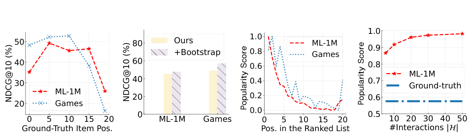
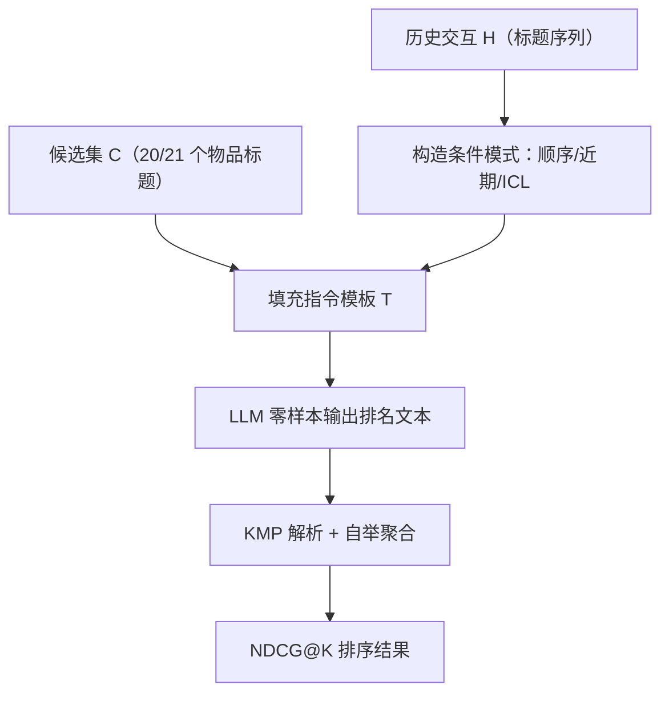
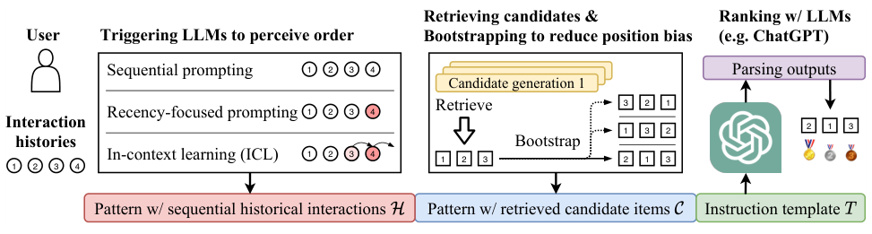

# Large Language Models are Zero-Shot Rankers for Recommender Systems (大语言模型作为推荐系统零样本排序器)

- **会议/期刊**: ECIR 2024
- **作者与机构**: Yupeng Hou, Junjie Zhang, Zihan Lin, Hongyu Lu, Ruobing Xie, Julian McAuley, Wayne Xin Zhao；中国人民大学、UC San Diego、腾讯微信
- **推荐链路定位**: 精排/候选重排
- **研究方向**: LLM推荐 / 列表级重排
- **论文原文**: [论文原文链接](https://arxiv.org/abs/2305.08845v2)
- **开源代码**: [开源代码仓库链接](https://github.com/RUCAIBox/LLMRank)

## TL;DR (1分钟核心速览)

本文把推荐重排形式化为“历史交互作条件、候选物品作选项”的零样本条件排序任务，系统诊断 LLM 的顺序感知弱、位置偏差与流行度偏差，并提出 recency-focused/ICL 提示与自举去偏。在 ML-1M、Games 的 20 候选采样排序（NDCG@K）上，最佳 zero-shot 结果较 UniSRec 的 N@10 提升 65.9%/31.4%。

## Background & Motivation (背景与核心矛盾)

- **主流范式**: 工业推荐采用召回+排序流水线，排序多由 BPRMF、SASRec 等全库训练的“窄专家”完成。
- **前人局限**: PLM/跨域迁移方法仍需任务数据微调；早期 LLM4Rec 多展示可行性，未回答哪些因素决定 zero-shot 排序能力，且忽略候选顺序与流行度偏差。
- **核心洞察 (Key Insight)**: LLM 能借世界知识排序，但对历史交互顺序不敏感，并受候选位置、物品流行度影响；聚焦近期交互与打乱自举可缓解。
- **本文切入点**: 用可控 prompt 解耦“历史条件 $H$”与“候选集$C$”，以控制变量实验刻画 LLM 零样本排序的边界。

<figure class="paper-figure" markdown="span">
  <figcaption>图3：LLMs排序中的偏差与去偏方法。(a) 提示中候选的位置会影响排序结果。(b) 自举法缓解位置偏差。(c) LLMs倾向于推荐热门物品。(d) 关注历史交互可降低流行度偏差。</figcaption>
</figure>

## Method (核心方法设计)

### 1. 整体框架 (Overall Architecture)

给定用户按时间排序的历史 $H=\{i_1,\ldots,i_n\}$与候选集$C=\{c_j\}_{j=1}^{m}$（默认$m=20$），将物品标题填入统一指令模板$T$，令 LLM 输出自然语言排序，再用 KMP/子串匹配解析为$\hat{\pi}=\mathrm{Parse}(\mathrm{LLM}(T(H,C)))$。框架不训练排序参数，只通过历史构造、候选排列与输出聚合完成 zero-shot 重排；推理时可对同一候选集打乱$B$ 次并融合，降低位置偏差。

<figure class="paper-figure" markdown="span">
  <figcaption>图1：所提出的基于LLM的零样本排序方法概览。</figcaption>
</figure>

### 2. 关键设计拆解 (Key Designs)

1. **条件排序 + 三类历史提示**：痛点在于 LLM 把历史当“无序集合”。顺序提示按时间编号；recency-focused 额外强调最近一次交互；ICL 用序列前缀-后继构造示例 $D=\{(H_{<k},i_k)\}_{k=1}^{n-1}$，避免引入其他用户噪声。直觉是显式触发“时间箭头”，让近期行为主导排序。
2. **自举去位置偏差**：候选在 prompt 中的位置会显著影响结果。对候选随机打乱 $B$次，按 Borda 式聚合：$\hat{\pi}=\operatorname{argsort}_{c\in C}\sum_{b=1}^{B}(m-\mathrm{rank}^{(b)}(c)+1)$。每个物品获得多位置暴露，抵消“末位候选被压低”的偏差。
3. **训练目标、负采样与推理效率**：LLM 侧无训练损失、无负采样，纯 zero-shot；候选负例由随机采样或 BM25/BERT/Pop/BPRMF/GRU4Rec/SASRec 等生成器构造。推理成本为每用户 $B$次 LLM 调用，论文默认$B=3$，适合小候选池重排而非全库召回。

## Experimental Setup & Evaluation Protocol (实验设置与评估协议)

**表1：数据集统计（5-core 过滤，按时间戳排序）**

| 数据集 | #Users | #Items | #Interactions | 稀疏度 | 特征/场景说明 |
| :--- | :---: | :---: | :---: | :---: | :--- |
| ML-1M | 6,040 | 3,706 | 1,000,209 | 95.53% | 电影评分，平均历史 46.19，标题均长 16.96 token |
| Games | 50,547 | 16,859 | 389,718 | 99.95% | Amazon 游戏评论，平均历史 7.02，标题均长 43.31 token |

- **数据划分与防穿越**: `Leave-One-Out`；每用户最后一条为测试正例、倒数第二条为验证集；历史按时间升序构造并截断至 50。
- **排名评测协议**: `Sampled Ranking`，非全库 Full-Ranking。默认 1 个真值 + 19 个随机负例；另设 BM25/BERT/Pop/BPRMF/GRU4Rec/SASRec 硬负例；多生成器场景取 7 个生成器各 top-3 合并为 21 候选，真值不保证在集合中。
- **对比基线与超参**: 全库训练 Pop/BPRMF/SASRec；zero-shot BM25/UniSRec/VQ-Rec；LLM 含 Alpaca-7B、Vicuna-13B、LLaMA-2-70B-Chat、GPT-3.5、GPT-4。主 LLM 为 `gpt-3.5-turbo`，温度 0.2，结果至少重复 3 次；表3预算受限，每模型仅评 200 用户 1 次。

## Key Experimental Results (实验关键数据)

### 1. 主实验对比 (Main Results)

**表2：随机候选集上的排序性能（NDCG@K，%）**

| 方法 | 类型 | ML-1M N@10 | ML-1M N@20 | Games N@10 | Games N@20 |
| :--- | :---: | :---: | :---: | :---: | :---: |
| Pop | full | 52.33 | 55.36 | 52.96 | 57.45 |
| BPRMF | full | 64.29 | 65.39 | 66.27 | 68.94 |
| SASRec | full | 78.89 | 79.79 | 75.92 | 77.14 |
| BM25 | zero-shot | 17.88 | 33.19 | 34.61 | 44.35 |
| UniSRec | zero-shot | 26.67 | 37.93 | 40.71 | 48.42 |
| VQ-Rec | zero-shot | 23.74 | 35.85 | 26.21 | 37.62 |
| **Ours (Recency)** | zero-shot | **44.23** | **50.01** | **53.50** | **59.01** |

粗体为最佳 zero-shot；SASRec 为全库训练上界参照。相对最佳 zero-shot UniSRec，Ours 的 N@10 提升 ML-1M **+65.9%**、Games **+31.4%**；N@20 提升 **+31.8%/+21.9%**。LLM 规模效应明显：Games N@10 上 GPT-4 62.88 > ChatGPT 50.31 > LLaMA-2-70B 37.83 > Vicuna 24.30 > Alpaca 21.67。

### 2. 消融实验 (Ablation Study)

**表3：历史提示策略控制实验（NDCG@K，%）**

| 提示策略 | ML-1M N@1 | ML-1M N@10 | Games N@1 | Games N@10 |
| :--- | :---: | :---: | :---: | :---: |
| Sequential | 18.28 | 42.85 | 30.28 | 50.57 |
| Recency-focused | 19.57 | 44.23 | **34.03** | **53.50** |
| ICL | **21.77** | **45.83** | 33.95 | 53.10 |

自举 $B=3$ 在图3(b)中对两数据集均提升；原文未给精确表值，故不列入。Random Order 与 Fake History 控制显示：打乱历史顺序与顺序提示接近，而伪造历史显著下降，说明 LLM 用了历史内容但弱感知顺序。

### 3. 关键实验发现 (Key Findings)

1. **顺序感知是瓶颈，历史不是越多越好**：`|H|` 从 5 增至 50 反而降分；Recency 相对 Sequential 在 ML-1M/Games N@10 提升 **3.2%/5.8%**，ICL 在 ML-1M N@10 提升 **7.0%**。
2. **Zero-shot 强于迁移基线、弱于全量训练**：Ours 44.23/53.50 的 N@10 远超 UniSRec 26.67/40.71（**+65.9%/+31.4%**），但 SASRec 78.89/75.92 仍显著领先，说明 LLM 可作冷启动重排补强而非替代监督模型。
3. **多生成器硬候选揭示综合信号**：表4 中 Ours N@10 为 6.91/2.80，第二优，超 Pop 的 4.13/2.27 与 BPRMF 的 4.41/2.96，但低于 SASRec 的 10.45/4.02；说明 LLM 同时利用流行度、文本与行为，非依赖单一召回源。

## Highlights & Limitations (亮点、对比与审稿批判)

- **与代表作对比 (vs. Prior Work)**: 与 SASRec/BPRMF 的全库监督不同，本文不训练排序器；与 UniSRec/VQ-Rec 的跨域迁移不同，直接调用 LLM 内在知识；与早期 LLM4Rec 可行性展示不同，本文控制变量诊断顺序/位置/流行度三类偏差。
- **可迁移亮点**: recency-focused 提示（少而近的历史更有效）与 B 次打乱自举聚合，可直接用于任何 LLM listwise reranker；KMP 解析也便于工程落地。
- **审稿级局限批判**: ChatGPT 闭源且 API 成本高，$B$ 次调用带来延迟；候选池仅 20/21、仅用标题文本，且隐式正例缺少人工核验；结论对 prompt 与数据集较敏感。

## Rating (四维评分)

- **方法创新性 (Novelty)**: ⭐⭐⭐⭐ （不是新架构，但把 LLM 排序拆成可控条件/候选并系统诊断三类偏差，实证洞察扎实。）
- **评估协议与实验扎实度 (Protocol & Experiments)**: ⭐⭐⭐⭐ （两数据集、leave-one-out、随机/硬负例/多生成器三种候选协议，重复≥3次；但非全库 Full-Ranking，候选池偏小。）
- **写作与数学规范度 (Clarity & Rigor)**: ⭐⭐⭐⭐ （条件排序形式化清晰，公式少而够用；理论分析偏弱，主要是实证。）
- **工业落地与复现价值 (Industrial & Practical Value)**: ⭐⭐⭐ （开源代码与提示可复用，但闭源 GPT-3.5 API 成本、B 次调用延迟和 20 候选限制制约线上部署。）

