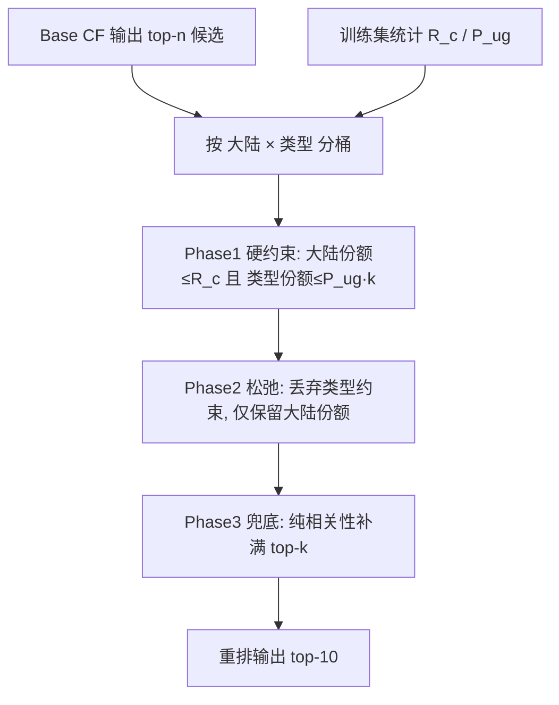

# MOReGIn: Multi-Objective Recommendation at the Global and Individual Levels (全局与个体层面的多目标推荐)

- **会议/期刊**: ECIR 2024
- **作者与机构**: Elizabeth Gómez、Maria Salamó（Universitat de Barcelona）；David Contreras（Universidad Arturo Prat）；Ludovico Boratto（University of Cagliari）
- **推荐链路定位**: 重排（后处理重排）
- **研究方向**: 多任务学习与列表级重排 / 去偏公平
- **论文原文**: [https://arxiv.org/abs/2401.12593v1](https://arxiv.org/abs/2401.12593v1)
- **开源代码**: 暂未开源（数据已公开于 https://tinyurl.com/yc6nnx5v）

## TL;DR (1分钟核心速览)

现有 MORS 要么只做全局目标（如提供者公平），要么只做个体目标（如类型校准），二者共存时无法同时满足。本文提出 MOReGIn：按「类型 × 大陆」将候选商品分桶，每个桶同时携带全局组表示 $R_c$与个体类型倾向$P_{ug}$，再以三阶段松弛约束重排 top-$k$。在 Movies/Songs 双数据集、5 个 CF 模型上，ΔTotal 全部精确降为 0.0000，ΔGenre 较最优基线低约一个量级，NDCG 在 SVDpp、NeuMF 上反而提升。

## Background & Motivation (背景与核心矛盾)

- **主流范式**: 多目标推荐（MORS）分两支——全局层追求系统整体属性（如各大洲提供者在推荐列表中曝光份额均衡），个体层追求每个用户的推荐列表属性（如推荐类型分布对齐用户历史偏好）。
- **前人局限**: 全局代表 PF 类方法只调节提供者组份额，完全不约束用户级类型分布；个体代表 CL（贪心校准 $\lambda=0.99$）只拉近类型分布，对提供者组毫无约束。二者共享候选列表时**约束互相挤占**，另一方目标必然退化。
- **核心洞察 (Key Insight)**: 用户对不同类型商品的偏好本身与生产地强相关（图 1：喜剧偏好欧洲片、动作偏北美片、电子舞曲偏欧洲、重金属偏北美）。因此「大陆」与「类型」是天然可绑定的二维属性，两个目标可以放进同一组桶里协同调节。
- **本文切入点**: 将全局目标（大陆份额）与个体目标（用户类型倾向）编码为同一个桶的两个维度，用分桶重排一次性满足，而无需分别调用两套算法。

## Method (核心方法设计)

### 1. 整体框架 (Overall Architecture)

MOReGIn 是纯后处理管线：Base CF 模型（ItemKNN/UserKNN/BPRMF/SVDpp/NeuMF）对每个用户生成 top-$n=1000$候选；同时从训练集算出两类统计量$R_c$（大陆组代表度，全局）和$P_{ug}$（用户类型倾向，个体）；把每条候选按「末身大陆 × 类型」写入$|C|\times|G|$个桶（同一条目可能被写入多个桶，但最终只推荐一次）；最后执行三阶段松弛重排选出 top-$k=10$。

### 2. 关键设计拆解 (Key Designs)

1. **联合目标分桶 (Joint Bucketing)**：解决「两目标互相挤占」。对任一候选条目 $i$，遍历其所属大陆集$C_i$与类型集$G_i$，投放到对应的$(c,g)$桶；桶条目按$(R_c \uparrow, P_{ug} \uparrow, \hat{r}_{ui} \downarrow)$ 三级排序——先关照数据中代表度低的大陆，再关照用户不常消费的类型，最后按相关性降序。物理直觉：**代表性越弱的目标越先填**，避免高频组在排位赛前就把预算花光。
2. **三阶段松弛重排 (3-Phase Relaxation)**：解决「同时满足两个目标可能无解」。
   - Phase 1：近似硬约束，大陆 $c$的份额$\le R_c$，且用户$u$对类型$g$的份额$\le P_{ug}\cdot k$；
   - Phase 2：丢掉类型约束，仅保留 $c$ 份额约束，防止全局公平被后面的填充破坏；
   - Phase 3：约束全放开，纯按 $\hat{r}_{ui}$补满$k$ 位。
   这种做法把「必须满足的目标」优先放在 Phase 1，把「锦上添花」的放在后续，本质上是**约束的优先级分层**，可行域始终非空。
3. **训练目标、负采样与推理效率**：MOReGIn 自身无可训练参数，也无负采样。代价仅在推理：每个用户读取 1000 条候选分桶再三段填充，额外开销约 $O(n\cdot |C_i|\cdot|G_i|)$，对单机排序可忽略；但依赖 Base 模型先产出大列表，因此**不能替代候选生成阶段的优化**。

## Experimental Setup & Evaluation Protocol (实验设置与评估协议)

- **数据集与预处理**:

| 数据集 | #Users | #Items | #Interactions | 稀疏度 | 特征/场景说明 |
| :--- | :---: | :---: | :---: | :---: | :--- |
| Movies（ML-1M 扩展） | 6,040 | 3,600 | 1,000,209 | 99.995% | 18 类型；通过 IMDB ID 调 OMDB API 补全制作大洲 |
| Songs（BeyondSongs） | 30,759 | 16,380 | 1,777,981 | 99.65% | 14 音乐类型；大洲取自艺人来源地 |

- **数据划分与防穿越**: 时间戳切分，每个用户按时间 80% 训练 / 20% 测试（后 20% 为测试集）。
- **排名评测协议**: 非传统 Full-Ranking。对每用户先生成 top-$n=1000$推荐，再重排到 top-$k=10$；指标为$\Delta_{\text{Total}}=\sum_c \Delta V_c$（全局公平，越接近 0 越好）、$\Delta_{\text{Genre}}=\sum_g\sum_u \Delta M_{ug}$（个体校准，越低越好）、NDCG（准确性，越高越好）。
- **对比基线与超参**: 5 个 CF 后端（ItemKNN/UserKNN：K=50，余弦；BPRMF/SVDpp/NeuMF：10 epochs、10 因子，NeuMF Movies 12 因子，MLP=10，lr=0.0025，均经网格搜索）；对比方法 OR（原始推荐）、CL（贪心校准 $\lambda=0.99$）、PF（提供者公平）。文中未报显著性检验（如$p<0.05$）。

## Key Experimental Results (实验关键数据)

### 1. 主实验对比 (Main Results)

Movies 与 Songs 上三个指标同步对比（格式：ΔTotal / ΔGenre / NDCG；加粗表示最优）：

| 数据集 | 模型 | OR | CL | PF | MOReGIn |
| :--- | :--- | :--- | :--- | :--- | :--- |
| Movies | BPRMF | 0.0539 / 0.2892 / 0.3204 | 0.0485 / 0.2606 / 0.3144 | 0.0576 / 0.2454 / 0.3195 | **0.0000** / **0.0634** / 0.3057 |
| Movies | SVDpp | 0.1154 / 0.5792 / 0.0830 | 0.1085 / 0.5026 / 0.0888 | 0.1059 / 0.5694 / 0.0812 | **0.0000** / **0.1184** / **0.1024** |
| Movies | NeuMF | 0.0395 / 0.4596 / 0.1963 | 0.0421 / 0.3962 / 0.1931 | 0.0638 / 0.3735 / 0.1956 | **0.0000** / **0.2901** / **0.2050** |
| Movies | UserKNN | 0.0345 / 0.0743 / 0.3051 | 0.0327 / 0.0862 / 0.2954 | 0.0328 / 0.0580 / 0.3030 | **0.0000** / **0.0392** / **0.3053** |
| Movies | ItemKNN | 0.0431 / 0.2102 / 0.3229 | 0.0418 / 0.1966 / 0.3145 | 0.0412 / 0.1954 / 0.3211 | **0.0000** / **0.0559** / 0.3131 |
| Songs | BPRMF | 0.2637 / 5.5107 / 0.0034 | 0.0840 / 0.0772 / 0.0067 | 0.2628 / 0.4610 / 0.0031 | **0.0000** / **0.0289** / 0.0055 |
| Songs | SVDpp | 0.2678 / 0.5773 / 0.0050 | 0.1063 / 0.1031 / **0.0103** | 0.2445 / 0.5029 / 0.0051 | **0.0000** / **0.0256** / 0.0138 |
| Songs | NeuMF | 0.4434 / 1.2886 / 0.0183 | 0.4516 / 0.7494 / 0.0098 | 0.3990 / 1.2202 / 0.0179 | **0.0000** / **0.0787** / **0.0314** |
| Songs | UserKNN | 0.0361 / 0.0298 / **0.3760** | 0.0575 / 0.0989 / 0.1925 | 0.0370 / 0.0291 / 0.3759 | **0.0000** / **0.0208** / 0.2648 |
| Songs | ItemKNN | 0.0392 / 0.0890 / **0.3860** | 0.0583 / 0.0601 / 0.1668 | 0.0420 / 0.0879 / 0.3857 | **0.0000** / **0.0205** / 0.2864 |

代表性提升幅度：Movies-BPRMF 的 ΔGenre 相对最优基线 PF 下降 **74.2%**；Songs-UserKNN 的 ΔGenre 相对最优基线下降 **28.5%**；SVDpp(Movies) NDCG 相对 OR 提升 **+23.4%**。

### 2. 消融实验 (Ablation Study)

论文未设经典 `w/o` 消融，但其对比方法本身构成「目标剥离」消融：CL 即移除全局约束（等价 $w/o$全局），PF 即移除个体约束（等价$w/o$ 个体）：

| 配置 | 等价消融 | Movies BPRMF ΔTotal | Movies BPRMF ΔGenre |
| :--- | :--- | :---: | :---: |
| OR（无任何后处理） | 基线 | 0.0539 | 0.2892 |
| CL（只保留个体校准） | w/o 全局公平 | 0.0485 | 0.2606 |
| PF（只保留全局公平） | w/o 个体校准 | 0.0576 | 0.2454 |
| MOReGIn（双目标联合） | 完整模型 | **0.0000** | **0.0634** |

### 3. 关键实验发现 (Key Findings)

1. **全局公平可以做到零残差，但个体校准只能做到显著缓解**：MOReGIn 在全部 10 组（5 模型×2 数据集）中 ΔTotal 恰好为 0.0000（最优基线 CL 在 Movies 仍残 0.0327–0.1085），而 ΔGenre 从未归零（Movies 最好 0.0392），说明**组份额是硬计数约束、可精确填平；类型分布是连续偏好，只能逼近**。
2. **两目标联合会产生「1+1>2」的协同而非零和**：只做全局公平的 PF 在 ΔGenre 上（如 Songs-BPRMF 0.4610）远差于双目标 MOReGIn（0.0289）；反之只做校准的 CL 在 ΔTotal 上（Songs 0.0840）远差于 0。结论是**任何单一目标算法在另一目标上都会系统性失效**，MOReGIn 是首个两者都不塌的方式。
3. **准确性代价高度依赖 Base 模型，并非普适损失**：模型基于记忆的 UserKNN/ItemKNN 在 Songs 上 NDCG 从 0.3760/0.3860 骤降至 0.2648/0.2864（下降约 26%–30%），但 SVDpp(Movies) 与 NeuMF 反而升（0.0830→0.1024、0.1963→0.2050）；规律是**强表达能力模型能靠重排恢复甚至获益，浅层近邻模型则被约束拖累**。

## Highlights & Limitations (亮点、对比与审稿批判)

- **与代表作对比 (vs. Prior Work)**: CL（Steger 等贪心校准）只在类型维度上做后处理、PF（Contreras 等）只在大陆维度上做重排，二者是本文两个正交消融的极端；MOReGIn 的核心差异不是更强模型，而是**把两个目标参数化为同一桶的两个属性**，从而在约束层面实现联合可行性，这是以往任何单一的全局或个体方法都不具备的。
- **可迁移亮点**: (1)「属性组 × 用户偏好」分桶 + 优先级三级排序的分桶策略，可推广到任意两组可分属性目标（如新颖度 × 地域、多样性 × 时效）；(2) 用「Phase 1 硬约束 → Phase 2 半松弛 → Phase 3 纯相关性」的兜底逻辑保证可行域非空，可迁移到其他约束重排任务。
- **审稿级局限批判**: (1) 全局公平只度量**可见性份额**（出现次数占比），未度量曝光/位次（exposure），可能仍存在位置级不公平；(2) 评估只有 3 个基线、两个同质文化数据集（电影与音乐均以欧美为主），且未做显著性检验，NDCG 在浅层模型上的剧烈退化暗示**约束代价并未被系统优化**；(3) 超参 $n=1000$、$k=10$、CL 的$\lambda=0.99$均固定，缺少敏感性分析，分桶数上限由$|C|\cdot|G|$ 决定，一旦属性类别数爆炸（如电商品类 × 品牌），桶将极其稀疏而难以协调。

## Rating (四维评分)

- **方法创新性 (Novelty)**: ⭐⭐⭐ （把双目标的联合可行性巧妙地编码为分桶结构，但本质是分而治之后处理，并无新的学习机制）
- **评估协议与实验扎实度 (Protocol & Experiments)**: ⭐⭐⭐ （5 模型 × 2 数据集 × 3 指标较为完整，但基线仅 3 个、缺少显著性检验与稀疏性分桶分析）
- **写作与数学规范度 (Clarity & Rigor)**: ⭐⭐⭐⭐ （形式化定义干净、伪代码完整、三阶段约束逻辑一目了然，符号系统自洽）
- **工业落地与复现价值 (Industrial & Practical Value)**: ⭐⭐⭐ （数据集已开源、算法无训练门槛，但需 top-1000 候选与双属性元数据，实际电商/流媒体冷启动迁移成本高，且无代码仓库）

