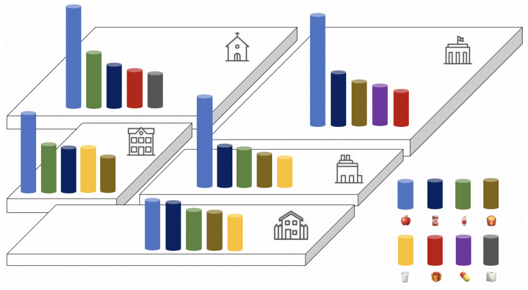
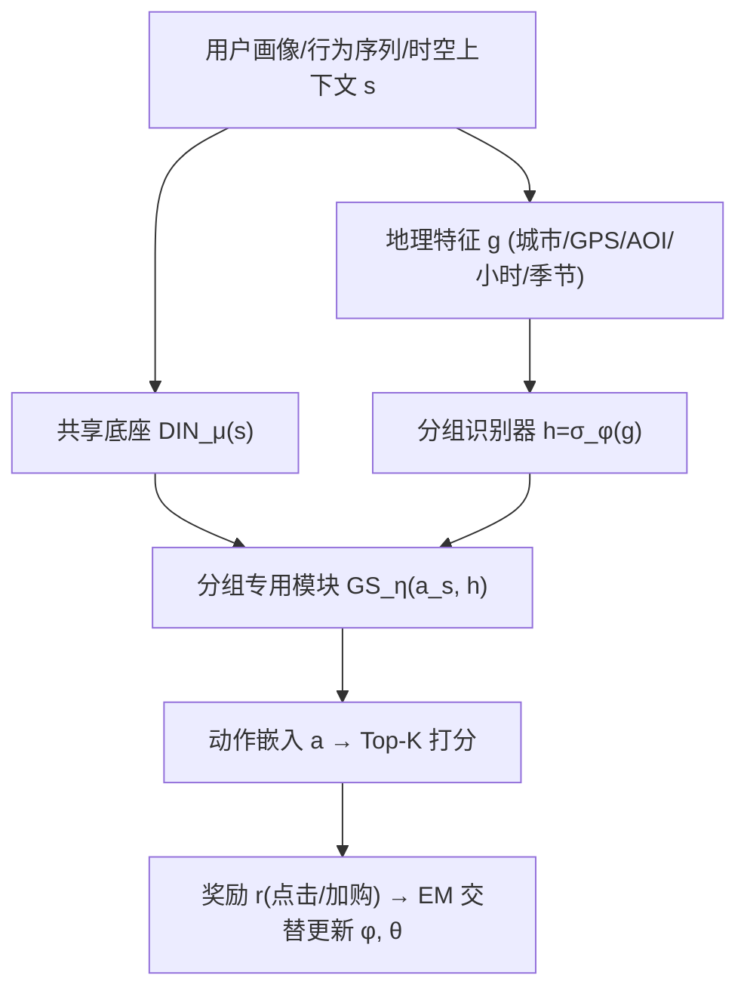
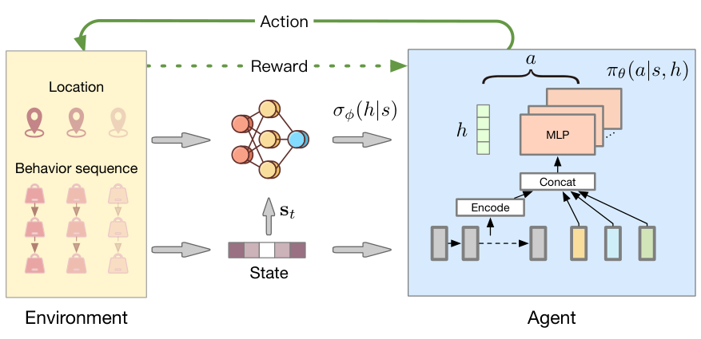

# An Adaptive Framework of Geographical Group-Specific Network on O2O Recommendation (面向 O2O 推荐的地理分组自适应网络框架)

- **会议/期刊**: ECIR 2024 (7 pages, 4 figures)
- **作者与机构**: Luo Ji, Jiayu Mao, Hailong Shi, Qian Li, Yunfei Chu, Hongxia Yang（阿里巴巴达摩院 / 阿里巴巴集团 / 中科院微电子所）
- **推荐链路定位**: 精排（Top-K 商品到店推荐策略）
- **研究方向**: 时空轨迹与 POI 本地生活推荐 / 跨域与多场景推荐
- **论文原文**: [论文原文链接](https://arxiv.org/abs/2312.17072v1)
- **开源代码**: [GeoGrouse](https://github.com/AaronJi/GeoGrouse)

## TL;DR (1分钟核心速览)

O2O 推荐中用户兴趣被地理功能区（居住/工作/商业/教育/医院）与时段强烈切分，单一统一模型难以覆盖异构分布，而按区域硬切模型又牺牲了跨区共性且加剧稀疏。GeoGrouse 借鉴 STAR 拓扑，把策略网络拆成「DIN 共享底座 + 分组专用模块」，分组指示变量 $h=\sigma_\phi(g)$由地理特征参数化生成，并用 EM 分别优化识别网络$\phi$与策略参数$\theta$。在饿了么零售到店 60 天日志（末日切分）上 AUC 0.832 优于 StEN 0.820（+1.46%），7 天线上 A/B 中 CTR 13.08%→13.20%、ACR 9.99%→10.06%。

## Background & Motivation (背景与核心矛盾)

- **主流范式**: 以 StEN 为代表的统一时空编码模型，把跨区域、跨时段数据混在一起训练一套共享表征，用时空特征作注意力/激活。
- **前人局限**: (1) 不同地理功能区的商品类目分布差异极大（图 1 所示五类功能区 Top-5 类目完全不同），统一模型强拟合平均分布，局部模式被淹没；(2) 若按 AOI/城市硬切多模型，粒度需人工拍定、各分区样本更稀疏，且彻底丢失用户行为共性。
- **核心洞察 (Key Insight)**: O2O 的用户状态分布本身由潜在分组变量 $h$隐式决定，因此策略应写成$\pi(a|s,h)$而非$\pi(a|s)$；分组应当「从数据中学」而不是「人工划」。
- **本文切入点**: 保留一个全量数据训练的共享底座学共性，用一个可微/可学的分组识别器把残差个性化交给分组专用模块，避免粒度人为设定。

<figure class="paper-figure" markdown="span">
  <figcaption>图1. 地理因素对O2O零售配送平台订单分布的影响。展示了五个不同功能区（居住区、工作区、商业区、教育区、医院区）的前五类商品类别及其占比。</figcaption>
</figure>

## Method (核心方法设计)

### 1. 整体框架 (Overall Architecture)

将 Top-K 推荐建模为 RL 策略：状态 $s$为用户画像、行为序列与季节/天气/地理上下文，动作$a$为商品嵌入，奖励$r$为点击或加购的 0/1 即时反馈。策略网络采用 STAR 式「下层共享 + 上层分组专用」结构：共享底座$\boldsymbol{a}_s=\mathrm{DIN}_\mu(s)$在全体数据上训练以捕获共性；分组识别器$\sigma_\phi(g)$由时空特征$g$（城市、GPS、AOI、小时、季节嵌入拼接）生成潜在分组$h$，据此激活对应分组模块得到$a=\mathrm{GS}_\eta(\boldsymbol{a}_s,h)$。训练用 EM 交替：E 步固定$\theta$优化识别似然，M 步固定$\hat{h}$ 用 REINFORCE 更新策略；线上仅需一次前向路由即可完成打分。

<figure class="paper-figure" markdown="span">
  <figcaption>图2. GeoGrouse 的框架。用户状态由中心模块和组特定模块处理，而 σϕ 生成用户分组潜变量，该变量决定激活的组特定模块。</figcaption>
</figure>

### 2. 关键设计拆解 (Key Designs)

1. **三种分组实现：从硬聚类到参数化路由**：痛点是把 $h$设计成不可导的离散簇会阻断梯度。K-Means 版取$h=\arg\min_{k}\lVert g-g_k\rVert_2$并挂$K$个 MLP；Prototypical 版改为余弦匹配$h=\arg\max_k \cos(g,p_k)$、$\eta_k=\tanh(Wp_k+b)$让原型可学；Co-Action 版最激进，直接把$g$线性变换为微型 MLP 的权重与偏置$h=L_\phi g,\ a=\mathrm{MLP}_{\eta=h}(\boldsymbol{a}_s)$，等价于无穷多软分组、无$K$ 超参，实验最优且被选为默认。

2. **EM 交替优化（E 步识别 + M 步策略）**：分组变量不可观测，故 E 步最大化识别似然
$$\mathcal{L}(\phi)=\tfrac{1}{N}\sum\nolimits_{|s|=N,\,s\sim\mu(\pi_\theta)}\log q_\phi(h|s)$$
M 步在 $\hat{h}$下做 REINFORCE 策略梯度$\nabla J(\theta)\sim\mathbb{E}_\pi[G_t\nabla\ln\pi(a|s,\hat{h})]$。直觉上 E 步让分组器对齐当前策略采样的状态分布，M 步再在自我更新的分组上做策略提升，形成「分组—策略」互促闭环。

3. **训练目标、奖励与推理开销**：奖励为稀疏 0/1 点击/加购，无额外负采样过程（全库候选由下游排序截断）；推理时每个请求只走一次共享塔 + 一个被激活的分组分支，计算量与原 DIN 同量级，代价主要是参数量随分组数线性增长（作者建议用端侧分拆部署缓解）。

## Experimental Setup & Evaluation Protocol (实验设置与评估协议)

- **数据集与预处理**: 饿了么零售到店 60 天线上日志，平均会话长度 35、最长 586；地理特征 $g$ 由城市、GPS、AOI、小时、季节嵌入拼接，AOI 层级作为关键粒度超参做敏感性分析。

| 数据集 | #Users | #Items | #Interactions | 稀疏度/密度 | 特征/场景说明 |
| :--- | :---: | :---: | :---: | :---: | :--- |
| Ele.me 零售到店（60 天日志） | 未披露 | 未披露 | 未披露（会话均长 35） | 极高稀疏（跨区不可履约） | 城市/GPS/AOI/小时/季节时空特征 |

- **数据划分与防穿越 (Splitting Strategy)**: 取最后一天日志作测试集，其余为训练，属**全局时间戳切分**（单次切分，未做滚动多折）。
- **排名评测协议 (Ranking Protocol)**: 报告 AUC、NDCG@3/5/10/20/50 与 HitRate@10；未明示是否 Full-Ranking，结合线上场景推断为**曝光候选集内的排序评估**（非全库无偏排序），实验重复 10 次取均值±标准差。
- **对比基线与超参设置**: 离线基线 StEN（O2O SOTA）、DIN（无时空逻辑）、DeepFM（特征交叉）；线上仅 StEN 可上线对照。AOI 层级敏感性显示 level 3 最优（图 4），正式实验固定该粒度。未报告显著性检验。

## Key Experimental Results (实验关键数据)

### 1. 主实验对比 (Main Results)

| Model | AUC | NDCG@3 | NDCG@10 | NDCG@20 | HitRate@10 |
| :--- | :---: | :---: | :---: | :---: | :---: |
| DIN | 0.658±0.005 | 0.504±0.010 | 0.583±0.017 | 0.627±0.018 | 0.893±0.005 |
| DeepFM | 0.778±0.006 | 0.575±0.011 | 0.651±0.015 | 0.691±0.018 | 0.932±0.008 |
| StEN | 0.820±0.004 | 0.672±0.012 | 0.728±0.015 | 0.759±0.016 | 0.959±0.006 |
| **GeoGrouse (CAN)** | **0.832±0.007** | **0.674±0.012** | **0.730±0.017** | **0.760±0.017** | **0.960±0.009** |
| Improv. vs StEN | **+1.46%** | +0.30% | +0.27% | +0.13% | +0.10% |

### 2. 消融实验 (Ablation Study)

线上 7 天 A/B，GeoGrouse-K（K-Means 分组）与 GeoGrouse-P（Prototypical 分组）数值为**相对 GeoGrouse(CAN) 的百分比差**：

| Model | CTR | ACR | impress-UV | click-UV | cart-UV |
| :--- | :---: | :---: | :---: | :---: | :---: |
| StEN（线上基线） | 13.08% | 9.99% | 313,206 | 40,980 | 31,277 |
| **GeoGrouse (CAN)** | **13.20%** | **10.06%** | **313,920** | **41,439** | **31,579** |
| GeoGrouse-K | -0.50% | -0.03% | +0.97% | -0.81% | -0.67% |
| GeoGrouse-P | -0.05% | -0.02% | -0.04% | -0.43% | +0.03% |

### 3. 关键实验发现 (Key Findings)

1. **时空建模是主要收益来源，分组是增量**：DIN→StEN 的 AUC 提升达 0.658→0.820（+24.6%），而 StEN→GeoGrouse 仅 +1.46%；说明分组专用化在强时空基线之上只吃到「残差个性化」的边际收益，也解释了 NDCG@10 仅 +0.27% 的微弱差距。
2. **硬分组不如软参数化路由**：K-Means 版本线下最优但线上 CTR 反降 0.50%、click-UV 降 0.81%；Prototypical 次之（-0.05%）；仅 CAN 的「$g\to$微 MLP 权重」全软路由全指标不降。离散$K$ 簇在跨区用户上强制归并，是硬分组的根本瓶颈。
3. **指标已近饱和，线上 KPI 更可信**：HitRate@10 高达 0.96、NDCG@10 0.730，离线提升空间被曝光候选集限制；而线上 CTR/ACR 的 +0.12pp/+0.07pp 与 click-UV +459 人在工业口径下才是有效信号，也暴露离线评估的区分度不足。

## Highlights & Limitations (亮点、对比与审稿批判)

- **与代表作对比 (vs. Prior Work)**: 相比 STAR/PLE 依赖人工预设场景划分，GeoGrouse 让分组由地理特征参数化生成，粒度自适应；相比 StEN 仅把时空信息当特征输入，本文把时空信息上升为**结构路由信号**；相比纯 RL 推荐（如 \pi(a|s) 建模），引入隐变量 $h$ 使策略具备分组条件化能力。
- **可迁移亮点**: (1) Co-Action 式「特征→微网络权重」的路由对任何需要多场景/多城市/多品类专家的精排模型都可即插即用，无需调 $K$；(2) EM 交替「识别器—策略」可迁移到用户生命周期分群、会话意图聚类等隐变量推荐场景。
- **审稿级局限批判**: (1) 评估偏薄——仅 3 个离线基线、单日测试集、无显著性检验，HitRate@10 已达 0.96 使 NDCG 差异落入标准差量级；(2) 分组数/参数量随 $K$ 与 AOI 词表线性膨胀，文中仅以「端侧分拆部署」一句话带过，缺少延迟与显存实测，且 EM 两阶段交替的收敛性与额外训练轮次未量化。

## Rating (四维评分)

- **方法创新性 (Novelty)**: ⭐⭐⭐⭐ （把 O2O 时空先验提升为分组路由隐变量，并用 CAN 实现无 $K$ 软分组，思路干净；但 STAR 拓扑与 EM/REINFORCE 组合本身属成熟组件的巧妙拼装）
- **评估协议与实验扎实度 (Protocol & Experiments)**: ⭐⭐⭐ （有真实的 7 天线上 A/B 与多 KPI，但离线仅 3 基线、单日切分、无显著性检验，HitRate 指标已饱和）
- **写作与数学规范度 (Clarity & Rigor)**: ⭐⭐⭐⭐ （三种分组实现并列对比清晰、EM 两阶段公式简洁可复现；但状态/动作定义偏简，RL 部分与 Top-K 排序的衔接略跳）
- **工业落地与复现价值 (Industrial & Practical Value)**: ⭐⭐⭐⭐⭐ （代码开源、饿了么线上验证、推理开销与原 DIN 同量级，是可直接照搬的工业级分组专家范式）

