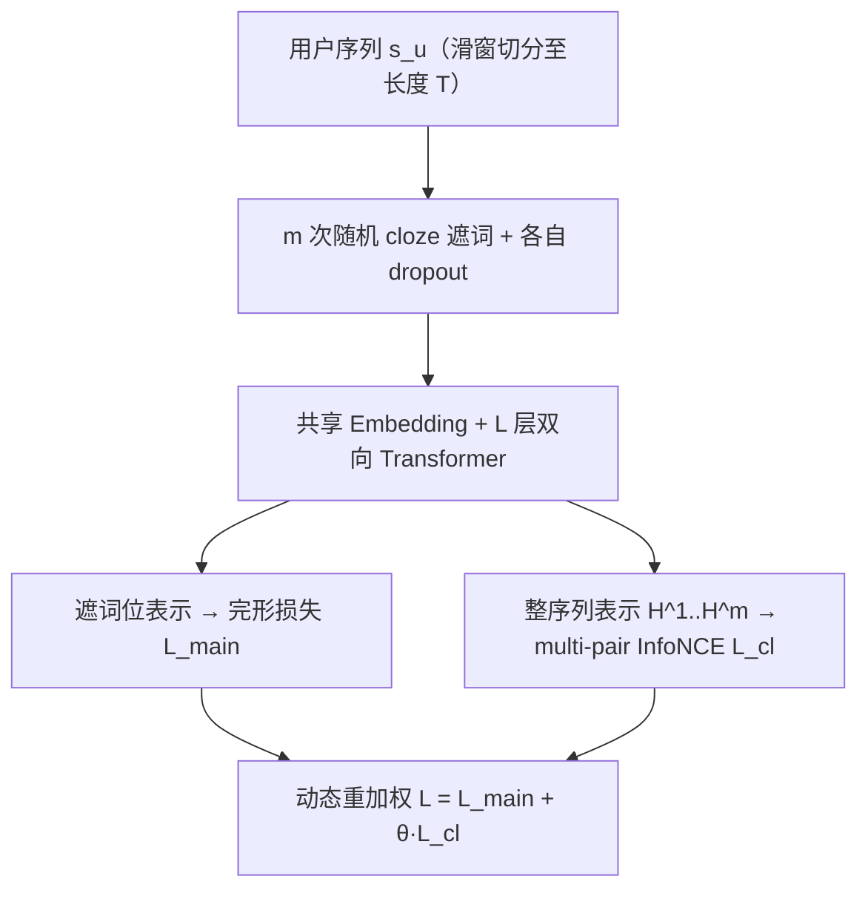
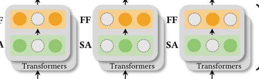

# Contrastive Learning with Bidirectional Transformers for Sequential Recommendation (面向序列推荐的双向 Transformer 对比学习)

- **会议/期刊**: CIKM 2022（ACM 第31届信息与知识管理大会）
- **作者与机构**: Hanwen Du, Hui Shi, Pengpeng Zhao 等（苏州大学、北京航空航天大学、Texas Tech、Rutgers、Macquarie）
- **推荐链路定位**: 召回（序列编码器 / 端到端 next-item 打分）
- **研究方向**: 序列与会话推荐 / 自监督对比学习与交互去噪
- **论文原文**: [arXiv:2208.03895v3](https://arxiv.org/abs/2208.03895v3)
- **开源代码**: [hw-du/CBiT](https://github.com/hw-du/CBiT)

## TL;DR (1分钟核心速览)

现有序列对比学习（CL4SRec / CoSeRec / DuoRec）全部把对比目标挂在**单向** Transformer 上，但真实用户行为并非严格从左到右；而换成双向 Transformer 后又与 BERT4Rec 的完形（cloze）任务、以及“再遮一次词”这类数据增广**直接冲突**。本文提出 CBiT：用滑窗把长序列切细、把 cloze mask 与 dropout mask 组合为“隐式数据增广+模型增广”的混合策略生成 $m$ 个正样本做 multi-pair InfoNCE，并用动态损失重加权平衡主损失与对比损失。在 Beauty/Toys/ML-1M 三套基准、`Leave-One-Out` + `Full-Ranking` 协议下，NDCG@10 相对最强基线最高提升 **21.04%**。

## Background & Motivation (背景与核心矛盾)

- **主流范式**: 以 SASRec 式单向 Transformer 为编码器，叠加序列级数据增广（mask / reorder / substitute）构造一对正样本做 InfoNCE，代表作为 CL4SRec、CoSeRec、DuoRec。
- **前人局限 1**: 单向注意力只能看左侧上下文，而真实交互序列存在跳过行为（skip）与外部因素导致的乱序，刚性 left-to-right 假设损失了全局上下文。
- **前人局限 2**: 若直接换成双向 Transformer（BERT4Rec），则“再遮词做增广”与完形任务本身的遮词**语义重叠且互相干扰**，且一对正样本差异过小，batch 内假负例无法被中和。
- **核心洞察 (Key Insight)**: 双向注意力天然能同时建模两侧上下文，但其优势只有在长序列被**细粒度切分**后才释放；同时双向架构自带两种“免费”扰动——cloze 遮词（数据级）与 dropout（模型级），二者可组合成更硬的、且不破坏语义的正样本。
- **本文切入点**: 不改架构主干，只重构“正样本怎么造、对比怎么做、损失怎么配平”三件事。

## Method (核心方法设计)

### 1. 整体框架 (Overall Architecture)

输入用户序列 $s_u$，先用滑窗切分为长度$T$的子序列（短序列前padding）；对每条子序列用不同随机种子生成$m$条 cloze 遮词序列，经共享 item/position embedding 后分别送入$L$层双向 Transformer（每次前向的 dropout mask 各不相同），得到$m$组隐表示$\boldsymbol{H}^1_u,\dots,\boldsymbol{H}^m_u$。遮词位置送预测层计算完形损失$\mathcal{L}_{\text{main}}$；$m$组整序列表示两两配对计算 multi-pair 对比损失$\mathcal{L}_{\text{cl}}$；两者由动态重加权系数$\theta$ 组合。推理时在序列尾部追加 `[mask]` 取该位置预测分布。

<figure class="paper-figure" markdown="span">
  <figcaption>图1：CBiT的架构。用户序列𝑠𝑢经过随机完形任务掩码，生成𝑚个不同的掩码序列。经过嵌入层后，每个掩码序列再通过具有不同随机dropout掩码的双向Transformer。掩码项用于完形任务，而整个序列的隐藏表示用于对比学习。𝑯1𝑢, 𝑯2𝑢, · · · , 𝑯𝑚𝑢均被视为来自同一序列𝑠𝑢的正样本。采用动态损失重加权策略来平衡完形任务损失与</figcaption>
</figure>

### 2. 关键设计拆解 (Key Designs)

1. **滑窗切分（Slide Window）**：痛点是用截断处理超长序列会丢数据、且双向注意力在整条长序列上学不到细粒度模式。做法是对长度 $|s_u|>T$的序列以步长滑动切出多个子序列，保留全部训练样本并把行为模式切到更细粒度。物理直觉见后文注意力热图：双向注意力需要“短上下文片”才敢做两侧聚合，$T$ 取 15/20/40 远小于 ML-1M 平均长度 163.5 时反而最优。
2. **混合增广 + 多正样本对比（Hybrid Aug. & Multi-Pair CL）**：痛点是一对正样本差异过小、且 batch 内假负例伤人。做法是把 $m$ 条“不同 cloze mask × 不同 dropout mask”的表示全部视为正样本，把标准一对 InfoNCE 外推为组合式损失：
$$\mathcal{L}_{\text{cl}}=\sum_{x=1}^{m}\sum_{y=1}^{m}\mathbb{I}[x\neq y]\,\ell(\boldsymbol{H}^{x}_{u},\boldsymbol{H}^{y}_{u}),\quad \ell=-\log\frac{e^{\langle\boldsymbol{H}^{x}_{u},\boldsymbol{H}^{y}_{u}\rangle/\tau}}{\sum_{k\neq u}\sum_{c\in\{x,y\}}e^{\langle\boldsymbol{H}^{x}_{u},\boldsymbol{H}^{c}_{k}\rangle/\tau}}$$
   正样本数由 2 扩到 $m$、负样本数扩到$m(N-1)$；同时因这些表示共享同一完形任务语义，假负例被更多真正例“稀释”。预测层刻意**不共享 item embedding**（改用独立线性层），避免完形任务与依赖 embedding 相似度的对比任务互相干扰。
3. **动态损失重加权与训练/推理开销**：痛点是训练初期 $\mathcal{L}_{\text{cl}}$ 量级过大拖慢收敛，而固定小权重又在后期让对比项失效。做法是用指数滑动平均自适应比例：
$$\theta^{\sigma+1}=\alpha\hat{\theta}+(1-\alpha)\theta^{\sigma},\quad \hat{\theta}=\frac{\mathcal{L}^{\sigma+1}_{\text{main}}}{\mathcal{L}^{\sigma+1}_{\text{main}}+\lambda\,\mathcal{L}^{\sigma+1}_{\text{cl}}},\quad \mathcal{L}=\mathcal{L}_{\text{main}}+\theta^{\sigma+1}\mathcal{L}_{\text{cl}}$$
   其中 $\theta$从 0 起、梯度截断不回传。完形损失对每个真值只配 **1 个随机负样本**（式8），无额外难负例挖掘；推理仅需一次前向（末位 `[mask]`），复杂度$O(T^2d)$，靠小$T$ 控开销。

## Experimental Setup & Evaluation Protocol (实验设置与评估协议)

- **数据集与预处理**: 全部按 `5-core` 过滤（用户与物品交互数均 ≥5），去重并按时间戳排序。

| 数据集 | #Users | #Items | #Interactions | 稀疏度 | 特征/场景说明 |
| :--- | :---: | :---: | :---: | :---: | :--- |
| Beauty | 22,363 | 12,101 | 198,502 | 99.93% | Amazon 短序列，平均长度 8.9 |
| Toys | 19,412 | 11,924 | 167,597 | 99.95% | Amazon 短序列，平均长度 8.6 |
| ML-1M | 6,040 | 3,953 | 1,000,209 | 95.21% | 电影长序列，平均长度 163.5 |

- **数据划分与防穿越**: `Leave-One-Out`——最后 1 个交互作测试、倒数第 2 个作验证、其余训练。
- **排名评测协议**: 无偏 `Full-Ranking`（在**全物品集**上排序，未做负采样候选裁剪），指标 HR@{5,10,20} 与 NDCG@{5,10,20}。
- **对比基线与超参**: 基线覆盖 RNN（GRU4Rec）、CNN（Caser）、单向 Transformer（SASRec/CL4SRec/CoSeRec/DuoRec）、双向 Transformer（BERT4Rec 及本文构造的 BERT4RecS、CoSeBERT）；$L=2$、头数 2、$d=256$、batch 256、cloze 遮词比$\rho=0.15$、Adam lr=0.001；$\tau$调 {0.1–6}、$m$调 {2–8}、$\lambda$调 {1–9}、$T$ 调 {10–100}、dropout 0.1–0.9；训练 250 epoch，取验证集 NDCG@10 最优 checkpoint。

## Key Experimental Results (实验关键数据)

### 1. 主实验对比 (Main Results)

| 模型 | Beauty HR@10 | Beauty NDCG@10 | Toys HR@10 | Toys NDCG@10 | ML-1M HR@10 | ML-1M NDCG@10 |
| :--- | :---: | :---: | :---: | :---: | :---: | :---: |
| GRU4Rec | 0.0332 | 0.0175 | 0.0184 | 0.0097 | 0.1344 | 0.0649 |
| Caser | 0.0436 | 0.0212 | 0.0333 | 0.0168 | 0.1442 | 0.0734 |
| SASRec | 0.0592 | 0.0284 | 0.0652 | 0.0320 | 0.1810 | 0.0918 |
| CL4SRec | 0.0630 | 0.0307 | 0.0736 | 0.0339 | 0.1815 | 0.0920 |
| CoSeRec | 0.0726 | 0.0410 | 0.0755 | 0.0442 | 0.1861 | 0.0915 |
| DuoRec | 0.0867 | 0.0430 | 0.0744 | 0.0406 | **0.2865** | 0.1586 |
| BERT4Rec | 0.0598 | 0.0306 | 0.0524 | 0.0309 | 0.2219 | 0.1097 |
| BERT4RecS | 0.0755 | 0.0431 | 0.0761 | 0.0442 | 0.2594 | 0.1471 |
| CoSeBERT | 0.0786 | 0.0462 | 0.0735 | 0.0434 | 0.2492 | 0.1412 |
| **CBiT** | **0.0905** | **0.0537** | **0.0865** | **0.0535** | **0.3013** | **0.1694** |
| Improv. | +4.38% | +16.23% | +13.67% | +21.04% | +5.17% | +6.81% |

（Beauty 上 HR@5 0.0559→**0.0637**（+13.95%）、NDCG@5 0.0378→**0.0451**（+19.31%）；ML-1M 上 HR@20 0.3901→**0.3998**。）

### 2. 消融实验 (Ablation Study)

| 配置 (NDCG@10) | Beauty | Toys | ML-1M | 说明 |
| :--- | :---: | :---: | :---: | :--- |
| GRU4Rec → GRU4RecS | 0.0175→0.0113 | 0.0097→0.0052 | 0.0649→0.0438 | 滑窗对 RNN 有害 |
| SASRec → SASRecS | 0.0284→0.0278 | 0.0320→0.0339 | 0.0918→0.0845 | 单向 Transformer 几乎无收益/略降 |
| BERT4Rec → BERT4RecS | 0.0306→**0.0431** | 0.0309→**0.0442** | 0.1097→**0.1471** | 滑窗仅对双向注意力显著 |
| 无对比学习（仅 cloze） | \~0.0431(BERT4RecS) | \~0.0442 | \~0.1471 | 图3a 基线 |
| 仅 cloze mask / 仅 dropout mask | 均低于 Hybrid | 均低于 Hybrid | — | 单一增广不足 |
| 固定 $\theta=0.1$/$\theta=0.5$ | 均低于动态重加权 | — | — | 图3b，动态策略曲线更平滑 |
| **CBiT（完整）** | **0.0537** | **0.0535** | **0.1694** | — |

### 3. 关键实验发现 (Key Findings)

1. **滑窗的收益专属双向注意力**：同一技巧用在 BERT4Rec 上使 Beauty NDCG@10 由 0.0306 跃升至 0.0431（+40.8%），而用在 SASRec（0.0284→0.0278）或 GRU4Rec（0.0175→0.0113）上反而掉点，证明“切细 + 两侧聚合”才是双向架构的放大器，单向编码器切细后只剩上下文缺失。
2. **增广必须与预训练目标同构**：同为双向骨干，CoSeBERT（沿用 CoSeRec 的 mask/reorder/substitute 数据增广）Beauty NDCG@10 仅 0.0462，明显低于 CBiT 的 0.0537；“cloze mask × dropout mask”这类架构原生扰动不破坏语义，是性能差的主因而非“是否加了对比学习”。
3. **长序列/密集场景优势收窄**：ML-1M 上 DuoRec 的 HR@10 已达 0.2865（监督正采样很强），CBiT 仅 +5.17%；而在两套稀疏短序列 Amazon 数据上 NDCG@10 提升 16%–21%，说明本文方法主要解决**稀疏短序列 + 双向上下文**场景，对高密度长序列的边际收益有限。

## Highlights & Limitations (亮点、对比与审稿批判)

- **与代表作对比**: vs. CL4SRec/CoSeRec 用数据级增广造一对正样本，本文改用架构原生扰动造 $m$ 对；vs. DuoRec 用序列末位表示 + 监督正采样，本文用整序列表示 + 免标注混合增广，可无监督适配任意骨干；vs. BERT4Rec 仅做 cloze，本文在同一骨干上叠加对比目标并证明滑窗是必要条件。
- **可迁移亮点**: ①“预训练自带的 mask 机制 = 免费增广”，任何含 cloze/denoising 目标的序列模型都可直接复用 multi-pair 对比；② 动态重加权 $\theta$ 用损失比值 EMA 自适应，可无缝替换多任务推荐中的手调权重。
- **审稿级局限批判**: ① multi-pair 需 $m$次前向，训练成本近似线性增长（$m$上限 8），论文未给出训练时长/显存实测；② 评测仅 3 个公开集、无显著性检验与线上 A/B，且 ML-1M 上相对 DuoRec 的提升幅度小、$\tau$/$m$/dropout/滑窗 4 个超参均需逐数据集搜索，超参敏感度偏高。

## Rating (四维评分)

- **方法创新性 (Novelty)**: ⭐⭐⭐⭐ （首个把对比学习迁移到双向 Transformer 序列推荐，混合增广 + multi-pair 外推思路清晰，但本质是已有组件的组合优化）
- **评估协议与实验扎实度 (Protocol & Experiments)**: ⭐⭐⭐⭐ （Full-Ranking 全库排序 + 三数据集 + BERT4RecS/CoSeBERT 两个自建对照很有说服力，缺显著性检验与效率实测）
- **写作与数学规范度 (Clarity & Rigor)**: ⭐⭐⭐⭐ （公式与符号定义完整、注意力热图与超参曲线佐证机制，但部分消融只有曲线无具体数值表）
- **工业落地与复现价值 (Industrial & Practical Value)**: ⭐⭐⭐⭐ （代码开源、仅需标准 Transformer 与 InfoNCE、滑窗反而降低 $O(T^2d)$推理开销，主要成本在$m$ 次前向训练）

