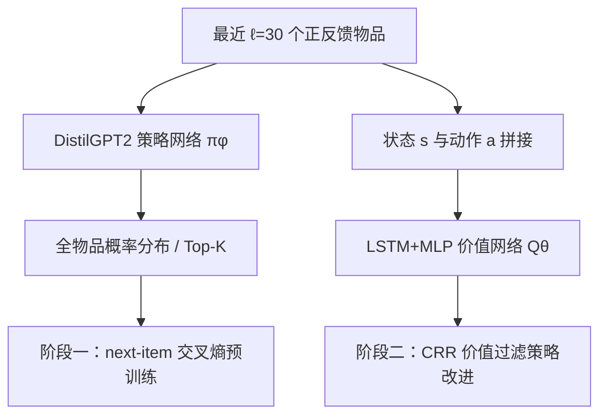
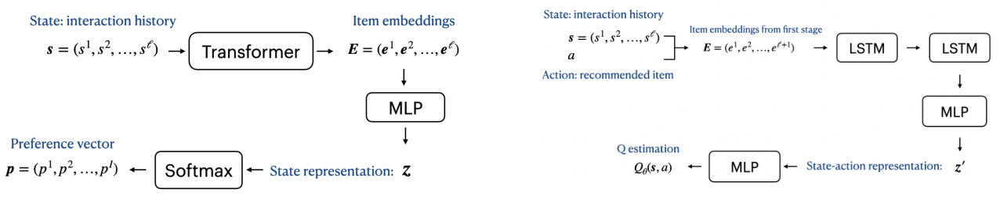

# Integrating Offline Reinforcement Learning with Transformers for Sequential Recommendation (基于 Transformer 的离线强化学习序列推荐)

- **会议/期刊**: ECIR 2024
- **作者与机构**: Xumei Xi (Cornell University)；Yuke Zhao, Quan Liu, Liwen Ouyang, Yang Wu (Bloomberg；部分工作完成于 Bloomberg)
- **推荐链路定位**: 召回/精排（序列 Next-Item 全库排序）
- **研究方向**: 序列与会话推荐 / 强化学习与动态探索推荐
- **论文原文**: [https://arxiv.org/abs/2307.14450v1](https://arxiv.org/abs/2307.14450v1)
- **开源代码**: 暂未开源

## TL;DR (1分钟核心速览)

针对监督式序列推荐只优化即时 next-item、忽视推荐对用户未来交互长期影响的问题，本文用 DistilGPT2 预训练策略初始化离线 RL，并采用 Critic Regularized Regression (CRR) 进行两阶段训练。在 ML-25M/Yoochoose 按全局时间戳切分、全库未交互物品 Full-Ranking 协议下，ML-25M HR@10 达 0.1840（SASRec 0.0270），Yoochoose 购买 HR@10 达 0.2559（SASRec 0.1948），验证了 Transformer 与离线 RL 结合的有效性。

## Background & Motivation (背景与核心矛盾)

- **主流范式**: Caser、SASRec 等监督式序列模型以最近交互序列预测下一物品，本质是短期行为克隆。
- **前人局限**: 其一，只最小化 next-item 交叉熵，忽略“当前推荐改变未来交互”的长期收益；其二，在线 RL 需真实试错或仿真器，成本高且仿真偏差大，而纯离线 RL 又受分布偏移与自举误差困扰。
- **核心洞察 (Key Insight)**: DistilGPT2 已具备强序列编码能力，若先用监督学习获得高质量策略初始化，再用离线 RL 做价值过滤式策略改进，可在不交互的前提下兼顾稳定收敛与长期回报。
- **本文切入点**: 构建完全离线、两阶段训练的 CRR-Transformer 推荐框架。

## Method (核心方法设计)

### 1. 整体框架 (Overall Architecture)

将用户最近 $\ell=30$个正反馈物品视为状态，DistilGPT2 策略网络输出全物品概率分布；价值网络以状态-动作对为输入，用两层 LSTM + MLP 估计$Q$ 值。第一阶段仅用 next-item 交叉熵预训练策略；第二阶段冻结物品嵌入，以预训练策略初始化 actor，联合 CRR actor-critic 更新，最终按策略分布取 Top-K 推荐。

<figure class="paper-figure" markdown="span">
  <figcaption>图 1：策略网络（左）和价值网络（右）的模型架构。对于策略网络，输入是状态，由长度为 ℓ 的最近交互历史组成。输出是物品空间上的概率分布，表示向用户推荐每个物品的概率。物品嵌入是 Rd 中的向量，状态表示 z 在 RI 中。MLP 表示多层感知机，是一种用于提取状态表示的全连接前馈网络。对于价值网络，输入是状态-动作对，输出 i</figcaption>
</figure>

### 2. 关键设计拆解 (Key Designs)

1. **两阶段“预训练→离线 RL”训练**：纯离线 RL 冷启动易震荡，故先用正反馈样本做行为克隆，最小化 $\mathcal{L}_{\text{CE}}=-\log\pi_\phi(a|s)$；随后将$\pi_\phi$ 作为 CRR actor 初值。预训练提供合理序列表征，RL 阶段再跳出短视行为克隆，实验显示收敛更快且方差更小。
2. **CRR 价值过滤策略更新**：离线数据由多策略混合产生，普通 actor-critic 会高估分布外动作。CRR 用优势估计加权最大似然：
$$
\text{(inline only)}
$$
避免行间公式，实际更新为 $\mathcal{L}_{\pi}(\phi)=-\mathbb{E}_{(s,a)\sim\mathcal{D}}[\exp(\hat{A}(s,a)/\beta)\log\pi_\phi(a|s)]$，其中$\hat{A}(s,a)=Q_\theta(s,a)-\frac{1}{m}\sum_{j=1}^{m}Q_\theta(s,a_j)$，$a_j\sim\pi_\phi(\cdot|s)$，$m=4$。该式等价于 KL 正则策略迭代的闭式解，既鼓励高优势动作，又约束策略靠近行为策略。
3. **奖励、状态转移与训练目标**：状态按“正反馈才滑动”更新，$s_{t+1}=(s_{t,2},\ldots,s_{t,\ell},a_t)$当$r>0$，否则保持。ML-25M 奖励$r=\mathbb{I}[\text{rating}\ge 3.5]$；Yoochoose 中购买奖励 3、点击奖励 1。Critic 用 TD 损失$\mathcal{L}_{Q}(\theta)=\mathbb{E}_{\mathcal{D}}[(r+\gamma\mathbb{E}_{a'\sim\pi_{\phi'}}Q_{\theta'}(s',a')-Q_\theta(s,a))^2]$，软更新$\tau=0.01$。无显式负采样，直接全物品 softmax；推理输出全库分布取 Top-10，冻结嵌入降低开销。

## Experimental Setup & Evaluation Protocol (实验设置与评估协议)

- **数据集与预处理**:

| 数据集 | #Users | #Items | #Interactions | 稀疏度/密度 | 特征/场景说明 |
| :--- | :---: | :---: | :---: | :---: | :--- |
| ML-25M | 未报告 | 62,423 | 25,000,095 | — | 电影评分 0.5–5.0；删除同一时间戳重复记录 |
| Yoochoose | 未报告 | 52,739 | 1,177,769 | — | 电商点击/购买，6 个月会话；忽略价格与数量 |

- **数据划分与防穿越 (Splitting Strategy)**: 全局时间戳切分。ML-25M 最早 99% 训练、随后 0.2% 验证、最新 0.8% 测试；Yoochoose 为 98%/0.2%/1.8%。
- **排名评测协议 (Ranking Protocol)**: 同时报告无偏 `Full-Ranking`（$A^{all}$，所有历史未交互物品）与 `Sampled Ranking`（$A^{rand}$，真实物品 + 100 个随机未交互物品）。核心指标 HR@10、NDCG@10；Full-Ranking 更难且更可信。
- **对比基线与超参设置**: Caser、SASRec、Transformer-only（第一阶段）、CRR-only（无预训练）；序列长度 30，DistilGPT2 约 82M 参数、嵌入 768，critic 为 2 层 LSTM（hidden 1024），$\beta=1$且过滤值截断 20，ML-25M$\gamma=0.6$、Yoochoose$\gamma=0.9$。报告 3 次均值±标准差，未做$p$ 值显著性检验。

## Key Experimental Results (实验关键数据)

### 1. 主实验对比 (Main Results)

| 方法 | ML-25M HR@10 | ML-25M NDCG@10 | YC-Purchase HR@10 | YC-Purchase NDCG@10 | YC-Click HR@10 | YC-Click NDCG@10 |
| :--- | :---: | :---: | :---: | :---: | :---: | :---: |
| Caser | 0.0275 | 0.0128 | 0.1733 | 0.0906 | 0.3236 | 0.2013 |
| SASRec | 0.0270 | 0.0131 | 0.1948 | 0.1083 | 0.3801 | 0.2350 |
| Transformer-only | 0.1303 | 0.0676 | 0.2274 | 0.1199 | 0.3792 | 0.2371 |
| CRR-only | 0.1627 | 0.0889 | 0.2424 | 0.1288 | 0.3386 | 0.2034 |
| **CRR-Transformer** | **0.1840** | **0.1019** | **0.2559** | **0.1374** | **0.3973** | **0.2541** |
| Improv. vs SASRec | +581.5% | +677.9% | +31.4% | +26.9% | +4.5% | +8.1% |

### 2. 消融实验 (Ablation Study)

| 变体 | ML-25M HR@10 | ML-25M NDCG@10 | YC-Purchase HR@10 | YC-Click HR@10 |
| :--- | :---: | :---: | :---: | :---: |
| w/o RL (Transformer-only) | 0.1303 | 0.0676 | 0.2274 | 0.3792 |
| w/o Transformer init (CRR-only) | 0.1627 | 0.0889 | 0.2424 | 0.3386 |
| Full CRR-Transformer | **0.1840** | **0.1019** | **0.2559** | **0.3973** |

### 3. 关键实验发现 (Key Findings)

1. **RL 阶段确实带来长期收益且显著稳定化**：ML-25M 上相较 Transformer-only，HR@10 提升 41.2%、NDCG@10 提升 50.7%，且 HR@10 标准差从 ±0.0146 降至 ±0.0010，说明优势加权更新比单纯行为克隆更稳。
2. **Transformer 初始化不可替代**：去掉预训练后 CRR-only 的 ML-25M HR@10 降至 0.1627（Full 0.1840，-11.6%），Yoochoose 点击 HR@10 仅 0.3386（Full 0.3973），印证纯离线 RL 冷启动慢且易不稳定。
3. **奖励设计引导不同任务偏好**：Yoochoose 购买任务相对 SASRec 的 HR@10 提升 31.4%，远高于点击任务的 4.5%；购买需更长决策链，故 $\gamma=0.9$更优，而点击任务偏好较小$\gamma$，与“远期奖励驱动购买”一致。此外，ML-25M 的 HR@10-rand 达 0.8737，但 Full-Ranking 仅 0.1840，说明随机候选会严重高估模型。

## Highlights & Limitations (亮点、对比与审稿批判)

- **与代表作对比 (vs. Prior Work)**: SASRec/Caser 仅监督短期 next-item；在线/仿真 RL 依赖交互或环境建模；CRR-only 缺少序列预训练。本文本质区别是“DistilGPT2 序列先验 + 完全离线 CRR + 两阶段训练”，避免在线试错与仿真偏差。
- **可迁移亮点**: 两阶段“监督预训练→离线 RL 微调”可迁移到生成式重排、长期留存优化；冻结第一阶段物品嵌入可降低 RL 训练开销。
- **审稿级局限批判**: 其一，全物品 softmax 与 82M DistilGPT2 带来较高推理/训练成本，未讨论 ANN 召回或蒸馏部署；其二，仅两个数据集、无显著性检验，且 CRR 的 KL 式正则可能对分布外动作过度悲观，随机候选指标也易受采样波动影响。

## Rating (四维评分)

- **方法创新性 (Novelty)**: ⭐⭐⭐⭐ （将 DistilGPT2 预训练与 CRR 离线 RL 结合的两阶段序列推荐框架较新颖，但各组件本身并非全新）
- **评估协议与实验扎实度 (Protocol & Experiments)**: ⭐⭐⭐⭐ （同时报告 Full-Ranking 与 Sampled Ranking，含 3 次方差；但数据集与显著性检验偏少）
- **写作与数学规范度 (Clarity & Rigor)**: ⭐⭐⭐⭐ （MDP、CRR 更新与奖励定义清晰，公式完整；部分实验细节置于附录）
- **工业落地与复现价值 (Industrial & Practical Value)**: ⭐⭐⭐ （完全离线训练适合工业数据，但大模型全库打分开销高且未开源，落地需工程优化）

