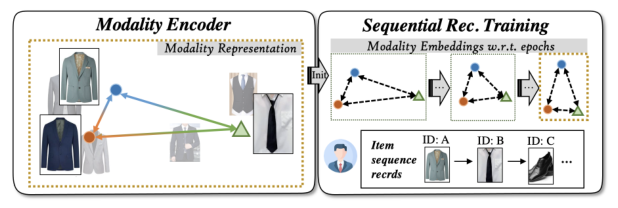
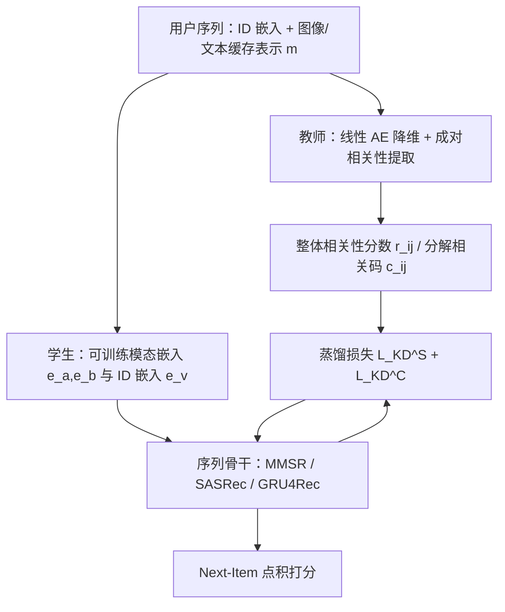
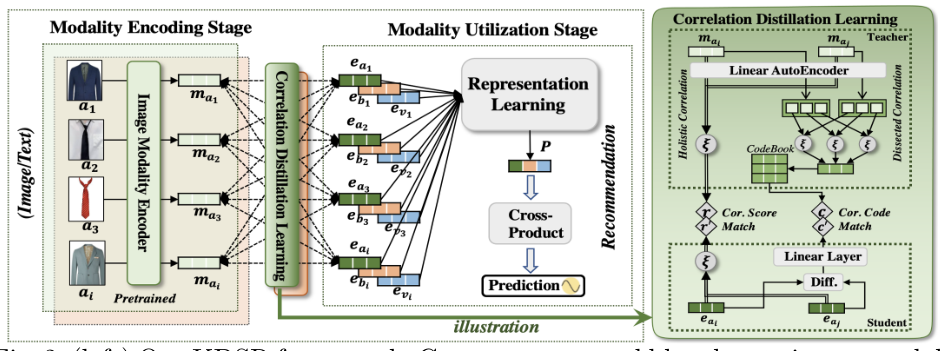

# Lightweight Modality Adaptation to Sequential Recommendation via Correlation Supervision（基于相关性监督的序列推荐轻量化模态适配）

- **会议/期刊**: ECIR 2024
- **作者与机构**: Hengchang Hu、Qijiong Liu、Chuang Li、Min-Yen Kan（新加坡国立大学、香港理工大学）
- **推荐链路定位**: 召回/排序（Next-Item 预测）
- **研究方向**: 序列与会话推荐 / 多模态推荐
- **论文原文**: [arXiv:2401.07257v1](https://arxiv.org/abs/2401.07257v1)
- **开源代码**: 暂未开源（论文与摘要均未给出代码仓库）

## TL;DR (1分钟核心速览)

两阶段多模态序列推荐把模态编码器输出缓存为物品嵌入，训练中序列目标会迅速覆盖模态关联，导致“模态遗忘”。本文提出 KDSR：教师从原始模态表示中提取整体相关性分数与分解相关性码，学生用微调后的模态嵌入去逼近这两类监督，并以异步训练延缓原始信息流失。在 5 个 Amazon/ML-1M 数据集、按用户 80/20 划分的 HR/MRR@5/20 评测下，KDSR 平均超越最优基线 6.8%，HR 平均提升 10.2%，Clothing 的 HR@5 相对提升 23.9%。

## Background & Motivation (背景与核心矛盾)

- **主流范式**: 多模态序列推荐（MSR）通常用预训练图像/文本编码器表示物品，再接入 GRU、SASRec 或异构图 MMSR 做序列建模；为控制大编码器成本，两阶段“先缓存模态表示、再训练推荐器”成为常见方案。
- **前人局限**: 端到端微调能保留原始模态特征，但需要同时训练大编码器，成本高；两阶段虽高效，却使缓存嵌入在推荐训练中过度适配序列选择关系，原始模态关联被稀释。论文图 1 显示：随着训练推进，模态嵌入与原始模态表示的 Pearson 相关性快速跌至接近 0，而与 ID 嵌入的序列相关性逐步对齐。
- **核心洞察 (Key Insight)**: 模态编码器的价值不只在逐维特征，更在“物品—物品”的成对关联结构；只要把这种关联作为监督迁移给下游嵌入，就能在不保留大编码器的情况下延缓遗忘。
- **本文切入点**: 用自监督知识蒸馏把模态相关性拆成粗粒度整体分数与细粒度分解码，联合约束学生嵌入，并辅以异步学习率调度。

<figure class="paper-figure" markdown="span">
  <figcaption>图 1：（左）原始模态表示随训练轮次向模态嵌入适配的过程示意图。（右）在 Beauty 数据集上使用基于 GRU 的模型进行实验，突出模态遗忘问题。</figcaption>
</figure>

图 1：训练过程中模态相关性与序列相关性此消彼长的“模态遗忘”现象。

## Method (核心方法设计)

### 1. 整体框架 (Overall Architecture)

输入为用户历史序列中的 ID 嵌入、图像与文本缓存表示。教师侧先对原始模态表示做线性自编码器降维，再计算两类物品对相关性：整体余弦分数与按子向量分解后经向量量化得到的离散相关码。学生侧维护可训练的模态嵌入与 ID 嵌入，经 MMSR 异构图或 SASRec 等骨干编码序列，同时用轻量线性头从嵌入对中回归整体分数、预测相关码类别。推荐主损失与两个蒸馏损失联合优化；推理时教师完全移除，学生与标准两阶段模型同构，不增加在线编码器开销。

<figure class="paper-figure" markdown="span">
  <figcaption>图 2：（左）我们的 KDSR 框架。绿色、橙色和蓝色分别表示图像模态、文本模态和 ID 特征。（右）图像（绿色）模态上的相关性蒸馏学习细节。</figcaption>
</figure>

图 2：KDSR 框架及图像模态上的相关性蒸馏细节。

### 2. 关键设计拆解 (Key Designs)

1. **整体相关性软匹配（Holistic Correlation）**：教师用余弦相似度计算降维后模态表示的成对相关性 $r_{ij}=\xi(\tilde{\mathbf{m}}_i,\tilde{\mathbf{m}}_j)$；学生用可训练嵌入经线性变换后得到$\hat r_{ij}=\xi(g_\phi(\mathbf{e}_{a_i}),g_\phi(\mathbf{e}_{a_j}))$。损失为温度缩放后的软匹配：
   $\mathcal{L}_{KD}^{S}=\frac{1}{N^2}\sum_{i,j}\left\|\sigma(r_{ij}/\tau)-\sigma(\hat r_{ij}/\tau)\right\|_2^2$。
   $\tau$ 越大监督越平滑，避免把模态相似性当成硬分类目标而损害推荐多样性；这使教师只传递“相对关联强弱”，不强迫学生复制绝对尺度。

2. **分解相关性码（Dissected Correlation Codes）**：单一标量无法区分“颜色像但形状不像”与“形状像但颜色不像”。作者把降维表示切成 $D$ 段，逐段计算相关向量
   $\mathbf{r}_{ij}=[\xi(\tilde{\mathbf{m}}_{i,1},\tilde{\mathbf{m}}_{j,1});\ldots;\xi(\tilde{\mathbf{m}}_{i,D},\tilde{\mathbf{m}}_{j,D})]$，
   再用向量量化映射到 $x$个码字，得到离散码$c_{ij}\in\{1,\ldots,x\}$。学生以差值向量$\tilde{\mathbf{e}}_{ij}=|\mathbf{e}_{a_i}-\mathbf{e}_{a_j}|$经两层 MLP 预测码分布$p_{ij}$，并用交叉熵对齐：
   $\mathcal{L}_{KD}^{C}=-\frac{1}{N^2}\sum_{i,j}\sum_{t=1}^{x}\mathbb{I}(c_{ij}=t)\log p_{ij,t}$。
   VQ 的码本从数据中学习，比固定初始化聚类更抗噪；离散码把连续关系压缩为可分类的“关系类型”，降低学生拟合难度。

3. **训练目标、异步调度与推理开销**：总损失为
   $\mathcal{L}=\mathcal{L}_{RS}(y,\hat y)+\lambda_1\mathcal{L}_{KD}^{S}+\lambda_2\mathcal{L}_{KD}^{C}$。
   异步训练让模态嵌入参数在前 $\eta$轮以$0.1\epsilon$线性升至主学习率$\epsilon$，使原始模态信息在早期不被序列目标立刻覆盖。训练额外开销为每序列$O(L^2d)$的相关性计算；相比 Transformer 骨干的$O(L^2dH)$，增量约为$1/(1+H)$，且推理阶段学生独立运行，复杂度与普通两阶段模型一致。

## Experimental Setup & Evaluation Protocol (实验设置与评估协议)

- **数据集与预处理**: 采用 Amazon 评论（Beauty、Clothing、Sports、Toys）与 ML-1M，均含图像和文本描述；按 `5-core` 迭代过滤，评分即正交互。

| 数据集 | #Users | #Items | #Interactions | 稀疏度 | 平均序列长 |
| :--- | :---: | :---: | :---: | :---: | :---: |
| Beauty | 22,363 | 12,101 | 198,502 | 99.93% | 8.88 |
| Clothing | 39,387 | 23,033 | 278,677 | 99.97% | 7.12 |
| Sports | 35,598 | 18,357 | 296,337 | 99.95% | 8.46 |
| Toys | 19,412 | 11,924 | 167,597 | 99.93% | 8.79 |
| ML-1M | 6,040 | 3,416 | 999,611 | 95.16% | 165.50 |

- **数据划分与防穿越**: 按用户序列做 `比例划分`，前 80% 训练、后 20% 测试，每位用户至少保留一个测试点；未采用全局时间戳切分。
- **排名评测协议**: 报告 HR@5/20 与 MRR@5/20。论文仅称遵循常规序列推荐评测，未明确候选集构造与负采样比例；从 HR@20 的量级看更接近 `Sampled Ranking` 而非全库 `Full-Ranking`，这是评估披露上的不足。
- **对比基线与超参**: 基线覆盖 ID 模型（GRU4Rec、SASRec、SR-GNN）、冻结模态模型（MMSRec、SASRM）、微调融合模型（NOVA、DIF-SR、Trans2D、MMSR）。统一 $d=128$、batch 512、Adam、学习率$10^{-1}$–$10^{-4}$、L2 取$\{0,10^{-5}\}$、dropout 0–0.9，五次运行取平均；$\tau=1.5$、$D=8$、$x=100$，Amazon 上$(\lambda_1,\lambda_2)=(1,0.5)$，ML-1M 上为$(0.5,0.1)$，并以$p<0.05$ 标注显著性。

## Key Experimental Results (实验关键数据)

### 1. 主实验对比 (Main Results)

表 1：5 个数据集上的 HR@5 / HR@20（%），KDSR 加粗；Improv. 为 KDSR 相对最佳基线的 HR@5 提升。

| 模型 | Beauty | Clothing | Sports | Toys | ML-1M |
| :--- | :---: | :---: | :---: | :---: | :---: |
| GRU4Rec | 5.642 / 12.722 | 1.334 / 3.811 | 2.439 / 6.643 | 3.866 / 10.073 | 12.085 / 29.381 |
| SASRec | 6.190 / 14.068 | 1.589 / 3.957 | 2.955 / 7.221 | 5.090 / 11.867 | 10.616 / 29.188 |
| MMSRec | 5.285 / 11.957 | 1.400 / 3.833 | 2.900 / 6.826 | 4.115 / 9.906 | 14.094 / 31.215 |
| SASRM | 6.308 / 13.753 | 1.966 / 4.816 | 3.031 / 7.368 | 4.621 / 9.582 | 15.460 / 32.921 |
| DIF-SR | 6.579 / 14.014 | 1.552 / 4.057 | 2.515 / 7.077 | 5.236 / 12.028 | 14.200 / 33.163 |
| Trans2D | 6.019 / 13.221 | 1.393 / 4.068 | 2.717 / 6.945 | 4.191 / 10.508 | 13.291 / 30.844 |
| MMSR | 7.156 / 14.147 | 1.868 / 4.414 | 3.266 / 7.747 | 6.116 / 12.119 | 12.570 / 30.092 |
| **KDSR** | **7.416 / 14.675** | **2.437 / 4.950** | **3.501 / 7.813** | **6.603 / 12.336** | **15.564 / 33.197** |
| Improv. | +3.6% | +23.9% | +7.2% | +8.0% | +0.7% |

### 2. 消融实验 (Ablation Study)

表 2：KDSR 组件移除后的 HR@5 / HR@20（%），AT 为异步训练。

| 变体 | Beauty | Clothing | Sports |
| :--- | :---: | :---: | :---: |
| KDSR | **7.416 / 14.675** | **2.437 / 4.950** | **3.501 / 7.813** |
| w/o $\tau$（硬匹配） | 7.460 / 14.340 | 2.369 / 4.861 | 3.466 / 7.422 |
| w/o $\mathcal{L}_{KD}^{C}$ | 7.407 / 14.292 | 2.367 / 4.860 | 3.470 / 7.641 |
| w/o $\mathcal{L}_{KD}^{S}$ | 7.395 / 14.215 | 2.291 / 4.853 | 3.422 / 7.715 |
| w/o $\mathcal{L}_{KD}^{C\&S}$ | 7.045 / 13.951 | 2.269 / 4.716 | 3.391 / 7.623 |
| w/o AT | 7.394 / 14.493 | 2.388 / 4.852 | 3.418 / 7.709 |

### 3. 关键实验发现 (Key Findings)

1. **模态微调与冻结各有适用序列长度**：Beauty 上 MMSR 的 HR@5 为 7.156，高于冻结式 SASRM 的 6.308；ML-1M 上则相反（SASRM 15.460 vs. MMSR 12.570），说明长序列中模态信息更容易被序列目标覆盖，KDSR 在该场景仅提升 0.7%，也印证相关性监督并非万能。
2. **整体分数保精度、分解码补多样性**：去掉 $\mathcal{L}_{KD}^{S}$使 Beauty HR@20 从 14.675 降至 14.215（-3.1%），去掉$\mathcal{L}_{KD}^{C}$降至 14.292；二者同时移除进一步降至 13.951（-4.9%）。硬匹配（w/o$\tau$）虽把 Beauty HR@5 推高到 7.460，却让 HR@20 跌至 14.340，说明过度锐化监督会牺牲列表多样性。
3. **异步训练与编码器规模存在匹配关系**：去掉 AT 使 Beauty HR@20 降至 14.493，说明早期保留原始模态信息有效；而图 4 显示，大编码器（Swin、T5、LLaMA）需要 $d=256$才能释放细粒度相关性，但 ML-1M 长序列在$d=256$下反而因相关对随$L^2$ 增长而过拟合，容量应与序列长度、物品规模联合调节。

## Highlights & Limitations (亮点、对比与审稿批判)

- **与代表作对比 (vs. Prior Work)**: MMSR、Trans2D 采用端到端异构图融合，能保留原始特征但需训练大编码器，且模态嵌入仍会被序列目标覆盖；SASRM、DIF-SR、NOVA 采用冻结或非侵入融合，效率高却缺少对下游任务的适配。KDSR 的差异在于不复制逐维特征，而是蒸馏“物品对关系”，兼顾适配性与轻量推理。
- **可迁移亮点**: ① 把大编码器知识转成成对相关性监督，可迁移到跨域推荐、LLM4Rec 蒸馏与多场景迁移；② 用 VQ 将连续关系离散为“关系码”，可作为物品关系索引或推荐解释的中间表示。
- **审稿级局限批判**: ① 教师需预计算每个模态的 $N\times N$相关矩阵与量化码，物品库极大时存储与训练开销呈平方级增长，论文未给出大规模采样或分块方案；② 评估仅报告 HR/MRR，未明确候选集与负采样规模，缺全库排序与更长序列的分桶分析，且$\tau$、$D$、$x$、$\eta$ 均需数据集相关调参，长序列收益微弱限制了结论外推。

## Rating (四维评分)

- **方法创新性 (Novelty)**: ⭐⭐⭐⭐ （从“模态遗忘”现象切入，以成对相关性替代逐维特征蒸馏，并配 VQ 关系码，视角新颖；但教师—学生 KD 框架本身并非全新。）
- **评估协议与实验扎实度 (Protocol & Experiments)**: ⭐⭐⭐☆ （5 个数据集、9 个基线、5 次运行与 $p<0.05$ 检验较完整；但负采样协议披露不足、无全库排序，长序列提升偏弱。）
- **写作与数学规范度 (Clarity & Rigor)**: ⭐⭐⭐⭐ （现象—方法—损失闭环清晰，公式简洁，复杂度分析明确；符号与模块缩写略密，阅读门槛偏高。）
- **工业落地与复现价值 (Industrial & Practical Value)**: ⭐⭐⭐⭐ （学生推理与两阶段同开销，兼容 GRU/SASRec/MMSR 与 LLM 编码器，落地友好；但 $O(N^2)$ 相关预计算与多超参调节限制超大物品库应用。）

