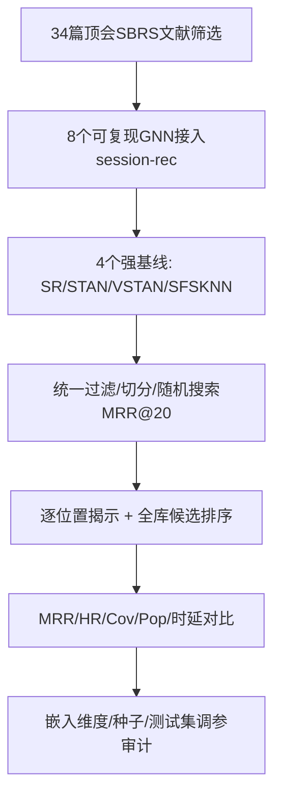
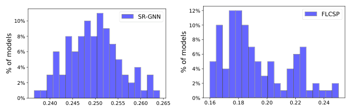

# Performance Comparison of Session-based Recommendation Algorithms based on GNNs (基于GNN的会话推荐算法性能比较)

- **会议/期刊**: ECIR 2024
- **作者与机构**: Faisal Shehzad, Dietmar Jannach；University of Klagenfurt
- **推荐链路定位**: 精排（会话内 next-item 排序）
- **研究方向**: 序列与会话推荐 / 去偏公平、可信隐私与工业架构（评测基准）
- **论文原文**: [论文原文链接](https://arxiv.org/abs/2312.16695v2)
- **开源代码**: [开源代码仓库链接](https://github.com/rn5l/session-rec)

## TL;DR (1分钟核心速览)

本文质疑GNN会话推荐“持续超越”的假设：在统一预处理、划分、调参与排序协议下复现8个顶会GNN，并加入SR/STAN/VSTAN/SFSKNN强基线。结果显示简单模型在4个数据集设置的MRR@20上不劣于甚至优于GNN，HR仅在部分配置被反超；随机种子与嵌入维度还可造成大幅波动，提示“幻影进展”仍存在。

## Background & Motivation (背景与核心矛盾)

- **主流范式**: 匿名会话仅用当前session，GNN构建会话图并融入类别等side information，成为SIGIR/RecSys/ECIR近期主流。
- **前人局限**: 数据预处理、划分、指标、候选打分协议不统一；多数论文只比弱item-KNN或流行度基线，忽视STAN/VSTAN/SFSKNN等强kNN；嵌入维度常被固定，甚至存在测试集调参。
- **核心洞察 (Key Insight)**: 2017年后kNN在SBRS仍具强竞争力，GNN论文的“全面提升”可能来自弱基线、调参泄漏与随机性，而非模型本身。
- **本文切入点**: 半系统筛选34篇顶会文献，取8个可复现代码，在session-rec框架内同条件重跑，并审计种子、嵌入维度与测试集调参的影响。

## Method (核心方法设计)

### 1. 整体框架 (Overall Architecture)

本文不提出新推荐模型，而是构建一套可复现的“GNN会话推荐基准审计”流程：先按顶会发表与代码可用性筛选8个GNN模型，统一接入session-rec框架；同时加入4个非神经网络强基线；所有模型使用同一数据过滤、时间切分、随机搜索调参与MRR@20目标；最后在MRR/HR、覆盖率、流行度、训练/预测时延上比较，并追加嵌入维度、随机种子、测试集调参三类稳健性实验。

### 2. 关键设计拆解 (Key Designs)

1. **统一复现与强基线注入**：痛点在于GNN论文常只比弱item-KNN，本文把原作者代码统一接入框架，并强制加入STAN/VSTAN/SFSKNN等强kNN/规则模型。这样可检验“GNN增益”是否只是基线选择造成的假象。
2. **统一调参与评测协议**：所有模型用训练集/验证集随机搜索25–60轮，目标为MRR@20；评测逐位置“揭示”session内物品，报告MRR@K与HR@K，并以$\mathrm{MRR@K}=\frac{1}{|\mathcal{S}|}\sum_{s\in\mathcal{S}}\frac{1}{\mathrm{rank}(s)}\mathbb{I}[\mathrm{rank}(s)\le K]$统一排序质量。统一协议消除了原论文“留最后一项”等差异。
3. **稳健性审计**：在固定最优超参下变动嵌入维度（RSC15取16–500，DIGI取16–250）、随机种子（RSC15 100个、DIGI 35个），并复现“测试集调参”以量化乐观偏差。该设计把“模型好坏”扩展为“结果是否可信”。

**训练目标、负采样与推理效率**：不引入新损失；各模型沿用原作者损失，统一以MRR@20调参。评测未报告采样负例，采用全库候选排序；kNN无训练阶段，GCE-GNN在DIGI单次训练约19小时，COTREC生成单条推荐列表约2秒，工业实时性风险显著。

## Experimental Setup & Evaluation Protocol (实验设置与评估协议)

- **数据集与预处理**: 采用RSC15(1/12、1/64)、DIGI、RETAIL；过滤长度1的session、出现少于5次的item、测试集新item；匿名会话无#Users。

| 数据集 | Clicks | #Items | #Categories | #Sessions | Avg. len |
| :--- | :---: | :---: | :---: | :---: | :---: |
| RSC15 (1/12) | 574,157 | 20,979 | 58 | 145,202 | 3.95 |
| RSC15 (1/64) | 107,242 | 13,133 | 31 | 26,464 | 4.05 |
| DIGI | 1,004,598 | 43,100 | 995 | 216,134 | 4.65 |
| RETAIL | 1,045,413 | 44,540 | 944 | 304,902 | 3.42 |

- **数据划分与防穿越**: RSC15/RETAIL取最后一天session为测试集；DIGI取最后7天为测试集，其余用于训练与验证；未使用未来交互。
- **排名评测协议**: 逐位置揭示session内物品，全库候选排序（原文未报告采样负例）；主指标MRR@10/20、HR@10/20，辅以Cov@20、Pop@20。
- **对比基线与超参设置**: 8个GNN（SR-GNN、TAGNN、GCE-GNN、COTREC、GNRRW、FLCSP、CM-HGNN、MGS）+4个简单基线；嵌入维度$d$作为超参搜索而非固定；ANOVA$p<0.05$，Tukey post-hoc检验最优模型间差异。

## Key Experimental Results (实验关键数据)

### 1. 主实验对比 (Main Results)

下表保留8个代表性模型，单元格为MRR@20 / HR@20；每列加粗该指标最优值。

| 类型/模型 | RSC15 1/12 | RSC15 1/64 | DIGI | RETAIL |
| :--- | :---: | :---: | :---: | :---: |
| 简单 STAN | 0.330 / 0.661 | **0.296** / 0.613 | **0.351** / 0.600 | 0.548 / 0.931 |
| 简单 VSTAN | 0.330 / **0.673** | 0.289 / 0.595 | 0.346 / 0.581 | **0.631** / **0.980** |
| 简单 SFSKNN | 0.325 / 0.609 | 0.264 / 0.428 | **0.351** / 0.604 | 0.603 / **0.980** |
| 简单 SR | **0.344** / 0.627 | 0.266 / 0.506 | 0.337 / 0.617 | 0.560 / 0.959 |
| GNN SR-GNN | 0.332 / 0.621 | 0.251 / 0.581 | 0.327 / **0.688** | **0.631** / 0.931 |
| GNN CM-HGNN | 0.299 / 0.618 | 0.284 / **0.650** | 0.316 / 0.649 | 0.568 / 0.890 |
| GNN COTREC | 0.312 / 0.639 | 0.279 / 0.616 | 0.335 / 0.637 | 0.556 / 0.861 |
| GNN MGS | 0.331 / 0.642 | 0.270 / 0.630 | 0.329 / 0.656 | 0.558 / 0.878 |

相对差（简单最优 vs GNN最优，按表内 $\Delta=(简单-GNN)/GNN$）：MRR@20 **+3.6%/+4.2%/+4.8%/0.0%**；HR@20 **+4.8%/-5.7%/-10.3%/+5.3%**，负号表示GNN更优。

### 2. 消融实验 (Ablation Study)

原文无模型组件消融；以下以“影响因子审计”替代，直接量化非模型因素。

| 审计项 | 设置 | 观测结果 |
| :--- | :--- | :--- |
| 嵌入维度 | RSC15 16–500；DIGI 16–250 | 最大MRR@20差达0.085/0.130；部分模型相对差>40%；效应量$\eta^2$=91.39%/85.53% |
| 随机种子 | RSC15 100个；DIGI 35个 | FLCSP在RSC15为0.159–0.250（差0.091）；TAGNN在DIGI为0.228–0.281 |
| 测试集调参 | 4个高效GNN | MRR@20平均虚高1.5–2.0%，最大+5.6% |

### 3. 关键实验发现 (Key Findings)

1. **强kNN/规则基线全面不劣于GNN（MRR）**：RSC15(1/12) SR 0.344 > SR-GNN 0.332（+3.6%）；RSC15(1/64) STAN 0.296 > GCE-GNN 0.285；DIGI SFSKNN/STAN 0.351 > COTREC 0.335（+4.8%）；RETAIL VSTAN与SR-GNN均0.631打平。
2. **HR只在部分配置被GNN反超**：DIGI上SR-GNN 0.688 > SR 0.617（GNN相对+11.5%），RSC15(1/64) CM-HGNN 0.650 > STAN 0.613；但RSC15(1/12) VSTAN 0.673 > MGS 0.642，RETAIL VSTAN/SFSKNN 0.980 > SR-GNN 0.931，说明GNN优势并不稳定。
3. **随机性与调参可制造“幻影进展”**：FLCSP仅换种子，RSC15 MRR@20从0.159到0.250；测试集调参平均抬高1.5–2.0%、最高5.6%。同时GCE-GNN训练约19小时、COTREC单列表预测约2秒，而kNN无训练，复杂模型性价比存疑。

<figure class="paper-figure" markdown="span">
  <figcaption>图1：不同随机种子下MRR@20值的分布（RSC15）</figcaption>
</figure>

## Highlights & Limitations (亮点、对比与审稿批判)

- **与代表作对比 (vs. Prior Work)**: 原始GNN论文多只比弱item-KNN/流行度，本文注入STAN/VSTAN/SFSKNN强基线并统一调参；相较以往可复现性研究，本文进一步覆盖GNN并审计种子、嵌入维度与测试集调参。
- **可迁移亮点**: 任何新会话推荐模型都应报告强kNN/规则基线、种子方差与嵌入维度敏感性；评测应采用逐位置揭示而非只留最后一项，避免协议偏差。
- **审稿级局限批判**: 仅覆盖3个数据集且不含Transformer/LLM会话模型；8个GNN受“代码可用性”选择偏差影响；以MRR@20调参可能天然利于简单模型，HR未优化；最优模型间差异经Tukey检验有时不显著。

## Rating (四维评分)

- **方法创新性 (Novelty)**: ⭐⭐⭐ （非新模型，但系统审计与稳健性分析对社区方法论有直接价值）
- **评估协议与实验扎实度 (Protocol & Experiments)**: ⭐⭐⭐⭐ （3数据集、8 GNN+4强基线、统一调参与ANOVA，但缺Transformer与线上验证）
- **写作与数学规范度 (Clarity & Rigor)**: ⭐⭐⭐⭐ （协议、表格与审计清晰，公式极少但定义明确）
- **工业落地与复现价值 (Industrial & Practical Value)**: ⭐⭐⭐ （代码可复现、kNN高效；GNN训练/预测开销大，结论限于离线排序）

