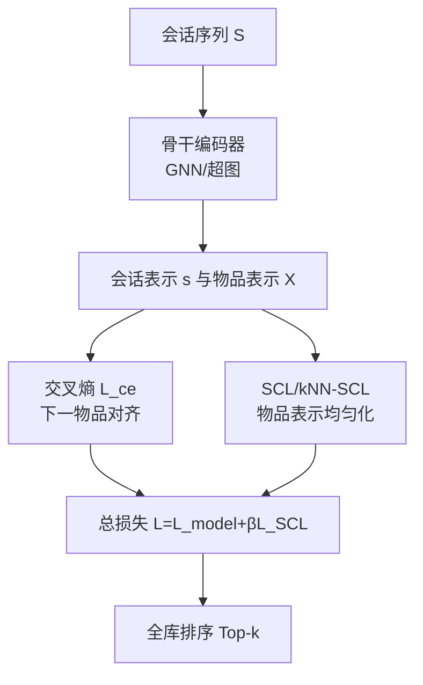
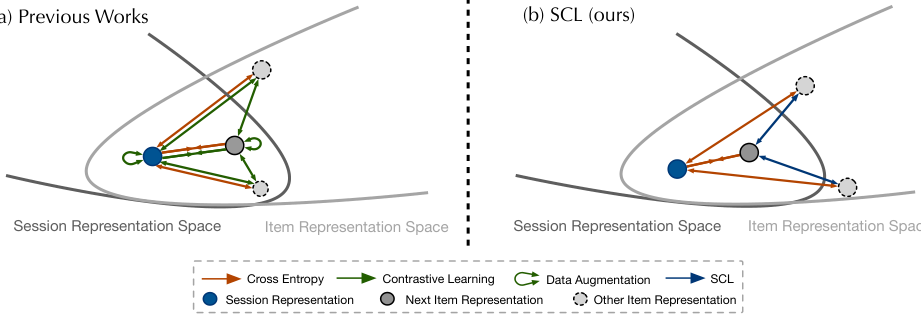

# Self Contrastive Learning for Session-based Recommendation (面向会话推荐的自对比学习)

- **会议/期刊**: ECIR 2024 (Full Paper)
- **作者与机构**: Zhengxiang Shi, Xi Wang, Aldo Lipani; University College London
- **推荐链路定位**: 召回 / 下一物品排序
- **研究方向**: 序列与会话推荐 / 自监督对比学习与交互去噪
- **论文原文**: [arXiv:2306.01266v2](https://arxiv.org/abs/2306.01266v2)
- **开源代码**: [GitHub](https://github.com/ZhengxiangShi/SelfContrastiveLearningRecSys)

## TL;DR (1分钟核心速览)

本文针对会话推荐中对比学习与交叉熵目标高度同质、过度对齐且依赖复杂增广的问题，提出自对比学习 SCL：仅以物品自身为正样本、全库其他物品为负样本，直接正则在单位超球面上均匀分布物品表示，并用 kNN 近似降低开销。在 Tmall/Nowplaying/Diginetica 全库排序协议下，SCL 即插即用，使 S2-DHCN 的 P@10 提升 22.7%、MRR@10 提升 27.9%（Tmall），并在多数据集显著优于 SOTA。

## Background & Motivation (背景与核心矛盾)

- **主流范式**: 会话推荐常用 GRU/GNN/超图编码会话，并叠加 InfoNCE 对比损失与交叉熵（CE）联合训练；S2-DHCN、COTREC 代表 SOTA。
- **前人局限**: ①InfoNCE 与 CE 都在拉近会话表示与下一物品、推远其他物品，作用重复，物品表示空间的均匀性被忽视；②复杂正负样本构造与数据增广强依赖模型结构，难迁移。
- **核心洞察 (Key Insight)**: CE 可写成 $\mathcal{L}_{ce}=-\log\frac{f(s,x^+)}{\sum_j f(s,x_j)}$，与 InfoNCE 同构；额外 CL 主要重复“对齐”，真正缺的是“均匀”。
- **本文切入点**: 用 SCL 直接惩罚物品表示间过近，专门优化均匀性，作为 CE 的互补正则。

## Method (核心方法设计)

### 1. 整体框架 (Overall Architecture)

输入会话序列 $S$，骨干编码器（GNN/超图）输出会话表示$s$与物品表示矩阵$X$；CE 负责将$s$ 对齐到下一物品，SCL 负责将各物品表示在单位超球面上推开；总损失为二者加权，推理仍按全库物品打分排序。

<figure class="paper-figure" markdown="span">
  <figcaption>图 1：SCL 框架示意图。在以往工作中，对比学习（CL）目标（绿色部分）通常涉及复杂建模，导致对物品表示空间优化的重视相对不足。相比之下，SCL（蓝色部分）专门解决该问题，并更好地补充交叉熵损失的作用。</figcaption>
</figure>
图 1：SCL 与既有 CL 目标对比（绿色为复杂 CL，蓝色为 SCL 直接优化物品均匀性）。

### 2. 关键设计拆解 (Key Designs)

1. **自对比损失 SCL（物品空间均匀化）**：痛点在于既有 CL 过度对齐、忽略物品间可分性。SCL 把每个物品自身当唯一正样本，其余物品全为负样本：
   $\mathcal{L}_{SCL}=-\sum_{i=1}^{n}\log\frac{g(x_i,x_i)}{\sum_{j=1}^{n}g(x_i,x_j)}$，其中$g(x_i,x_j)=e^{sim(x_i,x_j)/\tau}$。它不构造增广视图，直接让所有物品在超球面上互斥，提升语义可分性。
2. **kNN-SCL（降低二次复杂度）**：全量分母为 $O(n^2d)$，大物品库难扩展。用余弦最近$k$个物品构成$K_i$：
   $\mathcal{L}_{SCL}^{knn}=-\sum_i\log\frac{f(x_i,x_i)}{\sum_{x'\in K_i}f(x_i,x')}$，复杂度降为$O(nkd)$；$k=2$已有效，$k=10$ 基本饱和。
3. **训练目标、负采样与推理**：总损失 $\mathcal{L}=\mathcal{L}_{model}+\beta\mathcal{L}_{SCL}$；SCL 自带“自身正/其余负”机制，无需额外负采样或数据增广；$\tau=0.1$，$\beta\in[0.1,100]$。推理与骨干完全一致，仅训练增加正则项。

## Experimental Setup & Evaluation Protocol (实验设置与评估协议)

- **数据集与预处理**: 原文报告会话级训练/测试规模，未展开全局时间戳切分细节；评测在完整物品集上排序，属 Full-Ranking，避免采样负例偏差。

| 数据集 | #Train | #Test | #Items | 平均长度 | 场景 |
| :--- | :---: | :---: | :---: | :---: | :--- |
| Tmall | 351,268 | 25,898 | 40,728 | 6.69 | 电商购物 |
| Nowplaying | 825,304 | 89,824 | 60,417 | 7.42 | 音乐收听 |
| Diginetica | 719,470 | 60,858 | 43,097 | 5.12 | 电商交易 |

- **数据划分与防穿越 (Splitting Strategy)**: 原文按会话级训练/测试集规模报告；未给出全局时间戳切分细节，本文不臆造。
- **排名评测协议 (Ranking Protocol)**: 无偏 Full-Ranking（全库未交互物品排序），指标 P@k、MRR@k，$k\in\{5,10,20\}$。
- **对比基线与超参设置**: FPMC、GRU4REC、NARM、STAMP、SR-GNN、GCE-GNN、S2-DHCN、COTREC；$\tau=0.1$，$\beta\in[0.1,100]$；显著性$p<1e-20/1e-5/1e-2$。

## Key Experimental Results (实验关键数据)

### 1. 主实验对比 (Main Results)

表1 主实验（P@10/MRR@10，Full-Ranking；‡为复现；粗体为列最优；Δ为相对同骨干复现提升）

| 方法 | Tmall P@10 | Tmall MRR@10 | Nowplaying P@10 | Nowplaying MRR@10 | Diginetica P@10 | Diginetica MRR@10 | Tmall Δ(P/M) |
| :--- | :---: | :---: | :---: | :---: | :---: | :---: | :---: |
| FPMC | 13.10 | 7.12 | 5.28 | 2.68 | 15.43 | 6.20 | — |
| GRU4REC | 9.47 | 5.78 | 6.74 | 4.40 | 17.93 | 7.33 | — |
| NARM | 19.17 | 10.42 | 13.60 | 6.62 | 35.44 | 15.13 | — |
| STAMP | 22.63 | 13.12 | 13.22 | 6.57 | 33.98 | 14.26 | — |
| SR-GNN | 23.41 | 13.45 | 14.17 | 7.15 | 36.86 | 15.52 | — |
| GCE-GNN‡ | 27.48 | 14.85 | 17.19 | 8.09 | 40.98 | 18.12 | — |
| COTREC‡ | 30.44 | 17.28 | — | — | 40.26 | 17.75 | — |
| S2-DHCN‡ | 28.65 | 15.94 | 17.23 | 7.70 | 39.54 | 17.31 | — |
| GCE-GNN+SCL | 28.67 | 15.20 | 17.44 | **8.10** | **41.93** | **18.45** | 4.3/2.4 |
| COTREC+SCL | 35.03 | **20.46** | — | — | 40.78 | 18.00 | 15.1/18.4 |
| S2-DHCN+SCL | **35.14** | 20.39 | **17.61** | 7.92 | 40.91 | 17.79 | 22.7/27.9 |

### 2. 消融实验 (Ablation Study)

表2 移除原复杂 CL 目标后的对比（P@10/MRR@10，约值）

| 设置 | COTREC Tmall | COTREC Dig. | S2-DHCN Tmall | S2-DHCN Dig. |
| :--- | :---: | :---: | :---: | :---: |
| 原骨干 (复现) | 30.44/17.28 | 40.26/17.75 | 28.65/15.94 | 39.54/17.31 |
| + SCL only | 34.9/20.5 | 40.8/18.0 | 35.0/20.4 | 40.8/17.8 |
| + SCL + 原CL | 35.0/20.5 | 40.8/18.0 | 35.1/20.4 | 40.9/17.8 |

### 3. 关键实验发现 (Key Findings)

- SCL 即插即用：Tmall 上 S2-DHCN P@10 从 28.65→35.14（+22.7%），MRR@10 从 15.94→20.39（+27.9%）；COTREC 为 +15.1%/+18.4%，且显著性 $p<1e-20$。
- 均匀性降低是主因：原文图2 中 S2-DHCN Tmall 的 $\ell_{uniform}$ 从 -3.86→-3.92，P@10 同步升至 35.14；对齐损失反而由 1.08 升至约 1.20，说明过度对齐会损害性能。
- 复杂 CL 冗余且 kNN 高效：仅 SCL 与 SCL+原 CL 几乎持平（COTREC Tmall 34.9 vs 35.0）；$k=2$已超原骨干，$k=10$基本饱和，复杂度由$O(n^2d)$降至$O(nkd)$。

## Highlights & Limitations (亮点、对比与审稿批判)

- **与代表作对比 (vs. Prior Work)**: S2-DHCN 依赖双编码器与损坏会话构造正负样本，COTREC 依赖两套物品表示与模型特定增广；SCL 只做物品-物品均匀性正则，不增广、不构造对，可直接替换既有 CL 目标。
- **可迁移亮点**: ①把 CL 从“样本对工程”转为“表示空间均匀性正则”，可加到任意 item embedding 表；②kNN-SCL 用向量检索把 $O(n^2)$降到$O(nk)$，适合大物品库。
- **审稿级局限批判**: ①强制所有物品互斥可能忽略同类/互补语义，缺少层级或品类约束；②kNN 检索与 $\beta/\tau$ 调参带来训练开销，论文未报告线上 A/B、冷启动分桶与极端长尾场景。

## Rating (四维评分)

- **方法创新性 (Novelty)**: ⭐⭐⭐⭐ （点明 CE 与 InfoNCE 同构，用极简均匀性正则替代复杂 CL，朴素但切中要害。）
- **评估协议与实验扎实度 (Protocol & Experiments)**: ⭐⭐⭐⭐ （三基准、全库排序、显著性检验和多骨干验证较完整，但切分细节与线上验证不足。）
- **写作与数学规范度 (Clarity & Rigor)**: ⭐⭐⭐⭐ （公式简洁，对齐/均匀性分析直观，复杂度与 kNN 近似交代清楚。）
- **工业落地与复现价值 (Industrial & Practical Value)**: ⭐⭐⭐⭐ （代码开源、即插即用且推理零额外开销，训练端 kNN 与超参需工程调优。）

