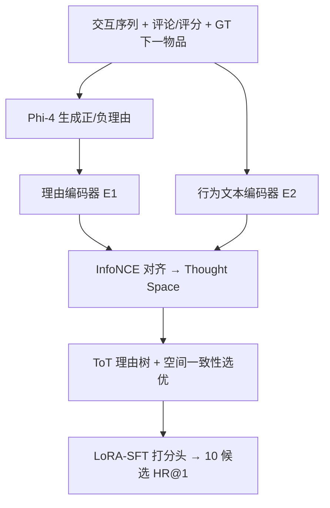
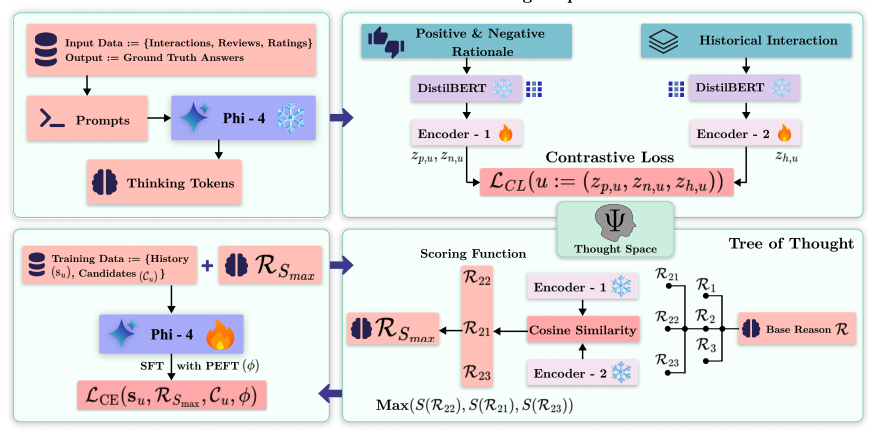
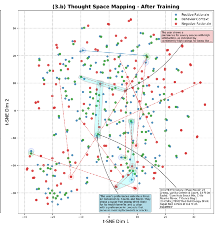

# From What to Why: Thought-Space Recommendation with Small Language Models (从“做什么”到“为什么”：小模型驱动的思维空间推荐)

- **会议/期刊**: ECIR 2026
- **作者与机构**: Prosenjit Biswas, Pervez Shaik, Abhinav Thorat, Ravi Kolla, Niranjan Pedanekar（Sony Research India）
- **推荐链路定位**: 精排（10 候选打分）+ 理由生成增强
- **研究方向**: 大语言模型推荐 (LLM4Rec) / 自监督对比学习
- **论文原文**: [https://arxiv.org/abs/2510.08626v1](https://arxiv.org/abs/2510.08626v1)
- **开源代码**: [匿名仓库](https://anonymous.4open.science/r/Thinking_PULSE-0FC5/README.md)

## TL;DR (1分钟核心速览)

现有 LLM4Rec 依赖十亿级参数推理、代价高昂，而 SLM 生成的自然语言理由（rationale）只被当作描述性文本，未作为监督信号。本文提出 PULSE：先让 Phi-4 (4B) 由交互历史+真实下一物品生成"为什么选"的理由，用 InfoNCE 将理由嵌入与行为文本嵌入对齐成 **Thought Space**，再用 Tree-of-Thought 扩展理由、以思维空间余弦一致性选出最佳理由，最后 LoRA-SFT 一个小模型在 10 候选集上打分。在三个 Amazon 数据集（5-core、末次交互切分、1 正 9 负采样排序、HR@1）上把最强基线 ALLMRec+Reason 从 0.73/0.74/0.78 提升至 0.93/0.84/0.92。

## Background & Motivation (背景与核心矛盾)

- **主流范式**: 一路是把 ID/物品改写成提示词交给 LLM 做零样本或少样本推荐；另一路是 LLM-CF 混合（ALLMRec）或把 LLM 生成的思维链/理由（R2Rec、RDRec）当作下游模型的辅助输入。
- **前人局限**: ①十亿级参数的训练/推理开销使延迟敏感场景难以部署，即使蒸馏也要先付 LLM 推理成本；②理由被"消费"而非"监督"——往往原样拼进 prompt，缺少筛选与精炼，噪声理由反而污染输入；③对比学习只在交互层面（序列掩码、图扰动、嵌入加噪）做增广，从未把理由本身当作对比对象。
- **核心洞察 (Key Insight)**: 理由刻画的是"为什么"，比"点击了什么"更具因果与跨域可迁移性（如"偏好有机产品""追求长期功效"这类模式在交互数据缺失时仍可迁移），因此天然适合作为对比学习的锚点；只要把理由与行为拉到同一空间，小模型也能替代大模型的知识蒸馏。
- **本文切入点**: 不做 LLM 蒸馏，而是自建一个 SLM 生成的共享"思维空间"，用对比对齐把理由变成**一等的监督信号**，再用对齐度而非生成似然来挑理由。

## Method (核心方法设计)

### 1. 整体框架 (Overall Architecture)

输入是用户时序交互序列 $s_u$、物品元数据与评论评分，输出是 10 候选集中的下一物品打分。**Phase I（造空间）**：把$(s_u, i_{t+1})$与评论评分喂给 Phi-4 (4B)，生成正理由$R_u^+$；batch 内其他用户的正理由作为负理由$R_v^-$（1:10 采样）。用两个 DistilBERT 初始化的编码器$E_1$（理由）、$E_2$（行为文本$b_u=(s_u,i_{t+1})$）做对比训练，得到对齐的 Thought Space。**Phase II（用空间）**：用 ToT 把一条基础理由扩成两层树，取叶节点在思维空间里与$b_u$余弦一致性最高者为$R_{S_{\max}}$；随后冻结$E_1,E_2$，仅用 LoRA 微调 SLM 打分头，对 10 个候选输出 logits 做 softmax 交叉熵。

<figure class="paper-figure" markdown="span">
  <figcaption>图 1. 架构图。标有 的组件可训练，而标有 的组件被冻结，仅在推理时使用。</figcaption>
</figure>

### 2. 关键设计拆解 (Key Designs)

1. **理由级对比对齐（Thought Space）**：痛点在于直接拿 SBERT/DistilBERT 的通用语义相似度选理由，会把"读起来像"但用户并不认同的理由排到前面。本文改为让理由编码器与行为编码器在同一 InfoNCE 下联合微调，正理由靠近行为锚点、负理由被推开：

$$\mathcal{L}_{CL}(u)=-\log\frac{\exp(\mathrm{sim}(\boldsymbol{z}_{p,u},\boldsymbol{z}_{h,u})/\tau)}{\exp(\mathrm{sim}(\boldsymbol{z}_{p,u},\boldsymbol{z}_{h,u})/\tau)+\sum_{j=1}^{M}\exp(\mathrm{sim}(\boldsymbol{z}_{n,u}^{j},\boldsymbol{z}_{h,u})/\tau)}$$

直觉：把"行为—理由"的匹配从通用语义空间搬到任务特定空间，使相似度直接度量"这条理由是否解释了这个用户的选择"。t-SNE 显示训练前行为与理由分居两簇，训练后正例紧贴锚点、负例外移。

<figure class="paper-figure" markdown="span">
  <figcaption>图 3. 对比对齐前后的思维空间。(a) 预训练：行为嵌入（绿色）与带有正例（蓝色）和负例（红色）的理由嵌入未对齐，由 DistilBERT 初始化的行为文本和理由文本占据不同区域。(b) 训练后：优化式 (1) 后，正例聚集在其行为锚点附近（蓝色边缩短），而负例被排斥（红色边变长）。</figcaption>
</figure>

2. **ToT 理由精炼 + 空间选优**：单次 prompt 的理由噪声大、覆盖窄。本文让 SLM 先扩 $n$个一级、每个再扩$m$ 个二级改写，形成深度 2 的理由树；然后用 Phase I 的冻结编码器评分选叶：

$$R_{S_{\max}}=\arg\max_{R_{i,j}}\ \mathrm{sim}\big(E_1(R_{i,j}),\,E_2(b_u)\big)$$

关键差别是选择准则从"生成似然 LL"换成"行为一致性"——前者奖励语言模型自己的流畅偏好，后者奖励与用户行为的因果贴合，因此跨域时更稳。

3. **训练目标、负采样与推理开销**：Phase I 损失为 $\mathcal{L}_{CL}$（batch 内跨用户负例 + 随机 10 倍负理由，无 hard negative 挖掘）；Phase II 损失为

$$\mathcal{L}_{CE}(u)=-\log p_\phi\big(i^u_{t+1}\mid s_u,R_{S_{\max}},\mathcal{C}_u\big)$$

仅 $\phi$（LoRA，rank 8、$\alpha=16$）可训练，$E_1,E_2$ 冻结、无梯度回传 Phase I。推理时只需一次 SLM 前向对 10 候选打分，无自回归文本生成，因此延迟远低于 LLM 生成式推荐；但 ToT 理由树与理由生成是离线预处理，成本一次性摊销。

## Experimental Setup & Evaluation Protocol (实验设置与评估协议)

- **数据集与预处理**: 三个 Amazon 评论数据集，去重、按时间排序、过滤交互数 < 5 的用户/物品（5-core），序列截断/补齐至 50。

| 数据集 | #Users | #Items | #Interactions | 稀疏度 | 特征/场景说明 |
| :--- | :---: | :---: | :---: | :---: | :--- |
| Luxury Beauty | 11,690 | 6,534 | 71,898 | 0.094% | 平均序列仅 4.15，极稀疏美妆 |
| Prime Pantry | 15,611 | 7,841 | 150,402 | 0.123% | 日用杂货，序列中等 (7.64) |
| Video Games | 64,073 | 33,614 | 568,508 | 0.026% | 用户/物品规模最大、最稀疏 (6.88) |

- **数据划分与防穿越 (Splitting Strategy)**: 时间感知切分——每个用户最后一次交互作测试、其余作训练，属 `Leave-Last-Out` 变体；无验证集之外的全局时间戳对齐。
- **排名评测协议 (Ranking Protocol)**: **Sampled Ranking**，候选集 $|\mathcal{C}_u|=10$（1 个真实下一物品 + 9 个从未交互物品，均匀采样），指标为 HR@1；同时对 ToT 选优需要真实下一物品作为行为文本的一部分（见下"局限"）。**注意：并非 Full-Ranking**。
- **对比基线与超参设置**: SASRec、CTRL、MoRec、DuoRec、EC4SRec、ALLMRec、ALLMRec+Reason、SLM+SFT 共 8 个基线；理由/行为编码器 DistilBERT，SLM 为 Phi-4 (4B)，Phase I lr $2\times10^{-5}$、batch 32，Phase II batch 1、lr$2\times10^{-4}$、LoRA rank 8，max token 512，双 RTX 3090。

## Key Experimental Results (实验关键数据)

### 1. 主实验对比 (Main Results)

| Model | Luxury Beauty | Prime Pantry | Video Games |
| :--- | :---: | :---: | :---: |
| SASRec | 0.5612 | 0.3702 | 0.6117 |
| CTRL | 0.3154 | 0.2660 | 0.4003 |
| DuoRec | 0.5412 | 0.3519 | 0.5139 |
| EC4SRec | 0.5781 | 0.3995 | 0.5891 |
| ALLMRec | 0.6014 | 0.6237 | 0.6990 |
| ALLMRec+Reason | 0.7309 | 0.7426 | 0.7781 |
| SLM+SFT | 0.6100 | 0.5700 | 0.6757 |
| **PULSE (ours)** | **0.9339** | **0.8373** | **0.9170** |
| Improv. vs best baseline | +27.8% | +12.8% | +17.8% |

### 2. 消融实验 (Ablation Study)

| 设置 | Luxury Beauty | Prime Pantry | Video Games |
| :--- | :---: | :---: | :---: |
| 评分空间：DistilBERT 余弦 | 0.7920 | 0.6284 | 0.8896 |
| 评分空间：SBERT 余弦 | 0.8636 | 0.7182 | 0.8046 |
| 评分空间：**Thought Space** | **0.9339** | **0.8373** | **0.9170** |
| SFT 无理由（仅历史+候选） | 0.6111 | 0.5748 | 0.6757 |
| SFT + 单条基础理由 | 0.7186 | 0.7718 | 0.8883 |
| SFT + ToT，按对数似然选 | 0.8559 | 0.7548 | 0.8647 |
| SFT + ToT，按 Thought Space 选 | **0.9339** | **0.8373** | **0.9170** |

跨域迁移（Luxury Beauty → Video Games，HR@1）：SASRec 0.1030、MoRec 0.0700、SFT 无理由 0.4075、基础理由 0.5580、ToT+LL 0.5460、**PULSE 0.6240**（相对 SASRec 6.1×）。下游多跳 QA（HotpotQA dev）：ReAct+Thought Space 取得 **F1 0.6060 / EM 0.4951**，优于 Standard Prompting（0.5607/0.4553）与 ReAct+CoT（0.5667/0.4283）。

### 3. 关键实验发现 (Key Findings)

1. **"有理由"本身贡献最大，但选理由的方式决定上限**：从无理由 (0.6111) 到加一条基础理由 (0.7186) 已获 +17.6% 相对提升，说明理由确实携带增量语义；而在同一 ToT 候选池上，把选择准则从 LL 换成 Thought Space，在 Luxury Beauty 上从 0.8559 跳到 0.9339（+9.1%），在 Prime Pantry 上从 0.7548 跳到 0.8373（+10.9%）——增益来自"选得对"，不是"生成得多"。
2. **任务特定对齐显著强于通用语义相似度**：Thought Space 相比 SBERT 余弦在三个数据集上分别 +8.1%/+16.6%/+13.9%，且在 Video Games 上 SBERT 甚至退化到 0.8046（低于 DistilBERT 的 0.8896），说明通用句向量在领域文本上排序不稳定，而对比微调后的空间才是可靠的选择器。
3. **理由级对齐带来跨域鲁棒性**：训练于美妆、直测游戏时，所有基于 ID/模态的方法崩塌（SASRec 0.103、MoRec 0.070），而 PULSE 达 0.624，甚至高于同域 SFT 无理由的 0.4075（+53.1%）；这印证"为什么"比"什么"在分布漂移下更可迁移，且该推理能力可外溢到 HotpotQA（EM +17.9% vs ReAct+CoT）。

## Highlights & Limitations (亮点、对比与审稿批判)

- **与代表作对比 (vs. Prior Work)**: 相比 ALLMRec 与其 +Reason 变体，本文不把理由当输入特征而当作对比锚点与筛选准则，用 4B 模型击败十亿级 LLM 混合方案；相比 EC4SRec 的解释引导增广，本文的对比对象从"交互序列的多视图"上移到"理由文本本身"；相比 DuoRec 的序列级对比正则，本文的负例是跨用户的"错误偏好解释"，语义粒度更细。
- **可迁移亮点**: ①"用对齐度替代生成似然"作为理由/思维链筛选准则，可直接移植到 CoT 蒸馏、RAG 证据选择、可解释推荐 reranking；②行为-理由双编码器 + 冻结复用（Phase I 训练、Phase II 只推理）是一种低成本的"理由质量打分器"范式。
- **审稿级局限批判**: ①**评估协议偏弱**：仅 10 候选的 Sampled Ranking + HR@1，随机命中率就有 10%，0.93 的绝对值说服力有限，缺 Full-Ranking 与 NDCG@K 佐证；②**存在信息泄漏风险**：正理由由 $(s_u, i_{t+1})$共同生成，ToT 选优的评分函数又以包含$i_{t+1}$的行为文本$b_u$ 为锚，测试时如何获得无 GT 的行为文本未充分交代；③Phase II batch=1、ToT 理由树需离线批量 SLM 调用，工程吞吐与端到端延迟未做量化对比。

## Rating (四维评分)

- **方法创新性 (Novelty)**: ⭐⭐⭐⭐ （首次把理由文本本身作为对比锚点并提出 Thought Space 选优准则，思路清晰；但 InfoNCE + 双编码器组合本身较常规）
- **评估协议与实验扎实度 (Protocol & Experiments)**: ⭐⭐⭐ （三数据集 + 跨域 + QA 外溢较全面，但 10 候选采样排序与 HR@1 单一指标明显偏低，且缺显著性检验与 Full-Ranking）
- **写作与数学规范度 (Clarity & Rigor)**: ⭐⭐⭐⭐ （两阶段流程与符号表清晰、公式简洁；对行为文本含 GT 的处理与复杂度分析略欠严谨）
- **工业落地与复现价值 (Industrial & Practical Value)**: ⭐⭐⭐⭐ （4B 模型 + LoRA + 免生成式推理，成本友好且有匿名代码；但理由生成/ToT 的离线成本与在线吞吐仍需工程化验证）

