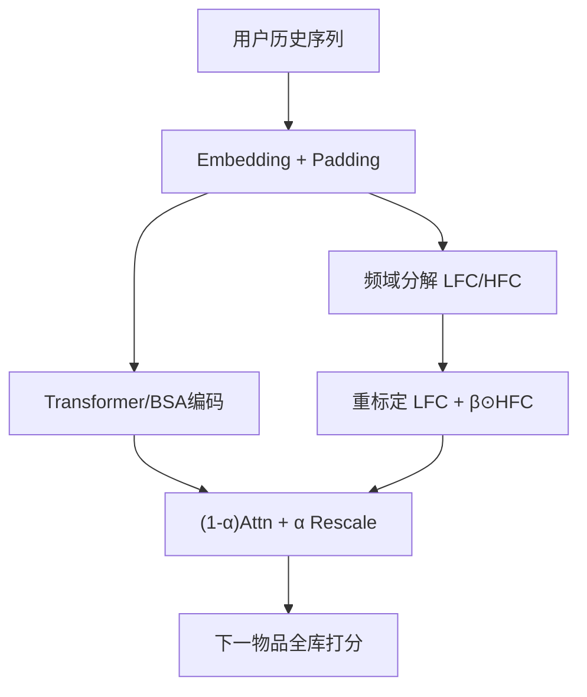

# A Systematic Reproducibility Study of BSARec for Sequential Recommendation (BSARec 用于序列推荐的系统性可复现性研究)

- **会议/期刊**: ECIR 2026
- **作者与机构**: Jan Hutter, Hua Chang Bakker, Stan Fris, Madelon Bernardy, Yuanna Liu；University of Amsterdam
- **推荐链路定位**: 召回/排序（Next-Item 序列推荐）
- **研究方向**: 序列与会话推荐
- **论文原文**: [论文原文链接](https://arxiv.org/abs/2512.17442v1)
- **开源代码**: [开源代码仓库链接](https://github.com/Janhutter/BSARec)

## TL;DR (1分钟核心速览)

本文系统复现BSARec，提出scaled DC度量用户历史频率，并在7个基准上拆解频域重标定、DWT/残差与padding。Full-Ranking下BSARec在LastFM、ML-1M、Toys领先（LastFM HR@10 +18.94%），却在Yelp/MIND落后；DSP相对残差无稳定优势，reflect padding带来显著增益。

## Background & Motivation (背景与核心矛盾)

- **主流范式**: Transformer自注意力在序列推荐中建模长短期兴趣，但其频谱响应近似低通滤波；BSARec并联频域重标定分支，用DFT放大高频分量以捕捉短期兴趣。
- **前人局限**: BSARec的SOTA结论尚未被独立复现；其“高频收益”与各组件（DFT、重标定、padding）的因果关系未拆开验证。
- **核心洞察 (Key Insight)**: 零填充本身是恒定低频信号，会污染频域分解并削弱频率重标定器；用户历史频率可用scaled DC分量量化并分组检验。
- **本文切入点**: 以复现实验为骨架，增加频率分组、DWT/残差替换与padding策略三类扩展分析。

## Method (核心方法设计)

### 1. 整体框架 (Overall Architecture)

BSARec在标准Transformer编码器旁并联BSA频率分支：输入经DFT分解为低频$\mathrm{LFC}_c(\mathbf{x})$与高频$\mathrm{HFC}_c(\mathbf{x})$，用可学习$\boldsymbol{\beta}$重标高频，再与注意力输出加权融合；复现研究只替换频域算子、padding与评估分组。训练仍为下一物品全库softmax，推理为全库排序。

<figure class="paper-figure" markdown="span">
  ![图1：BSARec 架构，复现自 \[26\]。](../../../../assets/papers/2512.17442v1/figure_1.png)<figcaption>图1：BSARec 架构，复现自 [26]。</figcaption>
</figure>

### 2. 关键设计拆解 (Key Designs)

1. **scaled DC 频率度量**：将用户历史映射为类别序列，按首次出现顺序编码为稠密向量$\mathbf{d}_u$。定义$\mathrm{scaledDC}(x)=1-\mathcal{F}(\mathbf{d}_u)_1/\|\mathbf{d}_u\|_2=1-\mathrm{sim}(\mathbf{1},\mathbf{d}_u)$。值越大，历史越不平坦，高频/短期兴趣越强；按Q1–Q4分组可检验模型是否真在高频用户上占优。
2. **频域重标定与DSP替换**：原算子为$\mathrm{Rescale}_c(\mathbf{x})=\mathrm{LFC}_c(\mathbf{x})+\boldsymbol{\beta}\odot\mathrm{HFC}_c(\mathbf{x})$，并与注意力输出做$(1-\alpha)\mathrm{Attn}(\mathbf{X})+\alpha\mathrm{Rescale}_c(\mathbf{X})$。本文把DFT换成Haar-DWT与纯残差，检验“高频重标定”是否必须依赖DSP。
3. **Padding 策略**：零填充等价于向序列注入恒定低频分量，使LFC被padding主导、HFC主要剩真实物品，重标定器难以识别高频兴趣。故比较zero/cyclic/reflect/symmetric，padding置于历史左侧；reflect镜像但不重复首项，避免恒定低频主导。

**训练目标、负采样与推理效率**：$\mathcal{L}=-\sum_u\log\frac{\exp(s_{u,i_u^+})}{\sum_{j\in\mathcal{I}}\exp(s_{u,j})}$，无负采样；推理全库排序。频域分支增加一次DFT/DWT与逆变换，约$O(\ell\log\ell)$，相对Transformer编码开销较小。

## Experimental Setup & Evaluation Protocol (实验设置与评估协议)

- **数据集与预处理**: 沿用BSARec原文/仓库口径，Amazon系列按5-core过滤；统计如下：

| 数据集 | #Users | #Items | #Interactions | Avg. Length | Sparsity |
| :--- | :---: | :---: | :---: | :---: | :---: |
| Beauty | 22,363 | 12,101 | 198,502 | 8.9 | 99.93% |
| ML-1M | 6,041 | 3,417 | 999,611 | 165.5 | 95.16% |
| Sports | 25,598 | 18,357 | 296,337 | 8.3 | 99.95% |
| Toys | 19,412 | 11,924 | 167,597 | 8.6 | 99.93% |
| LastFM | 1,090 | 3,646 | 52,551 | 48.2 | 98.68% |
| Yelp | 30,431 | 20,033 | 316,354 | 10.4 | 99.95% |
| MIND | 91,935 | 48,204 | 230,117 | 21.0 | 99.99% |

- **数据划分与防穿越**: 按用户序列位置切分，末三位交互用于训练/验证/测试标签（Next-Item）；默认编码长度$\ell=50$，扩展至450；短序列左补零（padding研究除外）。
- **排名评测协议**: Full-Ranking 全库未交互物品排序（原文未重述候选规模，复现沿用BSARec官方实现），报告HR/NDCG@5/10/20。
- **对比基线与超参**: SASRec、BERT4Rec、FMLPRec、DuoRec、FEARec；嵌入维度$d$沿用官方实现（原文未重述）。5个随机种子，A100，配对t检验$p<0.05$；超参沿用原文并对MIND网格搜索$\alpha\in\{0.1,0.3,0.5,0.7,0.9\}$、$c\in\{1,3,5,7,9\}$、lr与heads。

## Key Experimental Results (实验关键数据)

### 1. 主实验对比 (Main Results)

下表每格为 **HR@10 / NDCG@10**；`Improv.`为BSARec相对该数据集最佳基线的相对变化（负值表示下降）。

| 数据集 | SASRec | BERT4Rec | FMLPRec | DuoRec | FEARec | BSARec | Improv.(H/N) |
| :--- | :---: | :---: | :---: | :---: | :---: | :---: | :---: |
| Beauty | .0466/.0246 | .0537/.0284 | .0535/.0288 | .0705/.0432 | **.0712/.0435** | .0712/.0433 | -0.13/-0.40 |
| LastFM | .0546/.0303 | .0495/.0256 | .0591/.0316 | .0547/.0338 | .0543/.0331 | **.0703/.0405** | +18.94/+19.73 |
| ML-1M | .2008/.1054 | .2234/.1220 | .2090/.1085 | .2678/.1512 | .2700/.1503 | **.2746/.1539** | +1.73/+1.80 |
| Sports | .0221/.0114 | .0275/.0141 | .0256/.0136 | **.0351/.0206** | .0346/.0203 | .0349/.0200 | -0.54/-2.77 |
| Toys | .0476/.0275 | .0429/.0240 | .0531/.0307 | .0650/.0412 | .0642/.0406 | **.0672/.0424** | +3.38/+2.77 |
| Yelp | .0212/.0105 | .0334/.0164 | .0259/.0129 | **.0340/.0172** | .0330/.0162 | .0309/.0154 | -9.31/-10.08 |
| MIND | .1068/.0584 | **.1739/.0947** | .0987/.0529 | .1692/.0926 | .1710/.0943 | .1633/.0899 | -6.11/-5.07 |

### 2. 消融实验 (Ablation Study)

下表为频域算子与padding替换（Table 4复现实测；DFT+zero为对照组）。

| 设置 | LastFM H@10 | LastFM N@10 | Yelp H@10 | Yelp N@10 | ML-1M H@10 | ML-1M N@10 |
| :--- | :---: | :---: | :---: | :---: | :---: | :---: |
| DFT + zero | .0686 | .0408 | .0310 | .0154 | .2784 | .1558 |
| DFT + cyclic | .0730 | .0411 | .0323 | .0161 | .2807 | .1594 |
| DFT + reflect | **.0760** | **.0430** | **.0332** | **.0166** | **.2817** | **.1595** |
| DFT + symmetric | .0701 | .0414 | .0328 | .0164 | .2801 | .1582 |
| Haar-DWT | .0642 | .0376 | — | — | .2736 | .1528 |

残差替换：图7显示$\ell<250$时略优于DFT，但误差带重叠；$\ell\ge250$与DFT相当，说明DSP非唯一增益来源。

### 3. 关键实验发现 (Key Findings)

1. **复现并非全面SOTA**：BSARec在LastFM（HR@10 .0703 vs .0591，+18.94%）、ML-1M（.2746 vs .2700，+1.73%）、Toys（+3.38%）领先；但Yelp（.0309 vs .0340，-9.31%）与MIND（.1633 vs .1739，-6.11%）明显落后，Sports NDCG@10也下降2.77%，说明原结论受数据集与对比学习缺失影响。
2. **DSP可替代性**：LastFM上Haar-DWT的HR@10 .0642显著低于DFT .0703，ML-1M .2736 vs .2746基本持平；残差连接与DFT误差带重叠。按scaled DC分Q1–Q4时，BSARec仅在LastFM/ML-1M高频组占优，Yelp趋势相反，频率收益呈数据集依赖。
3. **Padding是低成本增益**：reflect将LastFM HR@10 .0686→.0760（+10.8%）、Yelp .0310→.0332（+7.1%），ML-1M仅+1.2%；零填充低频主导频域分解，非恒定padding缓解此问题；但$\ell>200$后padding占比上升，增益递减。

## Highlights & Limitations (亮点、对比与审稿批判)

- **与代表作对比 (vs. Prior Work)**: 原始BSARec只报告若干SOTA；本文首次独立复现并指出Yelp/MIND失效，且DWT/残差不稳定优于DFT。相对FEARec/DuoRec，BSARec缺少对比学习，在Yelp/MIND上让位于它们；相对FMLPRec/SASRec，频域分支仅在部分数据集有效。
- **可迁移亮点**: scaled DC可直接作为“用户历史频率”诊断指标，用于分组评测任何序列推荐模型；reflect/cyclic/symmetric等非恒定padding可低成本迁移到DSP类序列模型。
- **审稿级局限批判**: 超参固定为$\ell=50$，长序列结论可能低估；DWT最终仅系统报告Haar小波；Table 2与Table 4的zero-padding结果存在差异，复现随机性与设置未完全解释；scaled DC依赖外部类别映射，跨域稳定性仍需验证。

## Rating (四维评分)

- **方法创新性 (Novelty)**: ⭐⭐⭐ （非新架构，但scaled DC与padding/DSP拆解提供了有价值的可复现性证据）
- **评估协议与实验扎实度 (Protocol & Experiments)**: ⭐⭐⭐⭐ （7数据集、5种子、t检验齐全；但候选协议与长序列超参复述不足）
- **写作与数学规范度 (Clarity & Rigor)**: ⭐⭐⭐⭐ （RQ组织清晰、公式简洁；个别表格数值口径需读者自行对齐）
- **工业落地与复现价值 (Industrial & Practical Value)**: ⭐⭐⭐ （代码开源、padding改动易落地；DSP分支收益不稳，线上需谨慎A/B）

