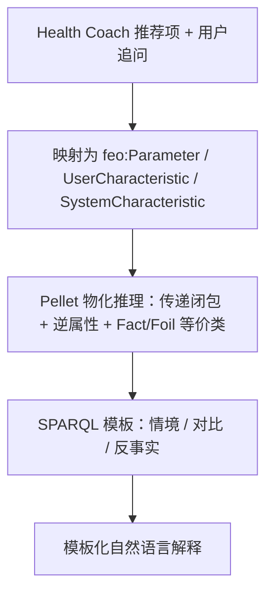
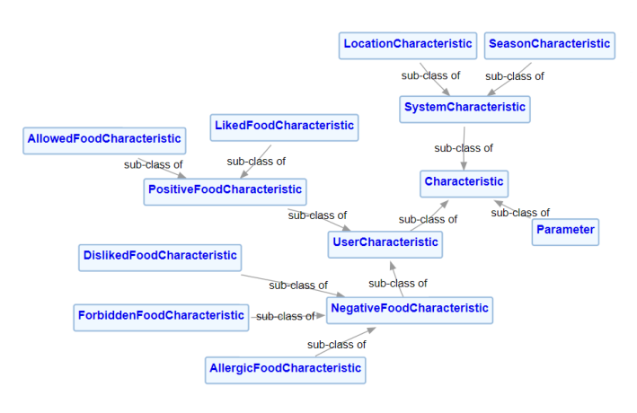
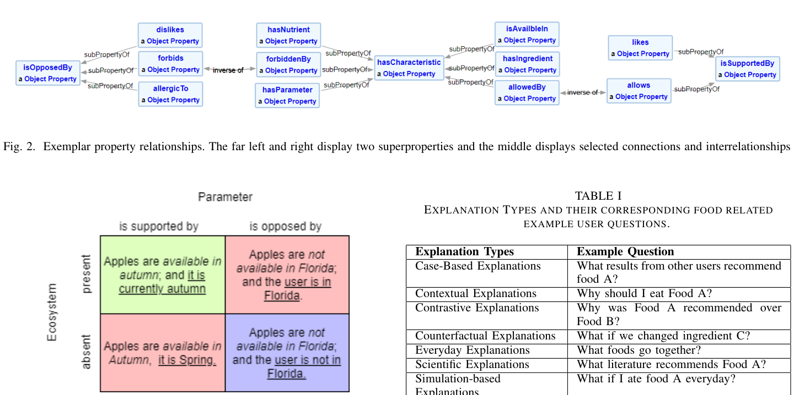

# Semantic Modeling for Food Recommendation Explanations (面向食物推荐解释的语义建模)

- **会议/期刊**: ICDE 2021
- **作者与机构**: Ishita Padhiar, Oshani Seneviratne, Shruthi Chari, Dan Gruen, Deborah L. McGuinness（Rensselaer Polytechnic Institute, Tetherless World Constellation / IDEA）
- **推荐链路定位**: 推荐后置解释层（面向对话式追问的解释生成，非打分/排序模块）
- **研究方向**: 对话推荐与智能体仿真 / 图神经网络与知识图谱推荐
- **论文原文**: [https://arxiv.org/abs/2105.01269v1](https://arxiv.org/abs/2105.01269v1)
- **开源代码**: 暂未开源（本体与资源站点见 https://purl.org/heals/food-explanation-ontology/ ）

## TL;DR (1分钟核心速览)

食物/膳食推荐的痛点不在"排不准"，而在**说不清**：理由横跨季节、地域、过敏、孕期禁忌等异质语义，黑箱模型给不出可追问的解释。作者提出 **FEO（Food Explanation Ontology）**，在 Explanation Ontology 与 What-To-Make/FoodKG 之上建立 `feo:Characteristic` 三层分类（问题参数 / 用户特征 / 系统特征）、Fact–Foil 等价类与传递属性，用 Pellet 物化推理 + SPARQL 模板抽取**情境、对比、反事实**三类解释。评测采用 3 个能力问题（CQ）对 Health Coach 的真实推荐做任务级验证，全部返回预期语义答案；论文**不含任何量化基准对比**。

## Background & Motivation (背景与核心矛盾)

- **主流范式**: 食物推荐多沿用内容（食材/菜谱网络）或行为历史的深度模型 [Forbes & Zhu; Ueda et al.]，输出仅为菜谱排序，理由是模型内部权重，不可读。
- **前人局限**: 其一，基于模板的"说服/追踪式"解释（Dragoni et al.）只能解释规则引擎的推理链，无法回答"为什么是它而不是另一个"这类对比与反事实追问；其二，通用解释本体（Explanation Ontology）虽定义了 9 类解释，却缺少食物域的语义约束（饮食、季节、过敏原）。
- **核心洞察 (Key Insight)**: 用户问句中的"关注点"（某道菜）与推荐环境（用户/系统）共享同一批底层特征，只要把二者统一到可递归遍历的同一层级下，解释就等于"两集合求交/求差"。
- **本文切入点**: 不造新推荐模型，而是把解释的**语义契约**显式编码为 OWL-DL 公理，让 SPARQL 一句查询即可跨多跳取证据。

## Method (核心方法设计)

### 1. 整体框架 (Overall Architecture)

FEO 走"本体建模 + 推理物化 + 模板查询"三段流水线：先由 Health Coach 这类黑箱推荐器给出菜谱与用户问题，把问题参数（如 Cauliflower Potato Curry）、用户特征（喜欢/厌恶/过敏/饮食）与系统特征（季节/地域/预算）映射为 `feo:Characteristic` 的实例；再由 Pellet 对 TBox+ABox 做一次物化，推出传递闭包、逆属性与 Fact/Foil 等价类成员；最后按解释类型套用 SPARQL 模板，把推断出的特征填充进自然语言解释。训练阶段完全不存在，成本集中在离线推理与查询复杂度。

### 2. 关键设计拆解 (Key Designs)

1. **`feo:Characteristic` 统一超类 + 传递属性递归（把推理深度从查询搬到公理）**：以往多跳证据（菜品→食材→应季→秋季）必须在查询里硬编码深度，换一道菜即失效。作者令 `feo:hasCharacteristic` 为 `owl:TransitiveProperty`：

$\text{feo:hasCharacteristic}^{+}=\bigcup_{k\ge 1}\text{feo:hasCharacteristic}^{k}$

于是查询只需写一跳，任意深度的基础特征都会回传。直觉：路径长度是本体事实，不应重复编码在每个查询里。

<figure class="paper-figure" markdown="span">
  <figcaption>图1. feo:Characteristic 类的子类。</figcaption>
</figure>

2. **Fact/Foil 等价类：把"好理由 vs 坏理由"编译成可判定描述逻辑**：对比解释此前无形式定义。作者用等价类与多重继承（`feo:forbids` 同时是 `isOpposedBy` 与 `isCharacteristicOf` 的子属性）区分"支持主参数且与环境吻合"的事实与"被环境反对"的反例：

$\text{eo:Fact}\equiv\text{feo:Parameter}\sqcap\exists\,\text{feo:hasCharacteristic}.\,(\text{feo:EcoCharacteristic}\sqcap\text{Match}\sqcap\neg\text{feo:isInternal})$

$\text{eo:Foil}\equiv\text{feo:Parameter}\sqcap\exists\,\text{feo:hasCharacteristic}.\,(\text{feo:forbids}\sqcup(\text{Support}\sqcap\neg\text{Match}))$

直觉：事实与反例是同一证据池的互补切片，因此对比与反事实解释**无需各自建模型**，只需改变切片条件。

<figure class="paper-figure" markdown="span">
  <figcaption>图3. 我们系统中事实与反例的定义。每个框中的斜体部分指问题参数的一项基础特征。下划线部分指生态系统的基础特征。这些特征本身可以重叠，并可包括位置和季节等内容。绿色方框中的实例视为事实，红色框中的实例为反例。蓝色框推荐指被归类为既非事实也非反例的实例。</figcaption>
</figure>

3. **内/外知识分离 + 逆属性免断言推理（训练目标与推理开销）**：情境解释只允许使用**外部**因素，否则"菜里含花椰菜"这类内因会污染理由。作者以布尔数据属性 `feo:isInternal` 过滤：

$\text{Ans}_{\text{ctx}}=\{\,c\in\text{Char}(p)\mid \text{feo:isInternal}(c)=\text{false}\,\}$

同时定义 `dislike`/`dislikedBy` 为 `owl:inverseOf`，使"讨厌食物"无需显式三元组即可被推出。全流程无损失函数、无负采样：离线 Pellet 物化一次，在线仅执行 SPARQL 图匹配，延迟由知识图谱规模而非模型推理决定。

## Experimental Setup & Evaluation Protocol (实验设置与评估协议)

- **数据与资源**: 论文未提供实例/三元组计数，下表为可用资源清单（**统计列缺失本身构成复现短板**）：

| 资源 | 角色 | 规模/说明 |
| :--- | :---: | :--- |
| FEO 本体 | TBox（本文贡献） | 3 个 `Characteristic` 子支 + 传递/逆/多重继承属性；类-属性数未报告 |
| Health Coach | 黑箱推荐来源 | 机器学习驱动的个性化膳食建议服务，提供真实推荐项 |
| Explanation Ontology | 解释类型规范 | 9 类解释的语义编码，FEO 复用其 3 类 |
| What-To-Make / FoodOn | 食物域词表 | 食材、菜谱、菜系；FEO 扩展了饮食、季节、地域可用性 |
| FoodKG | 外部证据库 | 可挂载孕期叶酸建议等科学/统计证据（未来工作） |

- **数据划分与防穿越 (Splitting Strategy)**: 不适用——无训练/测试集划分；评测为**能力问题 (competency question) 驱动的任务级本体评估**，是语义网领域评估 TBox 承诺的标准做法（Grüninger & Fox）。
- **排名评测协议 (Ranking Protocol)**: **不适用**——全文未报告 HR/Recall/NDCG@K，也未设定候选集或负采样；评价对象是"解释查询是否返回语义正确的结果"。
- **对比基线与超参**: 无 SOTA 数值基线，仅与 Dragoni et al. 的模板化 trace-based 说服系统做定性功能对比；无可调超参、无显著性检验。

## Key Experimental Results (实验关键数据)

### 1. 主实验对比 (Main Results)

论文以 3 个 CQ 覆盖 3 类解释，结果以 SPARQL 查询输出呈现（等价于"基线缺失下的定性通过/不通过"）：

| CQ | 解释类型 | 用户追问 | SPARQL 返回证据 | 结论 |
| :--- | :---: | :--- | :--- | :---: |
| CQ1 | Contextual | 为什么该吃 Cauliflower Potato Curry？ | `SeasonCharacteristic → Autumn`（外部特征） | 通过 |
| CQ2 | Contrastive | 为什么选 Butternut Squash Soup 而非 Broccoli Cheddar Soup？ | Fact：`Season → Autumn`；Foil：`AllergicFood → Broccoli` | 通过 |
| CQ3 | Counterfactual | 如果我怀孕了呢？ | `forbids → Sushi`；`recommends → Spinach Frittata`（含 Spinach） | 通过 |

解释类型覆盖度（源自原文 Table I，9 类中支持 3 类）：

| 解释类型 | FEO 支持 | 解释类型 | FEO 支持 |
| :--- | :---: | :--- | :---: |
| Contextual | ✔ | Scientific | ✘（未来） |
| Contrastive | ✔ | Statistical | ✘（未来） |
| Counterfactual | ✔ | Simulation-based | ✘ |
| Case-Based | ✘ | Trace-based | ✘ |
| Everyday | ✘ | — | — |

### 2. 消融实验 (Ablation Study)

原文**未做消融**；下表为依据其公理与查询逻辑推演的组件必要性分析（非实测数字）：

| 移除组件 | 失效 CQ | 预期后果 |
| :--- | :---: | :--- |
| `hasCharacteristic` 的传递性 | CQ1 | 只能取 1 跳特征，Season 无法经 Curry→Cauliflower→Season 抵达，情境解释为空 |
| Fact/Foil 等价类与 `forbids` 多重继承 | CQ2 | 无法区分支持性/反对性证据，输出退化为单侧特征列表 |
| `feo:isInternal` 内外过滤 | CQ1/CQ3 | 食材、菜系等内因混入"情境"结果，外部因素理由被稀释 |
| `dislike`/`dislikedBy` 逆属性 | CQ2 | 未显式断言"讨厌食物"时 foil 覆盖率下降 |

### 3. 关键实验发现 (Key Findings)

1. **一跳查询即可跨三跳取证**：CQ1 中 `Cauliflower Potato Curry → Cauliflower → Season → Autumn` 的整链由传递属性一次性回传，证明把路径深度写进本体公理可让终端 SPARQL 与图谱深度解耦——这是相对模板化 trace 解释最实质的结构性收益。
2. **对比解释与反事实解释共享同一证据池**：CQ2 同时输出正向 Fact（当季）与负向 Foil（过敏原 Broccoli），二者来自同一交集/差集运算，说明一套 `Characteristic` 层级足以支撑多解释类型，避免为每种解释重复建库。
3. **模型无关的插入成本极低**：CQ3 仅在 ABox 注入"怀孕"状态，即由 `forbids`/`recommends` 推出 Sushi→Spinach Frittata 的替代方案，无需重训推荐器，验证了 post-hoc 解释层可与黑箱模型解耦部署。

## Highlights & Limitations (亮点、对比与审稿批判)

- **与代表作对比 (vs. Prior Work)**: 相比 Explanation Ontology（通用但无食物语义）与 Dragoni 的模板 trace 系统（仅单一解释类型、绑定规则引擎），FEO 的差异在于**领域化 + 多类型 + 递归取证**；相比内容/行为驱动的深度食物推荐，它不追求排序精度，而是补上缺失的"理由层"。
- **可迁移亮点**: (i) 把"证据深度"编码为传递属性、以查询侧一跳替代多跳枚举，可用于任何 KG 增强推荐的解释模块；(ii) 用 Fact/Foil 等价类同时服务对比与反事实解释，是低成本复用证据池的通用范式。
- **审稿级局限批判**: (i) **评测过弱**——仅 3 个 CQ 的人工验证，无用户研究（信任/满意度提升幅度）、无标注一致性、无与基线的量化对比，结论强度接近技术报告；(ii) **可复现性与规模存疑**——未报告本体类/属性数、ABox 实例量、Pellet 物化时间与内存，OWL-DL 推理在 FoodKG 规模下易成瓶颈，在线可用性未讨论；(iii) 仅覆盖 3/9 解释类型，解释文本仍为模板拼接而非生成式表述。

## Rating (四维评分)

- **方法创新性 (Novelty)**: ⭐⭐⭐ （把解释语义契约公理化为可判定 DL 等价类、以传递闭包替代多跳查询，思路清晰但属本体工程范式迁移，非算法突破）
- **评估协议与实验扎实度 (Protocol & Experiments)**: ⭐⭐ （仅 3 个能力问题定性通过，无量化指标、无基线、无消融、无用户研究，规模统计缺失）
- **写作与数学规范度 (Clarity & Rigor)**: ⭐⭐⭐⭐ （三种 CQ 均给出完整 SPARQL 与查询结果，Fact/Foil 示意图与形式定义对应清楚；缺类/属性计数与复杂度分析）
- **工业落地与复现价值 (Industrial & Practical Value)**: ⭐⭐ （本体公开可查、模型无关易挂载，但依赖 Pellet 物化、无开源代码与规模压测，难以直接上线对话式健康应用）

